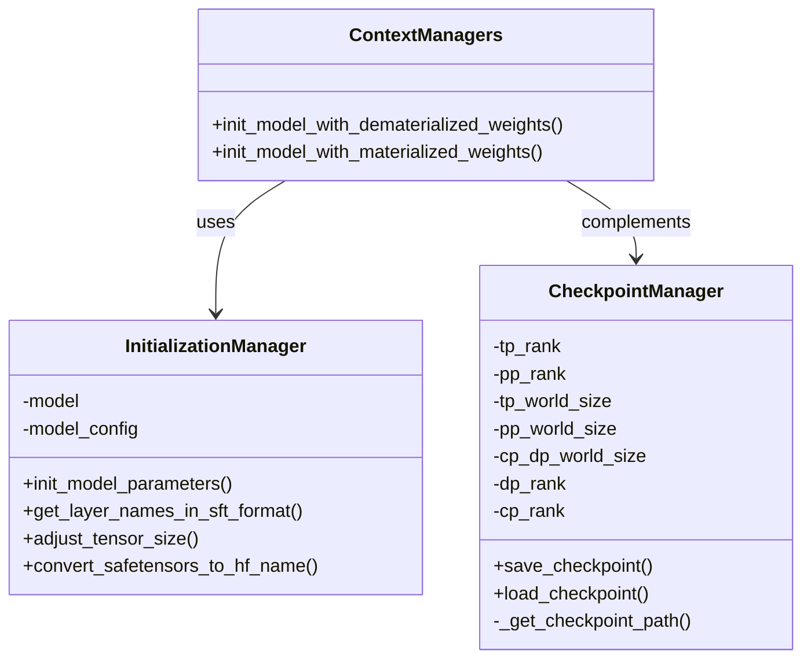
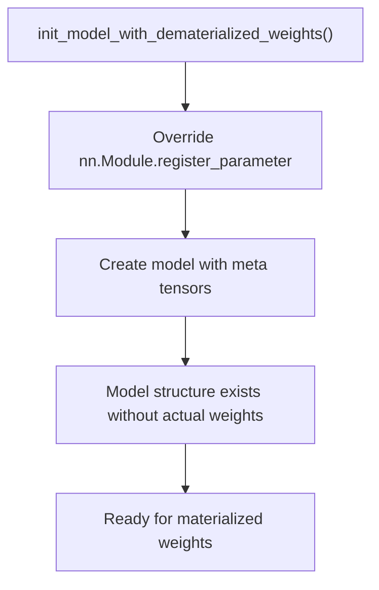
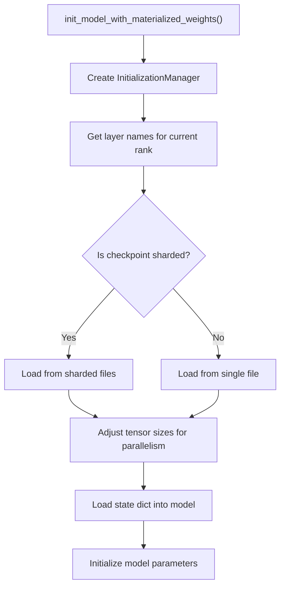
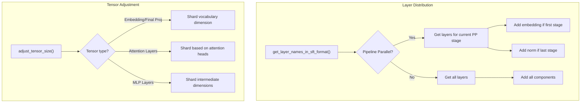
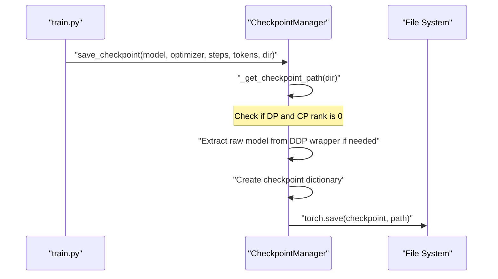
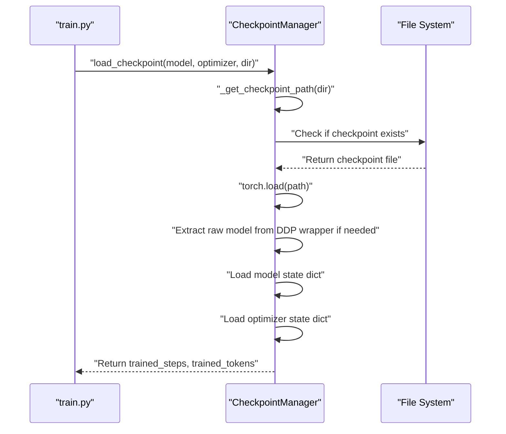
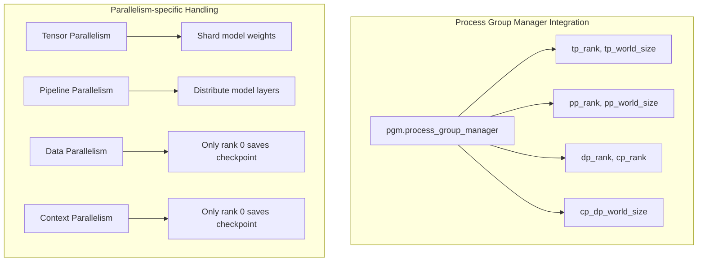
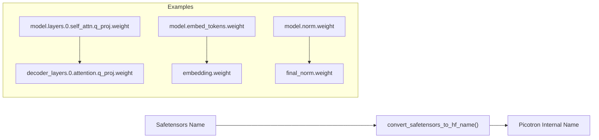
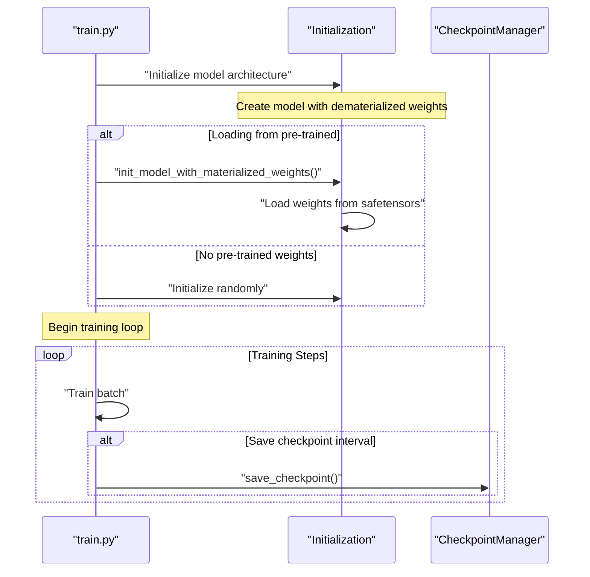

<!-- source: DeepWiki mcp.deepwiki.com · repo huggingface/picotron · page 3.3 Checkpoint Management · fetched 2026-10-26 -->

# Checkpoint Management

<details>
<summary>Relevant source files</summary>

The following files were used as context for generating this wiki page:

- [picotron/checkpoint.py](picotron/checkpoint.py)

</details>


## Purpose and Scope

This document details Picotron's checkpoint management system, which handles initializing models with pre-trained weights, saving training progress, and resuming from previous training checkpoints in a distributed training environment. This system is specifically designed to work with Picotron's 4D parallelism strategies (Tensor, Pipeline, Data, and Context parallelism) and ensures efficient distribution of model parameters across multiple devices.

For information about the overall training pipeline, see [Training Pipeline](#3.0), and for details on the various parallelism strategies, see [Parallelism Implementations](#5.0).

## Architecture Overview

The checkpoint management system in Picotron has three main components:



Sources: [picotron/checkpoint.py:243-289](), [picotron/checkpoint.py:115-241](), [picotron/checkpoint.py:17-113]()

## Model Initialization

Picotron provides two approaches for model initialization:

### Dematerialized Initialization

This approach creates model structures without allocating memory for weights, using meta tensors. This is useful for initial model setup before loading actual weights.



Sources: [picotron/checkpoint.py:17-49]()

### Materialized Initialization

This approach loads actual weights from safetensors files, with proper tensor sharding for distributed training.



Sources: [picotron/checkpoint.py:51-113]()

## Tensor Sharding and Distribution

The `InitializationManager` handles tensor size adjustments and distribution across multiple devices based on the parallelism configuration.



Sources: [picotron/checkpoint.py:124-158](), [picotron/checkpoint.py:161-222]()

## Checkpoint Operations

### Saving Checkpoints

The `CheckpointManager` handles saving model state, optimizer state, and training progress information to disk. Only specific ranks (DP and CP rank 0) save checkpoints to avoid redundancy.



Sources: [picotron/checkpoint.py:257-272]()

### Loading Checkpoints

When resuming training, the `CheckpointManager` loads model and optimizer states from checkpoint files and returns training progress information.



Sources: [picotron/checkpoint.py:273-289]()

## Checkpoint File Structure

Checkpoint files are named to encode the parallelism configuration, ensuring each rank loads the correct weights when resuming training.

```
output_dir/
  ├── weights_tp_rank_world_size=0_4_pp_rank_world_size=0_2.pth
  ├── weights_tp_rank_world_size=1_4_pp_rank_world_size=0_2.pth
  ├── weights_tp_rank_world_size=2_4_pp_rank_world_size=0_2.pth
  ├── weights_tp_rank_world_size=3_4_pp_rank_world_size=0_2.pth
  ├── weights_tp_rank_world_size=0_4_pp_rank_world_size=1_2.pth
  ├── weights_tp_rank_world_size=1_4_pp_rank_world_size=1_2.pth
  ├── weights_tp_rank_world_size=2_4_pp_rank_world_size=1_2.pth
  └── weights_tp_rank_world_size=3_4_pp_rank_world_size=1_2.pth
```

Each checkpoint file contains:
- Model state dictionary
- Optimizer state dictionary
- Number of trained steps
- Number of trained tokens

Sources: [picotron/checkpoint.py:254-255](), [picotron/checkpoint.py:265-270]()

## Integration with Parallelism

The checkpoint system integrates with Picotron's process group manager to understand the distributed training setup. Different components handle special cases for each parallelism strategy:



Sources: [picotron/checkpoint.py:243-252](), [picotron/checkpoint.py:90-102]()

## Safetensors and Model Format Conversion

Picotron supports loading pre-trained weights from safetensors format and converts between safetensors naming convention and Picotron's internal naming convention.



Sources: [picotron/checkpoint.py:224-241]()

## Usage in Training Pipeline

The checkpoint management system is used in the training pipeline to initialize models with pre-trained weights, save checkpoints at regular intervals, and resume training from previous checkpoints.



Sources: [picotron/checkpoint.py:17-113](), [picotron/checkpoint.py:257-272]()

## Special Considerations

### Handling Final Projection Layer

The checkpoint system includes special handling for the final projection layer (lm_head), ensuring proper initialization for both tensor-parallel and non-tensor-parallel setups.

```python
# For TP>1, initialize with sharded size
if pgm.process_group_manager.tp_world_size > 1:
    vocab_per_rank = vocab_size // pgm.process_group_manager.tp_world_size
    state_dict['final_proj.weight'] = torch.zeros(vocab_per_rank, model_config.hidden_size)
# For TP=1, create the full layer
else:
    model.final_proj = FinalProjection(model_config.hidden_size, vocab_size, bias=False)
    state_dict['final_proj.weight'] = torch.zeros(vocab_size, model_config.hidden_size)
```

Sources: [picotron/checkpoint.py:90-102]()

---

