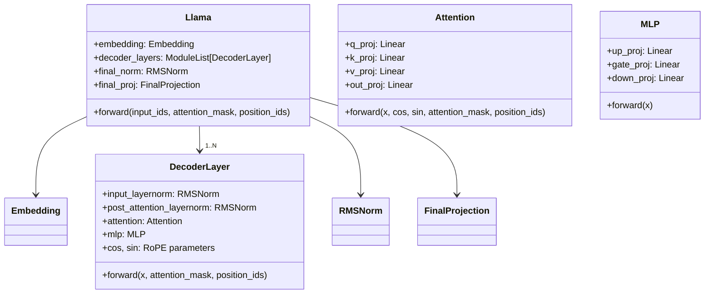
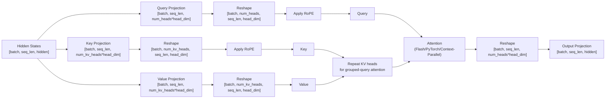
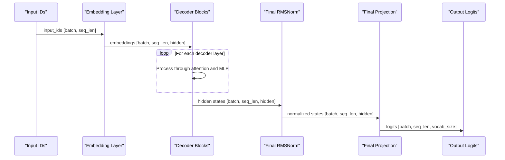

<!-- source: DeepWiki mcp.deepwiki.com · repo huggingface/picotron · page 4 Model Architecture · fetched 2026-10-26 -->

# Model Architecture

<details>
<summary>Relevant source files</summary>

The following files were used as context for generating this wiki page:

- [picotron/model.py](picotron/model.py)

</details>


## Purpose and Scope

This document details the model architecture implemented in Picotron, specifically focusing on the Llama-like transformer model. It covers the key components, their interactions, and the implementation details of the model architecture. For information about parallelism strategies applied to this model, see [Parallelism Implementations](#5).

## Overview

Picotron implements a Llama-style decoder-only transformer architecture, designed for efficient distributed training using 4D parallelism. The model follows the standard transformer architecture with modifications like RMSNorm instead of LayerNorm and SwiGLU activation in the MLP blocks.


Sources: [picotron/model.py:253-298]()

## Core Components

### Llama Class

The main model class is `Llama`, which orchestrates the entire architecture. It initializes and connects all components including the embedding layer, decoder layers, and final projection. The model follows a straightforward forward pass, processing input through embeddings, transformer layers, and finally projecting to vocabulary space.



Sources: [picotron/model.py:253-298]()

### Embedding Layer

The `Embedding` class handles token embedding, converting input token IDs to embedding vectors. It's a simple wrapper around PyTorch's embedding functionality.

```python
# Input: [batch_size, seq_length] tensor of token indices
# Output: [batch_size, seq_length, hidden_size] tensor of embeddings
```

Sources: [picotron/model.py:237-251]()

### Decoder Layer

The `DecoderLayer` class implements a single transformer block with the following structure:
1. Input → RMSNorm → Attention
2. Residual connection (add attention output to input)
3. RMSNorm → MLP
4. Residual connection (add MLP output to previous step)

Each decoder layer maintains its own rotary position embeddings (RoPE) parameters.

Sources: [picotron/model.py:214-235]()

### Attention Mechanism

The `Attention` class implements multi-head attention with several key features:
- Support for grouped-query attention (where num_key_value_heads ≤ num_attention_heads)
- Rotary position embeddings (RoPE)
- Support for multiple attention backends:
  - Flash Attention (default)
  - PyTorch's scaled dot-product attention
  - Context-parallel ring attention



Sources: [picotron/model.py:88-162]()

### MLP Block

The `MLP` class implements a feed-forward network using SwiGLU activation:
1. Two parallel projections: gate projection and up projection
2. SiLU activation applied to gate projection
3. Element-wise multiplication with up projection
4. Down projection to hidden dimension

```python
# SwiGLU implementation
down_proj(silu(gate_proj(x)) * up_proj(x))
```

Sources: [picotron/model.py:164-186]()

### Normalization Layers

The model uses RMSNorm (Root Mean Square Layer Normalization) instead of the standard LayerNorm. Two implementations are available:
- `LlamaRMSNorm`: Standard implementation 
- `TritonRMSNorm`: Optimized implementation using Triton kernels

RMSNorm normalizes by the root mean square of the inputs, which is computationally more efficient than LayerNorm.

Sources: [picotron/model.py:39-86]()

### Final Projection

The `FinalProjection` class handles the final linear projection from hidden states to vocabulary logits. It's essentially a linear layer that maps from hidden dimension to vocabulary size.

Sources: [picotron/model.py:188-212]()

## Model Forward Pass

The forward pass through the model follows this sequence:

1. Convert input token IDs to embeddings using the embedding layer
2. Process the embeddings through each decoder layer sequentially
3. Apply the final RMSNorm layer
4. Project to vocabulary space to produce logits



Sources: [picotron/model.py:291-298]()

## Rotary Position Embeddings (RoPE)

The model uses Rotary Position Embeddings for encoding positional information. RoPE applies a rotation to the query and key vectors in the attention mechanism, which encodes relative position information.

Two implementations are available:
- Custom implementation in `apply_rotary_pos_emb`
- Flash Attention implementation from `apply_rotary_emb`

```python
# RoPE formulation (simplified):
# Apply a rotation to the embedding vectors where the angle of rotation depends on position
```

Sources: [picotron/model.py:12-31]()

## Attention Implementation Details

The attention mechanism supports multiple backends:

1. **Flash Attention**: The default and fastest implementation, using the `flash_attn_func` from the Flash Attention library.
   ```python
   # [batch, seq_len, num_heads, head_dim] format
   flash_attn_func(q, k, v, causal=causal)
   ```

2. **PyTorch's Scaled Dot-Product Attention**: Used as fallback.
   ```python
   # [batch, num_heads, seq_len, head_dim] format
   F.scaled_dot_product_attention(q, k, v, is_causal=causal)
   ```

3. **Context-Parallel Ring Attention**: Used when context parallelism is enabled.
   ```python
   # Special implementation for context parallelism
   context_parallel.ring_attention(q, k, v, sm_scale, causal)
   ```

Sources: [picotron/model.py:33-37](), [picotron/model.py:147-158]()

## Initialization

All components of the model use specific initialization strategies:
- Linear layers: Uniform initialization based on input dimension
- Embedding layer: Normal initialization
- Normalization layers: Ones initialization for the weight parameter

Sources: [picotron/model.py:110-120](), [picotron/model.py:174-182](), [picotron/model.py:202-209](), [picotron/model.py:248](), [picotron/model.py:77-79]()

## Integration with Parallelism Strategies

The model architecture has built-in support for all four parallelism dimensions:

1. **Tensor Parallelism**: Attention heads and MLP layers are sharded across devices
   ```python
   # Example: Adjusting number of attention heads based on TP world size
   self.num_local_heads = config.num_attention_heads // pgm.process_group_manager.tp_world_size
   ```

2. **Context Parallelism**: Special handling for RoPE parameters and attention
   ```python
   # Adjusting RoPE parameters for context parallelism
   self.cos, self.sin = context_parallel.update_rope_for_context_parallel(self.cos, self.sin)
   ```

3. **Pipeline Parallelism**: Model layers can be distributed across pipeline stages
4. **Data Parallelism**: Full model replication across data-parallel workers

Sources: [picotron/model.py:95-98](), [picotron/model.py:228](), [picotron/model.py:148-151]()

---

