<!-- source: DeepWiki mcp.deepwiki.com · repo huggingface/picotron · page 5 Parallelism Implementations · fetched 2026-10-26 -->

# Parallelism Implementations

Relevant source files

The following files were used as context for generating this wiki page:

- [CITATION.cff](CITATION.cff)
- [README.md](README.md)
- [extract_metrics.py](extract_metrics.py)
- [picotron/pipeline_parallel/pipeline_parallel.py](picotron/pipeline_parallel/pipeline_parallel.py)
- [picotron/utils.py](picotron/utils.py)

## Purpose and Scope

This document provides a technical overview of the parallelism strategies implemented in Picotron for distributed training of large language models. It covers the 4D parallelism approach - Data, Tensor, Pipeline, and Context parallel - and details how each strategy is implemented. For information about the general system architecture, see [System Architecture](#2).

## Introduction to 4D Parallelism

Picotron implements a 4D parallelism strategy that combines four complementary approaches to distribute model training across multiple GPUs:

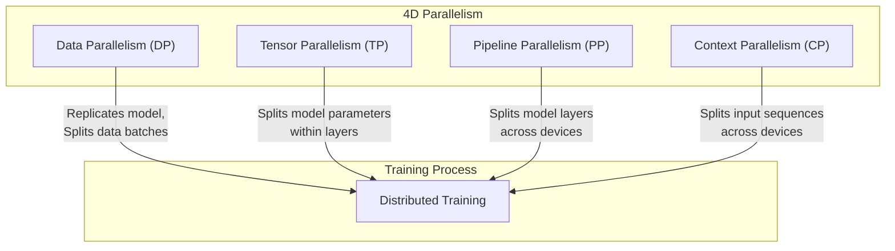

Sources: [README.md:1-47]()

## Process Group Manager

The Process Group Manager is the central component that establishes and manages the communication groups required for distributed training. It creates four process groups:

1. **Data Parallel Group (DP)**: Processes that work on different batches of data with the same model replica
2. **Tensor Parallel Group (TP)**: Processes that split individual tensors within layers
3. **Pipeline Parallel Group (PP)**: Processes that handle different layers of the model
4. **Context Parallel Group (CP)**: Processes that split sequences along the context dimension

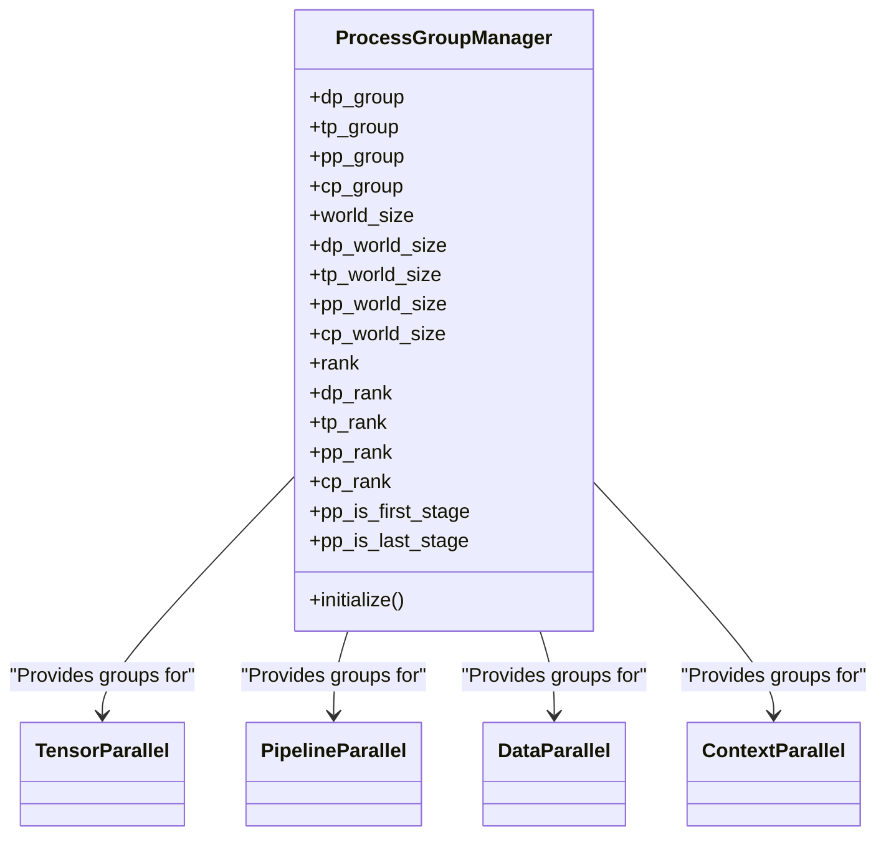

Sources: [picotron/utils.py:10-11](), [picotron/utils.py:61-78]()

## Pipeline Parallelism

Pipeline parallelism splits the model vertically, assigning different layers to different devices. This allows training of models that are too large to fit on a single device.

### Implementation

The `PipelineParallel` class wraps the base model and distributes its layers across GPUs:

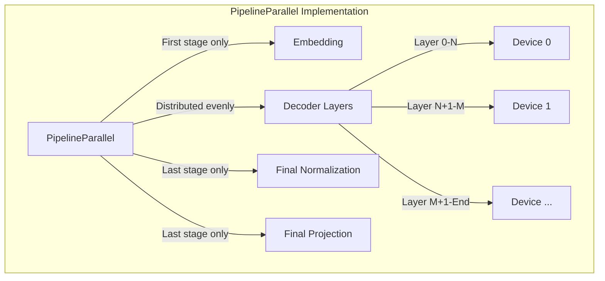

Sources: [picotron/pipeline_parallel/pipeline_parallel.py:8-63]()

### Training Strategies

Pipeline Parallelism in Picotron supports two scheduling strategies:

1. **All-Forward-All-Backward (AFAB)**: Performs all forward passes first, then all backward passes
2. **One-Forward-One-Backward (1F1B)**: Interleaves forward and backward passes to improve GPU utilization

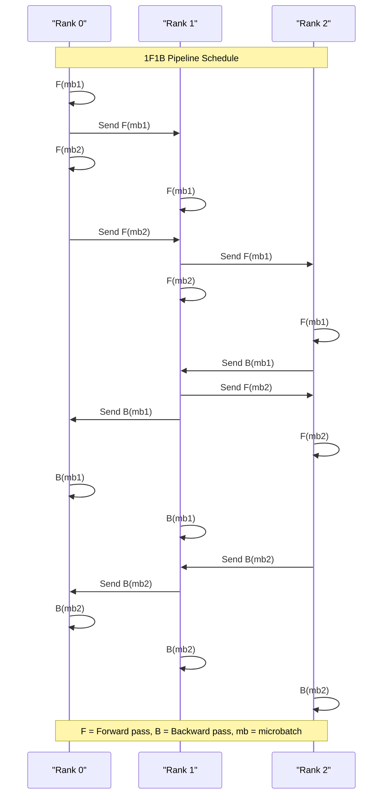

Sources: [picotron/pipeline_parallel/pipeline_parallel.py:77-120](), [picotron/pipeline_parallel/pipeline_parallel.py:122-214]()

### Pipeline Communication

Pipeline parallelism requires efficient communication between adjacent stages in the pipeline:

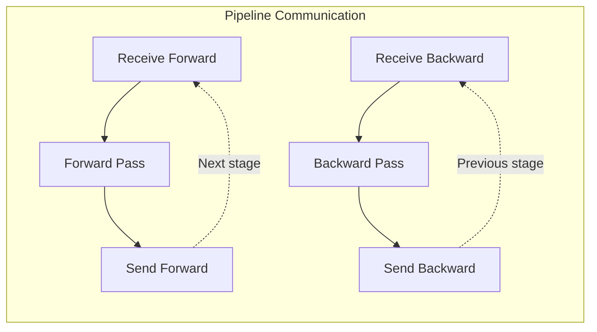

For the 1F1B schedule, Picotron uses bidirectional communication to reduce overhead:

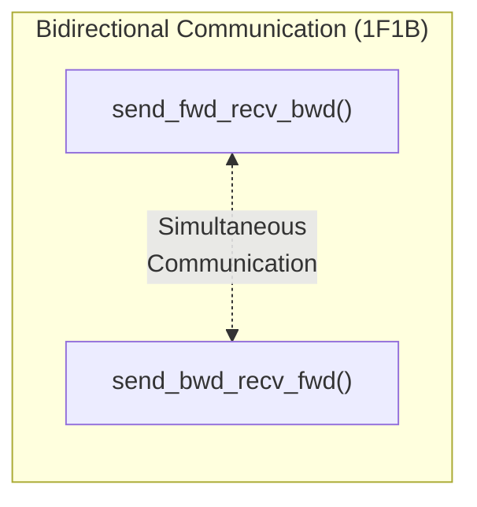

Sources: [picotron/pipeline_parallel/pipeline_parallel.py:84-85](), [picotron/pipeline_parallel/pipeline_parallel.py:185-202]()

## Tensor Parallelism

Tensor parallelism splits individual layers horizontally by partitioning the parameters of specific operations across multiple devices.

### Implementation

Tensor parallelism in Picotron primarily targets the most parameter-intensive parts of the model:

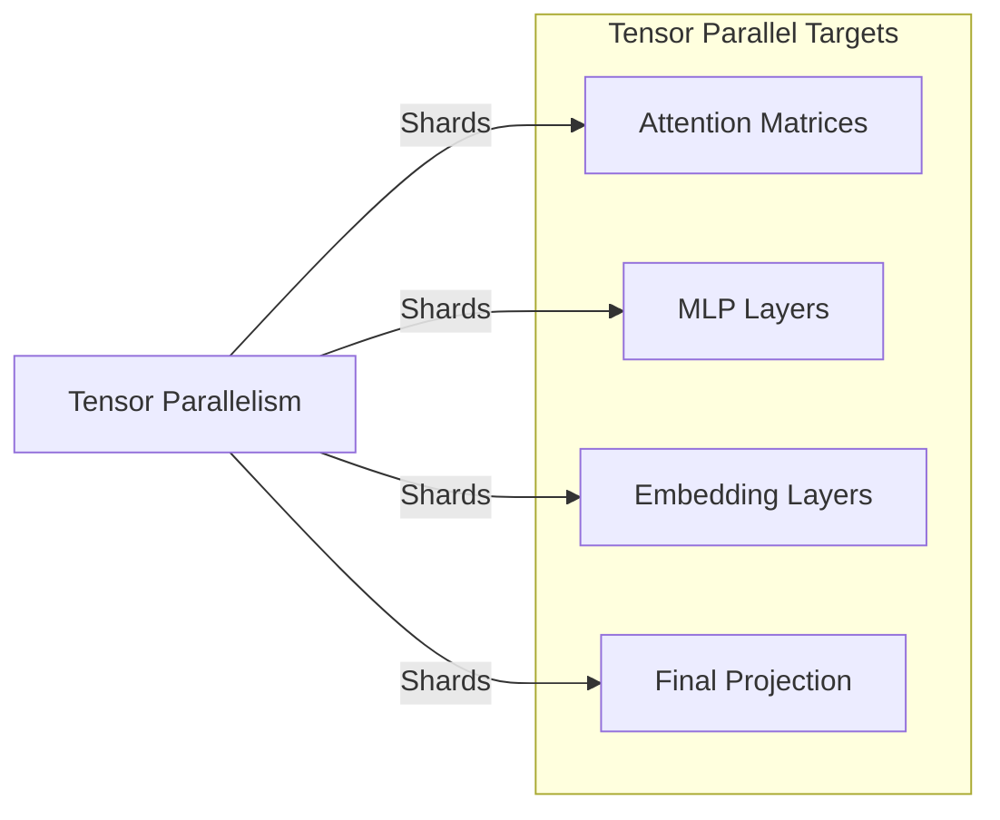

The utils.py file contains functions that help identify tensor-parallel parameters and handle their distribution:

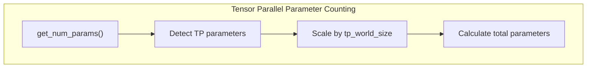

Sources: [picotron/utils.py:51-80]()

## Data Parallelism

Data parallelism replicates the model across multiple devices, with each device processing a different subset of the training data.

### Implementation

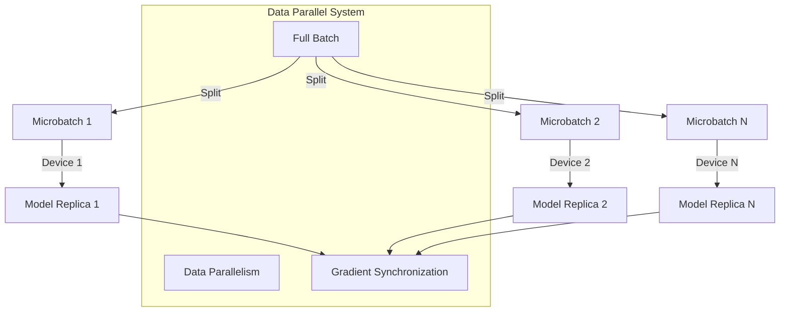

Picotron implements gradient synchronization across data-parallel ranks through the following mechanism in `utils.py`:

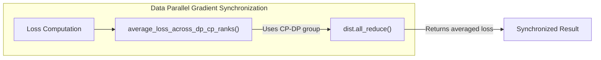

Sources: [picotron/utils.py:94-99]()

## Context Parallelism

Context parallelism splits input sequences across multiple devices, allowing each device to process a portion of the input context.

### Implementation

Context parallelism is particularly useful for handling long sequences that would exceed memory constraints on a single device:

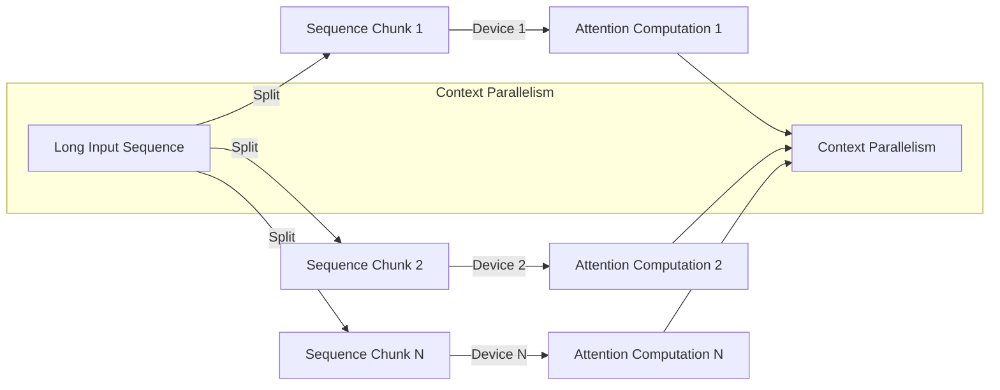

Context parallelism requires specialized communication for attention computations to ensure correct results across sequence boundaries.

Sources: [picotron/utils.py:94-99]()

## Interaction Between Parallelism Strategies

The 4D parallelism strategies work together to enable efficient training of large models:

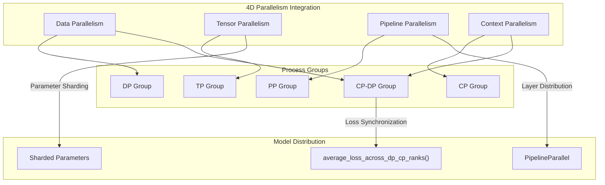

The utils.py file contains several functions that facilitate the interaction between different parallelism strategies:

- `get_num_params()`: Calculates total parameters accounting for tensor and pipeline parallelism
- `average_loss_across_dp_cp_ranks()`: Synchronizes loss values across data-parallel and context-parallel ranks

Sources: [picotron/utils.py:51-80](), [picotron/utils.py:94-99]()

## Pipeline Parallelism Implementation Details

The pipeline parallelism implementation in Picotron deserves special attention due to its complexity:

### PipelineParallel Class

The `PipelineParallel` class wraps the base model and distributes its layers:

1. The `__init__` method divides the model based on pipeline rank
2. The `distribute_layers` method calculates which layers should be assigned to each GPU
3. The `forward` and `backward` methods handle the flow of data through the pipeline

### Pipeline Training Strategies

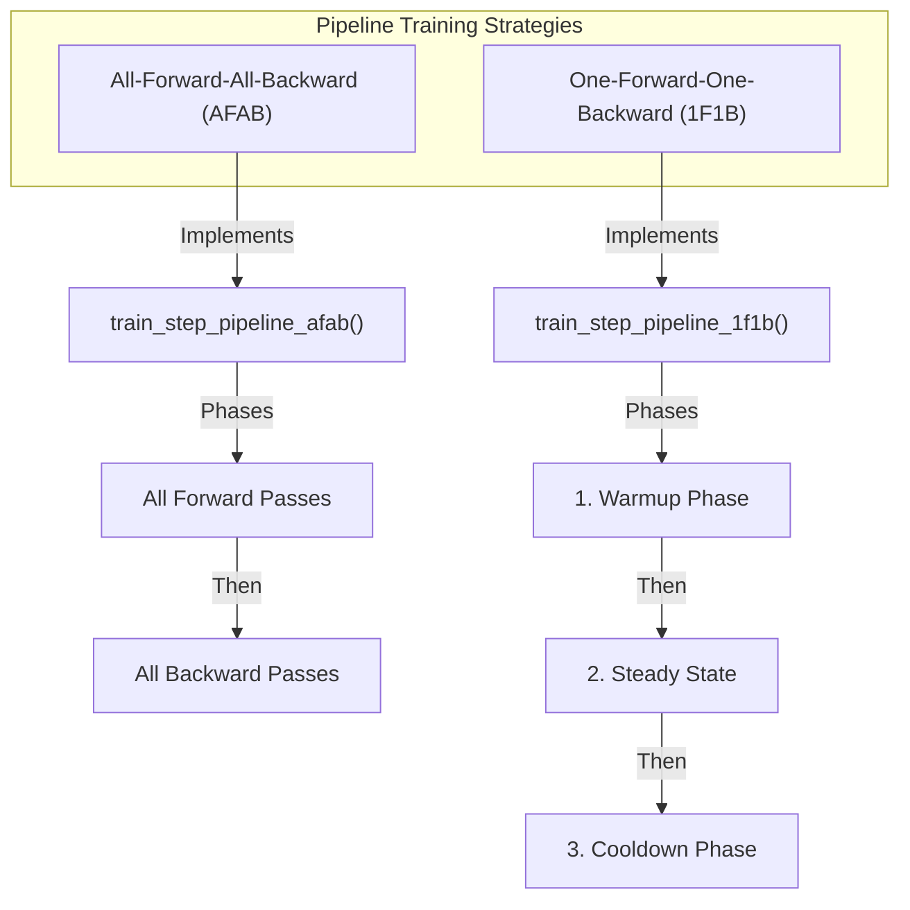

The 1F1B strategy is more complex but provides better hardware utilization:

1. **Warmup Phase**: Fills the pipeline with forward passes
2. **Steady State**: Alternates between forward and backward passes
3. **Cooldown Phase**: Completes remaining backward passes

Sources: [picotron/pipeline_parallel/pipeline_parallel.py:77-120](), [picotron/pipeline_parallel/pipeline_parallel.py:122-214]()

## Performance Considerations

Picotron's parallelism implementations are designed for educational clarity rather than maximum performance, but still achieve reasonable efficiency:

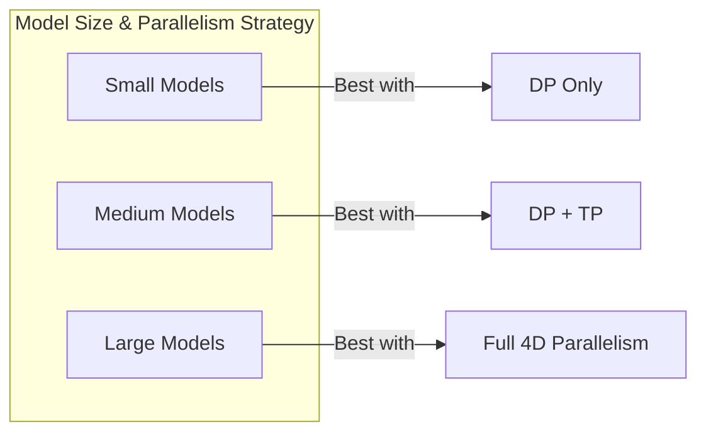

As noted in the README, Picotron can achieve:
- ~38% MFU (Model FLOPs Utilization) on a LLaMA-2-7B model using 64 H100 GPUs
- ~50% MFU on the SmolLM-1.7B model with 8 H100 GPUs

Sources: [README.md:6-8](), [picotron/utils.py:40-49]()

## Integration with Other Systems

The parallelism implementations interface with other components in the Picotron system:

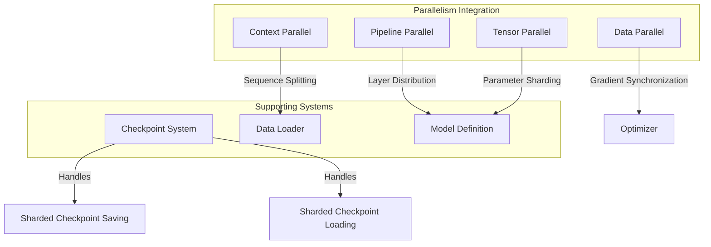

Sources: [picotron/utils.py:51-80]()

## Conclusion

Picotron's 4D parallelism implementation provides a clear, educational framework for understanding distributed training strategies. While designed for simplicity rather than maximum performance, it still achieves reasonable efficiency for training large language models.

---

