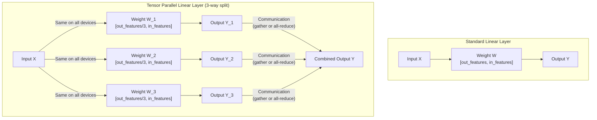
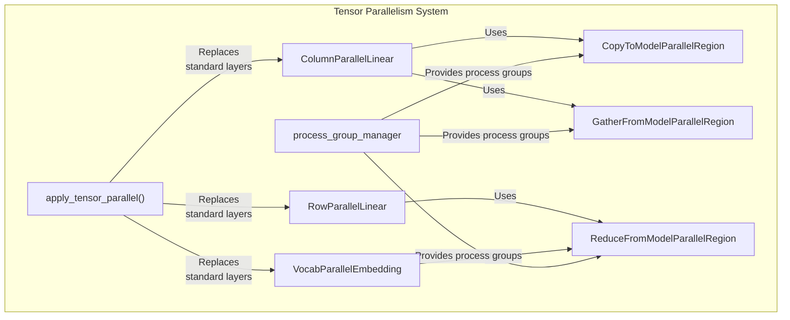
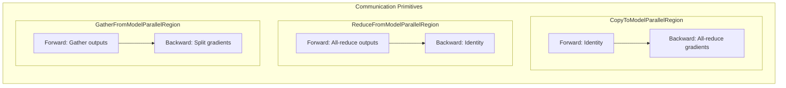
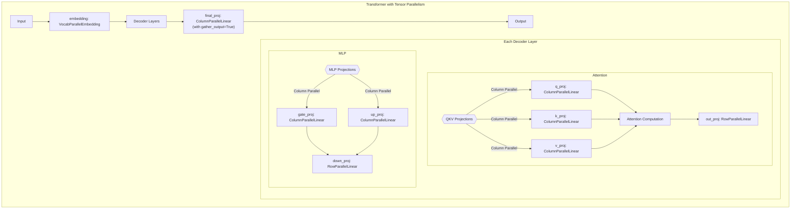
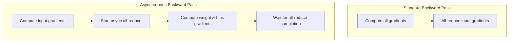

<!-- source: DeepWiki mcp.deepwiki.com · repo huggingface/picotron · page 5.1 Tensor Parallelism · fetched 2026-10-26 -->

# Tensor Parallelism

<details>
<summary>Relevant source files</summary>

The following files were used as context for generating this wiki page:

- [picotron/tensor_parallel/tensor_parallel.py](picotron/tensor_parallel/tensor_parallel.py)
- [picotron/tensor_parallel/tp_communications.py](picotron/tensor_parallel/tp_communications.py)
- [tests/test_tensor_parallel.py](tests/test_tensor_parallel.py)

</details>


Tensor Parallelism is a model parallelism strategy in Picotron that splits individual tensors (weights and activations) across multiple devices. This approach enables training of models larger than would fit on a single GPU by distributing the memory requirements of individual layers across multiple GPUs.

For information about other parallelism strategies, see:
- [4D Parallelism Design](#2.1)
- [Pipeline Parallelism](#5.2)
- [Data Parallelism](#5.3)
- [Context Parallelism](#5.4)

## How Tensor Parallelism Works

In a standard neural network, operations like linear transformations can be represented as Y = XW + b, where W is a weight matrix. Tensor parallelism divides this weight matrix across multiple devices:

### Diagram: Tensor Parallelism Concept



Sources: [picotron/tensor_parallel/tensor_parallel.py:54-123](), [picotron/tensor_parallel/tensor_parallel.py:125-189]()

Picotron implements three types of tensor-parallel layers:

1. **Column Parallel Linear**: Splits weight matrices along the output dimension (columns)
2. **Row Parallel Linear**: Splits weight matrices along the input dimension (rows)
3. **Vocab Parallel Embedding**: Splits the embedding matrix across the vocabulary dimension

## Implementation Architecture

### Diagram: Tensor Parallelism System Components



Sources: [picotron/tensor_parallel/tensor_parallel.py:9-51](), [picotron/tensor_parallel/tp_communications.py:1-107]()

The tensor parallelism implementation consists of:

1. **Parallel Module Classes**: Specialized layer implementations replacing standard PyTorch modules
2. **Communication Primitives**: Custom autograd functions for inter-device communication
3. **Model Transformation Function**: Applies tensor parallelism to a model by replacing standard layers

## Parallel Module Classes

### ColumnParallelLinear

The `ColumnParallelLinear` class splits a linear layer's weight matrix along the output dimension (columns).

```python
# Shape examples for 4-way tensor parallelism:
# Input: [batch_size, seq_len, in_features]
# Full weight: [out_features, in_features]
# Per-device weight: [out_features/4, in_features]
# Per-device output: [batch_size, seq_len, out_features/4]
```

Key features:
- Each device computes a portion of the output dimensions
- Optionally gathers outputs across devices (for final layer)
- Supports asynchronous all-reduce for improved performance

Sources: [picotron/tensor_parallel/tensor_parallel.py:54-123]()

### RowParallelLinear

The `RowParallelLinear` class splits a linear layer's weight matrix along the input dimension (rows).

```python
# Shape examples for 4-way tensor parallelism:
# Input (already split): [batch_size, seq_len, in_features/4]
# Full weight: [out_features, in_features]
# Per-device weight: [out_features, in_features/4]
# Per-device output (before all-reduce): [batch_size, seq_len, out_features]
# Final output (after all-reduce): [batch_size, seq_len, out_features]
```

Key features:
- Assumes input tensor is already split across devices
- Performs all-reduce to combine partial results
- Full output dimensions are produced on each device

Sources: [picotron/tensor_parallel/tensor_parallel.py:125-189]()

### VocabParallelEmbedding

The `VocabParallelEmbedding` class splits an embedding layer across the vocabulary dimension.

```python
# Shape examples for 4-way tensor parallelism:
# Input tokens: [batch_size, seq_len]
# Full embedding table: [vocab_size, embedding_dim]
# Per-device embedding table: [vocab_size/4, embedding_dim]
```

Key features:
- Each device handles a subset of the vocabulary
- Uses masking to identify which tokens each device should process
- Performs all-reduce to combine partial embeddings

Sources: [picotron/tensor_parallel/tensor_parallel.py:191-271]()

## Communication Primitives

Communication between devices is handled by three custom PyTorch autograd functions:

### Diagram: Communication Patterns



Sources: [picotron/tensor_parallel/tp_communications.py:19-72]()

These communication primitives manage the flow of data and gradients:

1. **CopyToModelParallelRegion**:
   - Forward: Copy input (identity function)
   - Backward: All-reduce gradients across devices
   - Used primarily in column parallel linear layers

2. **ReduceFromModelParallelRegion**:
   - Forward: All-reduce outputs across devices
   - Backward: Identity (pass gradients unchanged)
   - Used in row parallel linear and vocab parallel embedding

3. **GatherFromModelParallelRegion**:
   - Forward: Gather and concatenate outputs from all devices
   - Backward: Split gradients and send to appropriate devices
   - Used primarily in the final projection layer

## Applying Tensor Parallelism to the Model

The `apply_tensor_parallel` function transforms a standard model into a tensor-parallel version by replacing PyTorch layers with their parallel equivalents.

### Diagram: Tensor Parallelism in Transformer Architecture



Sources: [picotron/tensor_parallel/tensor_parallel.py:9-51]()

The transformation follows this pattern:

| Module | Layer | Parallel Type |
|--------|-------|---------------|
| Attention | q_proj | Column Parallel |
| Attention | k_proj | Column Parallel |
| Attention | v_proj | Column Parallel |
| Attention | out_proj | Row Parallel |
| MLP | gate_proj | Column Parallel |
| MLP | up_proj | Column Parallel |
| MLP | down_proj | Row Parallel |
| Model | embedding | Vocab Parallel |
| Model | final_proj | Column Parallel (with gather) |

Sources: [picotron/tensor_parallel/tensor_parallel.py:35-50]()

## Asynchronous Communication Optimization

Picotron implements an optimization for column parallel linear layers that overlaps computation and communication during the backward pass:



This optimization is implemented in the `LinearWithAsyncAllReduce` class and can be enabled by setting `async_all_reduce=True` in `ColumnParallelLinear`.

Sources: [picotron/tensor_parallel/tp_communications.py:74-102]()

## Weight Initialization

To ensure consistent initialization across devices, each parallel layer:

1. Creates a full-sized matrix on each device
2. Initializes it using the standard initialization method
3. Splits the matrix and keeps only the relevant portion

This approach ensures that the distributed model behaves identically to a non-parallelized version.

Sources: [picotron/tensor_parallel/tensor_parallel.py:97-114](), [picotron/tensor_parallel/tensor_parallel.py:165-182](), [picotron/tensor_parallel/tensor_parallel.py:233-244]()

## Testing

The tensor parallel implementation is verified through unit tests that confirm equivalence with non-parallel PyTorch layers. These tests ensure that:

1. Forward pass outputs match between parallel and non-parallel versions
2. Backward pass gradients match between parallel and non-parallel versions
3. Both row and column parallel implementations maintain numerical correctness

Sources: [tests/test_tensor_parallel.py:1-75]()

## Summary

Tensor Parallelism in Picotron enables training larger models by distributing individual weight matrices across multiple devices. The implementation provides:

1. Three parallel layer types (column, row, and vocab)
2. Efficient communication primitives
3. Automated model transformation
4. Optimizations like asynchronous all-reduce

This approach maintains mathematical equivalence to non-parallel training while enabling models that would otherwise exceed the memory capacity of a single device.

---

