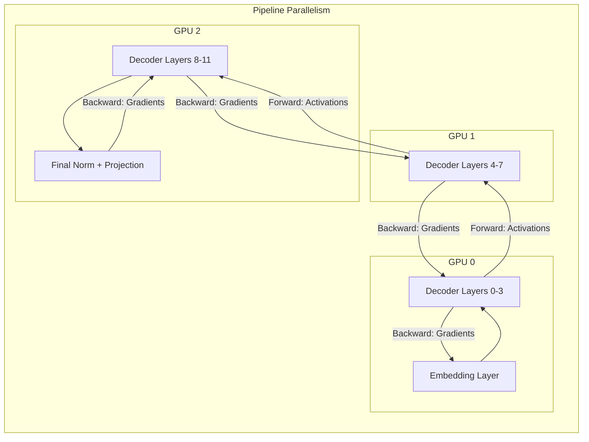
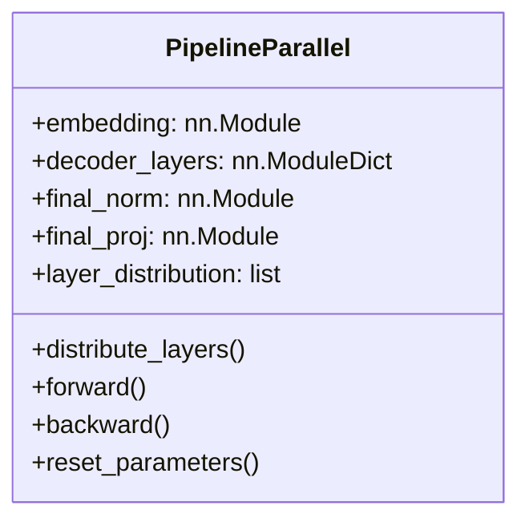
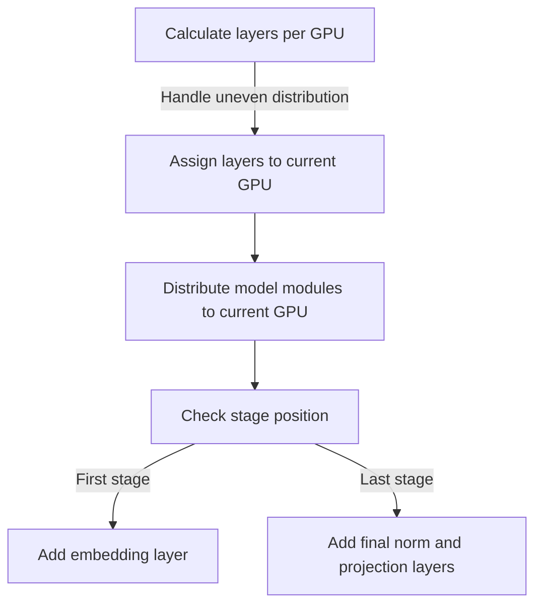
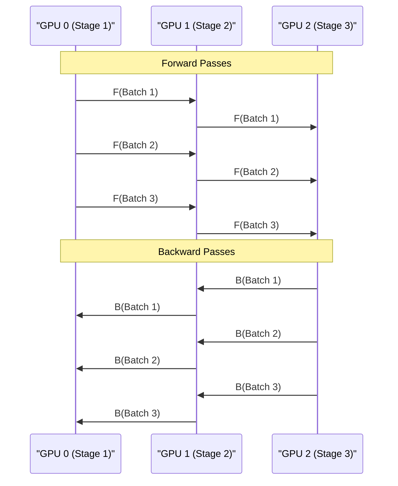
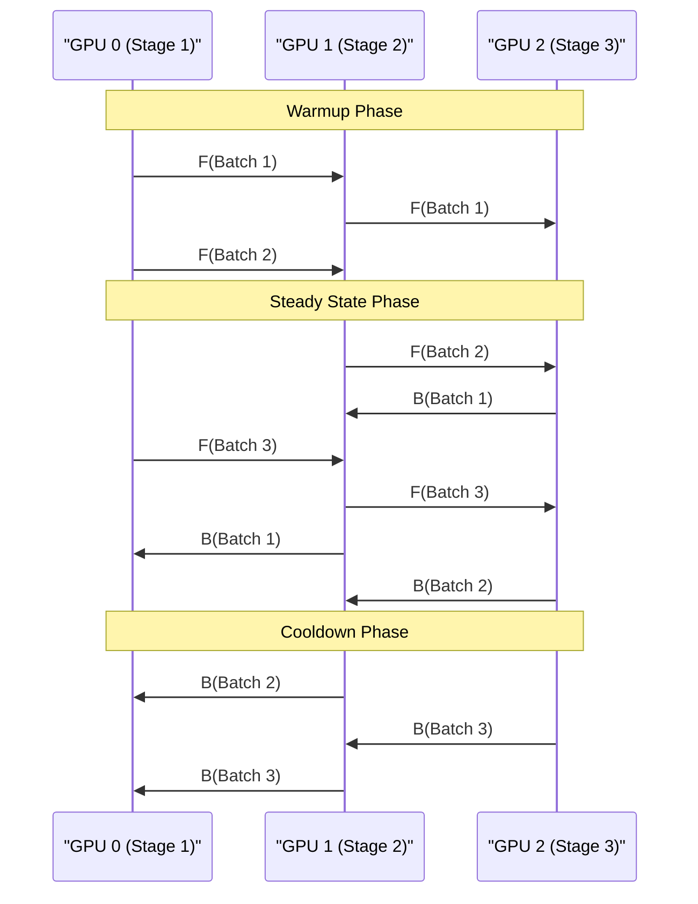
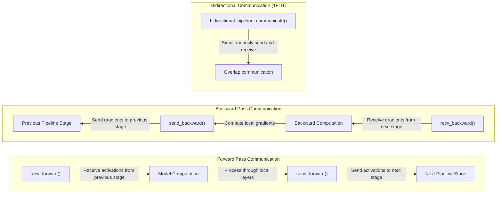
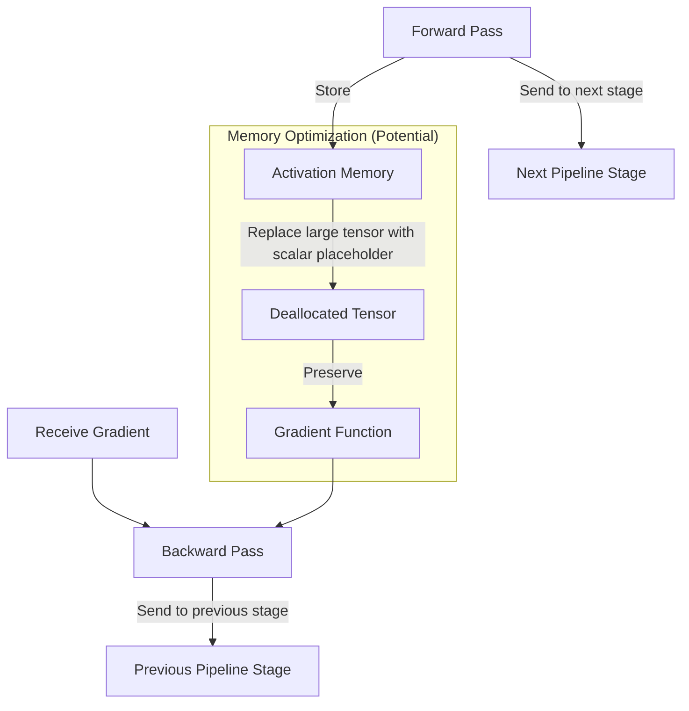

<!-- source: DeepWiki mcp.deepwiki.com · repo huggingface/picotron · page 5.2 Pipeline Parallelism · fetched 2026-10-26 -->

# Pipeline Parallelism

<details>
<summary>Relevant source files</summary>

The following files were used as context for generating this wiki page:

- [extract_metrics.py](extract_metrics.py)
- [picotron/pipeline_parallel/pipeline_parallel.py](picotron/pipeline_parallel/pipeline_parallel.py)
- [picotron/utils.py](picotron/utils.py)

</details>


## Purpose and Scope

This document describes the implementation of pipeline parallelism in Picotron, a system for training large language models with 4D parallelism. Pipeline parallelism is one of the four parallel training strategies used in Picotron (alongside data, tensor, and context parallelism) and is specifically responsible for distributing model layers across multiple GPUs. For information about other parallelism strategies, see [Tensor Parallelism](#5.1), [Data Parallelism](#5.3), and [Context Parallelism](#5.4).

## Pipeline Parallelism Overview

Pipeline parallelism partitions a neural network model vertically by distributing layers across different devices. Each GPU processes a subset of the model's layers, with activations flowing from one device to the next. This approach enables training models that would otherwise be too large to fit on a single GPU.



Sources: [picotron/pipeline_parallel/pipeline_parallel.py:8-75]()

## Implementation Details

### PipelineParallel Class

The pipeline parallelism implementation is centered around the `PipelineParallel` class, which distributes model layers across multiple GPUs and manages computation for each pipeline stage.



The class handles:
1. Layer distribution across pipeline stages
2. Forward pass through assigned layers
3. Backward pass computation and gradient propagation
4. Parameter initialization

Sources: [picotron/pipeline_parallel/pipeline_parallel.py:8-75]()

### Layer Distribution

Model layers are distributed as evenly as possible across available GPUs. The distribution algorithm handles cases where the number of layers isn't evenly divisible by the number of pipeline stages.



Sources: [picotron/pipeline_parallel/pipeline_parallel.py:42-51]()

### Model Structure in Pipeline Parallel Mode

The model is carefully partitioned to maintain correct execution flow:

1. **First Stage**: Contains the embedding layer plus a subset of decoder layers
2. **Middle Stages**: Contain only decoder layers
3. **Last Stage**: Contains decoder layers plus the final normalization and projection layers

Each stage replaces components it doesn't need with `nn.Identity()` modules to maintain a consistent interface.

Sources: [picotron/pipeline_parallel/pipeline_parallel.py:16-23]()

## Pipeline Scheduling Strategies

Picotron implements two pipeline scheduling strategies, each with different performance characteristics:

### 1. All-Forward-All-Backward (AFAB)

AFAB performs all forward passes before starting any backward passes, which is simpler but less efficient.



Sources: [picotron/pipeline_parallel/pipeline_parallel.py:77-120]()

### 2. One-Forward-One-Backward (1F1B)

1F1B interleaves forward and backward passes, maximizing GPU utilization by reducing pipeline bubbles (idle GPU time).



The 1F1B strategy consists of three phases:
1. **Warmup Phase**: Fill the pipeline with forward passes
2. **Steady State**: Alternate between forward and backward passes
3. **Cooldown Phase**: Complete remaining backward passes

Sources: [picotron/pipeline_parallel/pipeline_parallel.py:122-215]()

## Communication Mechanism

Pipeline parallelism requires efficient communication between pipeline stages for both forward and backward passes:



Bidirectional communication in the 1F1B strategy allows sending forward activations while receiving backward gradients (and vice versa), maximizing communication efficiency.

Sources: [picotron/pipeline_parallel/pipeline_parallel.py:185-186](), [picotron/pipeline_parallel/pipeline_parallel.py:202]()

## Memory Optimization

Pipeline parallelism includes memory optimizations to handle large models efficiently:

1. **Activation Storage**: The implementation carefully manages which activations need to be stored for the backward pass
2. **Tensor Deallocation**: A note in the code mentions a potential optimization to deallocate output tensor data after forward passes, retaining only the computation graph for backpropagation



Sources: [picotron/pipeline_parallel/pipeline_parallel.py:166-172]()

## Integration with Other Parallelism Strategies

Pipeline parallelism is designed to work alongside other parallelism strategies to enable efficient training of very large models:

### Integration with Data Parallelism

Data parallelism replicates the model across multiple devices, while pipeline parallelism splits the model across devices. The code handles the interaction between these approaches by:

1. Determining when to synchronize gradients across data parallel ranks
2. Only performing gradient synchronization on the last micro-batch of accumulated gradients

```
model.require_backward_grad_sync = is_last_iteration
```

Sources: [picotron/pipeline_parallel/pipeline_parallel.py:112-113](), [picotron/pipeline_parallel/pipeline_parallel.py:192-194]()

### Process Group Management

Pipeline parallelism uses process groups to manage communication between stages:

1. `pp_group`: Communication group for pipeline stages
2. `pp_rank`: Rank within the pipeline group
3. `pp_world_size`: Total number of pipeline stages
4. `pp_is_first_stage`/`pp_is_last_stage`: Indicators for position in pipeline

Sources: [picotron/utils.py:75-78](), [picotron/pipeline_parallel/pipeline_parallel.py:17-23]()

## Performance Metrics

Pipeline parallelism contributes to the overall training efficiency, which can be measured using:

1. **Tokens/s/GPU**: Throughput per device
2. **MFU (Model FLOPs Utilization)**: Percentage of theoretical maximum computation achieved

These metrics help evaluate the effectiveness of different pipeline configurations and scheduling strategies.

| Configuration | Description | Typical Benefits |
|---------------|-------------|------------------|
| PP=1 | No pipeline parallelism | Simplest setup, no communication overhead |
| PP>1, AFAB | Multiple stages, all-forward-all-backward | Enables larger models, straightforward implementation |
| PP>1, 1F1B | Multiple stages, one-forward-one-backward | Higher GPU utilization, reduced pipeline bubbles |

Sources: [extract_metrics.py:56-57](), [extract_metrics.py:86-87]()

## Best Practices

When using pipeline parallelism in Picotron, consider these best practices:

1. **Balance pipeline stages**: Distribute layers as evenly as possible to avoid bottlenecks
2. **Choose appropriate micro-batch size**: Smaller micro-batches can reduce pipeline bubbles
3. **Prefer 1F1B for efficiency**: The 1F1B schedule generally provides better GPU utilization than AFAB
4. **Consider communication overhead**: Increasing pipeline stages adds communication overhead
5. **Monitor performance metrics**: Track tokens/s/GPU and MFU to evaluate efficiency

---

