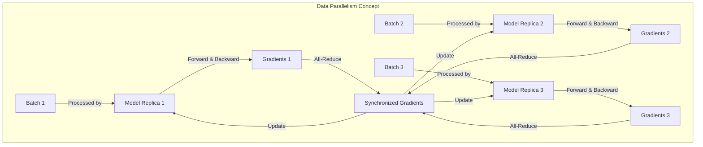
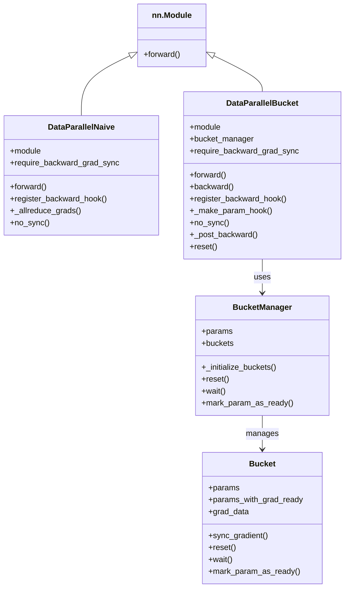
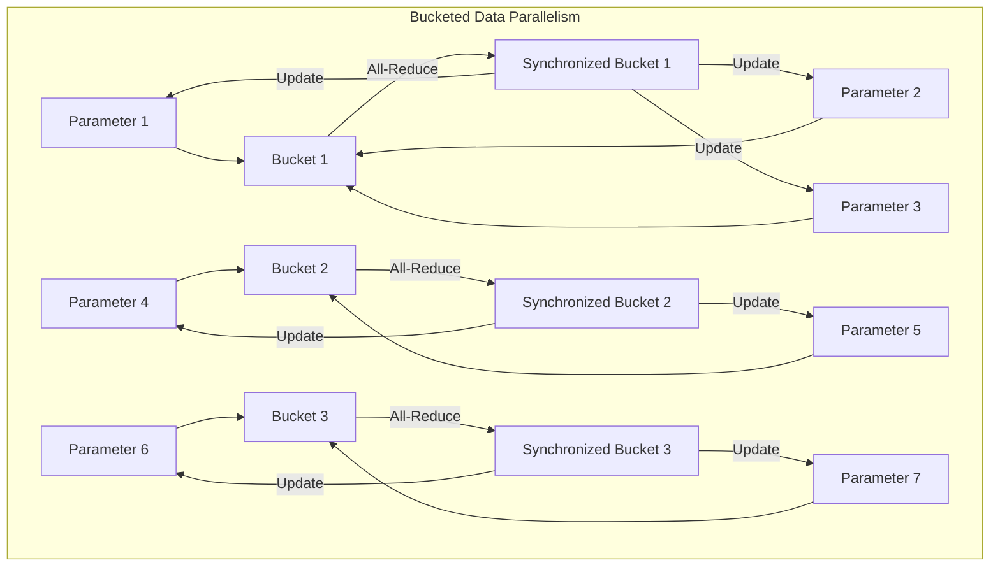
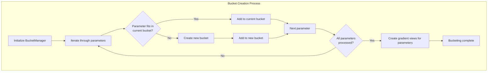
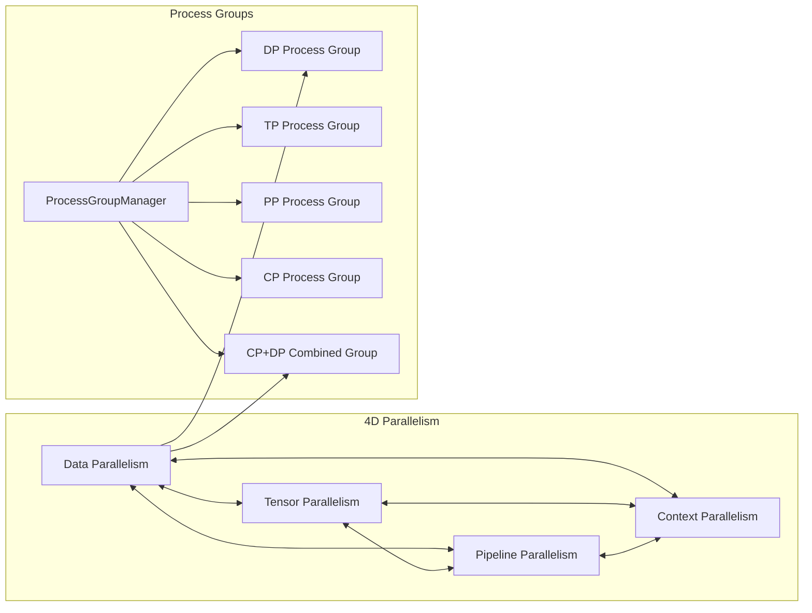

<!-- source: DeepWiki mcp.deepwiki.com · repo huggingface/picotron · page 5.3 Data Parallelism · fetched 2026-10-26 -->

# Data Parallelism

<details>
<summary>Relevant source files</summary>

The following files were used as context for generating this wiki page:

- [picotron/data_parallel/bucket.py](picotron/data_parallel/bucket.py)
- [picotron/data_parallel/data_parallel.py](picotron/data_parallel/data_parallel.py)
- [setup.py](setup.py)

</details>


## Purpose and Scope

This document details the implementation of Data Parallelism in Picotron, which is one of the four parallelism strategies in the 4D Parallelism design (along with Tensor, Pipeline, and Context parallelism). Data Parallelism replicates the entire model across multiple devices, with each device processing different batches of data, and then synchronizes gradients to ensure consistent model updates.

For information about the overall parallelism architecture, see [4D Parallelism Design](#2.1).
For details on other parallelism strategies, see [Tensor Parallelism](#5.1), [Pipeline Parallelism](#5.2), and [Context Parallelism](#5.4).

Sources: [picotron/data_parallel/data_parallel.py:1-171]()

## Overview

Data Parallelism is a technique to scale model training across multiple devices by replicating the model and distributing the data. In Picotron, it's implemented with special attention to communication efficiency and integration with other parallelism strategies.



Sources: [picotron/data_parallel/data_parallel.py:10-61]()

## Implementation Design

Picotron provides two data parallelism implementations:

1. **Naive Data Parallelism**: A simple implementation for educational purposes
2. **Bucketed Data Parallelism**: An optimized implementation that reduces communication overhead

Both implementations wrap the model and provide gradient synchronization mechanisms, with the bucketed version adding efficiency optimizations.



Sources: [picotron/data_parallel/data_parallel.py:10-171](), [picotron/data_parallel/bucket.py:6-157]()

## Naive Data Parallelism

The `DataParallelNaive` class implements a straightforward approach to data parallelism. This implementation is primarily educational, demonstrating the core concepts without the complexity of optimization techniques.

### Key Features:

- **Simple All-Reduce**: Synchronizes gradients using a basic all-reduce operation
- **Gradient Synchronization Control**: Provides a context manager to enable/disable gradient synchronization
- **Parameter Hooks**: Registers hooks for all parameters requiring gradients

```python
# Simplified usage example
model = MyModel()
data_parallel_model = DataParallelNaive(model)

# Training with gradient accumulation
for i, batch in enumerate(dataloader):
    # Only synchronize gradients on the last micro-batch
    with data_parallel_model.no_sync() if i < num_micro_batches-1 else nullcontext():
        output = data_parallel_model(batch)
        loss = loss_fn(output)
        loss.backward()
```

Sources: [picotron/data_parallel/data_parallel.py:10-61]()

## Bucketed Data Parallelism

The `DataParallelBucket` class implements an optimized version of data parallelism that reduces communication overhead by grouping gradients into buckets before synchronization.

### Key Features:

- **Gradient Bucketing**: Reduces communication overhead by grouping parameters
- **Asynchronous Communication**: Uses non-blocking all-reduce operations for better efficiency
- **Mixed Precision Support**: Properly handles gradient accumulation with mixed precision training
- **Custom Gradient Accumulation**: Implements manual gradient accumulation for better control



Sources: [picotron/data_parallel/data_parallel.py:62-171](), [picotron/data_parallel/bucket.py:59-157]()

## Bucket Implementation

The bucketing system is implemented through two main classes:

1. **BucketManager**: Divides parameters into buckets and manages synchronization
2. **Bucket**: Represents a single bucket and handles its synchronization

### Bucket Creation Process

Parameters are assigned to buckets based on their size, with each bucket having a maximum capacity (default 25MB):

1. Parameters are iterated in order
2. If a parameter would exceed the current bucket's capacity, a new bucket is created
3. Each parameter is assigned a location within its bucket
4. Gradient tensors are created for each bucket
5. Parameter-specific views of these tensors are created for efficient gradient accumulation



Sources: [picotron/data_parallel/bucket.py:84-130]()

### Gradient Synchronization Flow

The bucketing system uses a parameter-ready mechanism to trigger synchronization:

1. Each parameter registers a backward hook
2. When a gradient is computed, the hook accumulates it and marks the parameter as ready
3. When all parameters in a bucket are ready, gradient synchronization begins
4. After backward pass, a callback ensures all synchronizations complete before optimizer updates

```mermaid
sequenceDiagram
    participant BP as "Backward Pass"
    participant Hook as "Parameter Hook"
    participant Bucket as "Bucket"
    participant Comm as "Communication Layer"
    participant Opt as "Optimizer"
    
    BP->>Hook: Compute gradient
    Hook->>Bucket: Accumulate gradient
    Hook->>Bucket: Mark parameter as ready
    Bucket->>Bucket: Check if all parameters ready
    Bucket->>Comm: Launch async all-reduce
    
    BP->>Hook: Compute gradient (next param)
    Hook->>Bucket: Accumulate gradient
    Hook->>Bucket: Mark parameter as ready
    
    BP->>DataParallelBucket: Complete backward pass
    DataParallelBucket->>Bucket: Wait for all synchronizations
    Bucket->>Comm: Wait for async operation
    Comm-->>Bucket: Synchronization complete
    DataParallelBucket->>Opt: Copy gradients for optimizer
```

Sources: [picotron/data_parallel/data_parallel.py:93-116](), [picotron/data_parallel/data_parallel.py:145-166](), [picotron/data_parallel/bucket.py:48-57]()

## Main Components and Classes

### DataParallelNaive

Provides a simple implementation of data parallelism:

| Method/Attribute | Purpose |
|------------------|---------|
| `__init__(module)` | Initializes with the model to parallelize |
| `forward()` | Passes inputs to the underlying module |
| `register_backward_hook()` | Sets up hooks to synchronize gradients |
| `_allreduce_grads()` | Performs gradient synchronization |
| `no_sync()` | Context manager to disable gradient synchronization |

Sources: [picotron/data_parallel/data_parallel.py:10-61]()

### DataParallelBucket

Provides an optimized implementation with bucketing:

| Method/Attribute | Purpose |
|------------------|---------|
| `__init__(module, bucket_cap_mb, grad_type)` | Initializes with the model and bucket parameters |
| `forward()` | Passes inputs to the underlying module |
| `backward()` | Handles backward pass for pipeline parallelism integration |
| `register_backward_hook()` | Sets up custom hooks for gradient accumulation |
| `_make_param_hook()` | Creates parameter-specific hooks |
| `no_sync()` | Context manager to disable gradient synchronization |
| `_post_backward()` | Callback to finalize gradient synchronization |
| `reset()` | Resets buckets and gradients |

Sources: [picotron/data_parallel/data_parallel.py:62-171]()

### BucketManager

Manages buckets for gradient synchronization:

| Method/Attribute | Purpose |
|------------------|---------|
| `__init__(params, process_group, bucket_size, grad_type)` | Initializes with parameters and bucket configuration |
| `_initialize_buckets()` | Divides parameters into buckets |
| `_get_view_from_tensor()` | Creates parameter-specific views of bucket tensors |
| `reset()` | Resets all buckets |
| `wait()` | Waits for all synchronizations to complete |
| `mark_param_as_ready()` | Marks a parameter's gradient as ready |

Sources: [picotron/data_parallel/bucket.py:59-157]()

### Bucket

Represents a single bucket for gradient synchronization:

| Method/Attribute | Purpose |
|------------------|---------|
| `__init__(params, grad_data, process_group)` | Initializes with parameters and tensor |
| `sync_gradient()` | Launches asynchronous gradient synchronization |
| `reset()` | Resets the bucket state |
| `wait()` | Waits for synchronization to complete |
| `mark_param_as_ready()` | Marks a parameter as ready for synchronization |

Sources: [picotron/data_parallel/bucket.py:6-57]()

## Integration with 4D Parallelism

Data Parallelism in Picotron is designed to work seamlessly with the other three parallelism strategies:



Key integration points:

1. The `process_group_manager` provides access to the correct process groups for gradient synchronization
2. Data Parallelism uses a combined CP+DP process group to handle context parallelism integration
3. When pipeline parallelism is used, the `backward()` method passes through pipeline-specific backward operations

Sources: [picotron/data_parallel/data_parallel.py:8](), [picotron/data_parallel/data_parallel.py:46-48](), [picotron/data_parallel/data_parallel.py:83]()

## Gradient Accumulation

Both data parallelism implementations support gradient accumulation through the `no_sync()` context manager:

```python
# Example of gradient accumulation with data parallelism
for micro_batch_idx, batch in enumerate(micro_batches):
    # Only synchronize on the last micro-batch
    with model.no_sync() if micro_batch_idx < num_micro_batches - 1 else nullcontext():
        outputs = model(batch)
        loss = loss_fn(outputs)
        loss.backward()
```

This feature is particularly important for:
- Pipeline parallelism integration, where gradient accumulation is needed for micro-batches
- Training with limited memory, where larger effective batch sizes can be achieved

Sources: [picotron/data_parallel/data_parallel.py:51-60](), [picotron/data_parallel/data_parallel.py:146-151]()

## Key Design Considerations

1. **Communication Efficiency**: Bucketing reduces the number of communication operations, which is critical for distributed training performance
2. **Mixed Precision Support**: Custom gradient accumulation handles mixed precision training properly
3. **Asynchronous Communication**: Non-blocking operations allow computation and communication to overlap
4. **Integration with Other Parallelism Strategies**: Works seamlessly with tensor, pipeline, and context parallelism

Sources: [picotron/data_parallel/data_parallel.py:62-171](), [picotron/data_parallel/bucket.py:59-157]()

---

