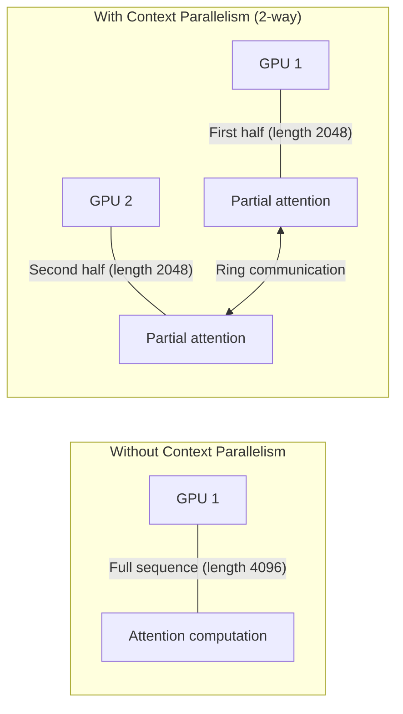
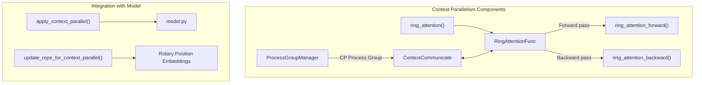
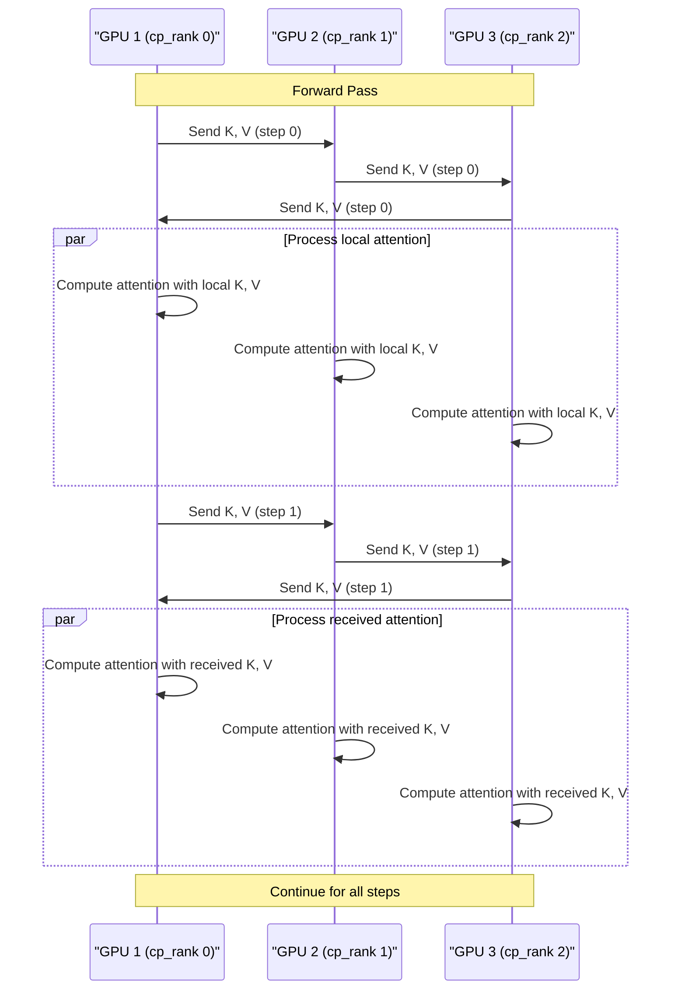
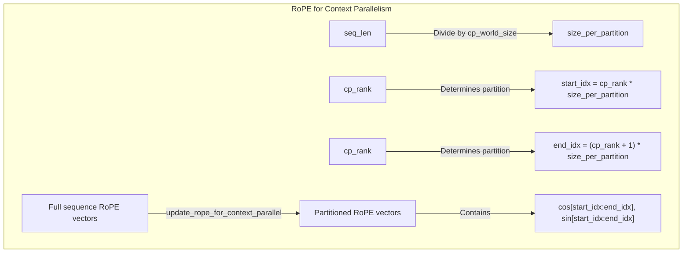

<!-- source: DeepWiki mcp.deepwiki.com · repo huggingface/picotron · page 5.4 Context Parallelism · fetched 2026-10-26 -->

# Context Parallelism

<details>
<summary>Relevant source files</summary>

The following files were used as context for generating this wiki page:

- [picotron/context_parallel/context_parallel.py](picotron/context_parallel/context_parallel.py)
- [picotron/process_group_manager.py](picotron/process_group_manager.py)

</details>


## Purpose and Scope

This document details the implementation of Context Parallelism in Picotron, which is one of the four parallelism strategies in the 4D parallelism architecture. Context Parallelism splits input sequences (context) across multiple devices, allowing model training on longer sequences than would fit on a single device. This page focuses on how context parallelism is implemented, particularly through the ring attention mechanism.

For information about other parallelism strategies, see [Tensor Parallelism](#5.1), [Pipeline Parallelism](#5.2), and [Data Parallelism](#5.3). For an overview of the 4D parallelism design, see [4D Parallelism Design](#2.1).

## What is Context Parallelism?

Context Parallelism is a technique for distributing long input sequences across multiple GPUs during transformer model training. Unlike other parallelism strategies that partition models or data batches, context parallelism partitions the sequence dimension of the attention operation, allowing each GPU to process a portion of the overall sequence length.



Sources: [picotron/context_parallel/context_parallel.py:1-196]()

### Key Benefits

1. **Longer Sequences**: Enables training with sequence lengths that exceed the memory capacity of a single GPU
2. **Memory Efficiency**: Reduces per-GPU memory requirements for attention computations
3. **Complementary**: Can be combined with other parallelism techniques (TP, PP, DP)

## Implementation Architecture

Context Parallelism in Picotron is implemented using a ring-based communication pattern for attention computations, inspired by the ring-flash-attention approach.



Sources: [picotron/context_parallel/context_parallel.py:10-15](), [picotron/context_parallel/context_parallel.py:189-195]()

### Process Group Management

Context Parallelism requires careful management of process groups for distributed communication. The `ProcessGroupManager` class handles the creation and coordination of these groups.

Key attributes relevant to context parallelism:

| Attribute | Description |
|-----------|-------------|
| `cp_world_size` | Number of GPUs in the context parallelism group |
| `cp_rank` | Current GPU's rank within the CP group |
| `cp_group` | PyTorch distributed group for CP communications |
| `cp_send_rank` | Rank to send tensors to in ring communication |
| `cp_recv_rank` | Rank to receive tensors from in ring communication |

Sources: [picotron/process_group_manager.py:39-44]()

## Ring Attention Mechanism

The core of Context Parallelism is the Ring Attention mechanism implemented as a custom PyTorch autograd function. This approach splits the input sequence across multiple devices and performs attention computations in a coordinated manner using ring communication.



Sources: [picotron/context_parallel/context_parallel.py:17-110]()

### Forward Pass

The forward pass of Ring Attention performs these key steps:

1. Initialize context communication channels
2. For each step in the ring communication:
   - Send current K, V tensors to the next rank and receive from the previous rank
   - Compute attention scores and values for the current K, V block
   - Update cumulative output and log-sum-exponential values
   - Rotate received K, V tensors for the next iteration
3. Return the aggregated attention output

Key aspects:
- Attention computation happens in blocks, corresponding to portions of the sequence
- Results are incrementally merged using numerically stable methods
- Causal masking is applied when needed (for autoregressive models)

Sources: [picotron/context_parallel/context_parallel.py:19-51](), [picotron/context_parallel/context_parallel.py:112-128]()

### Backward Pass

The backward pass computes gradients for the query (Q), key (K), and value (V) tensors through a similar ring communication pattern:

1. Initialize communication channels for K, V and their gradients
2. For each step in the ring:
   - Send current K, V and receive from other ranks
   - Compute gradients for the current block
   - Send and receive gradient tensors through the ring
   - Accumulate gradients from all steps
3. Return the complete gradients

This ensures that gradients are properly computed across all partitioned sequences.

Sources: [picotron/context_parallel/context_parallel.py:53-110](), [picotron/context_parallel/context_parallel.py:130-155]()

## Integration with Model Components

### Applying Context Parallelism

Context Parallelism is applied to a model through the `apply_context_parallel` function, which sets an environment variable to indicate whether context parallelism is active:

```python
def apply_context_parallel(model):
    os.environ["CONTEXT_PARALLEL"] = "1" if pgm.process_group_manager.cp_world_size > 1 else "0"
    return model
```

Sources: [picotron/context_parallel/context_parallel.py:10-12]()

### Rotary Position Embeddings Integration

For models using Rotary Position Embeddings (RoPE), Context Parallelism requires adapting the positional encodings to account for sequence partitioning. This is handled by the `update_rope_for_context_parallel` function:



Sources: [picotron/context_parallel/context_parallel.py:189-195]()

## Numerically Stable Aggregation

Special care is taken to ensure numerical stability when aggregating attention outputs across different context partitions. The `update_out_and_lse` function performs this aggregation using numerically stable operations for combining softmax values.

The key technique uses a variant of the log-sum-exp trick to merge partial attention outputs:

```python
current_out = current_out - F.sigmoid(block_lse - current_lse) * (current_out - block_out)
current_lse = current_lse - F.logsigmoid(current_lse - block_lse)
```

This approach avoids potential overflow or underflow issues when dealing with very large or small attention values.

Sources: [picotron/context_parallel/context_parallel.py:157-187]()

## Limitations and Future Work

The current implementation has several areas marked for potential improvement:

1. **Missing Flash Attention**: TODOs in the code indicate plans to add Flash Attention integration for better performance
2. **Flex Attention**: Another planned improvement for optimizing attention computation
3. **Tensor Management**: Currently, the implementation clones tensors which could be optimized for better memory usage

Sources: [picotron/context_parallel/context_parallel.py:22-24]()

## Usage Considerations

Context Parallelism is most beneficial when:

1. Training with very long sequences (exceeding single GPU memory)
2. Used in combination with other parallelism strategies for large models
3. When attention computation becomes the memory bottleneck

It adds communication overhead, so it's most effective when the benefits of handling longer sequences outweigh this overhead.

To use Context Parallelism effectively, ensure that sequence lengths are evenly divisible by the number of GPUs in the context parallel group (`cp_world_size`).

Sources: [picotron/context_parallel/context_parallel.py:192]()

---

