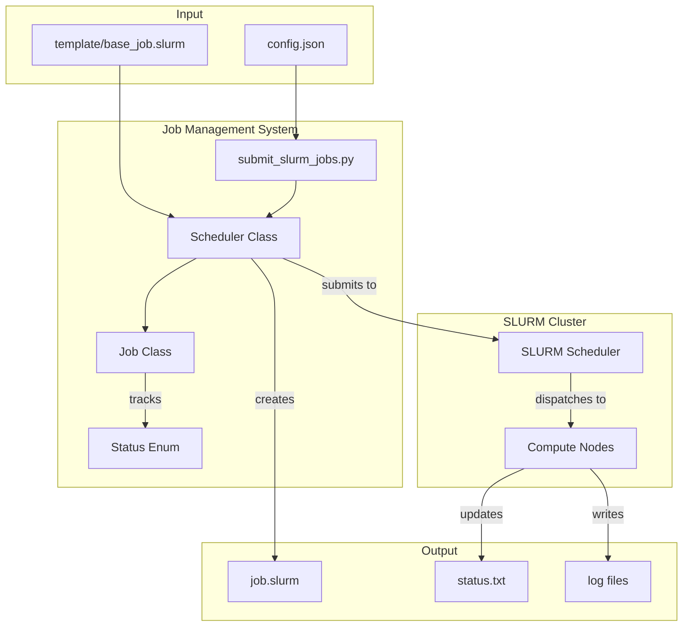
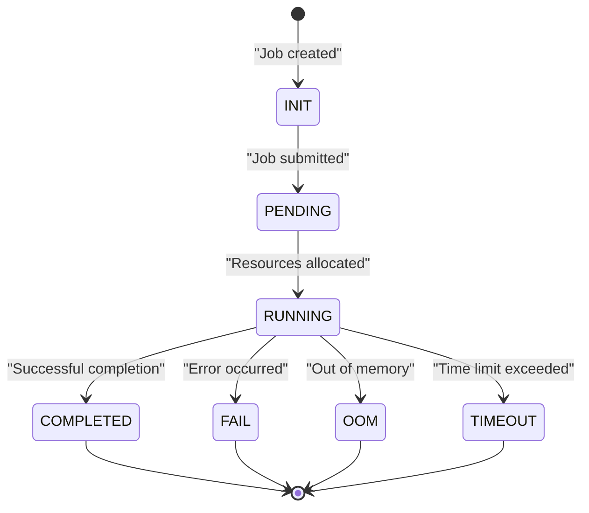
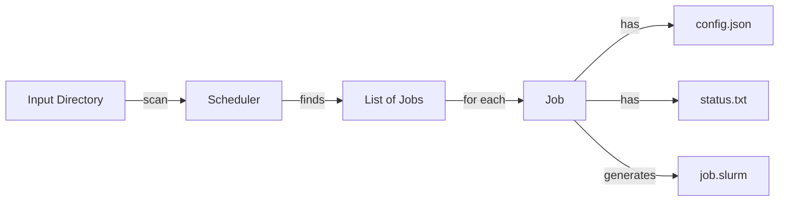
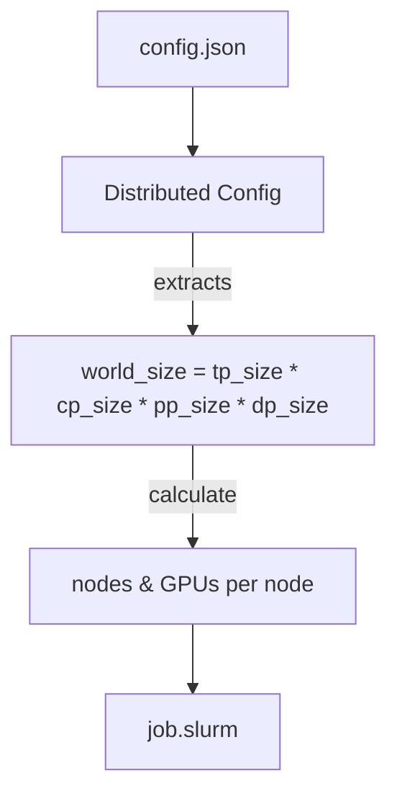
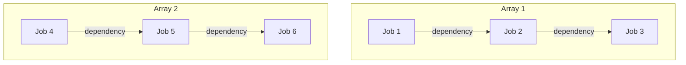
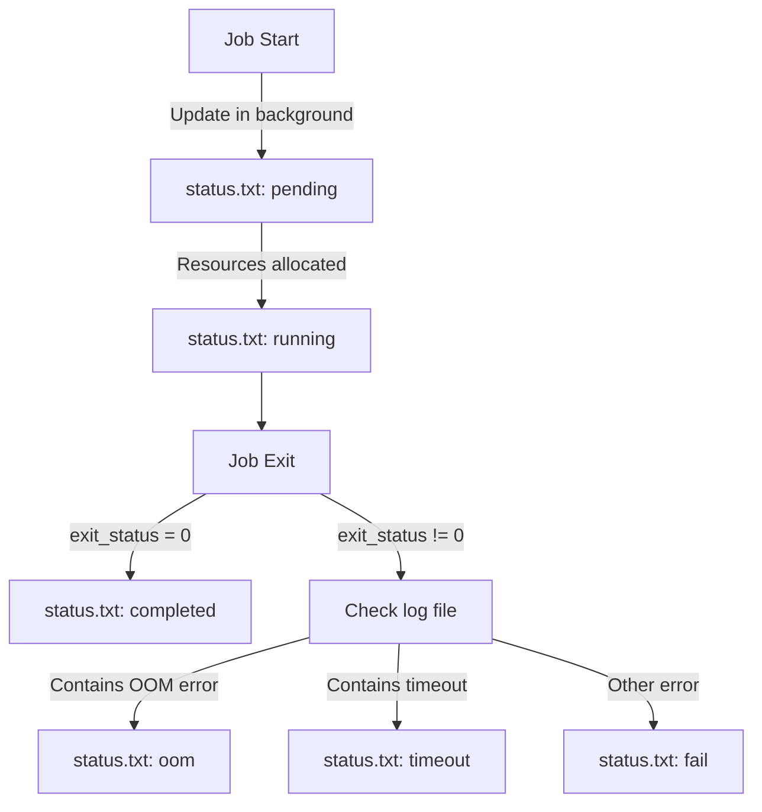
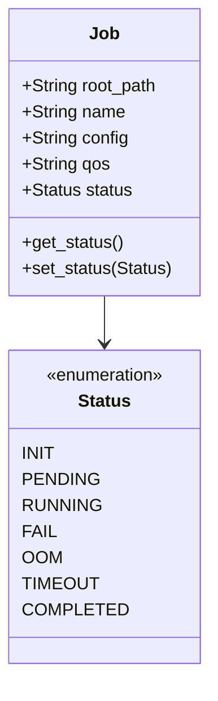
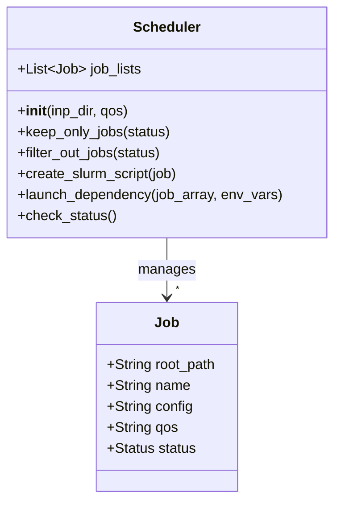
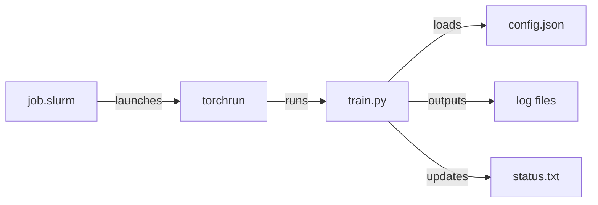

<!-- source: DeepWiki mcp.deepwiki.com · repo huggingface/picotron · page 6 Job Management · fetched 2026-10-26 -->

# Job Management

<details>
<summary>Relevant source files</summary>

The following files were used as context for generating this wiki page:

- [submit_slurm_jobs.py](submit_slurm_jobs.py)
- [template/base_job.slurm](template/base_job.slurm)

</details>


## Purpose and Scope

This document describes the job management system used by Picotron for submitting, monitoring, and managing distributed training jobs on SLURM-based HPC clusters. The job management system handles launching distributed training across multiple nodes, tracking job status, handling failures and dependencies, and efficiently utilizing cluster resources.

For information about the training pipeline that runs within these jobs, see [Training Pipeline](#3). For information about configuration generation that happens before job submission, see [Configuration System](#3.1).

## Job Management Architecture

The job management system consists of several components that work together to manage the lifecycle of training jobs:



Sources: [submit_slurm_jobs.py:55-104](), [submit_slurm_jobs.py:18-53](), [submit_slurm_jobs.py:8-16]()

### Job Status Lifecycle

Jobs in Picotron follow a specific lifecycle, with status transitions tracked in a `status.txt` file:



Sources: [submit_slurm_jobs.py:8-16](), [template/base_job.slurm:82-93]()

## Job Submission Process

The job submission process is managed by the `submit_slurm_jobs.py` script, which scans a specified directory for job configurations, creates appropriate SLURM scripts, and submits them to the cluster.

### Job Discovery and Preparation

The script first discovers jobs by scanning directories:



Sources: [submit_slurm_jobs.py:57-60](), [submit_slurm_jobs.py:68-102]()

### Resource Calculation

For each job, the system calculates the appropriate resources based on the parallelism configuration:



Sources: [submit_slurm_jobs.py:74-80]()

## Using the Job Management System

### Command Line Arguments

The `submit_slurm_jobs.py` script accepts several command line arguments:

| Argument | Description | Default |
|----------|-------------|---------|
| `--inp_dir` | Input directory containing job configurations | Required |
| `--qos` | Quality of Service for SLURM jobs | Required |
| `--nb_slurm_array` | Number of SLURM arrays to group jobs | 0 (disabled) |
| `--only` | Filter jobs by status (e.g., "fail", "timeout") | None (all jobs) |
| `--hf_token` | Hugging Face token for model access | Required |

Sources: [submit_slurm_jobs.py:211-216]()

### Submitting Jobs

To submit jobs, use the `submit_slurm_jobs.py` script with appropriate arguments:

```
python submit_slurm_jobs.py --inp_dir /path/to/jobs --qos regular --hf_token YOUR_HF_TOKEN
```

This will:
1. Scan the input directory for job configurations
2. Create SLURM scripts for each job
3. Submit the jobs to the SLURM scheduler
4. Update each job's status to "pending"

Sources: [submit_slurm_jobs.py:149-206]()

### Job Arrays and Dependencies

Jobs can be grouped into arrays with dependencies, which is useful for running multiple jobs in sequence:



Sources: [submit_slurm_jobs.py:104-114](), [submit_slurm_jobs.py:176-199]()

## SLURM Script Structure

The SLURM scripts created by the job management system are based on a template and include several key components:

### Script Sections

1. **SLURM Directives**: Define job parameters like nodes, GPUs, time limits
2. **Status Management**: Functions to update the status file
3. **Environment Setup**: Configure environment variables and modules
4. **Distributed Training**: Set up for multi-node, multi-GPU training
5. **Execution**: Run the training script with appropriate parameters
6. **Status Update**: Update status based on exit code and log analysis

Sources: [template/base_job.slurm:1-14](), [template/base_job.slurm:16-32](), [template/base_job.slurm:34-55](), [template/base_job.slurm:64-76](), [template/base_job.slurm:82-93]()

### Status File Management

The SLURM script includes logic to automatically update the job's status file:



Sources: [template/base_job.slurm:16-32](), [template/base_job.slurm:82-93]()

## Implementation Details

### Job Representation

Each job is represented by the `Job` class, which encapsulates:



Sources: [submit_slurm_jobs.py:18-53](), [submit_slurm_jobs.py:8-16]()

### Scheduler Implementation

The `Scheduler` class manages job discovery, filtering, script creation, and submission:



Sources: [submit_slurm_jobs.py:55-147]()

## Practical Examples

### Submitting All Jobs

```
python submit_slurm_jobs.py --inp_dir /path/to/experiments --qos regular --hf_token YOUR_HF_TOKEN
```

### Resubmitting Failed Jobs

```
python submit_slurm_jobs.py --inp_dir /path/to/experiments --qos regular --hf_token YOUR_HF_TOKEN --only fail
```

### Checking Job Status

```
python submit_slurm_jobs.py --inp_dir /path/to/experiments --qos regular --hf_token YOUR_HF_TOKEN
```

This will display a summary of job statuses:

```
Status     | Count 
------------|-------
Init        | 0     
Pending     | 2     
Running     | 3     
Fail        | 1     
Oom         | 0     
Timeout     | 0     
Completed   | 10    
------------|-------
Total       | 16    
```

Sources: [submit_slurm_jobs.py:116-147]()

## Integration with Training Pipeline

The job management system launches the Picotron training pipeline, passing the configuration file path to it:



Sources: [template/base_job.slurm:58-76]()

## Summary

The Picotron job management system provides a flexible and robust solution for submitting and monitoring distributed training jobs on SLURM clusters. It handles:

- Job discovery and submission
- Status tracking and updates
- Resource calculation based on model parallelism configuration
- Job dependencies and sequencing
- Error detection and categorization

This system enables efficient training of large language models across multiple nodes and GPUs, with automatic handling of common failure modes and dependencies between jobs.

---

