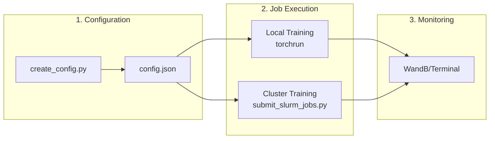
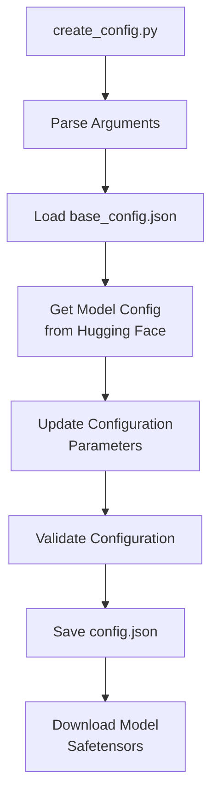
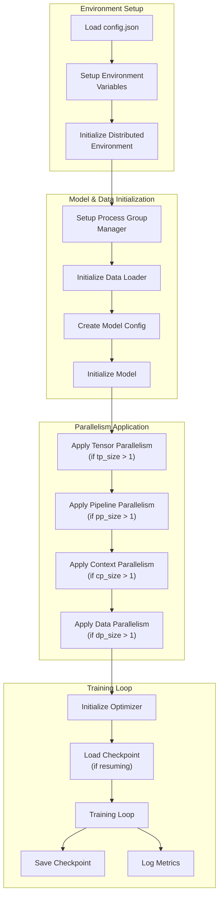
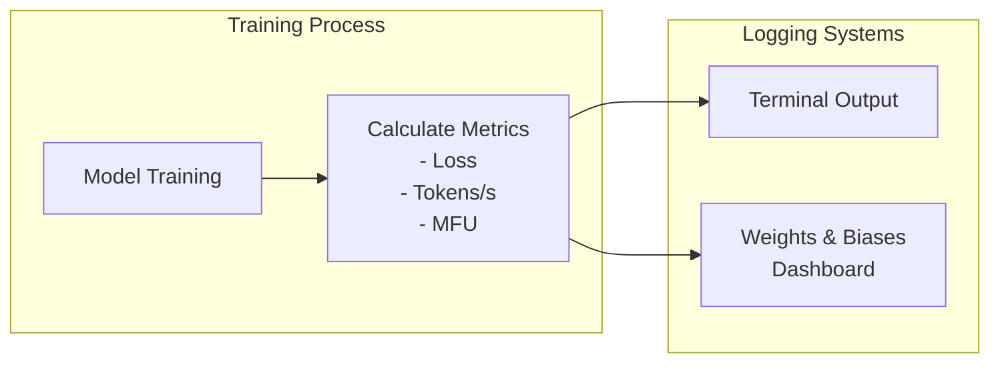
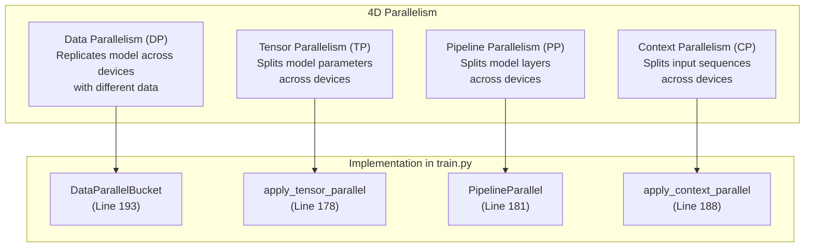

<!-- source: DeepWiki mcp.deepwiki.com · repo huggingface/picotron · page 7 Usage Guide · fetched 2026-10-26 -->

# Usage Guide

<details>
<summary>Relevant source files</summary>

The following files were used as context for generating this wiki page:

- [CITATION.cff](CITATION.cff)
- [README.md](README.md)
- [create_config.py](create_config.py)
- [train.py](train.py)

</details>


This guide provides practical instructions for using Picotron, a minimalist framework for pre-training Llama-like models with 4D Parallelism. It covers installation, configuration creation, job submission, and training execution. For information about the system architecture and design principles, see [System Architecture](#2). For details about parallelism implementations, see [Parallelism Implementations](#5).

## 1. Installation

Picotron requires Python and PyTorch. To install:

```bash
pip install -e .
```

You'll also need a Hugging Face token for downloading models. Get one at [https://huggingface.co/settings/tokens](https://huggingface.co/settings/tokens).

Sources: [README.md:17-20]()

## 2. Basic Workflow

The typical workflow for using Picotron consists of three main steps:

1. Create a configuration file
2. Submit or run the training job
3. Monitor training progress and results



Sources: [README.md:22-38](), [train.py:1-4]()

## 3. Creating Configurations

The `create_config.py` script is used to generate configuration files that define all parameters for your training run.

### 3.1 Configuration Parameters

The main parameters you'll need to specify include:

| Parameter | Description | Default |
|-----------|-------------|---------|
| `--out_dir` | Output directory for configs | `tmp` |
| `--tp` | Tensor parallelism size | 1 |
| `--cp` | Context parallelism size | 1 |
| `--dp` | Data parallelism size | 1 |
| `--pp` | Pipeline parallelism size | 1 |
| `--pp_engine` | Pipeline engine type (`1f1b` or `afab`) | `1f1b` |
| `--model_name` | Hugging Face model name | `HuggingFaceTB/SmolLM-360M-Instruct` |
| `--grad_acc_steps` | Gradient accumulation steps | 1 |
| `--mbs` | Micro batch size | 1 |
| `--seq_len` | Sequence length | 1024 |
| `--exp_name` | Experiment name | `dummy_exp` |
| `--use_wandb` | Enable WandB logging | False |
| `--use_cpu` | Use CPU instead of GPU | False |
| `--hf_token` | Hugging Face token | None |

Sources: [create_config.py:86-106]()

### 3.2 Configuration Examples

Here are some common configuration scenarios:

**Data Parallel Only (8 GPUs):**
```bash
python create_config.py --out_dir tmp --exp_name llama-1B --dp 8 \
    --model_name HuggingFaceTB/SmolLM-1.7B --num_hidden_layers 15 \
    --grad_acc_steps 32 --mbs 4 --seq_len 1024 --hf_token <HF_TOKEN>
```

**3D Parallelism (8 GPUs = 4 DP × 2 TP × 1 PP):**
```bash
python create_config.py --out_dir tmp --dp 4 --tp 2 --pp 1 \
    --exp_name llama-7B --model_name meta-llama/Llama-2-7b-hf \
    --grad_acc_steps 32 --mbs 4 --seq_len 1024 --hf_token <HF_TOKEN>
```

**CPU Training with 3D Parallelism:**
```bash
python create_config.py --out_dir tmp --exp_name llama-1B-cpu \
    --dp 2 --tp 2 --pp 2 --pp_engine 1f1b \
    --model_name HuggingFaceTB/SmolLM-1.7B --num_hidden_layers 5 \
    --grad_acc_steps 2 --mbs 4 --seq_len 128 --hf_token <HF_TOKEN> --use_cpu
```

Sources: [README.md:26-47](), [create_config.py:2-4]()

### 3.3 Configuration Creation Process



Sources: [create_config.py:14-130]()

## 4. Running Training Jobs

### 4.1 Local Training with `torchrun`

For training on a local machine with multiple GPUs:

```bash
torchrun --nproc_per_node 8 train.py --config tmp/llama-1B/config.json
```

For CPU training:

```bash
torchrun --nproc_per_node 8 train.py --config tmp/llama-1B-cpu/config.json
```

Sources: [README.md:31-32](), [README.md:46-47]()

### 4.2 Cluster Training with SLURM

For training on a SLURM cluster:

```bash
python submit_slurm_jobs.py --inp_dir tmp/llama-7B --qos high --hf_token <HF_TOKEN>
```

Sources: [README.md:37-38]()

### 4.3 Training Process Flow



Sources: [train.py:57-279]()

## 5. Monitoring and Logging

### 5.1 Terminal Output

During training, Picotron outputs metrics to the terminal including:

- Loss
- Global batch size
- Tokens/second
- Tokens/second/GPU
- Model Flops Utilization (MFU)
- Memory usage

Example output:
```
[rank 0] Step: 10    | Loss: 10.6753 | Global batch size:   32,768 | Tokens/s:  123,456 | Tokens/s/GPU:   15,432 | Tokens: 327,680/1,000,000,000 | MFU: 41.23% | Memory usage:  12.45GB
```

Sources: [train.py:242-259]()

### 5.2 Weights & Biases Integration

If `--use_wandb` is enabled, Picotron logs the following metrics to WandB:

- Loss
- Tokens per step
- Tokens per second
- Model Flops Utilization (MFU)
- Tokens per second per GPU
- Memory usage
- Total trained tokens



Sources: [train.py:261-270](), [train.py:132-150]()

## 6. Checkpointing and Resume Training

### 6.1 Checkpoint Configuration

Checkpoints are configured in the `config.json` file with the following parameters:

```json
"checkpoint": {
    "save_dir": "path/to/save/directory",
    "save_frequency": 100,
    "load_path": "path/to/load/from"
}
```

- `save_dir`: Directory where checkpoints will be saved
- `save_frequency`: How often to save checkpoints (in steps)
- `load_path`: Path to load a checkpoint from (for resuming training)

Sources: [train.py:211-215](), [train.py:272-273]()

### 6.2 Resuming from Checkpoint

To resume training from a checkpoint, specify the `load_path` in your configuration. The training script will automatically load the model state, optimizer state, step count, and trained tokens count.

Sources: [train.py:215]()

## 7. Understanding 4D Parallelism

Picotron supports four types of parallelism that can be combined:



Sources: [train.py:177-193]()

## 8. Troubleshooting

### 8.1 Common Issues

**CUDA Out of Memory**

If you encounter CUDA OOM errors, try:
- Reducing the micro batch size (`--mbs`)
- Increasing tensor parallelism (`--tp`)
- Enabling pipeline parallelism (`--pp`)
- Reducing sequence length (`--seq_len`)

**Slow Training on CPU**

CPU training is expected to be slow. For better performance, try:
- Reducing model size
- Reducing sequence length
- Minimizing hidden layers (`--num_hidden_layers`)

**NCCL Errors with Multiple Nodes**

For multi-node training, ensure network connectivity between nodes and use the appropriate NCCL configurations.

Sources: [README.md:40-47]()

### 8.2 Environment Variables

Key environment variables that affect training:

| Environment Variable | Description | Set By |
|----------------------|-------------|--------|
| `HF_TOKEN` | Hugging Face token for model access | Config or user environment |
| `OMP_NUM_THREADS` | OpenMP thread limit | Config |
| `TOKENIZERS_PARALLELISM` | Controls tokenizer parallelism | Config |
| `FLASH_ATTEN` | Enables Flash Attention (1 or 0) | Config |
| `CUDA_DEVICE_MAX_CONNECTIONS` | CUDA device connections | User |

Sources: [train.py:64-75]()

---

