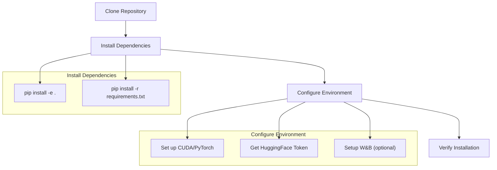
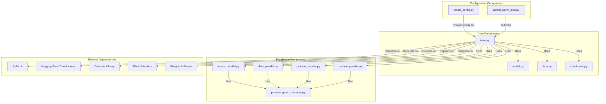
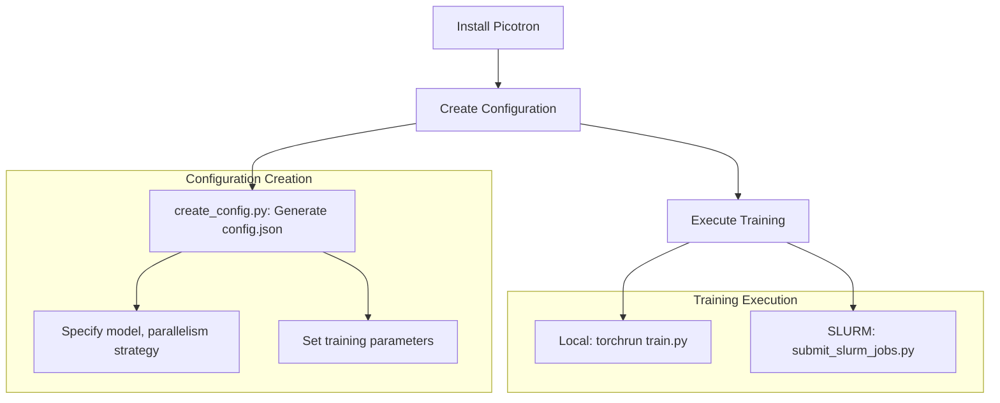

<!-- source: DeepWiki mcp.deepwiki.com · repo huggingface/picotron · page 7.1 Installation and Setup · fetched 2026-10-26 -->

# Installation and Setup

<details>
<summary>Relevant source files</summary>

The following files were used as context for generating this wiki page:

- [CITATION.cff](CITATION.cff)
- [README.md](README.md)
- [requirements.txt](requirements.txt)

</details>


This document provides detailed instructions for installing and setting up Picotron, a minimalist framework for pre-training Llama-like models with 4D Parallelism (Data, Tensor, Pipeline, and Context parallel). For information about creating configuration files after installation, see [Creating Configurations](#7.2), and for running training jobs with your setup, see [Running Training Jobs](#7.3).

## System Requirements

Before installing Picotron, ensure your system meets the following requirements:

- **Python**: Version 3.8 or higher
- **CUDA**: Compatible with PyTorch 2.1.0 (for GPU acceleration)
- **Storage**: Sufficient space for model checkpoints and datasets
- **Memory**: Depends on the model size and batch size you plan to use
- **GPUs**: Optional but recommended for practical training speeds

Sources: [README.md:1-10](), [requirements.txt:1-8]()

## Basic Installation

Picotron can be installed directly from the GitHub repository:

```bash
# Clone the repository
git clone https://github.com/huggingface/picotron
cd picotron

# Install in development mode
pip install -e .
```

This installs Picotron in development mode, allowing you to modify the code and have changes reflected immediately without reinstallation.

Sources: [README.md:16-20]()

## Dependencies

Picotron requires several dependencies, which are automatically installed when you run `pip install -e .`. The primary dependencies are:

| Dependency | Version | Purpose |
|------------|---------|---------|
| PyTorch | 2.1.0 | Deep learning framework |
| Triton | 2.1.0 | GPU-accelerated kernels |
| NumPy | 1.26.4 | Numerical computing |
| Datasets | 2.19.1 | Data loading and processing |
| Transformers | 4.47.0 | Model definitions and utilities |
| Flash Attention | 2.5.0 | Efficient attention implementation |
| Weights & Biases | Latest | Experiment tracking |
| Hugging Face Hub | Latest | Model and dataset downloading |

If you need to install these dependencies manually:

```bash
pip install -r requirements.txt
```

Sources: [requirements.txt:1-8]()

## Environment Setup

### Setting Up for GPU Training

For GPU training, ensure you have a compatible CUDA version installed. Verify your CUDA installation with:

```bash
nvidia-smi
python -c "import torch; print(torch.cuda.is_available(), torch.cuda.device_count())"
```

### Hugging Face Authentication

To download models from Hugging Face Hub, you'll need an access token:

1. Create a token at https://huggingface.co/settings/tokens
2. Use the token in your configuration or commands with the `--hf_token` flag

Sources: [README.md:23-24]()

## Installation Flow Diagram

Below is a diagram illustrating the installation process:



Sources: [README.md:16-24]()

## Picotron Component Architecture

The following diagram shows how the installed components relate to each other in the Picotron system:



Sources: [README.md:5-8](), [requirements.txt:1-8]()

## Verifying Installation

You can verify your installation by running a small test:

```bash
# Create a small test configuration
python create_config.py --out_dir tmp --exp_name test --dp 1 --model_name HuggingFaceTB/SmolLM-1.7B --num_hidden_layers 2 --grad_acc_steps 1 --mbs 1 --seq_len 128 --hf_token <YOUR_HF_TOKEN>

# Run a single step of training
python train.py --config tmp/test/config.json --max_steps 1
```

If this completes without errors, your installation is working correctly.

## Running on Different Platforms

### Local GPU Setup

For local GPU training:

```bash
# Create config
python create_config.py --out_dir tmp --exp_name llama-1B --dp 8 --model_name HuggingFaceTB/SmolLM-1.7B --num_hidden_layers 15 --grad_acc_steps 32 --mbs 4 --seq_len 1024 --hf_token <HF_TOKEN>

# Run with torchrun
torchrun --nproc_per_node 8 train.py --config tmp/llama-1B/config.json
```

Sources: [README.md:26-31]()

### SLURM Cluster Setup

For running on a SLURM cluster:

```bash
# Create config with 3D parallelism
python create_config.py --out_dir tmp --dp 4 --tp 2 --pp 2 --pp_engine 1f1b --exp_name llama-7B --model_name meta-llama/Llama-2-7b-hf --grad_acc_steps 32 --mbs 4 --seq_len 1024 --hf_token <HF_TOKEN>

# Submit to SLURM
python submit_slurm_jobs.py --inp_dir tmp/llama-7B --qos high --hf_token <HF_TOKEN>
```

Sources: [README.md:33-37]()

### CPU-Only Setup

For CPU-only training (slower but useful for testing):

```bash
# Create config with CPU flag
python create_config.py --out_dir tmp --exp_name llama-1B-cpu --dp 2 --tp 2 --pp 2 --pp_engine 1f1b --model_name HuggingFaceTB/SmolLM-1.7B --num_hidden_layers 5 --grad_acc_steps 2 --mbs 4 --seq_len 128 --hf_token <HF_TOKEN> --use_cpu

# Run locally
torchrun --nproc_per_node 8 train.py --config tmp/llama-1B-cpu/config.json
```

Sources: [README.md:40-46]()

## Training Setup Workflow



Sources: [README.md:22-46]()

## Common Issues and Troubleshooting

### CUDA Version Mismatch

If you encounter errors related to CUDA versions, ensure that your installed CUDA version is compatible with PyTorch 2.1.0.

### Out of Memory Errors

If you encounter OOM errors:
- Reduce the model size (`--num_hidden_layers`)
- Reduce batch size (`--mbs`)
- Increase parallelism (increase `--dp`, `--tp`, or `--pp`)
- Reduce sequence length (`--seq_len`)

### Hugging Face Token Issues

If you have problems downloading models from Hugging Face:
- Verify your token has the correct permissions
- Check your internet connection
- Ensure the model name is correct

### Distributed Training Issues

For issues with distributed training:
- Ensure all nodes can communicate
- Check that the port used for distributed communication is open
- Verify that all machines have identical environments

---

