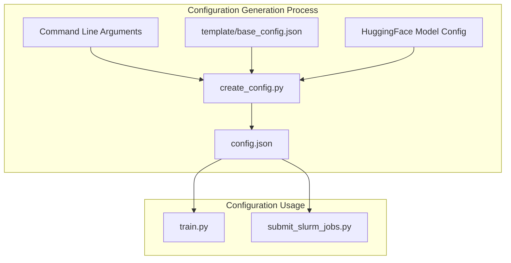
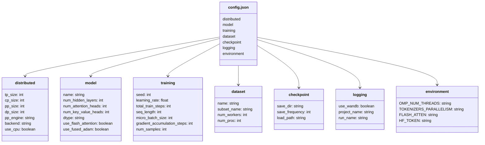
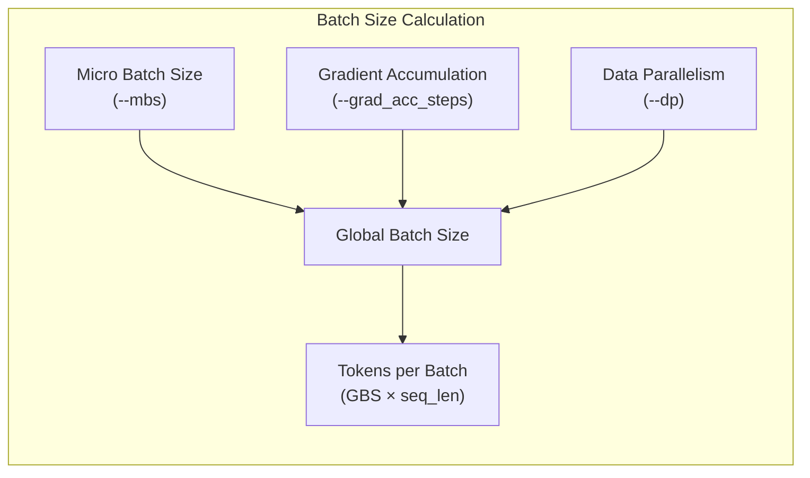

<!-- source: DeepWiki mcp.deepwiki.com · repo huggingface/picotron · page 7.2 Creating Configurations · fetched 2026-10-26 -->

# Creating Configurations

<details>
<summary>Relevant source files</summary>

The following files were used as context for generating this wiki page:

- [CITATION.cff](CITATION.cff)
- [README.md](README.md)
- [create_config.py](create_config.py)
- [template/base_config.json](template/base_config.json)

</details>


This page explains how to create and customize configuration files for Picotron training jobs. Configuration files control all aspects of model training, from parallelism strategies to model architecture parameters. For information on running training jobs with these configurations, see [Running Training Jobs](#7.3).

## Configuration System Overview

The Picotron configuration system uses JSON files to define all training parameters. These configurations are generated using the `create_config.py` script, which builds upon a base template and customizes it according to user-specified parameters.



Sources: [create_config.py:14-84](), [template/base_config.json:1-52]()

## Configuration File Structure

The configuration file contains multiple sections that control different aspects of training:



Sources: [template/base_config.json:1-52]()

## Creating a Basic Configuration

To create a basic configuration file, use the `create_config.py` script with appropriate parameters:

```bash
python create_config.py --out_dir tmp --exp_name my_experiment --model_name HuggingFaceTB/SmolLM-1.7B --mbs 4 --seq_len 1024 --hf_token YOUR_HF_TOKEN
```

This command will:
1. Create a directory `tmp/my_experiment`
2. Generate a `config.json` file in that directory
3. Download the specified model's weights (using the HuggingFace token)

### Required Parameters

| Parameter | Description | Example Value |
|-----------|-------------|---------------|
| `--out_dir` | Output directory for the configuration | `tmp` |
| `--exp_name` | Experiment name (also used for the subdirectory) | `my_experiment` |
| `--model_name` | HuggingFace model identifier | `HuggingFaceTB/SmolLM-1.7B` |
| `--hf_token` | HuggingFace API token for downloading models | `hf_xxxxx` |

Sources: [create_config.py:86-108](), [README.md:26-29]()

## Configuring Parallelism Dimensions

Picotron supports 4D parallelism. Here's how to configure each dimension:

### Data Parallelism (DP)

```bash
python create_config.py --out_dir tmp --exp_name dp_example --dp 8 --model_name HuggingFaceTB/SmolLM-1.7B --hf_token YOUR_HF_TOKEN
```

### Tensor Parallelism (TP)

```bash
python create_config.py --out_dir tmp --exp_name tp_example --tp 4 --model_name HuggingFaceTB/SmolLM-1.7B --hf_token YOUR_HF_TOKEN
```

### Pipeline Parallelism (PP)

```bash
python create_config.py --out_dir tmp --exp_name pp_example --pp 4 --pp_engine 1f1b --model_name HuggingFaceTB/SmolLM-1.7B --hf_token YOUR_HF_TOKEN
```

### Context Parallelism (CP)

```bash
python create_config.py --out_dir tmp --exp_name cp_example --cp 4 --model_name HuggingFaceTB/SmolLM-1.7B --hf_token YOUR_HF_TOKEN
```

### Multi-dimensional Parallelism

All dimensions can be combined:

```bash
python create_config.py --out_dir tmp --exp_name multi_parallel --dp 2 --tp 2 --pp 2 --cp 2 --pp_engine 1f1b --model_name HuggingFaceTB/SmolLM-1.7B --hf_token YOUR_HF_TOKEN
```

Sources: [create_config.py:58-62](), [README.md:34]()

## Batch Size and Performance Configuration

Configuring batch sizes correctly is critical for training performance. Picotron uses:

1. **Micro Batch Size (MBS)**: Batch size processed at once on each device
2. **Gradient Accumulation Steps**: Number of forward/backward passes before optimizer step
3. **Global Batch Size**: Total batch size across all devices = DP × MBS × gradient_accumulation_steps



Example configuration:

```bash
python create_config.py --out_dir tmp --exp_name batch_config --dp 8 --mbs 4 --grad_acc_steps 32 --seq_len 1024 --model_name HuggingFaceTB/SmolLM-1.7B --hf_token YOUR_HF_TOKEN
```

This results in a global batch size of 1024 (8 × 4 × 32) with ~1M tokens per batch (1024 × 1024).

Sources: [create_config.py:71-76](), [README.md:28]()

## Model Architecture Configuration

Picotron allows overriding model architecture parameters from the original HuggingFace model:

| Parameter | Description |
|-----------|-------------|
| `--num_hidden_layers` | Number of transformer layers |
| `--num_attention_heads` | Number of attention heads |
| `--num_key_value_heads` | Number of key-value heads (for grouped-query attention) |

When not specified, these values are automatically fetched from the HuggingFace model configuration.

```bash
python create_config.py --out_dir tmp --exp_name custom_arch --model_name HuggingFaceTB/SmolLM-1.7B --num_hidden_layers 12 --num_attention_heads 16 --num_key_value_heads 4 --hf_token YOUR_HF_TOKEN
```

Sources: [create_config.py:51-54]()

## Hardware Configuration

### CPU Training

For experimentation on systems without GPUs, use the `--use_cpu` flag:

```bash
python create_config.py --out_dir tmp --exp_name cpu_training --model_name HuggingFaceTB/SmolLM-1.7B --use_cpu --hf_token YOUR_HF_TOKEN
```

This automatically disables Flash Attention and changes the distributed backend to "gloo".

### Optimizer Configuration

For GPU training, you can enable fused Adam for better performance:

```bash
python create_config.py --out_dir tmp --exp_name fused_adam --model_name HuggingFaceTB/SmolLM-1.7B --use_fused_adam --hf_token YOUR_HF_TOKEN
```

Sources: [create_config.py:63-66](), [create_config.py:55](), [README.md:42-43]()

## Dataset Configuration

By default, Picotron uses the TinyStories dataset. To specify a different dataset or subset:

```bash
python create_config.py --out_dir tmp --exp_name custom_dataset --model_name HuggingFaceTB/SmolLM-1.7B --subset_name train --hf_token YOUR_HF_TOKEN
```

Sources: [create_config.py:47](), [template/base_config.json:30-35]()

## Logging and Monitoring

For enabling logging with Weights & Biases:

```bash
python create_config.py --out_dir tmp --exp_name with_logging --model_name HuggingFaceTB/SmolLM-1.7B --use_wandb --hf_token YOUR_HF_TOKEN
```

This will log training metrics to a WandB project named "picotron" with a run name matching your experiment name.

Sources: [create_config.py:68-69](), [template/base_config.json:41-45]()

## Complete Parameter Reference

Here is a comprehensive list of all parameters available in the `create_config.py` script:

| Parameter | Description | Default |
|-----------|-------------|---------|
| `--out_dir` | Output directory | `tmp` |
| `--tp` | Tensor parallelism degree | `1` |
| `--cp` | Context parallelism degree | `1` |
| `--dp` | Data parallelism degree | `1` |
| `--pp` | Pipeline parallelism degree | `1` |
| `--pp_engine` | Pipeline parallel engine | `1f1b` |
| `--model_name` | HuggingFace model name | `HuggingFaceTB/SmolLM-360M-Instruct` |
| `--num_hidden_layers` | Number of transformer layers | From model config |
| `--num_attention_heads` | Number of attention heads | From model config |
| `--num_key_value_heads` | Number of key-value heads | From model config |
| `--grad_acc_steps` | Gradient accumulation steps | `1` |
| `--mbs` | Micro batch size | `1` |
| `--seq_len` | Sequence length | `1024` |
| `--subset_name` | Dataset subset name | `None` |
| `--exp_name` | Experiment name | `dummy_exp` |
| `--use_wandb` | Enable WandB logging | `False` |
| `--use_cpu` | Use CPU for training | `False` |
| `--use_fused_adam` | Use fused Adam optimizer | `False` |
| `--hf_token` | HuggingFace token | `None` |

Sources: [create_config.py:87-106]()

## Common Configuration Examples

### Training a Small Model on a Single Node with 8 GPUs

```bash
python create_config.py --out_dir tmp --exp_name small_model --dp 8 --model_name HuggingFaceTB/SmolLM-1.7B --grad_acc_steps 32 --mbs 4 --seq_len 1024 --hf_token YOUR_HF_TOKEN
```

### Training a 7B Model with 3D Parallelism

```bash
python create_config.py --out_dir tmp --dp 4 --tp 2 --pp 2 --pp_engine 1f1b --exp_name llama_7b --model_name meta-llama/Llama-2-7b-hf --grad_acc_steps 32 --mbs 4 --seq_len 1024 --hf_token YOUR_HF_TOKEN
```

### CPU Training for Testing

```bash
python create_config.py --out_dir tmp --exp_name cpu_test --dp 2 --tp 2 --pp 2 --pp_engine 1f1b --model_name HuggingFaceTB/SmolLM-1.7B --num_hidden_layers 5 --grad_acc_steps 2 --mbs 4 --seq_len 128 --hf_token YOUR_HF_TOKEN --use_cpu
```

Sources: [README.md:26-47]()

## Troubleshooting Configuration Issues

| Issue | Possible Solution |
|-------|------------------|
| "No module named picotron.utils" | Ensure you've installed Picotron with `pip install -e .` |
| "Failed to download safetensors" | Check that your HF token is valid and has appropriate permissions |
| "CUDA out of memory" | Reduce `--mbs` or increase parallelism dimensions |
| "Process group creation failed" | Ensure your parallelism dimensions (tp × cp × dp × pp) match your available device count |

---

