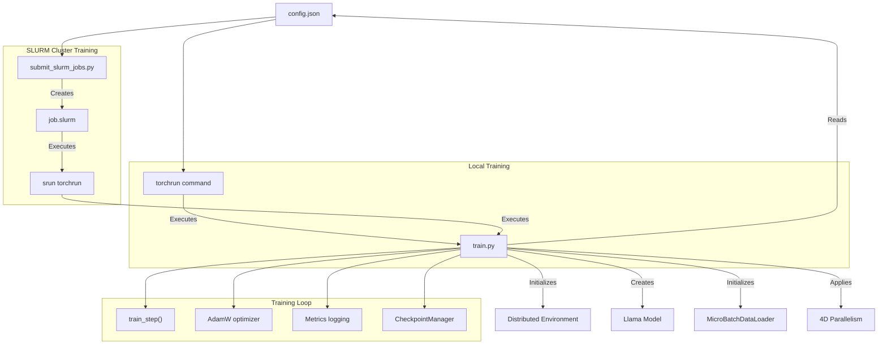
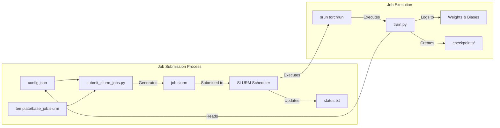
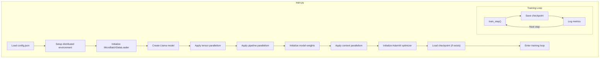

<!-- source: DeepWiki mcp.deepwiki.com · repo huggingface/picotron · page 7.3 Running Training Jobs · fetched 2026-10-26 -->

# Running Training Jobs

<details>
<summary>Relevant source files</summary>

The following files were used as context for generating this wiki page:

- [CITATION.cff](CITATION.cff)
- [README.md](README.md)
- [submit_slurm_jobs.py](submit_slurm_jobs.py)
- [template/base_job.slurm](template/base_job.slurm)
- [train.py](train.py)

</details>


This document provides a step-by-step guide for executing training jobs using Picotron's distributed training framework. It covers both local execution and cluster-based distributed training using SLURM. For information about creating configuration files for these jobs, see [Creating Configurations](#7.2).

## Training Job Execution Workflow



Sources: [train.py:1-281](), [README.md:21-47]()

## Local Training Execution

To run a training job locally, you'll use `torchrun` (PyTorch's distributed training launcher) along with the `train.py` script. The basic command structure is:

```bash
torchrun --nproc_per_node <NUM_GPUS> train.py --config <PATH_TO_CONFIG_JSON>
```

### Example Commands

For data parallel training with 8 GPUs:

```bash
torchrun --nproc_per_node 8 train.py --config tmp/llama-1B/config.json
```

For 3D parallelism (TP+PP+DP) on CPU (for testing purposes):

```bash
torchrun --nproc_per_node 8 train.py --config tmp/llama-1B-cpu/config.json
```

### Key Parameters

| Parameter | Description |
|-----------|-------------|
| `--nproc_per_node` | Number of processes to launch on each node (typically equal to number of GPUs) |
| `--master_addr` | Address of the master node (for multi-node training) |
| `--master_port` | Port for coordination (default: 29500) |
| `--nnodes` | Total number of nodes for multi-node training |
| `--node_rank` | Rank of the current node (0 for single-node training) |
| `--config` | Path to the configuration JSON file |

Sources: [train.py:2-3](), [README.md:30-46]()

## Running on SLURM Clusters

For large-scale distributed training, Picotron provides support for SLURM-based job submission. The workflow involves using `submit_slurm_jobs.py` to create and submit SLURM job scripts.



Sources: [submit_slurm_jobs.py:1-221](), [template/base_job.slurm:1-94]()

### Submitting SLURM Jobs

To submit a job to a SLURM cluster:

```bash
python submit_slurm_jobs.py --inp_dir tmp/llama-7B --qos high --hf_token <YOUR_HF_TOKEN>
```

### Key Parameters for `submit_slurm_jobs.py`

| Parameter | Description |
|-----------|-------------|
| `--inp_dir` | Directory containing the configuration files |
| `--qos` | Quality of service for the SLURM job |
| `--nb_slurm_array` | Number of SLURM job arrays to create (default: 0) |
| `--only` | Filter jobs by status (e.g., "fail", "pending") |
| `--hf_token` | Hugging Face token for downloading models |

Sources: [submit_slurm_jobs.py:211-220]()

### Job Status Tracking

Picotron tracks job status in a `status.txt` file in the job directory. Possible status values:

| Status | Description |
|--------|-------------|
| init | Job is created |
| pending | Job is waiting for resources |
| running | Job is currently running |
| fail | Job failed |
| oom | Job failed due to out of memory error |
| timeout | Job failed due to timeout |
| completed | Job successfully completed |

Sources: [submit_slurm_jobs.py:8-17](), [template/base_job.slurm:15-32](), [template/base_job.slurm:75-94]()

## Understanding the Training Process

When you run `train.py`, it performs the following steps:

1. Loads the configuration from the specified JSON file
2. Sets up the distributed training environment
3. Initializes the data loader
4. Creates the model and applies the specified parallelism strategies
5. Sets up the optimizer and loads checkpoints if specified
6. Executes the training loop, periodically saving checkpoints and logging metrics



Sources: [train.py:57-279]()

### Key Training Metrics

During training, Picotron outputs the following metrics:

| Metric | Description |
|--------|-------------|
| Loss | Training loss value |
| Global batch size | Total tokens processed per step |
| Tokens/s | Tokens processed per second |
| Tokens/s/GPU | Tokens processed per second per GPU |
| Tokens | Total number of tokens processed so far |
| MFU | Model FLOPs Utilization (efficiency metric) |
| Memory usage | GPU memory consumption |

Sources: [train.py:242-260]()

### Weights & Biases Integration

If enabled in your configuration (`config["logging"]["use_wandb"] = true`), Picotron will log training metrics to Weights & Biases. This provides a convenient way to monitor training progress and compare different runs.

Metrics logged to W&B include:
- Loss
- Tokens per step
- Tokens per second
- MFU (Model FLOPs Utilization)
- Memory usage
- Total trained tokens

Sources: [train.py:132-150](), [train.py:261-270]()

## Checkpoint Management

Picotron automatically saves checkpoints during training according to the frequency specified in the configuration file.

### Checkpoint Configuration

In your configuration file, you can specify:

```json
"checkpoint": {
  "save_dir": "path/to/checkpoints",
  "save_frequency": 100,
  "load_path": "path/to/existing/checkpoint"
}
```

- `save_dir`: Directory where checkpoints will be saved
- `save_frequency`: Number of steps between checkpoints
- `load_path`: Path to an existing checkpoint to resume training

### Resuming Training from Checkpoints

To resume training from a checkpoint, simply set the `load_path` in your configuration to point to the checkpoint directory, then run the training command as normal.

Sources: [train.py:211-216](), [train.py:273-274]()

## Troubleshooting

### Common Issues

1. **Out of Memory Errors**: If you encounter OOM errors, try:
   - Decreasing the micro batch size
   - Increasing the number of gradient accumulation steps
   - Using more GPUs with tensor or pipeline parallelism

2. **Slow Training**: If training is slower than expected:
   - Check if Flash Attention is enabled (`FLASH_ATTEN=1`)
   - Verify that your hardware supports bfloat16 for optimal performance
   - Consider using different parallelism strategies

3. **SLURM Job Failures**: If jobs fail on SLURM:
   - Check the job log files in your job directory
   - Verify that the status.txt file contains the failure reason
   - Resubmit failed jobs with: `python submit_slurm_jobs.py --inp_dir <dir> --qos <qos> --only fail --hf_token <token>`

Sources: [template/base_job.slurm:80-94](), [train.py:76-77]()

### Performance Optimization Tips

- Use Flash Attention when possible for faster training
- Tensor Parallelism (TP) helps reduce memory per GPU
- Pipeline Parallelism (PP) allows training larger models
- Data Parallelism (DP) improves throughput with larger batch sizes
- Context Parallelism (CP) helps with very long sequence lengths

Sources: [train.py:67-77](), [README.md:32-40]()

---

