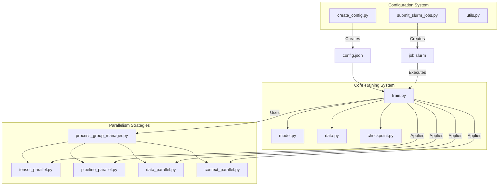
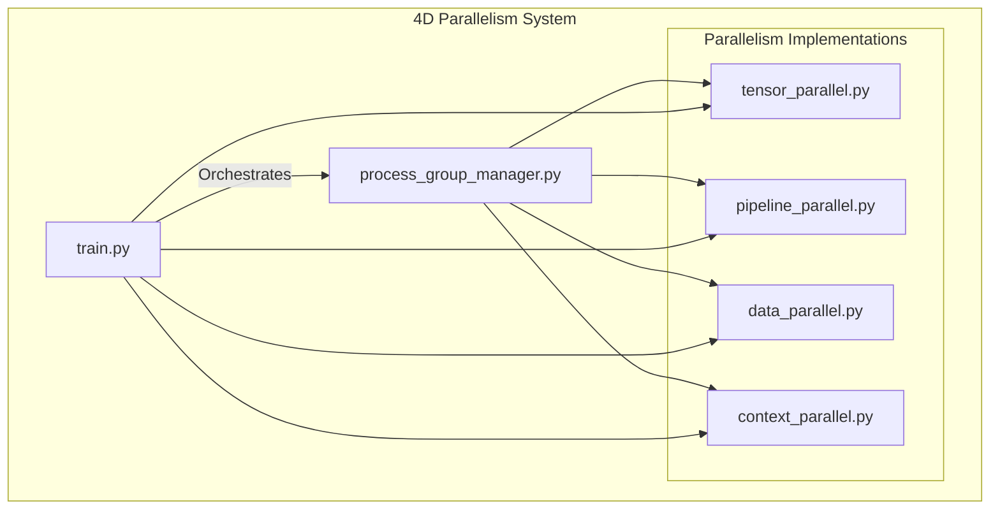

<!-- source: DeepWiki mcp.deepwiki.com · repo huggingface/picotron · page 8 Development Guide · fetched 2026-10-26 -->

# Development Guide

<details>
<summary>Relevant source files</summary>

The following files were used as context for generating this wiki page:

- [.gitignore](.gitignore)
- [CITATION.cff](CITATION.cff)
- [README.md](README.md)
- [picotron/model.py](picotron/model.py)
- [train.py](train.py)

</details>


This guide provides essential information for developers who want to extend or modify the Picotron codebase. It covers the codebase architecture, development workflows, and guidelines for contributing to the project. For information about using Picotron to train models, see the [Usage Guide](#7) instead.

## Codebase Architecture

Picotron follows a modular design with clear separation of concerns between components. Understanding this architecture is critical for effective development.

### High-Level Structure



Sources: [train.py](), [README.md]()

### Key Components

#### Core Components

1. **train.py**: Main entry point and orchestrator
   - Initializes distributed environment [train.py:94-100]()
   - Creates model, optimizer, and data loader [train.py:106-118](), [train.py:173-190]()
   - Implements training loop [train.py:219-276]()

2. **model.py**: Llama model implementation
   - Defines complete model architecture [model.py:253-298]()
   - Contains attention, normalization, and MLP components [model.py:88-163](), [model.py:164-186]()
   - Implements embedding and projection layers [model.py:237-252](), [model.py:188-212]()

3. **data.py**: Data loading and processing
   - Handles batching and iterator functionality
   - Interfaces with Hugging Face datasets

4. **checkpoint.py**: Checkpoint management
   - Saves and loads model states 
   - Handles sharded checkpoint management

#### Parallelism Components

1. **process_group_manager.py**: Base infrastructure for all parallelism strategies
   - Creates process groups for each parallelism dimension
   - Provides rank and world size information

2. **tensor_parallel.py**: Shards model parameters across devices
   - Applies tensor parallelism to model components

3. **pipeline_parallel.py**: Splits model layers across devices
   - Implements 1F1B and AFAB pipelining algorithms [train.py:223-229]()

4. **data_parallel.py**: Replicates model across devices with different data
   - Handles gradient synchronization

5. **context_parallel.py**: Splits input sequences across devices
   - Implements ring attention for efficient cross-device attention

#### Support Components

1. **utils.py**: Utility functions for logging, metrics, etc.
   - Print utilities
   - Metrics calculation (MFU, etc.)

2. **create_config.py**: Configuration generation
   - Creates configuration files from command line arguments

3. **submit_slurm_jobs.py**: SLURM job submission
   - Creates and submits job scripts

Sources: [train.py](), [picotron/model.py]()

## Model Architecture

The Llama model in Picotron follows a standard decoder-only transformer architecture with some specific optimizations.

```mermaid
graph TD
    subgraph "Llama Model Structure"
        Embed["Embedding"]
        Layers["DecoderLayers[0...n]"]
        FinalNorm["FinalRMSNorm"]
        FinalProj["FinalProjection"]
        
        Embed --> Layers
        Layers --> FinalNorm
        FinalNorm --> FinalProj
    end
    
    subgraph "DecoderLayer Structure"
        InputNorm["InputLayerNorm"]
        Attention["Attention"]
        PostNorm["PostAttentionLayerNorm"]
        MLP["MLP"]
        
        InputNorm --> Attention
        Attention --> |"+ Residual"| PostNorm
        PostNorm --> MLP
        MLP --> |"+ Residual"| Output["Output"]
    end
    
    subgraph "Attention Structure"
        QProj["q_proj"]
        KProj["k_proj"]
        VProj["v_proj"]
        OutProj["out_proj"]
        
        QProj --> |"Apply RoPE"| Q["Q"]
        KProj --> |"Apply RoPE"| K["K"]
        VProj --> V["V"]
        
        Q --> Attn["Attention Mechanism"]
        K --> Attn
        V --> Attn
        Attn --> OutProj
    end
    
    subgraph "MLP Structure"
        GateProj["gate_proj"]
        UpProj["up_proj"]
        DownProj["down_proj"]
        
        GateProj --> |"SiLU"| GateAct["Gate Activation"]
        UpProj --> MulOp["*"]
        GateAct --> MulOp
        MulOp --> DownProj
    end
```



Sources: [picotron/model.py:253-298](), [picotron/model.py:88-163](), [picotron/model.py:164-186]()

### Key Model Components

1. **Llama Class** [model.py:253-298]()
   - Main model class with embedding, decoder layers, normalization, and final projection
   - Manages forward pass through the entire model

2. **DecoderLayer** [model.py:214-235]()
   - Standard transformer block with pre-LayerNorm architecture
   - Contains attention and MLP modules

3. **Attention** [model.py:88-163]()
   - Implements multi-head attention with support for grouped-query attention
   - Uses rotary position embeddings (RoPE)
   - Optional Flash Attention support

4. **MLP** [model.py:164-186]()
   - Feed-forward network with SwiGLU activation
   - Configurable intermediate size

5. **Normalization** [model.py:39-86]()
   - RMS normalization with optional Triton acceleration

Sources: [picotron/model.py]()

## Development Workflow

### Setting Up Development Environment

1. **Clone the repository**
   ```
   git clone https://github.com/huggingface/picotron.git
   cd picotron
   ```

2. **Install in development mode**
   ```
   pip install -e .
   ```

3. **Install development dependencies**
   ```
   pip install pytest torch>=2.0.0 flash-attn
   ```

4. **Obtain a Hugging Face token**
   - Required for downloading model weights and datasets
   - Set as environment variable or in configuration

Sources: [README.md:16-20]()

### Modifying the Model

To extend or modify the model architecture:

1. **Understanding the current implementation**
   - Study the model components in [model.py]()
   - Note how components interact with parallelism strategies

2. **Adding a new layer type**
   ```python
   # Create a new layer class in model.py
   class CustomLayer(nn.Module):
       def __init__(self, config):
           super().__init__()
           # Initialize parameters
           
       def forward(self, x):
           # Implement forward pass
           return output
   ```

3. **Modifying the Llama class**
   - Add your custom layer to `self.decoder_layers` or other appropriate location
   - Update the forward method to use your new layer
   - Ensure compatibility with tensor and pipeline parallelism

4. **Testing the modifications**
   - Start with CPU testing for easier debugging
   - Progress to single-GPU testing
   - Finally test with multiple GPUs and parallelism strategies

Sources: [picotron/model.py:253-298]()

### Extending Parallelism Strategies

Picotron's 4D parallelism can be extended or modified to improve performance or add new capabilities:



1. **Process Group Manager**
   - Core infrastructure for all parallelism strategies
   - To extend: Add new process group types or communication patterns

2. **Tensor Parallelism**
   - To extend: Add support for new module types or optimize communication

3. **Pipeline Parallelism**
   - To extend: Implement new scheduling algorithms or bubble elimination techniques
   - Check the AFAB and 1F1B implementations in [train.py:223-229]()

4. **Data Parallelism**
   - To extend: Implement custom gradient reduction strategies

5. **Context Parallelism**
   - To extend: Optimize ring attention or implement new sequence partitioning techniques

When developing a new parallelism strategy, follow these steps:
1. Implement the strategy in a new or existing module
2. Integrate with process_group_manager
3. Add application logic in train.py
4. Test with progressively larger configurations

Sources: [train.py:94-100](), [train.py:223-229]()

### Debugging Distributed Training

Distributed training can be challenging to debug. Use these techniques:

1. **Selective printing**
   - Use the utility function from utils.py that handles rank filtering
   - Example: `print(f"Rank {pgm.process_group_manager.global_rank}: tensor shape {x.shape}", is_print_rank=True)`

2. **Synchronization points**
   - Use `dist.barrier()` to synchronize processes for debugging
   - Add before and after complex operations to isolate issues

3. **Step-by-step verification**
   - Implement intermediate validation checks
   - Add tensor shape and value assertions

4. **Single-process testing**
   - Test with 1 GPU first
   - Incrementally scale to multiple GPUs

5. **Memory profiling**
   - Monitor GPU memory with `torch.cuda.memory_reserved()`
   - Check for memory leaks during longer runs

Sources: [train.py:248-258]()

## Contributing Guidelines

When contributing to Picotron, follow these guidelines:

### Code Style

1. **Follow existing patterns**
   - Maintain consistent naming conventions
   - Keep organization similar to existing code
   - Add docstrings for new functions and classes

2. **Code organization**
   - Keep related functionality together
   - Minimize dependencies between components
   - Use clear, descriptive names

### Testing Strategy

1. **Unit testing**
   - Test new components independently
   - Verify compatibility with existing components

2. **Integration testing**
   - Test with different parallelism configurations
   - Verify end-to-end functionality

3. **Performance testing**
   - Monitor MFU (Model FLOP Utilization) metric
   - Compare against baseline implementations

### Pull Request Process

1. **Fork the repository**
   - Create a feature branch for your changes

2. **Implement your changes**
   - Follow the code style guidelines
   - Add appropriate documentation

3. **Test your changes**
   - Ensure functionality with small and large models
   - Test different parallelism configurations

4. **Submit a pull request**
   - Provide a clear description of changes
   - Reference any related issues

## Performance Optimization

When optimizing Picotron, focus on these areas:

1. **Data loading pipeline**
   - Optimize prefetching and preprocessing
   - Implement efficient batching strategies

2. **Communication optimization**
   - Reduce the frequency and size of communication
   - Use efficient collective operations

3. **Memory optimization**
   - Use gradient checkpointing for memory-intensive models
   - Implement efficient parameter initialization

4. **Computation optimization**
   - Use fused operations where possible
   - Optimize operator selection for specific hardware

5. **Monitoring and profiling**
   - Use PyTorch profiler to identify bottlenecks
   - Monitor MFU as the key performance metric

Sources: [train.py:245-246](), [README.md:7-8]()

## Conclusion

Picotron is designed to be educational and hackable, focusing on simplicity and readability rather than maximum performance. When extending or modifying the codebase, maintain this philosophy by keeping code simple, well-documented, and focused on educational value.

The framework provides a solid foundation for experimenting with distributed training techniques and model architectures. By understanding the core components and their interactions, you can effectively customize Picotron for your research or educational needs.

For more information about using Picotron, refer to the [Usage Guide](#7). For setup instructions, see [Installation and Setup](#7.1).