# Page: Overview

# Overview

<details>
<summary>Relevant source files</summary>

The following files were used as context for generating this wiki page:

- [CITATION.cff](CITATION.cff)
- [README.md](README.md)
- [requirements.txt](requirements.txt)

</details>


Picotron is a minimalist repository designed for pre-training Llama-like models using 4D Parallelism techniques. This document provides an introduction to the system, its architecture, and core components.

## Purpose and Scope

Picotron is primarily an educational tool created in the spirit of [NanoGPT](https://github.com/karpathy/nanoGPT) but focused on distributed training techniques for large language models (LLMs). It implements four complementary parallelism strategies (Data, Tensor, Pipeline, and Context) while maintaining code simplicity and readability.

The system is designed to help researchers and engineers learn about distributed training techniques through clear, concise implementations rather than optimizing for maximum performance. For a more production-focused implementation, see [System Architecture](#2).

Sources: [README.md:1-8]()

## Key Features

- **4D Parallelism Implementation**: Supports Data, Tensor, Pipeline, and Context parallelism in a modular design
- **Educational Focus**: Core files are under 300 lines of code each, prioritizing readability
- **Llama-like Model Support**: Compatible with Hugging Face transformer models
- **Distributed Training**: Works across multiple GPUs and nodes via SLURM integration
- **Checkpoint Management**: Handles distributed model state saving and loading

Sources: [README.md:4-8]()

## System Architecture Overview

Picotron follows a modular architecture with clear separation between different components:

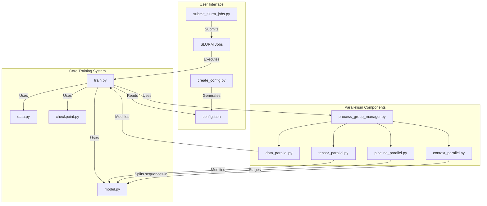

Sources: [README.md:5]()

## Parallelism Strategies

Picotron implements four complementary parallelism strategies to efficiently distribute training across multiple devices:

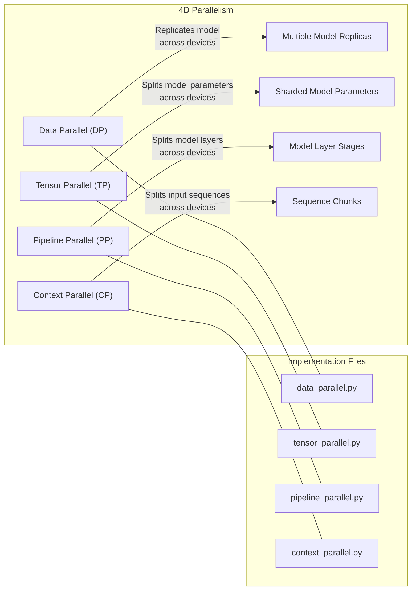

Each parallelism strategy addresses different scaling challenges:

| Strategy | What It Splits | Primary Benefit | Implementation |
|----------|----------------|-----------------|----------------|
| Data Parallel | Training data | Handles more samples | `data_parallel.py` |
| Tensor Parallel | Model parameters | Reduces memory per device | `tensor_parallel.py` |
| Pipeline Parallel | Model layers | Reduces memory, enables larger models | `pipeline_parallel.py` |
| Context Parallel | Input sequences | Processes longer sequences | `context_parallel.py` |

Sources: [README.md:2]()

## Training Workflow

The training workflow in Picotron follows a straightforward process:

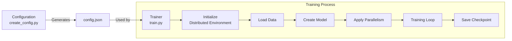

Sources: [README.md:25-47]()

## Installation and Quick Start

Picotron requires PyTorch and related libraries. The installation is straightforward:

```
pip install -e .
```

Basic usage involves two steps:
1. Creating a configuration file using `create_config.py`
2. Running training using `train.py` with the generated configuration

For a simple data-parallel training run:

```bash
# Create configuration
python create_config.py --out_dir tmp --exp_name llama-1B --dp 8 \
  --model_name HuggingFaceTB/SmolLM-1.7B --num_hidden_layers 15 \
  --grad_acc_steps 32 --mbs 4 --seq_len 1024 --hf_token <HF_TOKEN>

# Run training
torchrun --nproc_per_node 8 train.py --config tmp/llama-1B/config.json
```

For more advanced training scenarios including multiple parallelism strategies, see [Usage Guide](#7).

Sources: [README.md:16-47]()

## Repository Structure

Picotron maintains simplicity with a flat repository structure. Key files include:

| File | Purpose |
|------|---------|
| `train.py` | Main training orchestrator |
| `model.py` | Llama model implementation |
| `data_parallel.py` | Data parallelism implementation |
| `tensor_parallel.py` | Tensor parallelism implementation |
| `pipeline_parallel.py` | Pipeline parallelism implementation |
| `context_parallel.py` | Context parallelism implementation |
| `checkpoint.py` | Checkpoint management |
| `process_group_manager.py` | Distributed process group management |
| `create_config.py` | Configuration file creator |
| `submit_slurm_jobs.py` | SLURM job submission utility |

Sources: [README.md:5](), [requirements.txt:1-8]()

## Dependencies

Picotron relies on several key libraries:

| Library | Purpose |
|---------|---------|
| PyTorch | Core deep learning framework |
| Triton | GPU kernel optimization |
| Transformers | Hugging Face model implementations |
| Datasets | Data loading and processing |
| Flash-Attention | Optimized attention implementation |
| Wandb | Experiment tracking |

Sources: [requirements.txt:1-8]()

For detailed information about specific components, please refer to the corresponding wiki pages in the system architecture section.

---

# Page: System Architecture

# System Architecture

<details>
<summary>Relevant source files</summary>

The following files were used as context for generating this wiki page:

- [CITATION.cff](CITATION.cff)
- [README.md](README.md)
- [extract_metrics.py](extract_metrics.py)
- [picotron/pipeline_parallel/pipeline_parallel.py](picotron/pipeline_parallel/pipeline_parallel.py)
- [picotron/utils.py](picotron/utils.py)
- [train.py](train.py)

</details>


## Purpose and Scope

This document provides a comprehensive overview of Picotron's system architecture, explaining the core components and their interactions. It focuses on the high-level design principles, system organization, and the relationships between different subsystems. For detailed information about the 4D parallelism approach, see [4D Parallelism Design](#2.1).

## Overview

Picotron is designed as a minimalist, educational framework for pre-training Llama-like models at scale using 4D parallelism. The architecture prioritizes simplicity and readability while maintaining the capability to train large language models across distributed environments.

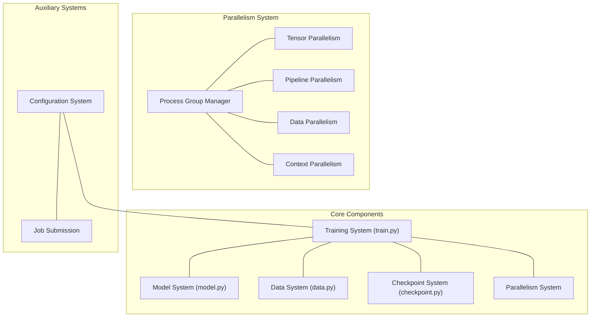

Sources: [train.py](), [README.md]()

## Core Components

The system architecture consists of several interconnected components, each responsible for specific aspects of the training process:

| Component | Primary Responsibility | Key Files |
|-----------|------------------------|-----------|
| Training System | Orchestrates the overall training process | train.py |
| Model System | Defines and implements the Llama model architecture | model.py |
| Data System | Handles data loading and preprocessing | data.py |
| Parallelism System | Implements the 4D parallelism strategies | tensor_parallel.py, pipeline_parallel.py, data_parallel.py, context_parallel.py |
| Checkpoint System | Manages saving and loading model states | checkpoint.py |
| Configuration System | Handles training configuration generation | create_config.py, base_config.json |
| Job Management | Handles job submission and monitoring | submit_slurm_jobs.py, extract_metrics.py |

Sources: [train.py:5-27](), [README.md:1-17]()

## Training System Architecture

The training system serves as the central orchestrator, bringing together all components for the training process.

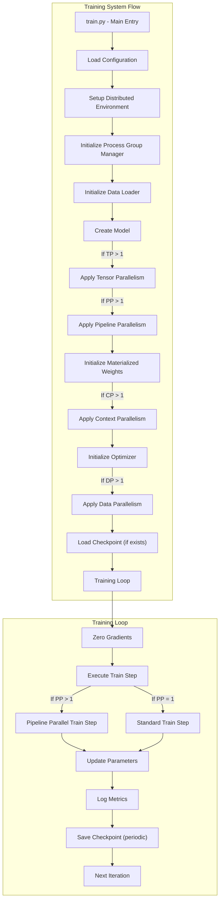

Sources: [train.py:57-281]()

### Key Training Components and Workflow

The training system follows a clear workflow:

1. **Configuration Loading**: Loads training parameters from a JSON configuration file
2. **Distributed Environment Setup**: Initializes the distributed training environment and process groups
3. **Data Loading**: Sets up data loaders with appropriate batch sizes and sequence lengths
4. **Model Initialization**: Creates the model and applies appropriate parallelism transformations
5. **Training Loop**: Executes forward and backward passes, optimizer steps, and tracks metrics

The training loop handles different execution paths based on the parallelism configuration, with specialized code paths for pipeline parallelism (using either 1F1B or AFAB scheduling algorithms).

Sources: [train.py:57-104](), [train.py:217-277]()

## Process Group Manager

The Process Group Manager is a central component that organizes and coordinates the different parallelism strategies. It creates and manages process groups for each dimension of parallelism, enabling coordinated communication between related processes.

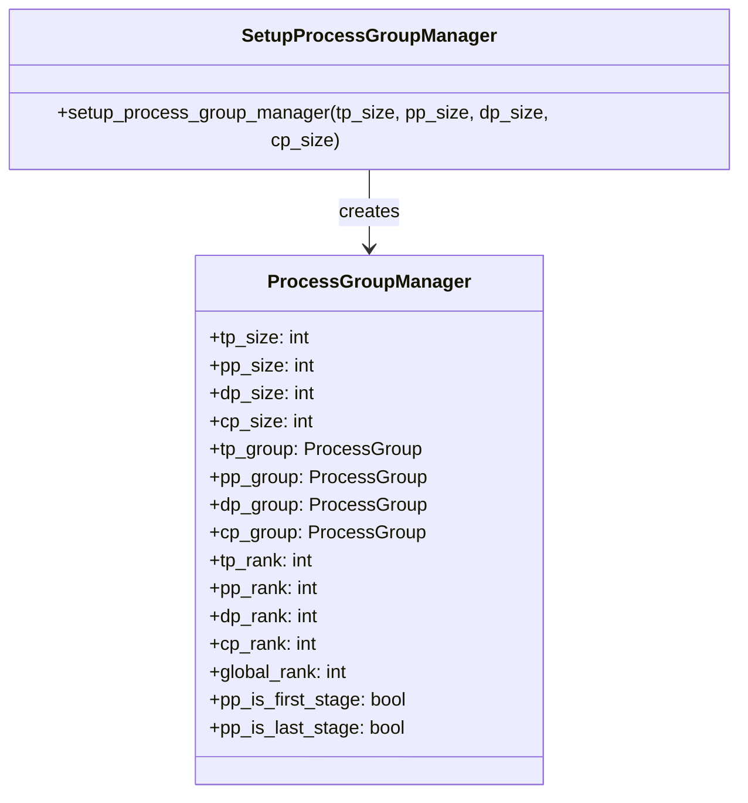

The Process Group Manager maintains:
- The size of each dimension (tp_size, pp_size, dp_size, cp_size)
- Process groups for collective operations within each parallelism dimension
- The rank of the current process in each dimension
- Helper flags such as identifying the first or last pipeline stage

Sources: [train.py:94-101](), [picotron/utils.py:52-80]()

## 4D Parallelism Architecture

Picotron implements four complementary parallelism strategies to enable efficient training of large models:

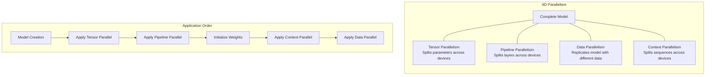

Key parallelism implementations:

1. **Tensor Parallelism** (TP): Splits individual model parameters across devices, particularly for large matrices in attention and MLP layers.
2. **Pipeline Parallelism** (PP): Distributes model layers across devices, with each device handling a subset of the model's layers.
3. **Data Parallelism** (DP): Replicates the model across devices with each device processing different data.
4. **Context Parallelism** (CP): Splits input sequences across devices, enabling processing of longer contexts.

These strategies are applied in a specific order during model initialization, as shown in the diagram above.

Sources: [train.py:174-193](), [picotron/pipeline_parallel/pipeline_parallel.py:8-76]()

### Pipeline Parallelism Implementation

The pipeline parallelism strategy splits model layers across multiple devices, with each device responsible for processing a subset of the model's layers.

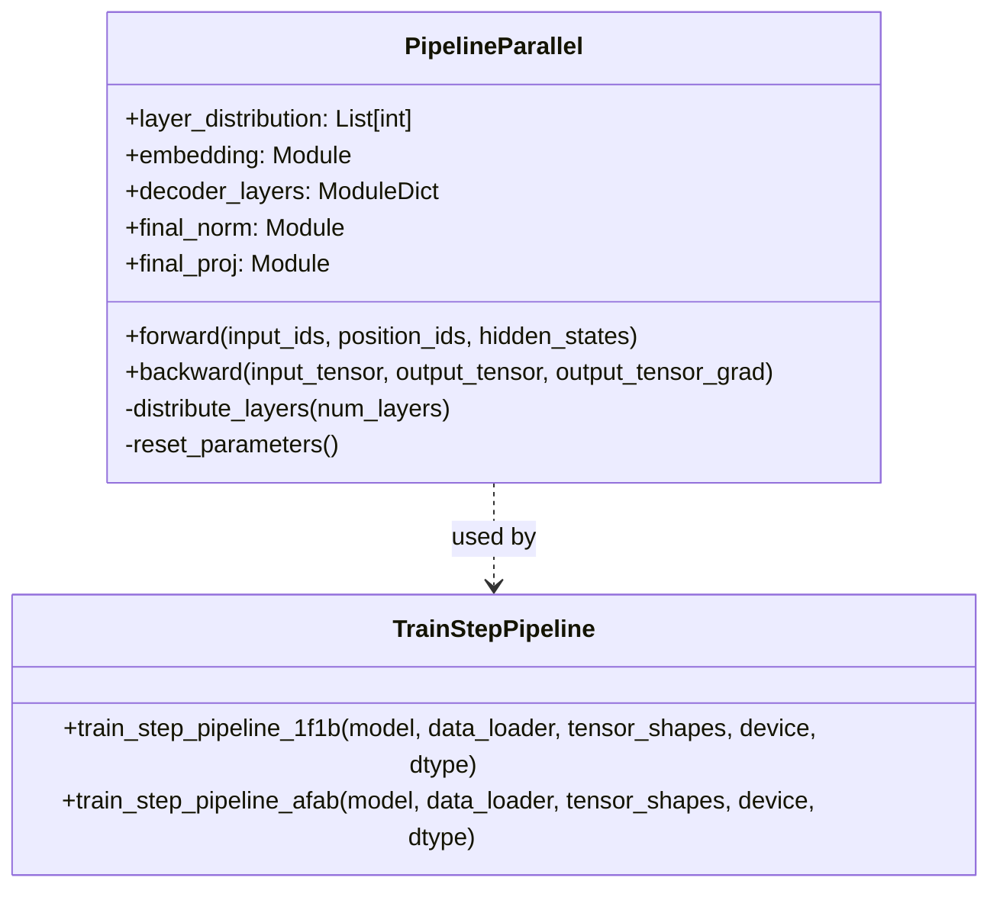

Picotron supports two pipeline scheduling algorithms:
1. **1F1B (One-Forward-One-Backward)**: Interleaves forward and backward passes for better GPU utilization
2. **AFAB (All-Forward-All-Backward)**: Completes all forward passes before starting backward passes

The `PipelineParallel` class transforms a standard model by distributing its layers across devices in the pipeline. Each device's pipeline stage is responsible for a subset of layers, with the first stage handling the embedding and the last stage handling the final normalization and projection.

Sources: [picotron/pipeline_parallel/pipeline_parallel.py:8-76](), [picotron/pipeline_parallel/pipeline_parallel.py:77-121](), [picotron/pipeline_parallel/pipeline_parallel.py:122-215]()

## Model Initialization Process

The model initialization process in Picotron follows a specific sequence to accommodate the various parallelism strategies:

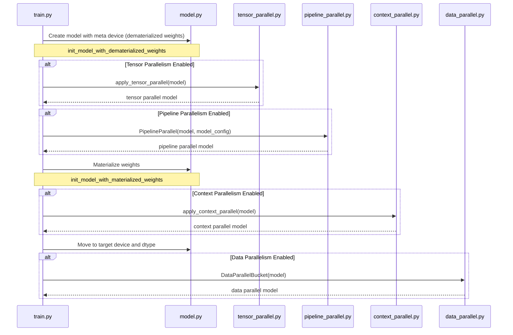

This initialization sequence is critical for properly applying the different parallelism strategies:
1. First, the model is created with dematerialized weights (meta device) to reduce memory usage during initialization
2. Tensor and Pipeline parallelism transformations are applied to the model structure
3. Weights are materialized (loaded) from checkpoint files
4. Context parallelism is applied to handle sequence splitting
5. The model is moved to the target device and data type
6. Finally, data parallelism is applied to enable processing different batches on multiple devices

Sources: [train.py:170-196]()

## Configuration and Execution Flow

The training process begins with configuration generation and job submission, following through to execution and monitoring:

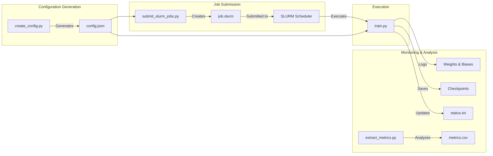

The configuration file (config.json) is the central artifact that defines all training parameters, including:
- Model specifications
- Parallelism configuration
- Training hyperparameters
- Dataset details
- Environment variables

This configuration is passed to the training script, which uses it to set up the entire training process.

Sources: [train.py:57-68](), [extract_metrics.py:8-196]()

## Resource Management and Performance Tracking

Picotron includes utilities for tracking resource usage and performance metrics:

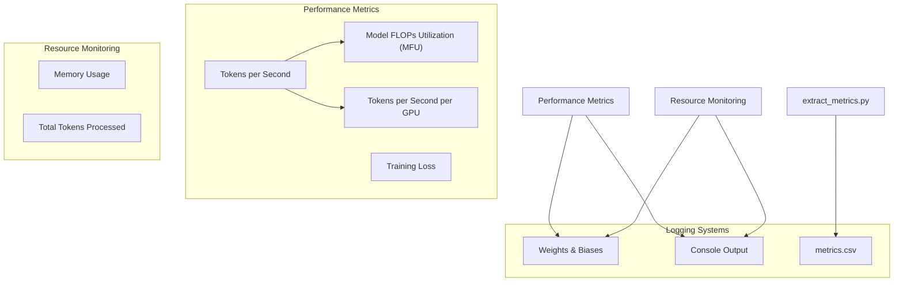

The system calculates key performance metrics:
- **Tokens per Second**: Overall throughput
- **Tokens per Second per GPU**: Per-device efficiency
- **Model FLOPs Utilization (MFU)**: Percentage of theoretical peak performance achieved
- **Memory Usage**: GPU memory consumption

These metrics are logged to Weights & Biases (if enabled) and to the console, providing visibility into training progress and efficiency.

Sources: [train.py:242-270](), [picotron/utils.py:28-49](), [extract_metrics.py:25-90]()

## System Requirements and Interactions

Picotron is designed to work with specific external systems and has specific requirements for operation:

| Component | Requirement | Purpose |
|-----------|-------------|---------|
| PyTorch | 2.0+ | Core training framework |
| CUDA | Compatible with PyTorch | GPU acceleration |
| Hugging Face Hub | Access token | Model and dataset access |
| SLURM (optional) | Cluster access | Distributed job management |
| Weights & Biases (optional) | Account | Training monitoring |

The system is designed to be compatible with Hugging Face's ecosystem, allowing easy access to models and datasets. It is optimized for running on SLURM-managed clusters but can also run on local machines for development and small-scale experiments.

Sources: [train.py:68-75](), [README.md:17-47]()

## Summary

Picotron's architecture is designed to be modular, educational, and capable of handling large-scale model training. The system implements 4D parallelism (Tensor, Pipeline, Data, and Context) to enable efficient distributed training of large language models. The architecture prioritizes simplicity and readability while maintaining the capability to scale to significant model sizes.

The key strengths of the architecture include:
1. Clear separation of concerns between components
2. Modular design that allows for flexible configuration
3. Support for multiple parallelism strategies
4. Integration with established ML infrastructure (Hugging Face, Weights & Biases)
5. Educational focus with readable, well-structured code

For detailed information about the training pipeline, see [Training Pipeline](#3), and for information about using the system, see [Usage Guide](#7).

---

# Page: 4D Parallelism Design

# 4D Parallelism Design

<details>
<summary>Relevant source files</summary>

The following files were used as context for generating this wiki page:

- [CITATION.cff](CITATION.cff)
- [README.md](README.md)
- [extract_metrics.py](extract_metrics.py)
- [picotron/pipeline_parallel/pipeline_parallel.py](picotron/pipeline_parallel/pipeline_parallel.py)
- [picotron/utils.py](picotron/utils.py)

</details>


## Purpose and Scope
This document explains the 4D Parallelism architecture in Picotron, a minimalist framework for pre-training Llama-like models. The four dimensions of parallelism—Data Parallel (DP), Tensor Parallel (TP), Pipeline Parallel (PP), and Context Parallel (CP)—work together to efficiently distribute training across multiple GPUs or nodes. This page focuses on the design principles and components of the 4D parallelism system. For implementation details of specific parallelism strategies, see the respective pages: [Tensor Parallelism](#5.1), [Pipeline Parallelism](#5.2), [Data Parallelism](#5.3), and [Context Parallelism](#5.4).

Sources: [README.md:1-10]()

## Introduction to 4D Parallelism

4D Parallelism addresses the fundamental challenge of training Large Language Models (LLMs) that exceed the memory and computational capabilities of a single GPU. Each dimension addresses a different aspect of model distribution:

1. **Data Parallelism (DP)**: Replicates the model across devices, each processing different batches of data
2. **Tensor Parallelism (TP)**: Splits individual model layers across devices
3. **Pipeline Parallelism (PP)**: Distributes model layers sequentially across devices
4. **Context Parallelism (CP)**: Splits input sequences across devices

Together, these four dimensions enable efficient scaling of model training across large GPU clusters, allowing the training of models with billions of parameters.

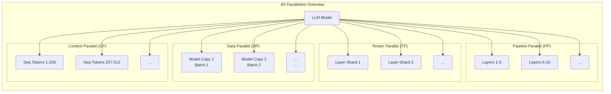

Sources: [README.md:1-10](), [utils.py:51-80]()

## Process Group Manager Architecture

The Process Group Manager is the central component that organizes the different process groups required for 4D parallelism. Each parallelism strategy requires its own process group to facilitate communication between the relevant processes.

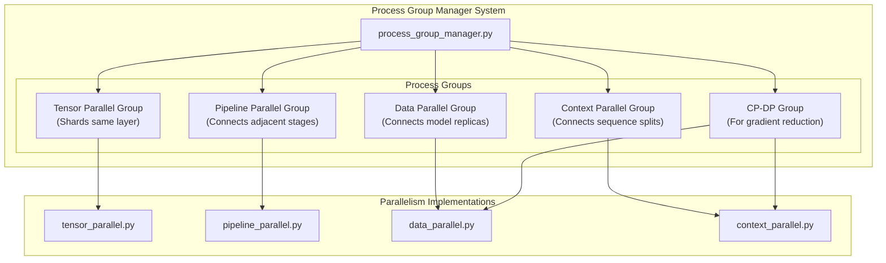

Sources: [utils.py:10-11](), [utils.py:78-79](), [utils.py:94-99](), [pipeline_parallel.py:6-7]()

## Each Dimension of Parallelism

### Data Parallelism (DP)

Data Parallelism is the simplest form of distributed training, where the model is replicated across multiple GPUs, each processing different batches of data. Gradients are synchronized across replicas to ensure consistency.

**Key characteristics:**
- Full model is replicated on each DP rank
- Each rank processes different mini-batches
- Gradient synchronization occurs after backward pass
- Memory usage scales linearly with model size
- Computation scales linearly with batch size

### Tensor Parallelism (TP)

Tensor Parallelism splits individual model layers across devices, allowing layers that are too large for a single GPU to be distributed. In Picotron, this primarily splits attention heads and MLP layers.

**Key characteristics:**
- Individual layers are sharded across TP ranks
- Primarily targets attention blocks and MLPs
- Requires collective communication within forward/backward passes
- Reduces memory per GPU linearly with TP size

### Pipeline Parallelism (PP)

Pipeline Parallelism distributes model layers sequentially across GPUs, with each GPU responsible for a subset of the model's layers.

**Key characteristics:**
- Sequential layers are assigned to different PP ranks
- Supports different pipeline schedules (AFAB and 1F1B)
- Reduces memory per GPU linearly with PP size
- Introduces pipeline bubbles (idle time)

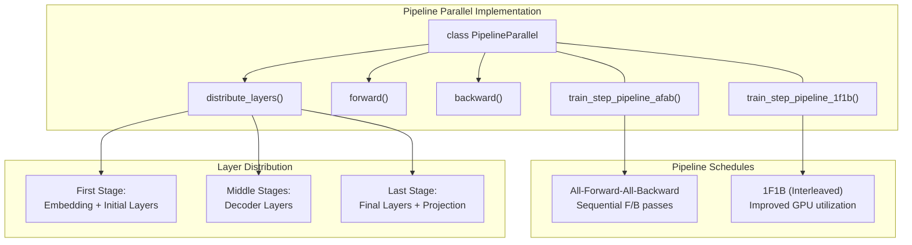

Sources: [pipeline_parallel.py:8-76](), [pipeline_parallel.py:77-214]()

### Context Parallelism (CP)

Context Parallelism splits input sequences across GPUs, allowing for processing of longer contexts than would fit on a single GPU.

**Key characteristics:**
- Input sequence is split across CP ranks
- Each rank processes a portion of the tokens
- Requires communication for attention across sequence boundaries
- Particularly useful for models with very long context lengths

## Integration of 4D Parallelism

The four dimensions of parallelism can be combined to maximize efficiency based on the training configuration. The Process Group Manager ensures that communication between various ranks is properly coordinated.

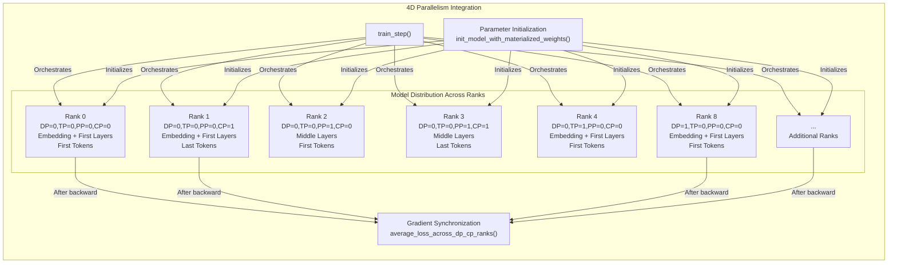

Sources: [utils.py:94-99](), [pipeline_parallel.py:77-214]()

## Parameter Counting in 4D Parallelism

The `get_num_params` function in Picotron illustrates how parameters are distributed across the different dimensions of parallelism:

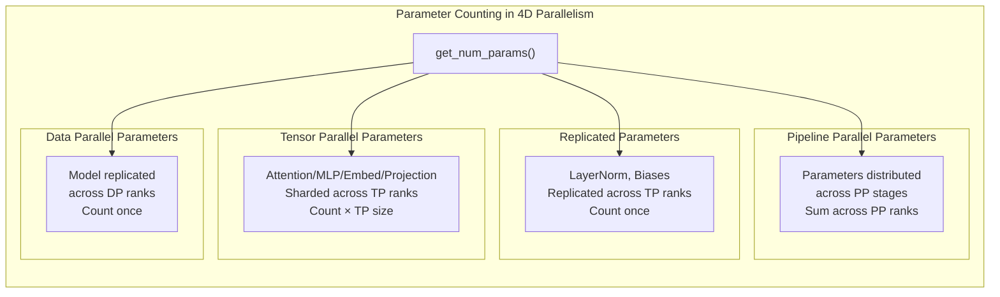

Sources: [utils.py:51-80]()

## Performance Metrics

The 4D Parallelism implementation in Picotron is measured using two key metrics:

1. **Tokens/s/GPU**: Measures throughput in terms of tokens processed per second per GPU
2. **MFU (Model FLOPs Utilization)**: Measures how efficiently the hardware's theoretical FLOP capacity is utilized

The `get_mfu` function calculates the MFU based on tokens per second, accounting for all four dimensions of parallelism.

| Parallelism Strategy | Memory Benefit | Communication Overhead | When to Use |
|----------------------|----------------|------------------------|-------------|
| Data Parallel (DP)   | None - full model on each rank | Low - gradients only | When model fits in memory and more throughput is needed |
| Tensor Parallel (TP) | ~Linear with TP size | Medium - activation transfers within layer | When individual layers are too large |
| Pipeline Parallel (PP)| ~Linear with PP size | Low - activations between stages | When model depth is significant |
| Context Parallel (CP) | ~Linear with CP size | Medium-High - attention communication | When context length is very long |
| Combined 4D          | Near-optimal with tuning | Complex - requires careful balancing | For largest models with longest contexts |

Sources: [utils.py:40-49](), [extract_metrics.py:8-23](), [extract_metrics.py:56-69]()

## Configuration and Setup

Setting up 4D Parallelism requires configuring the dimensions appropriately. In Picotron, this is done through the configuration system:

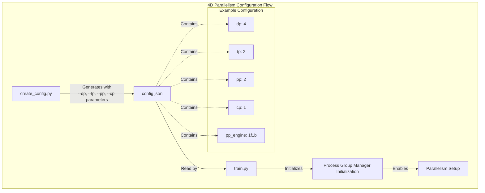

Sources: [README.md:25-47]()

## Conclusion

Picotron's 4D Parallelism design provides a comprehensive framework for distributed training of large language models. By combining Data, Tensor, Pipeline, and Context parallelism strategies, it enables efficient scaling across GPU clusters. The educational focus of the implementation makes it an excellent resource for understanding the principles of distributed deep learning at scale.

The modular design with clear separation between the different parallelism strategies allows users to configure the system according to their specific hardware setup and model requirements. This flexibility, combined with the simplicity of the codebase, makes Picotron an ideal starting point for experimenting with distributed training techniques.

Sources: [README.md:1-10](), [README.md:14-18]()

---

# Page: Training Pipeline

# Training Pipeline

<details>
<summary>Relevant source files</summary>

The following files were used as context for generating this wiki page:

- [train.py](train.py)

</details>


The Training Pipeline in Picotron orchestrates the end-to-end process of pre-training Llama-like models using 4D parallelism. This document explains the main training script and workflow, covering configuration loading, distributed environment setup, data loading, model initialization, training loop execution, optimization, and checkpoint management.

For information about the configuration system specifically, see [Configuration System](#3.1).

## Overview of the Training Pipeline

The training pipeline is implemented primarily in `train.py`, which serves as the central orchestrator for the entire training process. The pipeline handles distributed training across multiple GPUs and nodes, applying various parallelism strategies to efficiently train large language models.

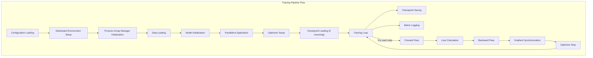

Sources: [train.py:5-56](), [train.py:57-281]()

## Pipeline Initialization

### Configuration Loading

The training pipeline begins by loading a configuration file that specifies all training parameters, model architecture, dataset details, and distributed training settings.

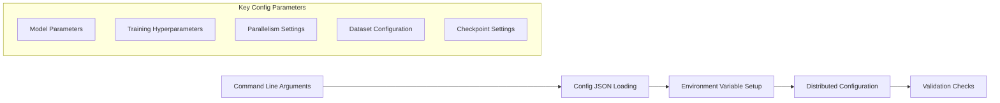

Sources: [train.py:57-77]()

### Distributed Environment Setup

The pipeline initializes the distributed training environment using PyTorch's distributed module. It sets up the backend (NCCL for GPU, Gloo for CPU) and prepares the device for each process.

```python
# Process rank and world size initialization
local_rank = int(os.environ["LOCAL_RANK"])
global_rank = int(os.environ["RANK"])
world_size = int(os.environ["WORLD_SIZE"])

# Initialize distributed process group
dist.init_process_group(rank=global_rank, world_size=world_size, backend=backend)
```

Sources: [train.py:79-94]()

### Process Group Management

A key component of the pipeline is the Process Group Manager, which organizes processes into different parallel groups:

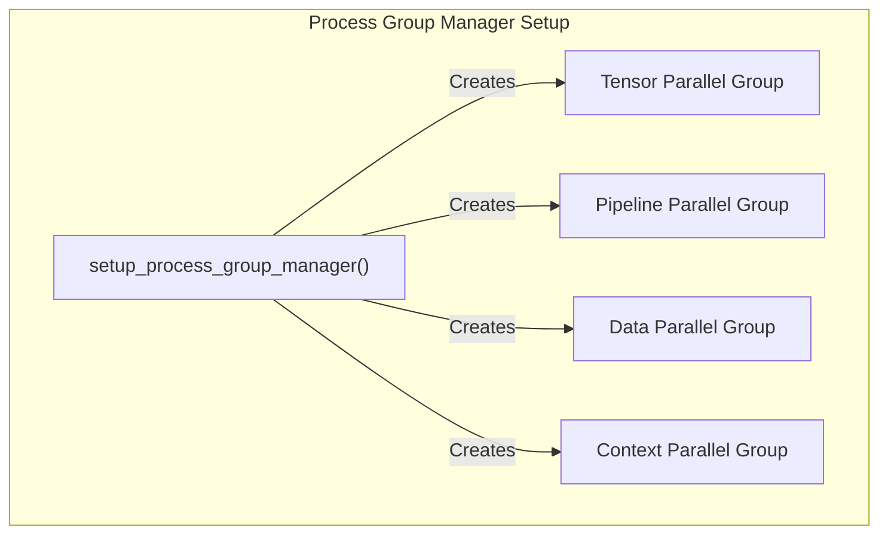

Sources: [train.py:95-102]()

## Data Loading System

The pipeline initializes a specialized `MicroBatchDataLoader` that handles:
- Breaking data into micro-batches for gradient accumulation
- Sequence length partitioning for context parallelism
- Dataset loading and tokenization
- Device placement of input tensors

```mermaid
flowchart LR
    A["MicroBatchDataLoader Initialization"] --> B["Dataset Loading"]
    B --> C["Tokenization"]
    C --> D["Micro-batch Preparation"]
    D --> E["Data Iterator Creation"]
    
    subgraph "Data Loading Parameters"
        F["micro_batch_size"]
        G["seq_length"]
        H["dataset_name"]
        I["tokenizer_name"]
        J["grad_acc_steps"]
    end
```

Sources: [train.py:105-118](), [train.py:28-55]()

## Model Creation and Parallelization

The model initialization process involves several sophisticated steps:

```mermaid
flowchart TD
    A["Load Model Config"] --> B["Initialize Model with Dematerialized Weights"]
    B --> C["Apply Tensor Parallelism"]
    C --> D["Apply Pipeline Parallelism"]
    D --> E["Materialize Weights"]
    E --> F["Apply Context Parallelism"]
    F --> G["Move to Target Device and Dtype"]
    G --> H["Apply Data Parallelism"]
```

The initialization uses a two-phase approach:
1. **Dematerialized initialization**: Creates the model structure without loading weights
2. **Materialization**: Loads and distributes weights according to the parallelism strategy

Sources: [train.py:152-194]()

## Optimization Setup

The pipeline initializes the AdamW optimizer, potentially using a fused implementation for better performance:

```python
# Optimizer initialization with potential fused implementation
extra_args = dict()
if config["model"]["use_fused_adam"]:
    fused_available = 'fused' in inspect.signature(torch.optim.AdamW).parameters
    use_fused = fused_available and device == 'cuda'
    extra_args = dict(fused=True) if use_fused else dict()

optimizer = AdamW(model.parameters(), lr=config["training"]["learning_rate"], **extra_args)
```

Sources: [train.py:201-209]()

## Checkpoint Management

The `CheckpointManager` handles loading and saving model checkpoints, enabling training to be resumed from a saved state:

```mermaid
flowchart TD
    A["Initialize CheckpointManager"] --> B{"Load Path Specified?"}
    B -->|"Yes"| C["Load Checkpoint"]
    C --> D["Resume Training"]
    B -->|"No"| D
    
    D --> E["Training Loop"]
    E --> F{"Save Interval Reached?"}
    F -->|"Yes"| G["Save Checkpoint"]
    G --> E
    F -->|"No"| E
```

Sources: [train.py:211-216](), [train.py:272-273]()

## Training Loop

The heart of the pipeline is the training loop, which iteratively processes batches, computes gradients, and updates model parameters:

### Standard vs. Pipeline-Parallel Training

The pipeline handles two distinct training modes:

```mermaid
flowchart LR
    A["Training Step"] --> B{"Pipeline Parallel?"}
    
    B -->|"No"| C["Standard Forward/Backward"]
    C --> D["train_step()"]
    
    B -->|"Yes"| E{"PP Engine Type"}
    E -->|"AFAB"| F["train_step_pipeline_afab()"]
    E -->|"1F1B"| G["train_step_pipeline_1f1b()"]
    
    D --> H["Average Loss"]
    F --> H
    G --> H
    
    H --> I["Optimizer Step"]
```

For pipeline-parallel training, the pipeline supports two scheduling algorithms:
- **1F1B**: One-Forward-One-Backward scheduling
- **AFAB**: All-Forward-All-Backward scheduling

Sources: [train.py:219-241]()

### Metrics Tracking and Logging

The training loop calculates and logs various performance metrics:

```mermaid
flowchart TD
    A["Calculate Metrics"] --> B["Loss"]
    A --> C["Tokens per Second"]
    A --> D["Tokens per Second per GPU"]
    A --> E["Model Flops Utilization (MFU)"]
    A --> F["Memory Usage"]
    
    subgraph "Logging"
        G["Console Output"]
        H["Weights & Biases"]
    end
    
    B --> G
    C --> G
    D --> G
    E --> G
    F --> G
    
    B --> H
    C --> H
    D --> H
    E --> H
    F --> H
```

Sources: [train.py:242-270]()

## Key Components and Interactions

The following diagram shows the key components of the training pipeline and their interactions:

```mermaid
graph TD
    subgraph "Training Pipeline Components"
        Train["train.py"] --> |"Uses"| Model["Llama Model"]
        Train --> |"Uses"| DataLoader["MicroBatchDataLoader"]
        Train --> |"Uses"| CheckpointMgr["CheckpointManager"]
        Train --> |"Uses"| PGM["Process Group Manager"]
        
        subgraph "Parallelism Strategies"
            TP["Tensor Parallelism"]
            PP["Pipeline Parallelism"]
            DP["Data Parallelism"]
            CP["Context Parallelism"]
        end
        
        Train --> |"Applies"| TP
        Train --> |"Applies"| PP
        Train --> |"Applies"| DP
        Train --> |"Applies"| CP
        
        Model <--> TP
        Model <--> PP
        Model <--> DP
        Model <--> CP
        
        Train --> |"Creates"| Optimizer["AdamW Optimizer"]
        Train --> |"Logs to"| WandB["Weights & Biases"]
        
        DataLoader --> |"Provides batches to"| Train
        CheckpointMgr --> |"Saves/Loads"| Model
        CheckpointMgr --> |"Saves/Loads"| Optimizer
    end
```

Sources: [train.py:5-26](), [train.py:57-281]()

## Training Pipeline Data Flow

This diagram illustrates the data flow through the training pipeline:

```mermaid
flowchart LR
    A["Dataset"] --> B["DataLoader"]
    B --> C["Input Tensors"]
    C --> D["Model Forward Pass"]
    D --> E["Loss Calculation"]
    E --> F["Backward Pass"]
    F --> G["Gradient Synchronization"]
    G --> H["Optimizer Update"]
    H --> I["Updated Model"]
    I --> |"Next Iteration"| C
    
    J["Checkpoint"] --> |"Load"| I
    I --> |"Save"| J
```

Sources: [train.py:28-55](), [train.py:219-241]()

## Pipeline Configuration Options

The training pipeline can be configured with various options from the config file:

| Configuration Category | Key Parameters | Description |
|------------------------|----------------|-------------|
| Model | `name`, `num_hidden_layers`, `num_attention_heads` | Model architecture parameters |
| Training | `learning_rate`, `max_tokens`, `seq_length`, `micro_batch_size` | Training hyperparameters |
| Distributed | `tp_size`, `pp_size`, `dp_size`, `cp_size`, `pp_engine` | Parallelism configuration |
| Checkpoint | `save_frequency`, `save_dir`, `load_path` | Checkpoint management |
| Logging | `use_wandb`, `run_name` | Metrics logging options |
| Dataset | `name`, `num_workers`, `num_proc`, `subset_name` | Data source configuration |

Sources: [train.py:57-77](), [train.py:152-166]()

## End-to-End Execution Flow

The following diagram captures the end-to-end execution flow of the training pipeline:

```mermaid
sequenceDiagram
    participant CLI as Command Line
    participant Train as train.py
    participant Config as Config File
    participant PGM as Process Group Manager
    participant Data as DataLoader
    participant Model as Llama Model
    participant Opt as Optimizer
    participant CM as Checkpoint Manager
    participant WB as Weights & Biases
    
    CLI->>Train: Start training with config path
    Train->>Config: Load configuration
    Train->>PGM: Initialize process groups
    Train->>Data: Initialize data loader
    Train->>Model: Initialize model structure
    Train->>Model: Apply parallelism strategies
    Train->>Model: Materialize weights
    Train->>Opt: Initialize optimizer
    Train->>CM: Try load checkpoint
    
    loop Training Loop
        Train->>Data: Get next batch
        Data->>Train: Return input tensors
        Train->>Model: Forward pass
        Model->>Train: Return logits
        Train->>Train: Calculate loss
        Train->>Model: Backward pass
        Train->>Opt: Step optimizer
        Train->>WB: Log metrics
        
        alt Save Checkpoint Interval
            Train->>CM: Save checkpoint
        end
        
        alt Max Tokens or Steps Reached
            Train->>Train: Exit training loop
        end
    end
    
    Train->>WB: Finish logging
    Train->>Train: Destroy process group
```

Sources: [train.py:57-281]()

In summary, the Training Pipeline in Picotron is a sophisticated system that orchestrates the entire training process for large language models. It leverages 4D parallelism to efficiently distribute computation across multiple devices, handles data loading and preprocessing, manages model initialization and optimization, and provides checkpointing and logging capabilities.

---

# Page: Configuration System

# Configuration System

<details>
<summary>Relevant source files</summary>

The following files were used as context for generating this wiki page:

- [create_config.py](create_config.py)
- [template/base_config.json](template/base_config.json)

</details>


## Purpose and Scope

The Configuration System in Picotron is responsible for creating, managing, and applying configuration files that define all aspects of the training process. This system provides a structured way to specify model architecture, parallelism strategies, training hyperparameters, dataset options, and environment settings in a centralized JSON configuration file.

This page focuses on how configurations are created and structured. For information about how configurations are used in the training pipeline, see [Training Pipeline](#3).

## Configuration System Overview

The configuration system consists of two main components:
1. A base configuration template (`template/base_config.json`)
2. A configuration creation script (`create_config.py`)

These components work together to generate customized configuration files that control Picotron's training behavior.

```mermaid
flowchart TD
    subgraph "Configuration System"
        BaseConfig["base_config.json\n(Template)"]
        CreateConfig["create_config.py\n(Generator)"]
        ConfigFile["config.json\n(Generated Config)"]
        ModelConfig["HuggingFace\nModel Config"]
        
        BaseConfig --> |"Used as template"| CreateConfig
        ModelConfig --> |"Provides model parameters"| CreateConfig
        CreateConfig --> |"Generates"| ConfigFile
    end
    
    subgraph "Training System"
        Train["train.py\n(Training Script)"]
    end
    
    ConfigFile --> |"Controls"| Train
    
    UserArgs["User Command-line\nArguments"] --> CreateConfig
```

Sources: [create_config.py:10-42](), [template/base_config.json:1-52]()

## Configuration File Structure

The configuration file is organized into several sections, each controlling a different aspect of the training process:

```mermaid
classDiagram
    class "config.json" {
        distributed
        model
        training
        dataset
        checkpoint
        logging
        environment
    }
    
    class "distributed" {
        tp_size: int
        cp_size: int
        pp_size: int
        dp_size: int
        pp_engine: string
        backend: string
        use_cpu: boolean
    }
    
    class "model" {
        name: string
        num_hidden_layers: int
        num_attention_heads: int
        num_key_value_heads: int
        dtype: string
        use_flash_attention: boolean
        use_fused_adam: boolean
    }
    
    class "training" {
        seed: int
        learning_rate: float
        total_train_steps: int
        seq_length: int
        micro_batch_size: int
        gradient_accumulation_steps: int
        num_samples: int
        max_tokens: int|null
    }
    
    class "dataset" {
        name: string
        subset_name: string|null
        num_workers: int
        num_proc: int
    }
    
    class "checkpoint" {
        save_dir: string
        save_frequency: int
        load_path: string
    }
    
    class "logging" {
        use_wandb: boolean
        project_name: string
        run_name: string|null
    }
    
    class "environment" {
        OMP_NUM_THREADS: string
        TOKENIZERS_PARALLELISM: string
        FLASH_ATTEN: string
        HF_TOKEN: string|null
    }
    
    "config.json" --> "distributed"
    "config.json" --> "model"
    "config.json" --> "training"
    "config.json" --> "dataset"
    "config.json" --> "checkpoint"
    "config.json" --> "logging"
    "config.json" --> "environment"
```

Sources: [template/base_config.json:1-52]()

### Section Details

| Section | Purpose | Key Fields |
|---------|---------|------------|
| `distributed` | Defines parallelism settings | `tp_size`, `cp_size`, `pp_size`, `dp_size`, `pp_engine`, `backend` |
| `model` | Specifies model architecture | `name`, `num_hidden_layers`, `num_attention_heads`, `num_key_value_heads` |
| `training` | Controls training hyperparameters | `learning_rate`, `total_train_steps`, `seq_length`, `micro_batch_size` |
| `dataset` | Configures training dataset | `name`, `subset_name`, `num_workers`, `num_proc` |
| `checkpoint` | Manages checkpointing behavior | `save_dir`, `save_frequency`, `load_path` |
| `logging` | Sets up logging options | `use_wandb`, `project_name`, `run_name` |
| `environment` | Defines environment variables | `OMP_NUM_THREADS`, `TOKENIZERS_PARALLELISM`, `FLASH_ATTEN` |

Sources: [template/base_config.json:1-52]()

## Creating Configurations

### Using `create_config.py`

The `create_config.py` script is the primary tool for generating configuration files. It takes command-line arguments that specify training parameters, reads the base configuration template, modifies it according to the provided arguments, and writes the resulting configuration to a JSON file.

```mermaid
flowchart LR
    subgraph "create_config.py Workflow"
        direction LR
        Args["Parse Command-line\nArguments"] --> LoadBase["Load Base Config\nfrom Template"]
        LoadBase --> FetchModelConfig["Fetch Model Config\nfrom Hugging Face"]
        FetchModelConfig --> ModifyConfig["Modify Config\nwith User Arguments"]
        ModifyConfig --> CalculateGBS["Calculate Global\nBatch Size"]
        CalculateGBS --> SaveConfig["Save Config\nto output directory"]
        SaveConfig --> DownloadModel["Download Model\nSafeTensors files"]
    end
```

Sources: [create_config.py:14-137]()

### Key Parameters and Default Values

The configuration script supports numerous parameters to customize the training process:

#### Parallelism Settings
- `--tp`: Tensor parallelism size (default: 1)
- `--cp`: Context parallelism size (default: 1)
- `--dp`: Data parallelism size (default: 1)
- `--pp`: Pipeline parallelism size (default: 1)
- `--pp_engine`: Pipeline parallel engine (default: "1f1b")

#### Model Configuration
- `--model_name`: HuggingFace model name (default: "HuggingFaceTB/SmolLM-360M-Instruct")
- `--num_hidden_layers`: Number of transformer layers (default: fetched from model config)
- `--num_attention_heads`: Number of attention heads (default: fetched from model config)
- `--num_key_value_heads`: Number of key-value heads for grouped-query attention (default: fetched from model config)

#### Training Parameters
- `--grad_acc_steps`: Gradient accumulation steps (default: 1)
- `--mbs`: Micro batch size (default: 1)
- `--seq_len`: Sequence length (default: 1024)

#### Other Settings
- `--out_dir`: Output directory for configuration (default: "tmp")
- `--exp_name`: Experiment name (default: "dummy_exp")
- `--subset_name`: Dataset subset name (default: None)
- `--use_wandb`: Enable Weights & Biases logging (flag)
- `--use_cpu`: Use CPU for training instead of GPU (flag)
- `--use_fused_adam`: Use fused Adam optimizer (flag)
- `--hf_token`: HuggingFace API token (optional)

Sources: [create_config.py:87-106]()

### Example Usage

To create a configuration for a training run with 2-way tensor parallelism, 2-way pipeline parallelism, and a custom model:

```
python create_config.py \
    --out_dir experiments \
    --exp_name tp2_pp2_test \
    --tp 2 \
    --pp 2 \
    --model_name meta-llama/Llama-2-7b \
    --mbs 8 \
    --seq_len 2048 \
    --grad_acc_steps 4 \
    --use_wandb
```

This will:
1. Create a directory at `experiments/tp2_pp2_test/`
2. Generate a `config.json` file in that directory with the specified settings
3. Download the model safetensors files for later use in training

Sources: [create_config.py:3-4](), [create_config.py:108-136]()

## Configuration Creation Process

The configuration creation process follows these steps:

1. **Load Base Template**: The script starts by loading the base configuration template from `template/base_config.json`.

2. **Apply Model Configuration**: 
   - The script fetches the model configuration from HuggingFace using `AutoConfig.from_pretrained()`
   - Model parameters like number of layers and attention heads are either taken from the HuggingFace config or overridden by user arguments

3. **Set Distributed Training Parameters**:
   - Tensor Parallelism (TP) size
   - Context Parallelism (CP) size
   - Data Parallelism (DP) size
   - Pipeline Parallelism (PP) size
   - Pipeline parallel engine type

4. **Configure Training Settings**:
   - Micro batch size
   - Gradient accumulation steps
   - Sequence length
   - Global batch size is calculated as: `dp * mbs * grad_acc_steps`

5. **Set Other Parameters**:
   - Experiment name
   - Output directory
   - Wandb logging options
   - CPU/GPU training mode
   - Environment variables

6. **Save Configuration**: The final configuration is saved as a JSON file at the specified location.

7. **Download Model Files**: The script downloads the model safetensors files for use during training.

Sources: [create_config.py:14-136]()

## Integration with Training Pipeline

Once created, the configuration file serves as the central control point for the training process. The main training script (`train.py`) reads this configuration to set up all aspects of the training run:

```mermaid
flowchart TD
    ConfigFile["config.json"] --> TrainScript["train.py"]
    
    subgraph "Configuration Controls"
        TrainScript --> SetupDistributed["Setup Distributed Environment\n(tp_size, pp_size, etc.)"]
        TrainScript --> InitializeModel["Initialize Model\n(model_name, num_layers, etc.)"]
        TrainScript --> ConfigureTraining["Configure Training\n(batch_size, learning_rate, etc.)"]
        TrainScript --> SetupDataLoader["Setup Data Loader\n(dataset name, seq_length, etc.)"]
        TrainScript --> ManageCheckpoints["Manage Checkpoints\n(save_dir, frequency, etc.)"]
        TrainScript --> ConfigureLogging["Configure Logging\n(use_wandb, run_name, etc.)"]
    end
```

Sources: [create_config.py:42-69](), [template/base_config.json:2-51]()

## Relationship to Parallelism Strategies

The configuration system plays a crucial role in setting up Picotron's 4D parallelism approach:

| Parallelism Type | Configuration Parameter | Description |
|------------------|-------------------------|-------------|
| Tensor Parallelism | `distributed.tp_size` | Number of devices to split model tensors across |
| Context Parallelism | `distributed.cp_size` | Number of devices to split sequences across |
| Data Parallelism | `distributed.dp_size` | Number of model replicas processing different data |
| Pipeline Parallelism | `distributed.pp_size` | Number of devices to split model layers across |

For more details on how these parallelism strategies are implemented, see [4D Parallelism Design](#2.1).

Sources: [template/base_config.json:2-10](), [create_config.py:58-62]()

## Summary

The Configuration System in Picotron provides a flexible and comprehensive way to specify all parameters needed for distributed training of large language models. By centralizing configuration in a single JSON file, the system enables:

1. Easy experimentation with different model architectures and training setups
2. Consistent configuration across distributed processes
3. Simple version control of training parameters
4. Streamlined automation of training runs

The system's design reflects the need to handle multiple aspects of large-scale distributed training, from model architecture details to parallelism strategies and environment settings.

---

# Page: Data Loading and Processing

# Data Loading and Processing

<details>
<summary>Relevant source files</summary>

The following files were used as context for generating this wiki page:

- [picotron/data.py](picotron/data.py)
- [tests/test_dataloader.py](tests/test_dataloader.py)

</details>


## Purpose and Scope

This document describes the data loading and processing system in Picotron, which is responsible for fetching, tokenizing, and preparing training data for large language models in a distributed training environment. The system is designed specifically to support Picotron's 4D parallelism approach, with special handling for context parallelism where input sequences are split across devices.

For information about how this system integrates with the broader training pipeline, see [Training Pipeline](#3).

Sources: [picotron/data.py:1-137]()

## System Overview

The data loading system in Picotron is built around the `MicroBatchDataLoader` class, which extends PyTorch's native `DataLoader`. It incorporates support for Hugging Face datasets and tokenizers while adding specialized functionality for distributed training scenarios.

```mermaid
flowchart TD
    subgraph "Data Loading System"
        A["MicroBatchDataLoader"]
        B["HuggingFace Datasets"]
        C["HuggingFace Tokenizer"]
        D["Distributed Sampling"]
        E["Context Parallel Splitting"]
        
        B --> |"load_dataset()"| A
        C --> |"tokenize_dataset()"| A
        A --> |"sets up"| D
        A --> |"implements"| E
    end
    
    subgraph "External Components"
        F["Process Group Manager"]
        G["Training Loop"]
        
        F --> |"provides rank info"| A
        A --> |"yields batches"| G
    end
    
    style A stroke-width:2px
```

Sources: [picotron/data.py:12-137]()

## Data Loading Architecture

The `MicroBatchDataLoader` handles the entire data pipeline, from loading raw text data to producing batched, tokenized, and properly distributed sequences for model training.

```mermaid
sequenceDiagram
    participant Train as "train.py"
    participant DataLoader as "MicroBatchDataLoader"
    participant Dataset as "HuggingFace Dataset"
    participant Tokenizer as "HuggingFace Tokenizer"
    participant PGM as "Process Group Manager"
    
    Train->>DataLoader: initialize(dataset_name, tokenizer_name, etc.)
    DataLoader->>PGM: get dp_world_size, cp_world_size, dp_rank, cp_rank
    DataLoader->>Dataset: load_dataset(dataset_name)
    DataLoader->>Tokenizer: load and broadcast to all ranks
    DataLoader->>Dataset: tokenize_dataset(tokenizer, seq_length)
    DataLoader->>DataLoader: create DistributedSampler
    
    loop Training
        Train->>DataLoader: next()
        DataLoader->>Dataset: get batch of samples
        DataLoader->>DataLoader: collate_batch(samples)
        DataLoader->>DataLoader: split for context parallelism
        DataLoader-->>Train: return processed batch
    end
```

Sources: [picotron/data.py:12-55](), [picotron/data.py:118-137]()

## Key Components

### Dataset Loading

The system uses Hugging Face's `load_dataset` function to fetch the training data. This provides access to a wide range of public datasets, with flexibility to specify particular subsets and splits.

```python
self.dataset = load_dataset(dataset_name, split=split, name=subset_name)
```

If `num_samples` is specified, the dataset is truncated to that size, which is useful for debugging or small-scale experiments.

Sources: [picotron/data.py:21-35]()

### Tokenization Process

The tokenization process consists of two main parts:

1. **Tokenizer Creation**: A tokenizer is created on rank 0 and broadcast to all other ranks to ensure consistency across distributed processes.

2. **Dataset Tokenization**: The dataset is tokenized and chunked into segments of length `sequence_length + 1` (the extra token is used for the target in the next step).

```mermaid
flowchart TB
    A["Raw Text Dataset"] --> B["Tokenizer"]
    B --> C["Token IDs"]
    C --> D["Chunking"]
    D --> E["Tokenized Dataset"]
    
    subgraph "tokenizer_group_text function"
        B
        C
        D
    end
    
    subgraph "tokenize_dataset method"
        F["Map function"]
        G["Feature specification"]
        H["Batched processing"]
        
        F --> G
        G --> H
    end
    
    E --> I["DistributedSampler"]
    I --> J["DataLoader Batches"]
```

Sources: [picotron/data.py:57-100]()

### Batch Collation

The `collate_batch` method transforms raw tokenized samples into the format expected by the model:

1. Stacks individual samples into batches
2. Splits sequences according to context parallelism rank
3. Prepares input IDs, target IDs (shifted by one position), and position IDs
4. Returns a structured dictionary with all necessary tensors

Sources: [picotron/data.py:102-116]()

## Data Distribution and Parallelism

### Data Parallelism

The system implements data parallelism using PyTorch's `DistributedSampler`, which ensures that:

1. Each data-parallel rank receives a unique subset of the data
2. The entire dataset is processed across all ranks
3. No sample is processed more than once per epoch

```python
self.sampler = DistributedSampler(
    self.tokenized_dataset, 
    num_replicas=pgm.process_group_manager.dp_world_size, 
    rank=pgm.process_group_manager.dp_rank, 
    shuffle=False
)
```

Sources: [picotron/data.py:40-45]()

### Context Parallelism

A key feature of this dataloader is its support for context parallelism, where input sequences are split across multiple devices:

```mermaid
flowchart LR
    subgraph "Original Sequence (length=8)"
        OS["Tokens [0,1,2,3,4,5,6,7]"]
    end
    
    OS --> Split["Split by CP_size=2"]
    
    subgraph "CP Rank 0"
        CP0["Tokens [0,1,2,3]"]
    end
    
    subgraph "CP Rank 1"
        CP1["Tokens [4,5,6,7]"]
    end
    
    Split --> CP0
    Split --> CP1
    
    CP0 --> T0["Input: [0,1,2,3]<br>Target: [1,2,3,4]"]
    CP1 --> T1["Input: [4,5,6,7]<br>Target: [5,6,7,8]"]
```

The sequence is split as follows:

1. Calculate `seq_length_per_gpu = seq_length // cp_world_size`
2. Determine start and end indices based on the context parallel rank
3. Extract the corresponding portion of the input sequence
4. Create target IDs by shifting the sequence by one position

Sources: [picotron/data.py:20](), [picotron/data.py:102-116](), [tests/test_dataloader.py:136-179]()

## Batch Structure and Format

Each batch returned by the dataloader is a dictionary with the following structure:

| Key | Shape | Description |
|-----|-------|-------------|
| `input_ids` | `[batch_size, seq_length_per_gpu]` | Token IDs for model input |
| `target_ids` | `[batch_size, seq_length_per_gpu]` | Token IDs for prediction targets (shifted by 1) |
| `position_ids` | `[batch_size, seq_length_per_gpu]` | Position embeddings indices |
| `hidden_states` | `None` | Placeholder for pipeline parallelism |

The positional encoding is adjusted based on the context parallel rank:

```python
position_ids = torch.arange(start_idx, end_idx, dtype=torch.long).unsqueeze(0).expand(batch_size, -1).contiguous()
```

This ensures that each device "knows" the absolute positions within the full sequence despite only processing a portion of it.

Sources: [picotron/data.py:102-116]()

## Continuous Training Loop

The dataloader implements an "infinite iterator" pattern by overriding the `__next__` method. When the dataset is exhausted, it:

1. Resets the epoch counter in the sampler
2. Reinitializes the iterator
3. Continues providing batches

This feature enables continuous training without manual epoch management in the training loop.

```mermaid
stateDiagram-v2
    [*] --> Initialize
    Initialize --> GetBatch
    GetBatch --> CheckIteration
    
    state CheckIteration {
        [*] --> HasMore
        HasMore --> ReturnBatch
        HasMore --> NoMore
        NoMore --> IncrementEpoch
        IncrementEpoch --> ResetIterator
        ResetIterator --> ReturnBatch
    }
    
    ReturnBatch --> GetBatch
```

Sources: [picotron/data.py:118-137](), [tests/test_dataloader.py:181-211]()

## Integration with Training Pipeline

The dataloader integrates with the broader training system in the following ways:

1. **Process Group Manager**: Uses the process group manager to determine parallel world sizes and ranks
2. **Batch Size Calculation**: Computes the global batch size based on micro batch size, gradient accumulation steps, and data parallel world size
3. **Device Handling**: Ensures proper device placement of tensors for efficient processing

```mermaid
flowchart LR
    subgraph "Training Pipeline"
        TP["train.py"]
    end
    
    subgraph "Data Loading"
        DL["MicroBatchDataLoader"]
    end
    
    subgraph "Parallelism Management"
        PGM["process_group_manager"]
    end
    
    subgraph "External Resources"
        HFD["HuggingFace Datasets"]
        HFT["HuggingFace Tokenizer"]
    end
    
    TP -->|"creates"| DL
    PGM -->|"provides ranks<br>& world sizes"| DL
    HFD -->|"provides data"| DL
    HFT -->|"tokenizes text"| DL
    DL -->|"yields batches"| TP
```

Sources: [picotron/data.py:10-19]()

## Performance Considerations

The dataloader implementation includes several performance optimizations:

1. **Tokenizer Broadcasting**: Creates the tokenizer only on rank 0 and broadcasts it to other ranks to avoid redundant loading
2. **Caching**: Uses Hugging Face's caching system with `load_from_cache_file=True`
3. **Parallel Processing**: Supports multi-process tokenization via the `num_proc` parameter
4. **Pin Memory**: Optional pinned memory for faster CPU to GPU transfers
5. **Workers**: Configurable number of worker processes via the `num_workers` parameter

Sources: [picotron/data.py:23-32](), [picotron/data.py:95-98]()

---

# Page: Checkpoint Management

# Checkpoint Management

<details>
<summary>Relevant source files</summary>

The following files were used as context for generating this wiki page:

- [picotron/checkpoint.py](picotron/checkpoint.py)

</details>


## Purpose and Scope

This document details Picotron's checkpoint management system, which handles initializing models with pre-trained weights, saving training progress, and resuming from previous training checkpoints in a distributed training environment. This system is specifically designed to work with Picotron's 4D parallelism strategies (Tensor, Pipeline, Data, and Context parallelism) and ensures efficient distribution of model parameters across multiple devices.

For information about the overall training pipeline, see [Training Pipeline](#3.0), and for details on the various parallelism strategies, see [Parallelism Implementations](#5.0).

## Architecture Overview

The checkpoint management system in Picotron has three main components:

```mermaid
classDiagram
    class CheckpointManager {
        -tp_rank
        -pp_rank
        -tp_world_size
        -pp_world_size
        -cp_dp_world_size
        -dp_rank
        -cp_rank
        +save_checkpoint()
        +load_checkpoint()
        -_get_checkpoint_path()
    }
    
    class InitializationManager {
        -model
        -model_config
        +init_model_parameters()
        +get_layer_names_in_sft_format()
        +adjust_tensor_size()
        +convert_safetensors_to_hf_name()
    }
    
    class ContextManagers {
        +init_model_with_dematerialized_weights()
        +init_model_with_materialized_weights()
    }
    
    ContextManagers --> InitializationManager : uses
    ContextManagers --> CheckpointManager : complements
```

Sources: [picotron/checkpoint.py:243-289](), [picotron/checkpoint.py:115-241](), [picotron/checkpoint.py:17-113]()

## Model Initialization

Picotron provides two approaches for model initialization:

### Dematerialized Initialization

This approach creates model structures without allocating memory for weights, using meta tensors. This is useful for initial model setup before loading actual weights.

```mermaid
flowchart TD
    A["init_model_with_dematerialized_weights()"] --> B["Override nn.Module.register_parameter"]
    B --> C["Create model with meta tensors"]
    C --> D["Model structure exists without actual weights"]
    D --> E["Ready for materialized weights"]
```

Sources: [picotron/checkpoint.py:17-49]()

### Materialized Initialization

This approach loads actual weights from safetensors files, with proper tensor sharding for distributed training.

```mermaid
flowchart TD
    A["init_model_with_materialized_weights()"] --> B["Create InitializationManager"]
    B --> C["Get layer names for current rank"]
    C --> D{"Is checkpoint sharded?"}
    D -->|Yes| E["Load from sharded files"]
    D -->|No| F["Load from single file"]
    E --> G["Adjust tensor sizes for parallelism"]
    F --> G
    G --> H["Load state dict into model"]
    H --> I["Initialize model parameters"]
```

Sources: [picotron/checkpoint.py:51-113]()

## Tensor Sharding and Distribution

The `InitializationManager` handles tensor size adjustments and distribution across multiple devices based on the parallelism configuration.

```mermaid
graph TD
    subgraph "Layer Distribution"
        A["get_layer_names_in_sft_format()"] --> B{"Pipeline Parallel?"}
        B -->|Yes| C["Get layers for current PP stage"]
        B -->|No| D["Get all layers"]
        C --> E["Add embedding if first stage"]
        C --> F["Add norm if last stage"]
        D --> G["Add all components"]
    end

    subgraph "Tensor Adjustment"
        AA["adjust_tensor_size()"] --> BB{"Tensor type?"}
        BB -->|"Embedding/Final Proj"| CC["Shard vocabulary dimension"]
        BB -->|"Attention Layers"| DD["Shard based on attention heads"]
        BB -->|"MLP Layers"| EE["Shard intermediate dimensions"]
    end
```

Sources: [picotron/checkpoint.py:124-158](), [picotron/checkpoint.py:161-222]()

## Checkpoint Operations

### Saving Checkpoints

The `CheckpointManager` handles saving model state, optimizer state, and training progress information to disk. Only specific ranks (DP and CP rank 0) save checkpoints to avoid redundancy.

```mermaid
sequenceDiagram
    participant Train as "train.py"
    participant CM as "CheckpointManager"
    participant FS as "File System"
    
    Train->>CM: "save_checkpoint(model, optimizer, steps, tokens, dir)"
    CM->>CM: "_get_checkpoint_path(dir)"
    Note over CM: Check if DP and CP rank is 0
    CM->>CM: "Extract raw model from DDP wrapper if needed" 
    CM->>CM: "Create checkpoint dictionary"
    CM->>FS: "torch.save(checkpoint, path)"
```

Sources: [picotron/checkpoint.py:257-272]()

### Loading Checkpoints

When resuming training, the `CheckpointManager` loads model and optimizer states from checkpoint files and returns training progress information.

```mermaid
sequenceDiagram
    participant Train as "train.py"
    participant CM as "CheckpointManager"
    participant FS as "File System"
    
    Train->>CM: "load_checkpoint(model, optimizer, dir)"
    CM->>CM: "_get_checkpoint_path(dir)"
    CM->>FS: "Check if checkpoint exists"
    FS-->>CM: "Return checkpoint file"
    CM->>CM: "torch.load(path)"
    CM->>CM: "Extract raw model from DDP wrapper if needed"
    CM->>CM: "Load model state dict"
    CM->>CM: "Load optimizer state dict"
    CM-->>Train: "Return trained_steps, trained_tokens"
```

Sources: [picotron/checkpoint.py:273-289]()

## Checkpoint File Structure

Checkpoint files are named to encode the parallelism configuration, ensuring each rank loads the correct weights when resuming training.

```
output_dir/
  ├── weights_tp_rank_world_size=0_4_pp_rank_world_size=0_2.pth
  ├── weights_tp_rank_world_size=1_4_pp_rank_world_size=0_2.pth
  ├── weights_tp_rank_world_size=2_4_pp_rank_world_size=0_2.pth
  ├── weights_tp_rank_world_size=3_4_pp_rank_world_size=0_2.pth
  ├── weights_tp_rank_world_size=0_4_pp_rank_world_size=1_2.pth
  ├── weights_tp_rank_world_size=1_4_pp_rank_world_size=1_2.pth
  ├── weights_tp_rank_world_size=2_4_pp_rank_world_size=1_2.pth
  └── weights_tp_rank_world_size=3_4_pp_rank_world_size=1_2.pth
```

Each checkpoint file contains:
- Model state dictionary
- Optimizer state dictionary
- Number of trained steps
- Number of trained tokens

Sources: [picotron/checkpoint.py:254-255](), [picotron/checkpoint.py:265-270]()

## Integration with Parallelism

The checkpoint system integrates with Picotron's process group manager to understand the distributed training setup. Different components handle special cases for each parallelism strategy:

```mermaid
graph TD
    subgraph "Process Group Manager Integration"
        A["pgm.process_group_manager"] --> B["tp_rank, tp_world_size"]
        A --> C["pp_rank, pp_world_size"]
        A --> D["dp_rank, cp_rank"]
        A --> E["cp_dp_world_size"]
    end
    
    subgraph "Parallelism-specific Handling"
        F["Tensor Parallelism"] --> G["Shard model weights"]
        H["Pipeline Parallelism"] --> I["Distribute model layers"]
        J["Data Parallelism"] --> K["Only rank 0 saves checkpoint"]
        L["Context Parallelism"] --> M["Only rank 0 saves checkpoint"]
    end
```

Sources: [picotron/checkpoint.py:243-252](), [picotron/checkpoint.py:90-102]()

## Safetensors and Model Format Conversion

Picotron supports loading pre-trained weights from safetensors format and converts between safetensors naming convention and Picotron's internal naming convention.

```mermaid
flowchart LR
    A["Safetensors Name"] --> B["convert_safetensors_to_hf_name()"]
    B --> C["Picotron Internal Name"]
    
    subgraph "Examples"
        D["model.layers.0.self_attn.q_proj.weight"] --> E["decoder_layers.0.attention.q_proj.weight"]
        F["model.embed_tokens.weight"] --> G["embedding.weight"]
        H["model.norm.weight"] --> I["final_norm.weight"]
    end
```

Sources: [picotron/checkpoint.py:224-241]()

## Usage in Training Pipeline

The checkpoint management system is used in the training pipeline to initialize models with pre-trained weights, save checkpoints at regular intervals, and resume training from previous checkpoints.

```mermaid
sequenceDiagram
    participant train as "train.py"
    participant init as "Initialization"
    participant cm as "CheckpointManager"
    
    train->>init: "Initialize model architecture"
    Note over init: Create model with dematerialized weights
    
    alt Loading from pre-trained
        train->>init: "init_model_with_materialized_weights()"
        init->>init: "Load weights from safetensors"
    else No pre-trained weights
        train->>init: "Initialize randomly"
    end
    
    Note over train: Begin training loop
    
    loop Training Steps
        train->>train: "Train batch"
        alt Save checkpoint interval
            train->>cm: "save_checkpoint()"
        end
    end
```

Sources: [picotron/checkpoint.py:17-113](), [picotron/checkpoint.py:257-272]()

## Special Considerations

### Handling Final Projection Layer

The checkpoint system includes special handling for the final projection layer (lm_head), ensuring proper initialization for both tensor-parallel and non-tensor-parallel setups.

```python
# For TP>1, initialize with sharded size
if pgm.process_group_manager.tp_world_size > 1:
    vocab_per_rank = vocab_size // pgm.process_group_manager.tp_world_size
    state_dict['final_proj.weight'] = torch.zeros(vocab_per_rank, model_config.hidden_size)
# For TP=1, create the full layer
else:
    model.final_proj = FinalProjection(model_config.hidden_size, vocab_size, bias=False)
    state_dict['final_proj.weight'] = torch.zeros(vocab_size, model_config.hidden_size)
```

Sources: [picotron/checkpoint.py:90-102]()

---

# Page: Model Architecture

# Model Architecture

<details>
<summary>Relevant source files</summary>

The following files were used as context for generating this wiki page:

- [picotron/model.py](picotron/model.py)

</details>


## Purpose and Scope

This document details the model architecture implemented in Picotron, specifically focusing on the Llama-like transformer model. It covers the key components, their interactions, and the implementation details of the model architecture. For information about parallelism strategies applied to this model, see [Parallelism Implementations](#5).

## Overview

Picotron implements a Llama-style decoder-only transformer architecture, designed for efficient distributed training using 4D parallelism. The model follows the standard transformer architecture with modifications like RMSNorm instead of LayerNorm and SwiGLU activation in the MLP blocks.

```mermaid
flowchart TD
    subgraph "Llama Model"
        input["Input Tokens"] --> embed["Embedding Layer"]
        embed --> blocks["Decoder Blocks (N layers)"]
        blocks --> norm["Final RMSNorm"]
        norm --> proj["Final Projection"]
        proj --> output["Output Logits"]
    end

    subgraph "Decoder Block Structure"
        inBlock["Block Input"] --> norm1["RMSNorm"]
        norm1 --> attn["Self-Attention"]
        attn --> add1["Residual Connection"]
        add1 --> norm2["RMSNorm"]
        norm2 --> mlp["MLP (SwiGLU)"]
        mlp --> add2["Residual Connection"]
        add2 --> outBlock["Block Output"]
    end
```

Sources: [picotron/model.py:253-298]()

## Core Components

### Llama Class

The main model class is `Llama`, which orchestrates the entire architecture. It initializes and connects all components including the embedding layer, decoder layers, and final projection. The model follows a straightforward forward pass, processing input through embeddings, transformer layers, and finally projecting to vocabulary space.

```mermaid
classDiagram
    class Llama {
        +embedding: Embedding
        +decoder_layers: ModuleList[DecoderLayer]
        +final_norm: RMSNorm
        +final_proj: FinalProjection
        +forward(input_ids, attention_mask, position_ids)
    }
    
    Llama --> Embedding
    Llama --> "1..N" DecoderLayer
    Llama --> RMSNorm
    Llama --> FinalProjection
    
    class DecoderLayer {
        +input_layernorm: RMSNorm
        +post_attention_layernorm: RMSNorm
        +attention: Attention
        +mlp: MLP
        +cos, sin: RoPE parameters
        +forward(x, attention_mask, position_ids)
    }
    
    class Attention {
        +q_proj: Linear
        +k_proj: Linear
        +v_proj: Linear
        +out_proj: Linear
        +forward(x, cos, sin, attention_mask, position_ids)
    }
    
    class MLP {
        +up_proj: Linear
        +gate_proj: Linear
        +down_proj: Linear
        +forward(x)
    }
```

Sources: [picotron/model.py:253-298]()

### Embedding Layer

The `Embedding` class handles token embedding, converting input token IDs to embedding vectors. It's a simple wrapper around PyTorch's embedding functionality.

```python
# Input: [batch_size, seq_length] tensor of token indices
# Output: [batch_size, seq_length, hidden_size] tensor of embeddings
```

Sources: [picotron/model.py:237-251]()

### Decoder Layer

The `DecoderLayer` class implements a single transformer block with the following structure:
1. Input → RMSNorm → Attention
2. Residual connection (add attention output to input)
3. RMSNorm → MLP
4. Residual connection (add MLP output to previous step)

Each decoder layer maintains its own rotary position embeddings (RoPE) parameters.

Sources: [picotron/model.py:214-235]()

### Attention Mechanism

The `Attention` class implements multi-head attention with several key features:
- Support for grouped-query attention (where num_key_value_heads ≤ num_attention_heads)
- Rotary position embeddings (RoPE)
- Support for multiple attention backends:
  - Flash Attention (default)
  - PyTorch's scaled dot-product attention
  - Context-parallel ring attention

```mermaid
flowchart LR
    input["Hidden States\n[batch, seq_len, hidden]"] --> qproj["Query Projection\n[batch, seq_len, num_heads*head_dim]"]
    input --> kproj["Key Projection\n[batch, seq_len, num_kv_heads*head_dim]"]
    input --> vproj["Value Projection\n[batch, seq_len, num_kv_heads*head_dim]"]
    
    qproj --> reshape1["Reshape\n[batch, num_heads, seq_len, head_dim]"]
    kproj --> reshape2["Reshape\n[batch, num_kv_heads, seq_len, head_dim]"]
    vproj --> reshape3["Reshape\n[batch, num_kv_heads, seq_len, head_dim]"]
    
    reshape1 --> rope1["Apply RoPE"]
    reshape2 --> rope2["Apply RoPE"]
    
    rope1 --> repeat1["Query"]
    rope2 --> repeat2["Key"]
    reshape3 --> repeat3["Value"]
    
    repeat2 --> repeat_kv["Repeat KV heads\nfor grouped-query attention"]
    repeat3 --> repeat_kv
    
    repeat1 --> attn["Attention\n(Flash/PyTorch/Context-Parallel)"]
    repeat_kv --> attn
    
    attn --> reshape4["Reshape\n[batch, seq_len, num_heads*head_dim]"]
    reshape4 --> outproj["Output Projection\n[batch, seq_len, hidden]"]
```

Sources: [picotron/model.py:88-162]()

### MLP Block

The `MLP` class implements a feed-forward network using SwiGLU activation:
1. Two parallel projections: gate projection and up projection
2. SiLU activation applied to gate projection
3. Element-wise multiplication with up projection
4. Down projection to hidden dimension

```python
# SwiGLU implementation
down_proj(silu(gate_proj(x)) * up_proj(x))
```

Sources: [picotron/model.py:164-186]()

### Normalization Layers

The model uses RMSNorm (Root Mean Square Layer Normalization) instead of the standard LayerNorm. Two implementations are available:
- `LlamaRMSNorm`: Standard implementation 
- `TritonRMSNorm`: Optimized implementation using Triton kernels

RMSNorm normalizes by the root mean square of the inputs, which is computationally more efficient than LayerNorm.

Sources: [picotron/model.py:39-86]()

### Final Projection

The `FinalProjection` class handles the final linear projection from hidden states to vocabulary logits. It's essentially a linear layer that maps from hidden dimension to vocabulary size.

Sources: [picotron/model.py:188-212]()

## Model Forward Pass

The forward pass through the model follows this sequence:

1. Convert input token IDs to embeddings using the embedding layer
2. Process the embeddings through each decoder layer sequentially
3. Apply the final RMSNorm layer
4. Project to vocabulary space to produce logits

```mermaid
sequenceDiagram
    participant Input as "Input IDs"
    participant Embed as "Embedding Layer"
    participant Blocks as "Decoder Blocks"
    participant Norm as "Final RMSNorm"
    participant Proj as "Final Projection"
    participant Output as "Output Logits"
    
    Input->>Embed: input_ids [batch, seq_len]
    Embed->>Blocks: embeddings [batch, seq_len, hidden]
    loop For each decoder layer
        Blocks->>Blocks: Process through attention and MLP
    end
    Blocks->>Norm: hidden states [batch, seq_len, hidden]
    Norm->>Proj: normalized states [batch, seq_len, hidden]
    Proj->>Output: logits [batch, seq_len, vocab_size]
```

Sources: [picotron/model.py:291-298]()

## Rotary Position Embeddings (RoPE)

The model uses Rotary Position Embeddings for encoding positional information. RoPE applies a rotation to the query and key vectors in the attention mechanism, which encodes relative position information.

Two implementations are available:
- Custom implementation in `apply_rotary_pos_emb`
- Flash Attention implementation from `apply_rotary_emb`

```python
# RoPE formulation (simplified):
# Apply a rotation to the embedding vectors where the angle of rotation depends on position
```

Sources: [picotron/model.py:12-31]()

## Attention Implementation Details

The attention mechanism supports multiple backends:

1. **Flash Attention**: The default and fastest implementation, using the `flash_attn_func` from the Flash Attention library.
   ```python
   # [batch, seq_len, num_heads, head_dim] format
   flash_attn_func(q, k, v, causal=causal)
   ```

2. **PyTorch's Scaled Dot-Product Attention**: Used as fallback.
   ```python
   # [batch, num_heads, seq_len, head_dim] format
   F.scaled_dot_product_attention(q, k, v, is_causal=causal)
   ```

3. **Context-Parallel Ring Attention**: Used when context parallelism is enabled.
   ```python
   # Special implementation for context parallelism
   context_parallel.ring_attention(q, k, v, sm_scale, causal)
   ```

Sources: [picotron/model.py:33-37](), [picotron/model.py:147-158]()

## Initialization

All components of the model use specific initialization strategies:
- Linear layers: Uniform initialization based on input dimension
- Embedding layer: Normal initialization
- Normalization layers: Ones initialization for the weight parameter

Sources: [picotron/model.py:110-120](), [picotron/model.py:174-182](), [picotron/model.py:202-209](), [picotron/model.py:248](), [picotron/model.py:77-79]()

## Integration with Parallelism Strategies

The model architecture has built-in support for all four parallelism dimensions:

1. **Tensor Parallelism**: Attention heads and MLP layers are sharded across devices
   ```python
   # Example: Adjusting number of attention heads based on TP world size
   self.num_local_heads = config.num_attention_heads // pgm.process_group_manager.tp_world_size
   ```

2. **Context Parallelism**: Special handling for RoPE parameters and attention
   ```python
   # Adjusting RoPE parameters for context parallelism
   self.cos, self.sin = context_parallel.update_rope_for_context_parallel(self.cos, self.sin)
   ```

3. **Pipeline Parallelism**: Model layers can be distributed across pipeline stages
4. **Data Parallelism**: Full model replication across data-parallel workers

Sources: [picotron/model.py:95-98](), [picotron/model.py:228](), [picotron/model.py:148-151]()

---

# Page: Parallelism Implementations

# Parallelism Implementations

<details>
<summary>Relevant source files</summary>

The following files were used as context for generating this wiki page:

- [CITATION.cff](CITATION.cff)
- [README.md](README.md)
- [extract_metrics.py](extract_metrics.py)
- [picotron/pipeline_parallel/pipeline_parallel.py](picotron/pipeline_parallel/pipeline_parallel.py)
- [picotron/utils.py](picotron/utils.py)

</details>


## Purpose and Scope

This document provides a technical overview of the parallelism strategies implemented in Picotron for distributed training of large language models. It covers the 4D parallelism approach - Data, Tensor, Pipeline, and Context parallel - and details how each strategy is implemented. For information about the general system architecture, see [System Architecture](#2).

## Introduction to 4D Parallelism

Picotron implements a 4D parallelism strategy that combines four complementary approaches to distribute model training across multiple GPUs:

```mermaid
graph TD
    subgraph "4D Parallelism"
        DP["Data Parallelism (DP)"]
        TP["Tensor Parallelism (TP)"]
        PP["Pipeline Parallelism (PP)"]
        CP["Context Parallelism (CP)"]
    end
    
    DP --> |"Replicates model,\nSplits data batches"| Training
    TP --> |"Splits model parameters\nwithin layers"| Training
    PP --> |"Splits model layers\nacross devices"| Training
    CP --> |"Splits input sequences\nacross devices"| Training
    
    subgraph "Training Process"
        Training["Distributed Training"]
    end
```

Sources: [README.md:1-47]()

## Process Group Manager

The Process Group Manager is the central component that establishes and manages the communication groups required for distributed training. It creates four process groups:

1. **Data Parallel Group (DP)**: Processes that work on different batches of data with the same model replica
2. **Tensor Parallel Group (TP)**: Processes that split individual tensors within layers
3. **Pipeline Parallel Group (PP)**: Processes that handle different layers of the model
4. **Context Parallel Group (CP)**: Processes that split sequences along the context dimension

```mermaid
classDiagram
    class ProcessGroupManager {
        +initialize()
        +dp_group
        +tp_group
        +pp_group
        +cp_group
        +world_size
        +dp_world_size
        +tp_world_size
        +pp_world_size
        +cp_world_size
        +rank
        +dp_rank
        +tp_rank
        +pp_rank
        +cp_rank
        +pp_is_first_stage
        +pp_is_last_stage
    }
    
    ProcessGroupManager --> TensorParallel: "Provides groups for"
    ProcessGroupManager --> PipelineParallel: "Provides groups for" 
    ProcessGroupManager --> DataParallel: "Provides groups for"
    ProcessGroupManager --> ContextParallel: "Provides groups for"
```

Sources: [picotron/utils.py:10-11](), [picotron/utils.py:61-78]()

## Pipeline Parallelism

Pipeline parallelism splits the model vertically, assigning different layers to different devices. This allows training of models that are too large to fit on a single device.

### Implementation

The `PipelineParallel` class wraps the base model and distributes its layers across GPUs:

```mermaid
flowchart TD
    subgraph "PipelineParallel Implementation"
        PP["PipelineParallel"] -->|"First stage only"| Embedding
        PP -->|"Distributed evenly"| DecoderLayers["Decoder Layers"]
        PP -->|"Last stage only"| FinalNorm["Final Normalization"]
        PP -->|"Last stage only"| FinalProj["Final Projection"]
        
        DecoderLayers -->|"Layer 0-N"| Device1["Device 0"]
        DecoderLayers -->|"Layer N+1-M"| Device2["Device 1"]
        DecoderLayers -->|"Layer M+1-End"| Device3["Device ..."]
    end
```

Sources: [picotron/pipeline_parallel/pipeline_parallel.py:8-63]()

### Training Strategies

Pipeline Parallelism in Picotron supports two scheduling strategies:

1. **All-Forward-All-Backward (AFAB)**: Performs all forward passes first, then all backward passes
2. **One-Forward-One-Backward (1F1B)**: Interleaves forward and backward passes to improve GPU utilization

```mermaid
sequenceDiagram
    participant R0 as "Rank 0"
    participant R1 as "Rank 1"
    participant R2 as "Rank 2"
    
    Note over R0,R2: 1F1B Pipeline Schedule
    
    R0->>R0: F(mb1)
    R0->>R1: Send F(mb1)
    R0->>R0: F(mb2)
    R1->>R1: F(mb1)
    R0->>R1: Send F(mb2)
    R1->>R2: Send F(mb1)
    R1->>R1: F(mb2)
    R2->>R2: F(mb1)
    R2->>R1: Send B(mb1)
    R1->>R2: Send F(mb2)
    R1->>R0: Send B(mb1)
    R2->>R2: F(mb2)
    R0->>R0: B(mb1)
    R1->>R1: B(mb1)
    R2->>R1: Send B(mb2)
    R1->>R0: Send B(mb2)
    R0->>R0: B(mb2)
    R1->>R1: B(mb2)
    R2->>R2: B(mb2)
    
    Note over R0,R2: F = Forward pass, B = Backward pass, mb = microbatch
```

Sources: [picotron/pipeline_parallel/pipeline_parallel.py:77-120](), [picotron/pipeline_parallel/pipeline_parallel.py:122-214]()

### Pipeline Communication

Pipeline parallelism requires efficient communication between adjacent stages in the pipeline:

```mermaid
flowchart LR
    subgraph "Pipeline Communication"
        FwdRecv["Receive Forward"] --> ForwardPass["Forward Pass"]
        ForwardPass --> FwdSend["Send Forward"]
        BwdRecv["Receive Backward"] --> BackwardPass["Backward Pass"]
        BackwardPass --> BwdSend["Send Backward"]
    end
    
    FwdSend -.-> |"Next stage"| FwdRecv
    BwdSend -.-> |"Previous stage"| BwdRecv
```

For the 1F1B schedule, Picotron uses bidirectional communication to reduce overhead:

```mermaid
flowchart LR
    subgraph "Bidirectional Communication (1F1B)"
        SendFwdRecvBwd["send_fwd_recv_bwd()"] 
        SendBwdRecvFwd["send_bwd_recv_fwd()"]
    end
    
    SendFwdRecvBwd <-.-> |"Simultaneous\nCommunication"| SendBwdRecvFwd
```

Sources: [picotron/pipeline_parallel/pipeline_parallel.py:84-85](), [picotron/pipeline_parallel/pipeline_parallel.py:185-202]()

## Tensor Parallelism

Tensor parallelism splits individual layers horizontally by partitioning the parameters of specific operations across multiple devices.

### Implementation

Tensor parallelism in Picotron primarily targets the most parameter-intensive parts of the model:

```mermaid
flowchart LR
    subgraph "Tensor Parallel Targets"
        Attention["Attention Matrices"]
        MLP["MLP Layers"]
        Embedding["Embedding Layers"]
        FinalProj["Final Projection"]
    end
    
    TP["Tensor Parallelism"] --> |"Shards"| Attention
    TP --> |"Shards"| MLP
    TP --> |"Shards"| Embedding
    TP --> |"Shards"| FinalProj
```

The utils.py file contains functions that help identify tensor-parallel parameters and handle their distribution:

```mermaid
flowchart TD
    subgraph "Tensor Parallel Parameter Counting"
        CountParams["get_num_params()"] --> TPDetect["Detect TP parameters"]
        TPDetect --> Scale["Scale by tp_world_size"]
        Scale --> Total["Calculate total parameters"]
    end
```

Sources: [picotron/utils.py:51-80]()

## Data Parallelism

Data parallelism replicates the model across multiple devices, with each device processing a different subset of the training data.

### Implementation

```mermaid
flowchart TD
    subgraph "Data Parallel System"
        DP["Data Parallelism"]
        Batch["Full Batch"]
        GradSync["Gradient Synchronization"]
    end
    
    Batch --> |"Split"| MB1["Microbatch 1"]
    Batch --> |"Split"| MB2["Microbatch 2"]
    Batch --> |"Split"| MB3["Microbatch N"]
    
    MB1 --> |"Device 1"| Replica1["Model Replica 1"]
    MB2 --> |"Device 2"| Replica2["Model Replica 2"]
    MB3 --> |"Device N"| ReplicaN["Model Replica N"]
    
    Replica1 --> GradSync
    Replica2 --> GradSync
    ReplicaN --> GradSync
```

Picotron implements gradient synchronization across data-parallel ranks through the following mechanism in `utils.py`:

```mermaid
flowchart LR
    subgraph "Data Parallel Gradient Synchronization"
        Loss["Loss Computation"]
        ReduceLoss["average_loss_across_dp_cp_ranks()"]
        AllReduce["dist.all_reduce()"]
    end
    
    Loss --> ReduceLoss
    ReduceLoss --> |"Uses CP-DP group"| AllReduce
    AllReduce --> |"Returns averaged loss"| Result["Synchronized Result"]
```

Sources: [picotron/utils.py:94-99]()

## Context Parallelism

Context parallelism splits input sequences across multiple devices, allowing each device to process a portion of the input context.

### Implementation

Context parallelism is particularly useful for handling long sequences that would exceed memory constraints on a single device:

```mermaid
flowchart LR
    subgraph "Context Parallelism"
        Input["Long Input Sequence"]
        CP["Context Parallelism"]
    end
    
    Input --> |"Split"| Chunk1["Sequence Chunk 1"]
    Input --> |"Split"| Chunk2["Sequence Chunk 2"]
    Input --> |"Split"| ChunkN["Sequence Chunk N"]
    
    Chunk1 --> |"Device 1"| Attn1["Attention Computation 1"]
    Chunk2 --> |"Device 2"| Attn2["Attention Computation 2"]
    ChunkN --> |"Device N"| AttnN["Attention Computation N"]
    
    Attn1 --> CP
    Attn2 --> CP
    AttnN --> CP
```

Context parallelism requires specialized communication for attention computations to ensure correct results across sequence boundaries.

Sources: [picotron/utils.py:94-99]()

## Interaction Between Parallelism Strategies

The 4D parallelism strategies work together to enable efficient training of large models:

```mermaid
graph TD
    subgraph "4D Parallelism Integration"
        DP["Data Parallelism"]
        TP["Tensor Parallelism"]
        PP["Pipeline Parallelism"]
        CP["Context Parallelism"]
    end
    
    subgraph "Process Groups"
        DPGroup["DP Group"]
        TPGroup["TP Group"]
        PPGroup["PP Group"]
        CPGroup["CP Group"]
        CPDP["CP-DP Group"]
    end
    
    DP --> DPGroup
    TP --> TPGroup
    PP --> PPGroup
    CP --> CPGroup
    
    CP --> CPDP
    DP --> CPDP
    
    subgraph "Model Distribution"
        CPDP --> |"Loss Synchronization"| LossSync["average_loss_across_dp_cp_ranks()"]
        PP --> |"Layer Distribution"| LayerDist["PipelineParallel"]
        TP --> |"Parameter Sharding"| ParamShard["Sharded Parameters"]
    end
```

The utils.py file contains several functions that facilitate the interaction between different parallelism strategies:

- `get_num_params()`: Calculates total parameters accounting for tensor and pipeline parallelism
- `average_loss_across_dp_cp_ranks()`: Synchronizes loss values across data-parallel and context-parallel ranks

Sources: [picotron/utils.py:51-80](), [picotron/utils.py:94-99]()

## Pipeline Parallelism Implementation Details

The pipeline parallelism implementation in Picotron deserves special attention due to its complexity:

### PipelineParallel Class

The `PipelineParallel` class wraps the base model and distributes its layers:

1. The `__init__` method divides the model based on pipeline rank
2. The `distribute_layers` method calculates which layers should be assigned to each GPU
3. The `forward` and `backward` methods handle the flow of data through the pipeline

### Pipeline Training Strategies

```mermaid
flowchart TD
    subgraph "Pipeline Training Strategies"
        AFAB["All-Forward-All-Backward (AFAB)"]
        OneForwardOneBackward["One-Forward-One-Backward (1F1B)"]
    end
    
    AFAB --> |"Implements"| AFABFunc["train_step_pipeline_afab()"]
    OneForwardOneBackward --> |"Implements"| OneForwardOneBackwardFunc["train_step_pipeline_1f1b()"]
    
    AFABFunc --> |"Phases"| AF["All Forward Passes"]
    AF --> |"Then"| AB["All Backward Passes"]
    
    OneForwardOneBackwardFunc --> |"Phases"| Warmup["1. Warmup Phase"]
    Warmup --> |"Then"| SteadyState["2. Steady State"]
    SteadyState --> |"Then"| Cooldown["3. Cooldown Phase"]
```

The 1F1B strategy is more complex but provides better hardware utilization:

1. **Warmup Phase**: Fills the pipeline with forward passes
2. **Steady State**: Alternates between forward and backward passes
3. **Cooldown Phase**: Completes remaining backward passes

Sources: [picotron/pipeline_parallel/pipeline_parallel.py:77-120](), [picotron/pipeline_parallel/pipeline_parallel.py:122-214]()

## Performance Considerations

Picotron's parallelism implementations are designed for educational clarity rather than maximum performance, but still achieve reasonable efficiency:

```mermaid
flowchart LR
    subgraph "Model Size & Parallelism Strategy"
        Small["Small Models"]
        Medium["Medium Models"]
        Large["Large Models"]
    end
    
    Small --> |"Best with"| DP["DP Only"]
    Medium --> |"Best with"| DPTP["DP + TP"]
    Large --> |"Best with"| Full4D["Full 4D Parallelism"]
```

As noted in the README, Picotron can achieve:
- ~38% MFU (Model FLOPs Utilization) on a LLaMA-2-7B model using 64 H100 GPUs
- ~50% MFU on the SmolLM-1.7B model with 8 H100 GPUs

Sources: [README.md:6-8](), [picotron/utils.py:40-49]()

## Integration with Other Systems

The parallelism implementations interface with other components in the Picotron system:

```mermaid
flowchart TD
    subgraph "Parallelism Integration"
        PP["Pipeline Parallel"]
        TP["Tensor Parallel"]
        DP["Data Parallel"]
        CP["Context Parallel"]
    end
    
    subgraph "Supporting Systems"
        Checkpoint["Checkpoint System"]
        DataLoader["Data Loader"]
        Model["Model Definition"]
    end
    
    PP --> |"Layer Distribution"| Model
    TP --> |"Parameter Sharding"| Model
    DP --> |"Gradient Synchronization"| Optimizer["Optimizer"]
    CP --> |"Sequence Splitting"| DataLoader
    
    Checkpoint --> |"Handles"| ShardedSave["Sharded Checkpoint Saving"]
    Checkpoint --> |"Handles"| ShardedLoad["Sharded Checkpoint Loading"]
```

Sources: [picotron/utils.py:51-80]()

## Conclusion

Picotron's 4D parallelism implementation provides a clear, educational framework for understanding distributed training strategies. While designed for simplicity rather than maximum performance, it still achieves reasonable efficiency for training large language models.

---

# Page: Tensor Parallelism

# Tensor Parallelism

<details>
<summary>Relevant source files</summary>

The following files were used as context for generating this wiki page:

- [picotron/tensor_parallel/tensor_parallel.py](picotron/tensor_parallel/tensor_parallel.py)
- [picotron/tensor_parallel/tp_communications.py](picotron/tensor_parallel/tp_communications.py)
- [tests/test_tensor_parallel.py](tests/test_tensor_parallel.py)

</details>


Tensor Parallelism is a model parallelism strategy in Picotron that splits individual tensors (weights and activations) across multiple devices. This approach enables training of models larger than would fit on a single GPU by distributing the memory requirements of individual layers across multiple GPUs.

For information about other parallelism strategies, see:
- [4D Parallelism Design](#2.1)
- [Pipeline Parallelism](#5.2)
- [Data Parallelism](#5.3)
- [Context Parallelism](#5.4)

## How Tensor Parallelism Works

In a standard neural network, operations like linear transformations can be represented as Y = XW + b, where W is a weight matrix. Tensor parallelism divides this weight matrix across multiple devices:

### Diagram: Tensor Parallelism Concept

```mermaid
graph TD
    subgraph "Standard Linear Layer"
        X1["Input X"] --> W1["Weight W<br>[out_features, in_features]"] --> Y1["Output Y"]
    end
    
    subgraph "Tensor Parallel Linear Layer (3-way split)"
        X2["Input X"] --> |"Same on all devices"| W21["Weight W_1<br>[out_features/3, in_features]"]
        X2 --> |"Same on all devices"| W22["Weight W_2<br>[out_features/3, in_features]"]
        X2 --> |"Same on all devices"| W23["Weight W_3<br>[out_features/3, in_features]"]
        
        W21 --> Y21["Output Y_1"]
        W22 --> Y22["Output Y_2"]
        W23 --> Y23["Output Y_3"]
        
        Y21 --> |"Communication<br>(gather or all-reduce)"| Y2["Combined Output Y"]
        Y22 --> |"Communication<br>(gather or all-reduce)"| Y2
        Y23 --> |"Communication<br>(gather or all-reduce)"| Y2
    end
```

Sources: [picotron/tensor_parallel/tensor_parallel.py:54-123](), [picotron/tensor_parallel/tensor_parallel.py:125-189]()

Picotron implements three types of tensor-parallel layers:

1. **Column Parallel Linear**: Splits weight matrices along the output dimension (columns)
2. **Row Parallel Linear**: Splits weight matrices along the input dimension (rows)
3. **Vocab Parallel Embedding**: Splits the embedding matrix across the vocabulary dimension

## Implementation Architecture

### Diagram: Tensor Parallelism System Components

```mermaid
graph TD
    subgraph "Tensor Parallelism System"
        TP["apply_tensor_parallel()"] --> |"Replaces<br>standard layers"| CPL["ColumnParallelLinear"]
        TP --> |"Replaces<br>standard layers"| RPL["RowParallelLinear"]
        TP --> |"Replaces<br>standard layers"| VPE["VocabParallelEmbedding"]
        
        CPL --> |"Uses"| CTMPR["CopyToModelParallelRegion"]
        CPL --> |"Uses"| GFMPR["GatherFromModelParallelRegion"]
        RPL --> |"Uses"| RFMPR["ReduceFromModelParallelRegion"]
        VPE --> |"Uses"| RFMPR
        
        PGM["process_group_manager"] --> |"Provides process groups"| CTMPR
        PGM --> |"Provides process groups"| RFMPR
        PGM --> |"Provides process groups"| GFMPR
    end
```

Sources: [picotron/tensor_parallel/tensor_parallel.py:9-51](), [picotron/tensor_parallel/tp_communications.py:1-107]()

The tensor parallelism implementation consists of:

1. **Parallel Module Classes**: Specialized layer implementations replacing standard PyTorch modules
2. **Communication Primitives**: Custom autograd functions for inter-device communication
3. **Model Transformation Function**: Applies tensor parallelism to a model by replacing standard layers

## Parallel Module Classes

### ColumnParallelLinear

The `ColumnParallelLinear` class splits a linear layer's weight matrix along the output dimension (columns).

```python
# Shape examples for 4-way tensor parallelism:
# Input: [batch_size, seq_len, in_features]
# Full weight: [out_features, in_features]
# Per-device weight: [out_features/4, in_features]
# Per-device output: [batch_size, seq_len, out_features/4]
```

Key features:
- Each device computes a portion of the output dimensions
- Optionally gathers outputs across devices (for final layer)
- Supports asynchronous all-reduce for improved performance

Sources: [picotron/tensor_parallel/tensor_parallel.py:54-123]()

### RowParallelLinear

The `RowParallelLinear` class splits a linear layer's weight matrix along the input dimension (rows).

```python
# Shape examples for 4-way tensor parallelism:
# Input (already split): [batch_size, seq_len, in_features/4]
# Full weight: [out_features, in_features]
# Per-device weight: [out_features, in_features/4]
# Per-device output (before all-reduce): [batch_size, seq_len, out_features]
# Final output (after all-reduce): [batch_size, seq_len, out_features]
```

Key features:
- Assumes input tensor is already split across devices
- Performs all-reduce to combine partial results
- Full output dimensions are produced on each device

Sources: [picotron/tensor_parallel/tensor_parallel.py:125-189]()

### VocabParallelEmbedding

The `VocabParallelEmbedding` class splits an embedding layer across the vocabulary dimension.

```python
# Shape examples for 4-way tensor parallelism:
# Input tokens: [batch_size, seq_len]
# Full embedding table: [vocab_size, embedding_dim]
# Per-device embedding table: [vocab_size/4, embedding_dim]
```

Key features:
- Each device handles a subset of the vocabulary
- Uses masking to identify which tokens each device should process
- Performs all-reduce to combine partial embeddings

Sources: [picotron/tensor_parallel/tensor_parallel.py:191-271]()

## Communication Primitives

Communication between devices is handled by three custom PyTorch autograd functions:

### Diagram: Communication Patterns

```mermaid
graph LR
    subgraph "Communication Primitives"
        subgraph "CopyToModelParallelRegion"
            CopyF["Forward: Identity"] --> CopyB["Backward: All-reduce gradients"]
        end
        
        subgraph "ReduceFromModelParallelRegion"
            RedF["Forward: All-reduce outputs"] --> RedB["Backward: Identity"]
        end
        
        subgraph "GatherFromModelParallelRegion"
            GathF["Forward: Gather outputs"] --> GathB["Backward: Split gradients"]
        end
    end
```

Sources: [picotron/tensor_parallel/tp_communications.py:19-72]()

These communication primitives manage the flow of data and gradients:

1. **CopyToModelParallelRegion**:
   - Forward: Copy input (identity function)
   - Backward: All-reduce gradients across devices
   - Used primarily in column parallel linear layers

2. **ReduceFromModelParallelRegion**:
   - Forward: All-reduce outputs across devices
   - Backward: Identity (pass gradients unchanged)
   - Used in row parallel linear and vocab parallel embedding

3. **GatherFromModelParallelRegion**:
   - Forward: Gather and concatenate outputs from all devices
   - Backward: Split gradients and send to appropriate devices
   - Used primarily in the final projection layer

## Applying Tensor Parallelism to the Model

The `apply_tensor_parallel` function transforms a standard model into a tensor-parallel version by replacing PyTorch layers with their parallel equivalents.

### Diagram: Tensor Parallelism in Transformer Architecture

```mermaid
graph TD
    subgraph "Transformer with Tensor Parallelism"
        Input["Input"] --> Embedding["embedding: VocabParallelEmbedding"]
        Embedding --> DecoderLayers["Decoder Layers"]
        
        subgraph "Each Decoder Layer"
            subgraph "Attention"
                QKV{{"QKV Projections"}} --> |"Column Parallel"| Q["q_proj: ColumnParallelLinear"]
                QKV --> |"Column Parallel"| K["k_proj: ColumnParallelLinear"]
                QKV --> |"Column Parallel"| V["v_proj: ColumnParallelLinear"]
                Q --> Attn["Attention Computation"]
                K --> Attn
                V --> Attn
                Attn --> Out["out_proj: RowParallelLinear"]
            end
            
            subgraph "MLP"
                MLPUp{{"MLP Projections"}} --> |"Column Parallel"| Gate["gate_proj: ColumnParallelLinear"]
                MLPUp --> |"Column Parallel"| Up["up_proj: ColumnParallelLinear"]
                Gate --> Down["down_proj: RowParallelLinear"]
                Up --> Down
            end
        end
        
        DecoderLayers --> FinalProj["final_proj: ColumnParallelLinear<br>(with gather_output=True)"]
        FinalProj --> Output["Output"]
    end
```

Sources: [picotron/tensor_parallel/tensor_parallel.py:9-51]()

The transformation follows this pattern:

| Module | Layer | Parallel Type |
|--------|-------|---------------|
| Attention | q_proj | Column Parallel |
| Attention | k_proj | Column Parallel |
| Attention | v_proj | Column Parallel |
| Attention | out_proj | Row Parallel |
| MLP | gate_proj | Column Parallel |
| MLP | up_proj | Column Parallel |
| MLP | down_proj | Row Parallel |
| Model | embedding | Vocab Parallel |
| Model | final_proj | Column Parallel (with gather) |

Sources: [picotron/tensor_parallel/tensor_parallel.py:35-50]()

## Asynchronous Communication Optimization

Picotron implements an optimization for column parallel linear layers that overlaps computation and communication during the backward pass:

```mermaid
graph TD
    subgraph "Standard Backward Pass"
        A1["Compute all gradients"] --> A2["All-reduce input gradients"]
    end
    
    subgraph "Asynchronous Backward Pass"
        B1["Compute input gradients"] --> B2["Start async all-reduce"]
        B2 --> B3["Compute weight & bias gradients"]
        B3 --> B4["Wait for all-reduce completion"]
    end
```

This optimization is implemented in the `LinearWithAsyncAllReduce` class and can be enabled by setting `async_all_reduce=True` in `ColumnParallelLinear`.

Sources: [picotron/tensor_parallel/tp_communications.py:74-102]()

## Weight Initialization

To ensure consistent initialization across devices, each parallel layer:

1. Creates a full-sized matrix on each device
2. Initializes it using the standard initialization method
3. Splits the matrix and keeps only the relevant portion

This approach ensures that the distributed model behaves identically to a non-parallelized version.

Sources: [picotron/tensor_parallel/tensor_parallel.py:97-114](), [picotron/tensor_parallel/tensor_parallel.py:165-182](), [picotron/tensor_parallel/tensor_parallel.py:233-244]()

## Testing

The tensor parallel implementation is verified through unit tests that confirm equivalence with non-parallel PyTorch layers. These tests ensure that:

1. Forward pass outputs match between parallel and non-parallel versions
2. Backward pass gradients match between parallel and non-parallel versions
3. Both row and column parallel implementations maintain numerical correctness

Sources: [tests/test_tensor_parallel.py:1-75]()

## Summary

Tensor Parallelism in Picotron enables training larger models by distributing individual weight matrices across multiple devices. The implementation provides:

1. Three parallel layer types (column, row, and vocab)
2. Efficient communication primitives
3. Automated model transformation
4. Optimizations like asynchronous all-reduce

This approach maintains mathematical equivalence to non-parallel training while enabling models that would otherwise exceed the memory capacity of a single device.

---

# Page: Pipeline Parallelism

# Pipeline Parallelism

<details>
<summary>Relevant source files</summary>

The following files were used as context for generating this wiki page:

- [extract_metrics.py](extract_metrics.py)
- [picotron/pipeline_parallel/pipeline_parallel.py](picotron/pipeline_parallel/pipeline_parallel.py)
- [picotron/utils.py](picotron/utils.py)

</details>


## Purpose and Scope

This document describes the implementation of pipeline parallelism in Picotron, a system for training large language models with 4D parallelism. Pipeline parallelism is one of the four parallel training strategies used in Picotron (alongside data, tensor, and context parallelism) and is specifically responsible for distributing model layers across multiple GPUs. For information about other parallelism strategies, see [Tensor Parallelism](#5.1), [Data Parallelism](#5.3), and [Context Parallelism](#5.4).

## Pipeline Parallelism Overview

Pipeline parallelism partitions a neural network model vertically by distributing layers across different devices. Each GPU processes a subset of the model's layers, with activations flowing from one device to the next. This approach enables training models that would otherwise be too large to fit on a single GPU.

```mermaid
flowchart LR
    subgraph "Pipeline Parallelism"
        direction TB
        subgraph "GPU 0"
            Embed["Embedding Layer"]
            Dec1["Decoder Layers 0-3"]
        end
        subgraph "GPU 1"
            Dec2["Decoder Layers 4-7"]
        end
        subgraph "GPU 2"
            Dec3["Decoder Layers 8-11"]
            FinalNorm["Final Norm + Projection"]
        end
        
        Embed --> Dec1
        Dec1 --> |"Forward: Activations"| Dec2
        Dec2 --> |"Forward: Activations"| Dec3
        Dec3 --> FinalNorm
        
        FinalNorm --> |"Backward: Gradients"| Dec3
        Dec3 --> |"Backward: Gradients"| Dec2
        Dec2 --> |"Backward: Gradients"| Dec1
        Dec1 --> |"Backward: Gradients"| Embed
    end
```

Sources: [picotron/pipeline_parallel/pipeline_parallel.py:8-75]()

## Implementation Details

### PipelineParallel Class

The pipeline parallelism implementation is centered around the `PipelineParallel` class, which distributes model layers across multiple GPUs and manages computation for each pipeline stage.

```mermaid
classDiagram
    class PipelineParallel {
        +embedding: nn.Module
        +decoder_layers: nn.ModuleDict
        +final_norm: nn.Module
        +final_proj: nn.Module
        +layer_distribution: list
        +distribute_layers()
        +forward()
        +backward()
        +reset_parameters()
    }
```

The class handles:
1. Layer distribution across pipeline stages
2. Forward pass through assigned layers
3. Backward pass computation and gradient propagation
4. Parameter initialization

Sources: [picotron/pipeline_parallel/pipeline_parallel.py:8-75]()

### Layer Distribution

Model layers are distributed as evenly as possible across available GPUs. The distribution algorithm handles cases where the number of layers isn't evenly divisible by the number of pipeline stages.

```mermaid
flowchart TD
    CalculateLayers["Calculate layers per GPU"] --> |"Handle uneven distribution"| AssignLayers["Assign layers to current GPU"]
    AssignLayers --> DistributeModules["Distribute model modules to current GPU"]
    DistributeModules --> CheckStage["Check stage position"]
    CheckStage --> |"First stage"| AddEmbedding["Add embedding layer"]
    CheckStage --> |"Last stage"| AddNormProj["Add final norm and projection layers"]
```

Sources: [picotron/pipeline_parallel/pipeline_parallel.py:42-51]()

### Model Structure in Pipeline Parallel Mode

The model is carefully partitioned to maintain correct execution flow:

1. **First Stage**: Contains the embedding layer plus a subset of decoder layers
2. **Middle Stages**: Contain only decoder layers
3. **Last Stage**: Contains decoder layers plus the final normalization and projection layers

Each stage replaces components it doesn't need with `nn.Identity()` modules to maintain a consistent interface.

Sources: [picotron/pipeline_parallel/pipeline_parallel.py:16-23]()

## Pipeline Scheduling Strategies

Picotron implements two pipeline scheduling strategies, each with different performance characteristics:

### 1. All-Forward-All-Backward (AFAB)

AFAB performs all forward passes before starting any backward passes, which is simpler but less efficient.

```mermaid
sequenceDiagram
    participant Stage1 as "GPU 0 (Stage 1)"
    participant Stage2 as "GPU 1 (Stage 2)"
    participant Stage3 as "GPU 2 (Stage 3)"
    
    Note over Stage1, Stage3: Forward Passes
    Stage1->>Stage2: F(Batch 1)
    Stage2->>Stage3: F(Batch 1)
    Stage1->>Stage2: F(Batch 2)
    Stage2->>Stage3: F(Batch 2)
    Stage1->>Stage2: F(Batch 3)
    Stage2->>Stage3: F(Batch 3)
    
    Note over Stage1, Stage3: Backward Passes
    Stage3->>Stage2: B(Batch 1)
    Stage2->>Stage1: B(Batch 1)
    Stage3->>Stage2: B(Batch 2)
    Stage2->>Stage1: B(Batch 2)
    Stage3->>Stage2: B(Batch 3)
    Stage2->>Stage1: B(Batch 3)
```

Sources: [picotron/pipeline_parallel/pipeline_parallel.py:77-120]()

### 2. One-Forward-One-Backward (1F1B)

1F1B interleaves forward and backward passes, maximizing GPU utilization by reducing pipeline bubbles (idle GPU time).

```mermaid
sequenceDiagram
    participant Stage1 as "GPU 0 (Stage 1)"
    participant Stage2 as "GPU 1 (Stage 2)"
    participant Stage3 as "GPU 2 (Stage 3)"
    
    Note over Stage1, Stage3: Warmup Phase
    Stage1->>Stage2: F(Batch 1)
    Stage2->>Stage3: F(Batch 1)
    Stage1->>Stage2: F(Batch 2)
    
    Note over Stage1, Stage3: Steady State Phase
    Stage2->>Stage3: F(Batch 2)
    Stage3->>Stage2: B(Batch 1)
    Stage1->>Stage2: F(Batch 3)
    Stage2->>Stage3: F(Batch 3)
    Stage2->>Stage1: B(Batch 1)
    Stage3->>Stage2: B(Batch 2)
    
    Note over Stage1, Stage3: Cooldown Phase
    Stage2->>Stage1: B(Batch 2)
    Stage3->>Stage2: B(Batch 3)
    Stage2->>Stage1: B(Batch 3)
```

The 1F1B strategy consists of three phases:
1. **Warmup Phase**: Fill the pipeline with forward passes
2. **Steady State**: Alternate between forward and backward passes
3. **Cooldown Phase**: Complete remaining backward passes

Sources: [picotron/pipeline_parallel/pipeline_parallel.py:122-215]()

## Communication Mechanism

Pipeline parallelism requires efficient communication between pipeline stages for both forward and backward passes:

```mermaid
flowchart LR
    subgraph "Forward Pass Communication"
        direction LR
        FRecv["recv_forward()"] --> |"Receive activations from previous stage"| FComp["Model Computation"]
        FComp --> |"Process through local layers"| FSend["send_forward()"]
        FSend --> |"Send activations to next stage"| NextStage["Next Pipeline Stage"]
    end
    
    subgraph "Backward Pass Communication"
        direction RL
        BRecv["recv_backward()"] --> |"Receive gradients from next stage"| BComp["Backward Computation"]
        BComp --> |"Compute local gradients"| BSend["send_backward()"]
        BSend --> |"Send gradients to previous stage"| PrevStage["Previous Pipeline Stage"]
    end
    
    subgraph "Bidirectional Communication (1F1B)"
        Bidir["bidirectional_pipeline_communicate()"] --> |"Simultaneously send and receive"| Overlap["Overlap communication"]
    end
```

Bidirectional communication in the 1F1B strategy allows sending forward activations while receiving backward gradients (and vice versa), maximizing communication efficiency.

Sources: [picotron/pipeline_parallel/pipeline_parallel.py:185-186](), [picotron/pipeline_parallel/pipeline_parallel.py:202]()

## Memory Optimization

Pipeline parallelism includes memory optimizations to handle large models efficiently:

1. **Activation Storage**: The implementation carefully manages which activations need to be stored for the backward pass
2. **Tensor Deallocation**: A note in the code mentions a potential optimization to deallocate output tensor data after forward passes, retaining only the computation graph for backpropagation

```mermaid
flowchart TD
    Forward["Forward Pass"] --> |"Store"| ActivMem["Activation Memory"]
    Forward --> |"Send to next stage"| NextStage["Next Pipeline Stage"]
    
    subgraph "Memory Optimization (Potential)"
        ActivMem --> |"Replace large tensor with scalar placeholder"| Deallocated["Deallocated Tensor"]
        Deallocated --> |"Preserve"| GradFn["Gradient Function"]
    end
    
    BackwardRecv["Receive Gradient"] --> Backward["Backward Pass"]
    GradFn --> Backward
    Backward --> |"Send to previous stage"| PrevStage["Previous Pipeline Stage"]
```

Sources: [picotron/pipeline_parallel/pipeline_parallel.py:166-172]()

## Integration with Other Parallelism Strategies

Pipeline parallelism is designed to work alongside other parallelism strategies to enable efficient training of very large models:

### Integration with Data Parallelism

Data parallelism replicates the model across multiple devices, while pipeline parallelism splits the model across devices. The code handles the interaction between these approaches by:

1. Determining when to synchronize gradients across data parallel ranks
2. Only performing gradient synchronization on the last micro-batch of accumulated gradients

```
model.require_backward_grad_sync = is_last_iteration
```

Sources: [picotron/pipeline_parallel/pipeline_parallel.py:112-113](), [picotron/pipeline_parallel/pipeline_parallel.py:192-194]()

### Process Group Management

Pipeline parallelism uses process groups to manage communication between stages:

1. `pp_group`: Communication group for pipeline stages
2. `pp_rank`: Rank within the pipeline group
3. `pp_world_size`: Total number of pipeline stages
4. `pp_is_first_stage`/`pp_is_last_stage`: Indicators for position in pipeline

Sources: [picotron/utils.py:75-78](), [picotron/pipeline_parallel/pipeline_parallel.py:17-23]()

## Performance Metrics

Pipeline parallelism contributes to the overall training efficiency, which can be measured using:

1. **Tokens/s/GPU**: Throughput per device
2. **MFU (Model FLOPs Utilization)**: Percentage of theoretical maximum computation achieved

These metrics help evaluate the effectiveness of different pipeline configurations and scheduling strategies.

| Configuration | Description | Typical Benefits |
|---------------|-------------|------------------|
| PP=1 | No pipeline parallelism | Simplest setup, no communication overhead |
| PP>1, AFAB | Multiple stages, all-forward-all-backward | Enables larger models, straightforward implementation |
| PP>1, 1F1B | Multiple stages, one-forward-one-backward | Higher GPU utilization, reduced pipeline bubbles |

Sources: [extract_metrics.py:56-57](), [extract_metrics.py:86-87]()

## Best Practices

When using pipeline parallelism in Picotron, consider these best practices:

1. **Balance pipeline stages**: Distribute layers as evenly as possible to avoid bottlenecks
2. **Choose appropriate micro-batch size**: Smaller micro-batches can reduce pipeline bubbles
3. **Prefer 1F1B for efficiency**: The 1F1B schedule generally provides better GPU utilization than AFAB
4. **Consider communication overhead**: Increasing pipeline stages adds communication overhead
5. **Monitor performance metrics**: Track tokens/s/GPU and MFU to evaluate efficiency

---

# Page: Data Parallelism

# Data Parallelism

<details>
<summary>Relevant source files</summary>

The following files were used as context for generating this wiki page:

- [picotron/data_parallel/bucket.py](picotron/data_parallel/bucket.py)
- [picotron/data_parallel/data_parallel.py](picotron/data_parallel/data_parallel.py)
- [setup.py](setup.py)

</details>


## Purpose and Scope

This document details the implementation of Data Parallelism in Picotron, which is one of the four parallelism strategies in the 4D Parallelism design (along with Tensor, Pipeline, and Context parallelism). Data Parallelism replicates the entire model across multiple devices, with each device processing different batches of data, and then synchronizes gradients to ensure consistent model updates.

For information about the overall parallelism architecture, see [4D Parallelism Design](#2.1).
For details on other parallelism strategies, see [Tensor Parallelism](#5.1), [Pipeline Parallelism](#5.2), and [Context Parallelism](#5.4).

Sources: [picotron/data_parallel/data_parallel.py:1-171]()

## Overview

Data Parallelism is a technique to scale model training across multiple devices by replicating the model and distributing the data. In Picotron, it's implemented with special attention to communication efficiency and integration with other parallelism strategies.

```mermaid
flowchart TD
    subgraph "Data Parallelism Concept"
        B1["Batch 1"] --> |Processed by| R1["Model Replica 1"]
        B2["Batch 2"] --> |Processed by| R2["Model Replica 2"]
        B3["Batch 3"] --> |Processed by| R3["Model Replica 3"]
        
        R1 --> |Forward & Backward| G1["Gradients 1"]
        R2 --> |Forward & Backward| G2["Gradients 2"]
        R3 --> |Forward & Backward| G3["Gradients 3"]
        
        G1 --> |"All-Reduce"| SG["Synchronized Gradients"]
        G2 --> |"All-Reduce"| SG
        G3 --> |"All-Reduce"| SG
        
        SG --> |"Update"| R1
        SG --> |"Update"| R2
        SG --> |"Update"| R3
    end
```

Sources: [picotron/data_parallel/data_parallel.py:10-61]()

## Implementation Design

Picotron provides two data parallelism implementations:

1. **Naive Data Parallelism**: A simple implementation for educational purposes
2. **Bucketed Data Parallelism**: An optimized implementation that reduces communication overhead

Both implementations wrap the model and provide gradient synchronization mechanisms, with the bucketed version adding efficiency optimizations.

```mermaid
classDiagram
    class nn.Module {
        +forward()
    }
    
    class DataParallelNaive {
        +module
        +require_backward_grad_sync
        +forward()
        +register_backward_hook()
        +_allreduce_grads()
        +no_sync()
    }
    
    class DataParallelBucket {
        +module
        +bucket_manager
        +require_backward_grad_sync
        +forward()
        +backward()
        +register_backward_hook()
        +_make_param_hook()
        +no_sync()
        +_post_backward()
        +reset()
    }
    
    class BucketManager {
        +params
        +buckets
        +_initialize_buckets()
        +reset()
        +wait()
        +mark_param_as_ready()
    }
    
    class Bucket {
        +params
        +params_with_grad_ready
        +grad_data
        +sync_gradient()
        +reset()
        +wait()
        +mark_param_as_ready()
    }
    
    nn.Module <|-- DataParallelNaive
    nn.Module <|-- DataParallelBucket
    DataParallelBucket --> BucketManager : uses
    BucketManager --> Bucket : manages
```

Sources: [picotron/data_parallel/data_parallel.py:10-171](), [picotron/data_parallel/bucket.py:6-157]()

## Naive Data Parallelism

The `DataParallelNaive` class implements a straightforward approach to data parallelism. This implementation is primarily educational, demonstrating the core concepts without the complexity of optimization techniques.

### Key Features:

- **Simple All-Reduce**: Synchronizes gradients using a basic all-reduce operation
- **Gradient Synchronization Control**: Provides a context manager to enable/disable gradient synchronization
- **Parameter Hooks**: Registers hooks for all parameters requiring gradients

```python
# Simplified usage example
model = MyModel()
data_parallel_model = DataParallelNaive(model)

# Training with gradient accumulation
for i, batch in enumerate(dataloader):
    # Only synchronize gradients on the last micro-batch
    with data_parallel_model.no_sync() if i < num_micro_batches-1 else nullcontext():
        output = data_parallel_model(batch)
        loss = loss_fn(output)
        loss.backward()
```

Sources: [picotron/data_parallel/data_parallel.py:10-61]()

## Bucketed Data Parallelism

The `DataParallelBucket` class implements an optimized version of data parallelism that reduces communication overhead by grouping gradients into buckets before synchronization.

### Key Features:

- **Gradient Bucketing**: Reduces communication overhead by grouping parameters
- **Asynchronous Communication**: Uses non-blocking all-reduce operations for better efficiency
- **Mixed Precision Support**: Properly handles gradient accumulation with mixed precision training
- **Custom Gradient Accumulation**: Implements manual gradient accumulation for better control

```mermaid
flowchart TD
    subgraph "Bucketed Data Parallelism"
        P1["Parameter 1"] --> B1["Bucket 1"]
        P2["Parameter 2"] --> B1
        P3["Parameter 3"] --> B1
        
        P4["Parameter 4"] --> B2["Bucket 2"]
        P5["Parameter 5"] --> B2
        
        P6["Parameter 6"] --> B3["Bucket 3"]
        P7["Parameter 7"] --> B3
        
        B1 --> |"All-Reduce"| S1["Synchronized Bucket 1"]
        B2 --> |"All-Reduce"| S2["Synchronized Bucket 2"]
        B3 --> |"All-Reduce"| S3["Synchronized Bucket 3"]
        
        S1 --> |"Update"| P1
        S1 --> |"Update"| P2
        S1 --> |"Update"| P3
        S2 --> |"Update"| P4
        S2 --> |"Update"| P5
        S3 --> |"Update"| P6
        S3 --> |"Update"| P7
    end
```

Sources: [picotron/data_parallel/data_parallel.py:62-171](), [picotron/data_parallel/bucket.py:59-157]()

## Bucket Implementation

The bucketing system is implemented through two main classes:

1. **BucketManager**: Divides parameters into buckets and manages synchronization
2. **Bucket**: Represents a single bucket and handles its synchronization

### Bucket Creation Process

Parameters are assigned to buckets based on their size, with each bucket having a maximum capacity (default 25MB):

1. Parameters are iterated in order
2. If a parameter would exceed the current bucket's capacity, a new bucket is created
3. Each parameter is assigned a location within its bucket
4. Gradient tensors are created for each bucket
5. Parameter-specific views of these tensors are created for efficient gradient accumulation

```mermaid
flowchart TB
    subgraph "Bucket Creation Process"
        Init["Initialize BucketManager"] --> Iterate["Iterate through parameters"]
        Iterate --> CheckSize{"Parameter fits in\ncurrent bucket?"}
        CheckSize --> |"Yes"| AddToCurrent["Add to current bucket"]
        CheckSize --> |"No"| CreateNew["Create new bucket"]
        CreateNew --> AddToNew["Add to new bucket"]
        
        AddToCurrent --> NextParam["Next parameter"]
        AddToNew --> NextParam
        NextParam --> CheckDone{"All parameters\nprocessed?"}
        CheckDone --> |"No"| Iterate
        CheckDone --> |"Yes"| CreateViews["Create gradient views for parameters"]
        CreateViews --> Done["Bucketing complete"]
    end
```

Sources: [picotron/data_parallel/bucket.py:84-130]()

### Gradient Synchronization Flow

The bucketing system uses a parameter-ready mechanism to trigger synchronization:

1. Each parameter registers a backward hook
2. When a gradient is computed, the hook accumulates it and marks the parameter as ready
3. When all parameters in a bucket are ready, gradient synchronization begins
4. After backward pass, a callback ensures all synchronizations complete before optimizer updates

```mermaid
sequenceDiagram
    participant BP as "Backward Pass"
    participant Hook as "Parameter Hook"
    participant Bucket as "Bucket"
    participant Comm as "Communication Layer"
    participant Opt as "Optimizer"
    
    BP->>Hook: Compute gradient
    Hook->>Bucket: Accumulate gradient
    Hook->>Bucket: Mark parameter as ready
    Bucket->>Bucket: Check if all parameters ready
    Bucket->>Comm: Launch async all-reduce
    
    BP->>Hook: Compute gradient (next param)
    Hook->>Bucket: Accumulate gradient
    Hook->>Bucket: Mark parameter as ready
    
    BP->>DataParallelBucket: Complete backward pass
    DataParallelBucket->>Bucket: Wait for all synchronizations
    Bucket->>Comm: Wait for async operation
    Comm-->>Bucket: Synchronization complete
    DataParallelBucket->>Opt: Copy gradients for optimizer
```

Sources: [picotron/data_parallel/data_parallel.py:93-116](), [picotron/data_parallel/data_parallel.py:145-166](), [picotron/data_parallel/bucket.py:48-57]()

## Main Components and Classes

### DataParallelNaive

Provides a simple implementation of data parallelism:

| Method/Attribute | Purpose |
|------------------|---------|
| `__init__(module)` | Initializes with the model to parallelize |
| `forward()` | Passes inputs to the underlying module |
| `register_backward_hook()` | Sets up hooks to synchronize gradients |
| `_allreduce_grads()` | Performs gradient synchronization |
| `no_sync()` | Context manager to disable gradient synchronization |

Sources: [picotron/data_parallel/data_parallel.py:10-61]()

### DataParallelBucket

Provides an optimized implementation with bucketing:

| Method/Attribute | Purpose |
|------------------|---------|
| `__init__(module, bucket_cap_mb, grad_type)` | Initializes with the model and bucket parameters |
| `forward()` | Passes inputs to the underlying module |
| `backward()` | Handles backward pass for pipeline parallelism integration |
| `register_backward_hook()` | Sets up custom hooks for gradient accumulation |
| `_make_param_hook()` | Creates parameter-specific hooks |
| `no_sync()` | Context manager to disable gradient synchronization |
| `_post_backward()` | Callback to finalize gradient synchronization |
| `reset()` | Resets buckets and gradients |

Sources: [picotron/data_parallel/data_parallel.py:62-171]()

### BucketManager

Manages buckets for gradient synchronization:

| Method/Attribute | Purpose |
|------------------|---------|
| `__init__(params, process_group, bucket_size, grad_type)` | Initializes with parameters and bucket configuration |
| `_initialize_buckets()` | Divides parameters into buckets |
| `_get_view_from_tensor()` | Creates parameter-specific views of bucket tensors |
| `reset()` | Resets all buckets |
| `wait()` | Waits for all synchronizations to complete |
| `mark_param_as_ready()` | Marks a parameter's gradient as ready |

Sources: [picotron/data_parallel/bucket.py:59-157]()

### Bucket

Represents a single bucket for gradient synchronization:

| Method/Attribute | Purpose |
|------------------|---------|
| `__init__(params, grad_data, process_group)` | Initializes with parameters and tensor |
| `sync_gradient()` | Launches asynchronous gradient synchronization |
| `reset()` | Resets the bucket state |
| `wait()` | Waits for synchronization to complete |
| `mark_param_as_ready()` | Marks a parameter as ready for synchronization |

Sources: [picotron/data_parallel/bucket.py:6-57]()

## Integration with 4D Parallelism

Data Parallelism in Picotron is designed to work seamlessly with the other three parallelism strategies:

```mermaid
flowchart LR
    subgraph "4D Parallelism"
        DP["Data Parallelism"]
        TP["Tensor Parallelism"]
        PP["Pipeline Parallelism"]
        CP["Context Parallelism"]
        
        DP <--> TP
        DP <--> PP
        DP <--> CP
        TP <--> PP
        TP <--> CP
        PP <--> CP
    end
    
    subgraph "Process Groups"
        PGM["ProcessGroupManager"]
        DP_Group["DP Process Group"]
        TP_Group["TP Process Group"]
        PP_Group["PP Process Group"]
        CP_Group["CP Process Group"]
        CP_DP_Group["CP+DP Combined Group"]
        
        PGM --> DP_Group
        PGM --> TP_Group
        PGM --> PP_Group
        PGM --> CP_Group
        PGM --> CP_DP_Group
    end
    
    DP --> DP_Group
    DP --> CP_DP_Group
```

Key integration points:

1. The `process_group_manager` provides access to the correct process groups for gradient synchronization
2. Data Parallelism uses a combined CP+DP process group to handle context parallelism integration
3. When pipeline parallelism is used, the `backward()` method passes through pipeline-specific backward operations

Sources: [picotron/data_parallel/data_parallel.py:8](), [picotron/data_parallel/data_parallel.py:46-48](), [picotron/data_parallel/data_parallel.py:83]()

## Gradient Accumulation

Both data parallelism implementations support gradient accumulation through the `no_sync()` context manager:

```python
# Example of gradient accumulation with data parallelism
for micro_batch_idx, batch in enumerate(micro_batches):
    # Only synchronize on the last micro-batch
    with model.no_sync() if micro_batch_idx < num_micro_batches - 1 else nullcontext():
        outputs = model(batch)
        loss = loss_fn(outputs)
        loss.backward()
```

This feature is particularly important for:
- Pipeline parallelism integration, where gradient accumulation is needed for micro-batches
- Training with limited memory, where larger effective batch sizes can be achieved

Sources: [picotron/data_parallel/data_parallel.py:51-60](), [picotron/data_parallel/data_parallel.py:146-151]()

## Key Design Considerations

1. **Communication Efficiency**: Bucketing reduces the number of communication operations, which is critical for distributed training performance
2. **Mixed Precision Support**: Custom gradient accumulation handles mixed precision training properly
3. **Asynchronous Communication**: Non-blocking operations allow computation and communication to overlap
4. **Integration with Other Parallelism Strategies**: Works seamlessly with tensor, pipeline, and context parallelism

Sources: [picotron/data_parallel/data_parallel.py:62-171](), [picotron/data_parallel/bucket.py:59-157]()

---

# Page: Context Parallelism

# Context Parallelism

<details>
<summary>Relevant source files</summary>

The following files were used as context for generating this wiki page:

- [picotron/context_parallel/context_parallel.py](picotron/context_parallel/context_parallel.py)
- [picotron/process_group_manager.py](picotron/process_group_manager.py)

</details>


## Purpose and Scope

This document details the implementation of Context Parallelism in Picotron, which is one of the four parallelism strategies in the 4D parallelism architecture. Context Parallelism splits input sequences (context) across multiple devices, allowing model training on longer sequences than would fit on a single device. This page focuses on how context parallelism is implemented, particularly through the ring attention mechanism.

For information about other parallelism strategies, see [Tensor Parallelism](#5.1), [Pipeline Parallelism](#5.2), and [Data Parallelism](#5.3). For an overview of the 4D parallelism design, see [4D Parallelism Design](#2.1).

## What is Context Parallelism?

Context Parallelism is a technique for distributing long input sequences across multiple GPUs during transformer model training. Unlike other parallelism strategies that partition models or data batches, context parallelism partitions the sequence dimension of the attention operation, allowing each GPU to process a portion of the overall sequence length.

```mermaid
graph LR
    subgraph "Without Context Parallelism"
        A["GPU 1"] --- |"Full sequence (length 4096)"| B["Attention computation"]
    end
    
    subgraph "With Context Parallelism (2-way)"
        C["GPU 1"] --- |"First half (length 2048)"| D["Partial attention"]
        E["GPU 2"] --- |"Second half (length 2048)"| F["Partial attention"]
        D <--> |"Ring communication"| F
    end
```

Sources: [picotron/context_parallel/context_parallel.py:1-196]()

### Key Benefits

1. **Longer Sequences**: Enables training with sequence lengths that exceed the memory capacity of a single GPU
2. **Memory Efficiency**: Reduces per-GPU memory requirements for attention computations
3. **Complementary**: Can be combined with other parallelism techniques (TP, PP, DP)

## Implementation Architecture

Context Parallelism in Picotron is implemented using a ring-based communication pattern for attention computations, inspired by the ring-flash-attention approach.

```mermaid
flowchart TD
    subgraph "Context Parallelism Components"
        RingAttention["ring_attention()"] --> RingAttentionFunc["RingAttentionFunc"]
        RingAttentionFunc --> |"Forward pass"| RingAttentionForward["ring_attention_forward()"]
        RingAttentionFunc --> |"Backward pass"| RingAttentionBackward["ring_attention_backward()"]
        ContextComm["ContextCommunicate"] <--> RingAttentionFunc
        ProcessGroupManager["ProcessGroupManager"] --> |"CP Process Group"| ContextComm
    end
    
    subgraph "Integration with Model"
        ApplyCP["apply_context_parallel()"] --> Model["model.py"]
        UpdateRope["update_rope_for_context_parallel()"] --> RoPE["Rotary Position Embeddings"]
    end
```

Sources: [picotron/context_parallel/context_parallel.py:10-15](), [picotron/context_parallel/context_parallel.py:189-195]()

### Process Group Management

Context Parallelism requires careful management of process groups for distributed communication. The `ProcessGroupManager` class handles the creation and coordination of these groups.

Key attributes relevant to context parallelism:

| Attribute | Description |
|-----------|-------------|
| `cp_world_size` | Number of GPUs in the context parallelism group |
| `cp_rank` | Current GPU's rank within the CP group |
| `cp_group` | PyTorch distributed group for CP communications |
| `cp_send_rank` | Rank to send tensors to in ring communication |
| `cp_recv_rank` | Rank to receive tensors from in ring communication |

Sources: [picotron/process_group_manager.py:39-44]()

## Ring Attention Mechanism

The core of Context Parallelism is the Ring Attention mechanism implemented as a custom PyTorch autograd function. This approach splits the input sequence across multiple devices and performs attention computations in a coordinated manner using ring communication.

```mermaid
sequenceDiagram
    participant GPU1 as "GPU 1 (cp_rank 0)"
    participant GPU2 as "GPU 2 (cp_rank 1)"
    participant GPU3 as "GPU 3 (cp_rank 2)"
    
    Note over GPU1, GPU3: Forward Pass
    
    GPU1->>GPU2: Send K, V (step 0)
    GPU2->>GPU3: Send K, V (step 0)
    GPU3->>GPU1: Send K, V (step 0)
    
    par Process local attention
        GPU1->>GPU1: Compute attention with local K, V
        GPU2->>GPU2: Compute attention with local K, V
        GPU3->>GPU3: Compute attention with local K, V
    end
    
    GPU1->>GPU2: Send K, V (step 1)
    GPU2->>GPU3: Send K, V (step 1)
    GPU3->>GPU1: Send K, V (step 1)
    
    par Process received attention
        GPU1->>GPU1: Compute attention with received K, V
        GPU2->>GPU2: Compute attention with received K, V
        GPU3->>GPU3: Compute attention with received K, V
    end
    
    Note over GPU1, GPU3: Continue for all steps
```

Sources: [picotron/context_parallel/context_parallel.py:17-110]()

### Forward Pass

The forward pass of Ring Attention performs these key steps:

1. Initialize context communication channels
2. For each step in the ring communication:
   - Send current K, V tensors to the next rank and receive from the previous rank
   - Compute attention scores and values for the current K, V block
   - Update cumulative output and log-sum-exponential values
   - Rotate received K, V tensors for the next iteration
3. Return the aggregated attention output

Key aspects:
- Attention computation happens in blocks, corresponding to portions of the sequence
- Results are incrementally merged using numerically stable methods
- Causal masking is applied when needed (for autoregressive models)

Sources: [picotron/context_parallel/context_parallel.py:19-51](), [picotron/context_parallel/context_parallel.py:112-128]()

### Backward Pass

The backward pass computes gradients for the query (Q), key (K), and value (V) tensors through a similar ring communication pattern:

1. Initialize communication channels for K, V and their gradients
2. For each step in the ring:
   - Send current K, V and receive from other ranks
   - Compute gradients for the current block
   - Send and receive gradient tensors through the ring
   - Accumulate gradients from all steps
3. Return the complete gradients

This ensures that gradients are properly computed across all partitioned sequences.

Sources: [picotron/context_parallel/context_parallel.py:53-110](), [picotron/context_parallel/context_parallel.py:130-155]()

## Integration with Model Components

### Applying Context Parallelism

Context Parallelism is applied to a model through the `apply_context_parallel` function, which sets an environment variable to indicate whether context parallelism is active:

```python
def apply_context_parallel(model):
    os.environ["CONTEXT_PARALLEL"] = "1" if pgm.process_group_manager.cp_world_size > 1 else "0"
    return model
```

Sources: [picotron/context_parallel/context_parallel.py:10-12]()

### Rotary Position Embeddings Integration

For models using Rotary Position Embeddings (RoPE), Context Parallelism requires adapting the positional encodings to account for sequence partitioning. This is handled by the `update_rope_for_context_parallel` function:

```mermaid
graph TD
    subgraph "RoPE for Context Parallelism"
        A["Full sequence RoPE vectors"] --> |"update_rope_for_context_parallel"| B["Partitioned RoPE vectors"]
        C["seq_len"] --> |"Divide by cp_world_size"| D["size_per_partition"]
        E["cp_rank"] --> |"Determines partition"| F["start_idx = cp_rank * size_per_partition"]
        G["cp_rank"] --> |"Determines partition"| H["end_idx = (cp_rank + 1) * size_per_partition"]
        B --> |"Contains"| I["cos[start_idx:end_idx], sin[start_idx:end_idx]"]
    end
```

Sources: [picotron/context_parallel/context_parallel.py:189-195]()

## Numerically Stable Aggregation

Special care is taken to ensure numerical stability when aggregating attention outputs across different context partitions. The `update_out_and_lse` function performs this aggregation using numerically stable operations for combining softmax values.

The key technique uses a variant of the log-sum-exp trick to merge partial attention outputs:

```python
current_out = current_out - F.sigmoid(block_lse - current_lse) * (current_out - block_out)
current_lse = current_lse - F.logsigmoid(current_lse - block_lse)
```

This approach avoids potential overflow or underflow issues when dealing with very large or small attention values.

Sources: [picotron/context_parallel/context_parallel.py:157-187]()

## Limitations and Future Work

The current implementation has several areas marked for potential improvement:

1. **Missing Flash Attention**: TODOs in the code indicate plans to add Flash Attention integration for better performance
2. **Flex Attention**: Another planned improvement for optimizing attention computation
3. **Tensor Management**: Currently, the implementation clones tensors which could be optimized for better memory usage

Sources: [picotron/context_parallel/context_parallel.py:22-24]()

## Usage Considerations

Context Parallelism is most beneficial when:

1. Training with very long sequences (exceeding single GPU memory)
2. Used in combination with other parallelism strategies for large models
3. When attention computation becomes the memory bottleneck

It adds communication overhead, so it's most effective when the benefits of handling longer sequences outweigh this overhead.

To use Context Parallelism effectively, ensure that sequence lengths are evenly divisible by the number of GPUs in the context parallel group (`cp_world_size`).

Sources: [picotron/context_parallel/context_parallel.py:192]()

---

# Page: Job Management

# Job Management

<details>
<summary>Relevant source files</summary>

The following files were used as context for generating this wiki page:

- [submit_slurm_jobs.py](submit_slurm_jobs.py)
- [template/base_job.slurm](template/base_job.slurm)

</details>


## Purpose and Scope

This document describes the job management system used by Picotron for submitting, monitoring, and managing distributed training jobs on SLURM-based HPC clusters. The job management system handles launching distributed training across multiple nodes, tracking job status, handling failures and dependencies, and efficiently utilizing cluster resources.

For information about the training pipeline that runs within these jobs, see [Training Pipeline](#3). For information about configuration generation that happens before job submission, see [Configuration System](#3.1).

## Job Management Architecture

The job management system consists of several components that work together to manage the lifecycle of training jobs:

```mermaid
flowchart TB
    subgraph "Input"
        config["config.json"]
        template["template/base_job.slurm"]
    end

    subgraph "Job Management System"
        submit["submit_slurm_jobs.py"]
        scheduler["Scheduler Class"]
        job["Job Class"]
        status["Status Enum"]
    end

    subgraph "SLURM Cluster"
        slurm["SLURM Scheduler"]
        nodes["Compute Nodes"]
    end

    subgraph "Output"
        job_script["job.slurm"]
        status_file["status.txt"]
        logs["log files"]
    end

    config --> submit
    template --> scheduler
    submit --> scheduler
    scheduler --> job
    job --> |"tracks"| status
    scheduler --> |"creates"| job_script
    scheduler --> |"submits to"| slurm
    slurm --> |"dispatches to"| nodes
    nodes --> |"updates"| status_file
    nodes --> |"writes"| logs
```

Sources: [submit_slurm_jobs.py:55-104](), [submit_slurm_jobs.py:18-53](), [submit_slurm_jobs.py:8-16]()

### Job Status Lifecycle

Jobs in Picotron follow a specific lifecycle, with status transitions tracked in a `status.txt` file:

```mermaid
stateDiagram-v2
    [*] --> INIT: "Job created"
    INIT --> PENDING: "Job submitted"
    PENDING --> RUNNING: "Resources allocated"
    RUNNING --> COMPLETED: "Successful completion"
    RUNNING --> FAIL: "Error occurred"
    RUNNING --> OOM: "Out of memory"
    RUNNING --> TIMEOUT: "Time limit exceeded"
    COMPLETED --> [*]
    FAIL --> [*]
    OOM --> [*]
    TIMEOUT --> [*]
```

Sources: [submit_slurm_jobs.py:8-16](), [template/base_job.slurm:82-93]()

## Job Submission Process

The job submission process is managed by the `submit_slurm_jobs.py` script, which scans a specified directory for job configurations, creates appropriate SLURM scripts, and submits them to the cluster.

### Job Discovery and Preparation

The script first discovers jobs by scanning directories:

```mermaid
flowchart LR
    inp_dir["Input Directory"] --> |"scan"| scheduler["Scheduler"]
    scheduler --> |"finds"| jobs["List of Jobs"]
    jobs --> |"for each"| job["Job"]
    job --> |"has"| config["config.json"]
    job --> |"has"| status["status.txt"]
    job --> |"generates"| slurm_script["job.slurm"]
```

Sources: [submit_slurm_jobs.py:57-60](), [submit_slurm_jobs.py:68-102]()

### Resource Calculation

For each job, the system calculates the appropriate resources based on the parallelism configuration:

```mermaid
flowchart TD
    config["config.json"] --> distributed["Distributed Config"]
    distributed --> |"extracts"| world_size["world_size = tp_size * cp_size * pp_size * dp_size"]
    world_size --> |"calculate"| resources["nodes & GPUs per node"]
    resources --> slurm_script["job.slurm"]
```

Sources: [submit_slurm_jobs.py:74-80]()

## Using the Job Management System

### Command Line Arguments

The `submit_slurm_jobs.py` script accepts several command line arguments:

| Argument | Description | Default |
|----------|-------------|---------|
| `--inp_dir` | Input directory containing job configurations | Required |
| `--qos` | Quality of Service for SLURM jobs | Required |
| `--nb_slurm_array` | Number of SLURM arrays to group jobs | 0 (disabled) |
| `--only` | Filter jobs by status (e.g., "fail", "timeout") | None (all jobs) |
| `--hf_token` | Hugging Face token for model access | Required |

Sources: [submit_slurm_jobs.py:211-216]()

### Submitting Jobs

To submit jobs, use the `submit_slurm_jobs.py` script with appropriate arguments:

```
python submit_slurm_jobs.py --inp_dir /path/to/jobs --qos regular --hf_token YOUR_HF_TOKEN
```

This will:
1. Scan the input directory for job configurations
2. Create SLURM scripts for each job
3. Submit the jobs to the SLURM scheduler
4. Update each job's status to "pending"

Sources: [submit_slurm_jobs.py:149-206]()

### Job Arrays and Dependencies

Jobs can be grouped into arrays with dependencies, which is useful for running multiple jobs in sequence:

```mermaid
flowchart TD
    job1["Job 1"] --> |"dependency"| job2["Job 2"]
    job2 --> |"dependency"| job3["Job 3"]
    
    subgraph "Array 1"
        job1
        job2
        job3
    end
    
    job4["Job 4"] --> |"dependency"| job5["Job 5"]
    job5 --> |"dependency"| job6["Job 6"]
    
    subgraph "Array 2"
        job4
        job5
        job6
    end
```

Sources: [submit_slurm_jobs.py:104-114](), [submit_slurm_jobs.py:176-199]()

## SLURM Script Structure

The SLURM scripts created by the job management system are based on a template and include several key components:

### Script Sections

1. **SLURM Directives**: Define job parameters like nodes, GPUs, time limits
2. **Status Management**: Functions to update the status file
3. **Environment Setup**: Configure environment variables and modules
4. **Distributed Training**: Set up for multi-node, multi-GPU training
5. **Execution**: Run the training script with appropriate parameters
6. **Status Update**: Update status based on exit code and log analysis

Sources: [template/base_job.slurm:1-14](), [template/base_job.slurm:16-32](), [template/base_job.slurm:34-55](), [template/base_job.slurm:64-76](), [template/base_job.slurm:82-93]()

### Status File Management

The SLURM script includes logic to automatically update the job's status file:

```mermaid
flowchart TD
    start["Job Start"] --> |"Update in background"| pending["status.txt: pending"]
    pending --> |"Resources allocated"| running["status.txt: running"]
    running --> exit["Job Exit"]
    exit --> |"exit_status = 0"| success["status.txt: completed"]
    exit --> |"exit_status != 0"| check_logs["Check log file"]
    check_logs --> |"Contains OOM error"| oom["status.txt: oom"]
    check_logs --> |"Contains timeout"| timeout["status.txt: timeout"]
    check_logs --> |"Other error"| fail["status.txt: fail"]
```

Sources: [template/base_job.slurm:16-32](), [template/base_job.slurm:82-93]()

## Implementation Details

### Job Representation

Each job is represented by the `Job` class, which encapsulates:

```mermaid
classDiagram
    class Job {
        +String root_path
        +String name
        +String config
        +String qos
        +Status status
        +get_status()
        +set_status(Status)
    }
    
    class Status {
        <<enumeration>>
        INIT
        PENDING
        RUNNING
        FAIL
        OOM
        TIMEOUT
        COMPLETED
    }
    
    Job --> Status
```

Sources: [submit_slurm_jobs.py:18-53](), [submit_slurm_jobs.py:8-16]()

### Scheduler Implementation

The `Scheduler` class manages job discovery, filtering, script creation, and submission:

```mermaid
classDiagram
    class Scheduler {
        +List~Job~ job_lists
        +__init__(inp_dir, qos)
        +keep_only_jobs(status)
        +filter_out_jobs(status)
        +create_slurm_script(job)
        +launch_dependency(job_array, env_vars)
        +check_status()
    }
    
    class Job {
        +String root_path
        +String name
        +String config
        +String qos
        +Status status
    }
    
    Scheduler --> "*" Job : manages
```

Sources: [submit_slurm_jobs.py:55-147]()

## Practical Examples

### Submitting All Jobs

```
python submit_slurm_jobs.py --inp_dir /path/to/experiments --qos regular --hf_token YOUR_HF_TOKEN
```

### Resubmitting Failed Jobs

```
python submit_slurm_jobs.py --inp_dir /path/to/experiments --qos regular --hf_token YOUR_HF_TOKEN --only fail
```

### Checking Job Status

```
python submit_slurm_jobs.py --inp_dir /path/to/experiments --qos regular --hf_token YOUR_HF_TOKEN
```

This will display a summary of job statuses:

```
Status     | Count 
------------|-------
Init        | 0     
Pending     | 2     
Running     | 3     
Fail        | 1     
Oom         | 0     
Timeout     | 0     
Completed   | 10    
------------|-------
Total       | 16    
```

Sources: [submit_slurm_jobs.py:116-147]()

## Integration with Training Pipeline

The job management system launches the Picotron training pipeline, passing the configuration file path to it:

```mermaid
flowchart LR
    job_script["job.slurm"] --> |"launches"| torchrun["torchrun"]
    torchrun --> |"runs"| train_py["train.py"]
    train_py --> |"loads"| config["config.json"]
    train_py --> |"outputs"| logs["log files"]
    train_py --> |"updates"| status["status.txt"]
```

Sources: [template/base_job.slurm:58-76]()

## Summary

The Picotron job management system provides a flexible and robust solution for submitting and monitoring distributed training jobs on SLURM clusters. It handles:

- Job discovery and submission
- Status tracking and updates
- Resource calculation based on model parallelism configuration
- Job dependencies and sequencing
- Error detection and categorization

This system enables efficient training of large language models across multiple nodes and GPUs, with automatic handling of common failure modes and dependencies between jobs.

---

# Page: Usage Guide

# Usage Guide

<details>
<summary>Relevant source files</summary>

The following files were used as context for generating this wiki page:

- [CITATION.cff](CITATION.cff)
- [README.md](README.md)
- [create_config.py](create_config.py)
- [train.py](train.py)

</details>


This guide provides practical instructions for using Picotron, a minimalist framework for pre-training Llama-like models with 4D Parallelism. It covers installation, configuration creation, job submission, and training execution. For information about the system architecture and design principles, see [System Architecture](#2). For details about parallelism implementations, see [Parallelism Implementations](#5).

## 1. Installation

Picotron requires Python and PyTorch. To install:

```bash
pip install -e .
```

You'll also need a Hugging Face token for downloading models. Get one at [https://huggingface.co/settings/tokens](https://huggingface.co/settings/tokens).

Sources: [README.md:17-20]()

## 2. Basic Workflow

The typical workflow for using Picotron consists of three main steps:

1. Create a configuration file
2. Submit or run the training job
3. Monitor training progress and results

```mermaid
flowchart LR
    subgraph "1. Configuration"
        config["create_config.py"] --> configFile["config.json"]
    end
    
    subgraph "2. Job Execution"
        configFile --> local["Local Training\ntorchrun"]
        configFile --> cluster["Cluster Training\nsubmit_slurm_jobs.py"]
    end
    
    subgraph "3. Monitoring"
        local --> monitoring["WandB/Terminal"]
        cluster --> monitoring
    end
```

Sources: [README.md:22-38](), [train.py:1-4]()

## 3. Creating Configurations

The `create_config.py` script is used to generate configuration files that define all parameters for your training run.

### 3.1 Configuration Parameters

The main parameters you'll need to specify include:

| Parameter | Description | Default |
|-----------|-------------|---------|
| `--out_dir` | Output directory for configs | `tmp` |
| `--tp` | Tensor parallelism size | 1 |
| `--cp` | Context parallelism size | 1 |
| `--dp` | Data parallelism size | 1 |
| `--pp` | Pipeline parallelism size | 1 |
| `--pp_engine` | Pipeline engine type (`1f1b` or `afab`) | `1f1b` |
| `--model_name` | Hugging Face model name | `HuggingFaceTB/SmolLM-360M-Instruct` |
| `--grad_acc_steps` | Gradient accumulation steps | 1 |
| `--mbs` | Micro batch size | 1 |
| `--seq_len` | Sequence length | 1024 |
| `--exp_name` | Experiment name | `dummy_exp` |
| `--use_wandb` | Enable WandB logging | False |
| `--use_cpu` | Use CPU instead of GPU | False |
| `--hf_token` | Hugging Face token | None |

Sources: [create_config.py:86-106]()

### 3.2 Configuration Examples

Here are some common configuration scenarios:

**Data Parallel Only (8 GPUs):**
```bash
python create_config.py --out_dir tmp --exp_name llama-1B --dp 8 \
    --model_name HuggingFaceTB/SmolLM-1.7B --num_hidden_layers 15 \
    --grad_acc_steps 32 --mbs 4 --seq_len 1024 --hf_token <HF_TOKEN>
```

**3D Parallelism (8 GPUs = 4 DP × 2 TP × 1 PP):**
```bash
python create_config.py --out_dir tmp --dp 4 --tp 2 --pp 1 \
    --exp_name llama-7B --model_name meta-llama/Llama-2-7b-hf \
    --grad_acc_steps 32 --mbs 4 --seq_len 1024 --hf_token <HF_TOKEN>
```

**CPU Training with 3D Parallelism:**
```bash
python create_config.py --out_dir tmp --exp_name llama-1B-cpu \
    --dp 2 --tp 2 --pp 2 --pp_engine 1f1b \
    --model_name HuggingFaceTB/SmolLM-1.7B --num_hidden_layers 5 \
    --grad_acc_steps 2 --mbs 4 --seq_len 128 --hf_token <HF_TOKEN> --use_cpu
```

Sources: [README.md:26-47](), [create_config.py:2-4]()

### 3.3 Configuration Creation Process

```mermaid
flowchart TD
    start["create_config.py"] --> args["Parse Arguments"]
    args --> baseConfig["Load base_config.json"]
    baseConfig --> modelConfig["Get Model Config\nfrom Hugging Face"]
    modelConfig --> updateConfig["Update Configuration\nParameters"]
    updateConfig --> validateConfig["Validate Configuration"]
    validateConfig --> saveConfig["Save config.json"]
    saveConfig --> downloadModel["Download Model\nSafetensors"]
```

Sources: [create_config.py:14-130]()

## 4. Running Training Jobs

### 4.1 Local Training with `torchrun`

For training on a local machine with multiple GPUs:

```bash
torchrun --nproc_per_node 8 train.py --config tmp/llama-1B/config.json
```

For CPU training:

```bash
torchrun --nproc_per_node 8 train.py --config tmp/llama-1B-cpu/config.json
```

Sources: [README.md:31-32](), [README.md:46-47]()

### 4.2 Cluster Training with SLURM

For training on a SLURM cluster:

```bash
python submit_slurm_jobs.py --inp_dir tmp/llama-7B --qos high --hf_token <HF_TOKEN>
```

Sources: [README.md:37-38]()

### 4.3 Training Process Flow

```mermaid
flowchart TD
    subgraph "Environment Setup"
        config["Load config.json"] --> envSetup["Setup Environment\nVariables"]
        envSetup --> distInit["Initialize Distributed\nEnvironment"]
    end
    
    subgraph "Model & Data Initialization"
        distInit --> pgm["Setup Process Group\nManager"]
        pgm --> dataLoader["Initialize Data Loader"]
        dataLoader --> modelConfig["Create Model Config"]
        modelConfig --> modelInit["Initialize Model"]
    end
    
    subgraph "Parallelism Application"
        modelInit --> tp["Apply Tensor Parallelism\n(if tp_size > 1)"]
        tp --> pp["Apply Pipeline Parallelism\n(if pp_size > 1)"]
        pp --> cp["Apply Context Parallelism\n(if cp_size > 1)"]
        cp --> dp["Apply Data Parallelism\n(if dp_size > 1)"]
    end
    
    subgraph "Training Loop"
        dp --> optimizer["Initialize Optimizer"]
        optimizer --> checkpoint["Load Checkpoint\n(if resuming)"]
        checkpoint --> trainingLoop["Training Loop"]
        trainingLoop --> saveCheckpoint["Save Checkpoint"]
        trainingLoop --> logging["Log Metrics"]
    end
```

Sources: [train.py:57-279]()

## 5. Monitoring and Logging

### 5.1 Terminal Output

During training, Picotron outputs metrics to the terminal including:

- Loss
- Global batch size
- Tokens/second
- Tokens/second/GPU
- Model Flops Utilization (MFU)
- Memory usage

Example output:
```
[rank 0] Step: 10    | Loss: 10.6753 | Global batch size:   32,768 | Tokens/s:  123,456 | Tokens/s/GPU:   15,432 | Tokens: 327,680/1,000,000,000 | MFU: 41.23% | Memory usage:  12.45GB
```

Sources: [train.py:242-259]()

### 5.2 Weights & Biases Integration

If `--use_wandb` is enabled, Picotron logs the following metrics to WandB:

- Loss
- Tokens per step
- Tokens per second
- Model Flops Utilization (MFU)
- Tokens per second per GPU
- Memory usage
- Total trained tokens

```mermaid
flowchart LR
    subgraph "Training Process"
        model["Model Training"]
        metrics["Calculate Metrics\n- Loss\n- Tokens/s\n- MFU"]
    end
    
    subgraph "Logging Systems"
        terminal["Terminal Output"]
        wandb["Weights & Biases\nDashboard"]
    end
    
    model --> metrics
    metrics --> terminal
    metrics --> wandb
```

Sources: [train.py:261-270](), [train.py:132-150]()

## 6. Checkpointing and Resume Training

### 6.1 Checkpoint Configuration

Checkpoints are configured in the `config.json` file with the following parameters:

```json
"checkpoint": {
    "save_dir": "path/to/save/directory",
    "save_frequency": 100,
    "load_path": "path/to/load/from"
}
```

- `save_dir`: Directory where checkpoints will be saved
- `save_frequency`: How often to save checkpoints (in steps)
- `load_path`: Path to load a checkpoint from (for resuming training)

Sources: [train.py:211-215](), [train.py:272-273]()

### 6.2 Resuming from Checkpoint

To resume training from a checkpoint, specify the `load_path` in your configuration. The training script will automatically load the model state, optimizer state, step count, and trained tokens count.

Sources: [train.py:215]()

## 7. Understanding 4D Parallelism

Picotron supports four types of parallelism that can be combined:

```mermaid
flowchart TD
    subgraph "4D Parallelism"
        dp["Data Parallelism (DP)\nReplicates model across devices\nwith different data"]
        tp["Tensor Parallelism (TP)\nSplits model parameters\nacross devices"]
        pp["Pipeline Parallelism (PP)\nSplits model layers\nacross devices"]
        cp["Context Parallelism (CP)\nSplits input sequences\nacross devices"]
    end
    
    subgraph "Implementation in train.py"
        dp_impl["DataParallelBucket\n(Line 193)"]
        tp_impl["apply_tensor_parallel\n(Line 178)"]
        pp_impl["PipelineParallel\n(Line 181)"]
        cp_impl["apply_context_parallel\n(Line 188)"]
    end
    
    dp --> dp_impl
    tp --> tp_impl
    pp --> pp_impl
    cp --> cp_impl
```

Sources: [train.py:177-193]()

## 8. Troubleshooting

### 8.1 Common Issues

**CUDA Out of Memory**

If you encounter CUDA OOM errors, try:
- Reducing the micro batch size (`--mbs`)
- Increasing tensor parallelism (`--tp`)
- Enabling pipeline parallelism (`--pp`)
- Reducing sequence length (`--seq_len`)

**Slow Training on CPU**

CPU training is expected to be slow. For better performance, try:
- Reducing model size
- Reducing sequence length
- Minimizing hidden layers (`--num_hidden_layers`)

**NCCL Errors with Multiple Nodes**

For multi-node training, ensure network connectivity between nodes and use the appropriate NCCL configurations.

Sources: [README.md:40-47]()

### 8.2 Environment Variables

Key environment variables that affect training:

| Environment Variable | Description | Set By |
|----------------------|-------------|--------|
| `HF_TOKEN` | Hugging Face token for model access | Config or user environment |
| `OMP_NUM_THREADS` | OpenMP thread limit | Config |
| `TOKENIZERS_PARALLELISM` | Controls tokenizer parallelism | Config |
| `FLASH_ATTEN` | Enables Flash Attention (1 or 0) | Config |
| `CUDA_DEVICE_MAX_CONNECTIONS` | CUDA device connections | User |

Sources: [train.py:64-75]()

---

# Page: Installation and Setup

# Installation and Setup

<details>
<summary>Relevant source files</summary>

The following files were used as context for generating this wiki page:

- [CITATION.cff](CITATION.cff)
- [README.md](README.md)
- [requirements.txt](requirements.txt)

</details>


This document provides detailed instructions for installing and setting up Picotron, a minimalist framework for pre-training Llama-like models with 4D Parallelism (Data, Tensor, Pipeline, and Context parallel). For information about creating configuration files after installation, see [Creating Configurations](#7.2), and for running training jobs with your setup, see [Running Training Jobs](#7.3).

## System Requirements

Before installing Picotron, ensure your system meets the following requirements:

- **Python**: Version 3.8 or higher
- **CUDA**: Compatible with PyTorch 2.1.0 (for GPU acceleration)
- **Storage**: Sufficient space for model checkpoints and datasets
- **Memory**: Depends on the model size and batch size you plan to use
- **GPUs**: Optional but recommended for practical training speeds

Sources: [README.md:1-10](), [requirements.txt:1-8]()

## Basic Installation

Picotron can be installed directly from the GitHub repository:

```bash
# Clone the repository
git clone https://github.com/huggingface/picotron
cd picotron

# Install in development mode
pip install -e .
```

This installs Picotron in development mode, allowing you to modify the code and have changes reflected immediately without reinstallation.

Sources: [README.md:16-20]()

## Dependencies

Picotron requires several dependencies, which are automatically installed when you run `pip install -e .`. The primary dependencies are:

| Dependency | Version | Purpose |
|------------|---------|---------|
| PyTorch | 2.1.0 | Deep learning framework |
| Triton | 2.1.0 | GPU-accelerated kernels |
| NumPy | 1.26.4 | Numerical computing |
| Datasets | 2.19.1 | Data loading and processing |
| Transformers | 4.47.0 | Model definitions and utilities |
| Flash Attention | 2.5.0 | Efficient attention implementation |
| Weights & Biases | Latest | Experiment tracking |
| Hugging Face Hub | Latest | Model and dataset downloading |

If you need to install these dependencies manually:

```bash
pip install -r requirements.txt
```

Sources: [requirements.txt:1-8]()

## Environment Setup

### Setting Up for GPU Training

For GPU training, ensure you have a compatible CUDA version installed. Verify your CUDA installation with:

```bash
nvidia-smi
python -c "import torch; print(torch.cuda.is_available(), torch.cuda.device_count())"
```

### Hugging Face Authentication

To download models from Hugging Face Hub, you'll need an access token:

1. Create a token at https://huggingface.co/settings/tokens
2. Use the token in your configuration or commands with the `--hf_token` flag

Sources: [README.md:23-24]()

## Installation Flow Diagram

Below is a diagram illustrating the installation process:

```mermaid
flowchart TD
    A["Clone Repository"] --> B["Install Dependencies"]
    B --> C["Configure Environment"]
    C --> D["Verify Installation"]
    
    subgraph "Install Dependencies"
        B1["pip install -e ."]
        B2["pip install -r requirements.txt"]
    end
    
    subgraph "Configure Environment"
        C1["Set up CUDA/PyTorch"]
        C2["Get HuggingFace Token"]
        C3["Setup W&B (optional)"]
    end
    
    B --> B1
    B --> B2
    C --> C1
    C --> C2
    C --> C3
```

Sources: [README.md:16-24]()

## Picotron Component Architecture

The following diagram shows how the installed components relate to each other in the Picotron system:

```mermaid
graph TD
    subgraph "Core Components"
        train["train.py"] --> |Uses| model["model.py"]
        train --> |Uses| data["data.py"]
        train --> |Uses| checkpoint["checkpoint.py"]
    end
    
    subgraph "Parallelism Components"
        tensor_parallel["tensor_parallel.py"]
        data_parallel["data_parallel.py"]
        pipeline_parallel["pipeline_parallel.py"]
        context_parallel["context_parallel.py"]
        pgm["process_group_manager.py"]
    end
    
    subgraph "Configuration Components"
        create_config["create_config.py"]
        submit_slurm["submit_slurm_jobs.py"]
    end
    
    train --> |Uses| tensor_parallel
    train --> |Uses| data_parallel
    train --> |Uses| pipeline_parallel
    train --> |Uses| context_parallel
    tensor_parallel & data_parallel & pipeline_parallel & context_parallel --> |Use| pgm
    create_config --> |Creates config for| train
    submit_slurm --> |Submits| train
    
    subgraph "External Dependencies"
        pytorch["PyTorch"]
        hf_transformers["Hugging Face Transformers"]
        datasets["Datasets Library"]
        flash_attn["Flash Attention"]
        wandb["Weights & Biases"]
    end
    
    train --> |Depends on| pytorch & hf_transformers & datasets & flash_attn & wandb
```

Sources: [README.md:5-8](), [requirements.txt:1-8]()

## Verifying Installation

You can verify your installation by running a small test:

```bash
# Create a small test configuration
python create_config.py --out_dir tmp --exp_name test --dp 1 --model_name HuggingFaceTB/SmolLM-1.7B --num_hidden_layers 2 --grad_acc_steps 1 --mbs 1 --seq_len 128 --hf_token <YOUR_HF_TOKEN>

# Run a single step of training
python train.py --config tmp/test/config.json --max_steps 1
```

If this completes without errors, your installation is working correctly.

## Running on Different Platforms

### Local GPU Setup

For local GPU training:

```bash
# Create config
python create_config.py --out_dir tmp --exp_name llama-1B --dp 8 --model_name HuggingFaceTB/SmolLM-1.7B --num_hidden_layers 15 --grad_acc_steps 32 --mbs 4 --seq_len 1024 --hf_token <HF_TOKEN>

# Run with torchrun
torchrun --nproc_per_node 8 train.py --config tmp/llama-1B/config.json
```

Sources: [README.md:26-31]()

### SLURM Cluster Setup

For running on a SLURM cluster:

```bash
# Create config with 3D parallelism
python create_config.py --out_dir tmp --dp 4 --tp 2 --pp 2 --pp_engine 1f1b --exp_name llama-7B --model_name meta-llama/Llama-2-7b-hf --grad_acc_steps 32 --mbs 4 --seq_len 1024 --hf_token <HF_TOKEN>

# Submit to SLURM
python submit_slurm_jobs.py --inp_dir tmp/llama-7B --qos high --hf_token <HF_TOKEN>
```

Sources: [README.md:33-37]()

### CPU-Only Setup

For CPU-only training (slower but useful for testing):

```bash
# Create config with CPU flag
python create_config.py --out_dir tmp --exp_name llama-1B-cpu --dp 2 --tp 2 --pp 2 --pp_engine 1f1b --model_name HuggingFaceTB/SmolLM-1.7B --num_hidden_layers 5 --grad_acc_steps 2 --mbs 4 --seq_len 128 --hf_token <HF_TOKEN> --use_cpu

# Run locally
torchrun --nproc_per_node 8 train.py --config tmp/llama-1B-cpu/config.json
```

Sources: [README.md:40-46]()

## Training Setup Workflow

```mermaid
flowchart TD
    A["Install Picotron"] --> B["Create Configuration"]
    B --> C["Execute Training"]
    
    subgraph "Configuration Creation"
        B1["create_config.py: Generate config.json"]
        B2["Specify model, parallelism strategy"]
        B3["Set training parameters"]
    end
    
    subgraph "Training Execution"
        C1["Local: torchrun train.py"]
        C2["SLURM: submit_slurm_jobs.py"]
    end
    
    B --> B1
    B1 --> B2
    B1 --> B3
    C --> C1
    C --> C2
```

Sources: [README.md:22-46]()

## Common Issues and Troubleshooting

### CUDA Version Mismatch

If you encounter errors related to CUDA versions, ensure that your installed CUDA version is compatible with PyTorch 2.1.0.

### Out of Memory Errors

If you encounter OOM errors:
- Reduce the model size (`--num_hidden_layers`)
- Reduce batch size (`--mbs`)
- Increase parallelism (increase `--dp`, `--tp`, or `--pp`)
- Reduce sequence length (`--seq_len`)

### Hugging Face Token Issues

If you have problems downloading models from Hugging Face:
- Verify your token has the correct permissions
- Check your internet connection
- Ensure the model name is correct

### Distributed Training Issues

For issues with distributed training:
- Ensure all nodes can communicate
- Check that the port used for distributed communication is open
- Verify that all machines have identical environments

---

# Page: Creating Configurations

# Creating Configurations

<details>
<summary>Relevant source files</summary>

The following files were used as context for generating this wiki page:

- [CITATION.cff](CITATION.cff)
- [README.md](README.md)
- [create_config.py](create_config.py)
- [template/base_config.json](template/base_config.json)

</details>


This page explains how to create and customize configuration files for Picotron training jobs. Configuration files control all aspects of model training, from parallelism strategies to model architecture parameters. For information on running training jobs with these configurations, see [Running Training Jobs](#7.3).

## Configuration System Overview

The Picotron configuration system uses JSON files to define all training parameters. These configurations are generated using the `create_config.py` script, which builds upon a base template and customizes it according to user-specified parameters.

```mermaid
flowchart TD
    subgraph "Configuration Generation Process"
        CLI["Command Line Arguments"] --> CreateConfig["create_config.py"]
        BaseTemplate["template/base_config.json"] --> CreateConfig
        HFModelConfig["HuggingFace Model Config"] --> CreateConfig
        CreateConfig --> ConfigFile["config.json"]
    end
    
    subgraph "Configuration Usage"
        ConfigFile --> TrainingScript["train.py"]
        ConfigFile --> JobSubmission["submit_slurm_jobs.py"]
    end
```

Sources: [create_config.py:14-84](), [template/base_config.json:1-52]()

## Configuration File Structure

The configuration file contains multiple sections that control different aspects of training:

```mermaid
classDiagram
    class config.json {
        distributed
        model
        training
        dataset
        checkpoint
        logging
        environment
    }
    
    class distributed {
        tp_size: int
        cp_size: int
        pp_size: int
        dp_size: int
        pp_engine: string
        backend: string
        use_cpu: boolean
    }
    
    class model {
        name: string
        num_hidden_layers: int
        num_attention_heads: int
        num_key_value_heads: int
        dtype: string
        use_flash_attention: boolean
        use_fused_adam: boolean
    }
    
    class training {
        seed: int
        learning_rate: float
        total_train_steps: int
        seq_length: int
        micro_batch_size: int
        gradient_accumulation_steps: int
        num_samples: int
    }
    
    class dataset {
        name: string
        subset_name: string
        num_workers: int
        num_proc: int
    }
    
    class checkpoint {
        save_dir: string
        save_frequency: int
        load_path: string
    }
    
    class logging {
        use_wandb: boolean
        project_name: string
        run_name: string
    }
    
    class environment {
        OMP_NUM_THREADS: string
        TOKENIZERS_PARALLELISM: string
        FLASH_ATTEN: string
        HF_TOKEN: string
    }
    
    config.json --> distributed
    config.json --> model
    config.json --> training
    config.json --> dataset
    config.json --> checkpoint
    config.json --> logging
    config.json --> environment
```

Sources: [template/base_config.json:1-52]()

## Creating a Basic Configuration

To create a basic configuration file, use the `create_config.py` script with appropriate parameters:

```bash
python create_config.py --out_dir tmp --exp_name my_experiment --model_name HuggingFaceTB/SmolLM-1.7B --mbs 4 --seq_len 1024 --hf_token YOUR_HF_TOKEN
```

This command will:
1. Create a directory `tmp/my_experiment`
2. Generate a `config.json` file in that directory
3. Download the specified model's weights (using the HuggingFace token)

### Required Parameters

| Parameter | Description | Example Value |
|-----------|-------------|---------------|
| `--out_dir` | Output directory for the configuration | `tmp` |
| `--exp_name` | Experiment name (also used for the subdirectory) | `my_experiment` |
| `--model_name` | HuggingFace model identifier | `HuggingFaceTB/SmolLM-1.7B` |
| `--hf_token` | HuggingFace API token for downloading models | `hf_xxxxx` |

Sources: [create_config.py:86-108](), [README.md:26-29]()

## Configuring Parallelism Dimensions

Picotron supports 4D parallelism. Here's how to configure each dimension:

### Data Parallelism (DP)

```bash
python create_config.py --out_dir tmp --exp_name dp_example --dp 8 --model_name HuggingFaceTB/SmolLM-1.7B --hf_token YOUR_HF_TOKEN
```

### Tensor Parallelism (TP)

```bash
python create_config.py --out_dir tmp --exp_name tp_example --tp 4 --model_name HuggingFaceTB/SmolLM-1.7B --hf_token YOUR_HF_TOKEN
```

### Pipeline Parallelism (PP)

```bash
python create_config.py --out_dir tmp --exp_name pp_example --pp 4 --pp_engine 1f1b --model_name HuggingFaceTB/SmolLM-1.7B --hf_token YOUR_HF_TOKEN
```

### Context Parallelism (CP)

```bash
python create_config.py --out_dir tmp --exp_name cp_example --cp 4 --model_name HuggingFaceTB/SmolLM-1.7B --hf_token YOUR_HF_TOKEN
```

### Multi-dimensional Parallelism

All dimensions can be combined:

```bash
python create_config.py --out_dir tmp --exp_name multi_parallel --dp 2 --tp 2 --pp 2 --cp 2 --pp_engine 1f1b --model_name HuggingFaceTB/SmolLM-1.7B --hf_token YOUR_HF_TOKEN
```

Sources: [create_config.py:58-62](), [README.md:34]()

## Batch Size and Performance Configuration

Configuring batch sizes correctly is critical for training performance. Picotron uses:

1. **Micro Batch Size (MBS)**: Batch size processed at once on each device
2. **Gradient Accumulation Steps**: Number of forward/backward passes before optimizer step
3. **Global Batch Size**: Total batch size across all devices = DP × MBS × gradient_accumulation_steps

```mermaid
flowchart LR
    subgraph "Batch Size Calculation"
        MBS["Micro Batch Size\n(--mbs)"] --> GBS["Global Batch Size"]
        GA["Gradient Accumulation\n(--grad_acc_steps)"] --> GBS
        DP["Data Parallelism\n(--dp)"] --> GBS
        GBS --> TokensPerBatch["Tokens per Batch\n(GBS × seq_len)"]
    end
```

Example configuration:

```bash
python create_config.py --out_dir tmp --exp_name batch_config --dp 8 --mbs 4 --grad_acc_steps 32 --seq_len 1024 --model_name HuggingFaceTB/SmolLM-1.7B --hf_token YOUR_HF_TOKEN
```

This results in a global batch size of 1024 (8 × 4 × 32) with ~1M tokens per batch (1024 × 1024).

Sources: [create_config.py:71-76](), [README.md:28]()

## Model Architecture Configuration

Picotron allows overriding model architecture parameters from the original HuggingFace model:

| Parameter | Description |
|-----------|-------------|
| `--num_hidden_layers` | Number of transformer layers |
| `--num_attention_heads` | Number of attention heads |
| `--num_key_value_heads` | Number of key-value heads (for grouped-query attention) |

When not specified, these values are automatically fetched from the HuggingFace model configuration.

```bash
python create_config.py --out_dir tmp --exp_name custom_arch --model_name HuggingFaceTB/SmolLM-1.7B --num_hidden_layers 12 --num_attention_heads 16 --num_key_value_heads 4 --hf_token YOUR_HF_TOKEN
```

Sources: [create_config.py:51-54]()

## Hardware Configuration

### CPU Training

For experimentation on systems without GPUs, use the `--use_cpu` flag:

```bash
python create_config.py --out_dir tmp --exp_name cpu_training --model_name HuggingFaceTB/SmolLM-1.7B --use_cpu --hf_token YOUR_HF_TOKEN
```

This automatically disables Flash Attention and changes the distributed backend to "gloo".

### Optimizer Configuration

For GPU training, you can enable fused Adam for better performance:

```bash
python create_config.py --out_dir tmp --exp_name fused_adam --model_name HuggingFaceTB/SmolLM-1.7B --use_fused_adam --hf_token YOUR_HF_TOKEN
```

Sources: [create_config.py:63-66](), [create_config.py:55](), [README.md:42-43]()

## Dataset Configuration

By default, Picotron uses the TinyStories dataset. To specify a different dataset or subset:

```bash
python create_config.py --out_dir tmp --exp_name custom_dataset --model_name HuggingFaceTB/SmolLM-1.7B --subset_name train --hf_token YOUR_HF_TOKEN
```

Sources: [create_config.py:47](), [template/base_config.json:30-35]()

## Logging and Monitoring

For enabling logging with Weights & Biases:

```bash
python create_config.py --out_dir tmp --exp_name with_logging --model_name HuggingFaceTB/SmolLM-1.7B --use_wandb --hf_token YOUR_HF_TOKEN
```

This will log training metrics to a WandB project named "picotron" with a run name matching your experiment name.

Sources: [create_config.py:68-69](), [template/base_config.json:41-45]()

## Complete Parameter Reference

Here is a comprehensive list of all parameters available in the `create_config.py` script:

| Parameter | Description | Default |
|-----------|-------------|---------|
| `--out_dir` | Output directory | `tmp` |
| `--tp` | Tensor parallelism degree | `1` |
| `--cp` | Context parallelism degree | `1` |
| `--dp` | Data parallelism degree | `1` |
| `--pp` | Pipeline parallelism degree | `1` |
| `--pp_engine` | Pipeline parallel engine | `1f1b` |
| `--model_name` | HuggingFace model name | `HuggingFaceTB/SmolLM-360M-Instruct` |
| `--num_hidden_layers` | Number of transformer layers | From model config |
| `--num_attention_heads` | Number of attention heads | From model config |
| `--num_key_value_heads` | Number of key-value heads | From model config |
| `--grad_acc_steps` | Gradient accumulation steps | `1` |
| `--mbs` | Micro batch size | `1` |
| `--seq_len` | Sequence length | `1024` |
| `--subset_name` | Dataset subset name | `None` |
| `--exp_name` | Experiment name | `dummy_exp` |
| `--use_wandb` | Enable WandB logging | `False` |
| `--use_cpu` | Use CPU for training | `False` |
| `--use_fused_adam` | Use fused Adam optimizer | `False` |
| `--hf_token` | HuggingFace token | `None` |

Sources: [create_config.py:87-106]()

## Common Configuration Examples

### Training a Small Model on a Single Node with 8 GPUs

```bash
python create_config.py --out_dir tmp --exp_name small_model --dp 8 --model_name HuggingFaceTB/SmolLM-1.7B --grad_acc_steps 32 --mbs 4 --seq_len 1024 --hf_token YOUR_HF_TOKEN
```

### Training a 7B Model with 3D Parallelism

```bash
python create_config.py --out_dir tmp --dp 4 --tp 2 --pp 2 --pp_engine 1f1b --exp_name llama_7b --model_name meta-llama/Llama-2-7b-hf --grad_acc_steps 32 --mbs 4 --seq_len 1024 --hf_token YOUR_HF_TOKEN
```

### CPU Training for Testing

```bash
python create_config.py --out_dir tmp --exp_name cpu_test --dp 2 --tp 2 --pp 2 --pp_engine 1f1b --model_name HuggingFaceTB/SmolLM-1.7B --num_hidden_layers 5 --grad_acc_steps 2 --mbs 4 --seq_len 128 --hf_token YOUR_HF_TOKEN --use_cpu
```

Sources: [README.md:26-47]()

## Troubleshooting Configuration Issues

| Issue | Possible Solution |
|-------|------------------|
| "No module named picotron.utils" | Ensure you've installed Picotron with `pip install -e .` |
| "Failed to download safetensors" | Check that your HF token is valid and has appropriate permissions |
| "CUDA out of memory" | Reduce `--mbs` or increase parallelism dimensions |
| "Process group creation failed" | Ensure your parallelism dimensions (tp × cp × dp × pp) match your available device count |

---

# Page: Running Training Jobs

# Running Training Jobs

<details>
<summary>Relevant source files</summary>

The following files were used as context for generating this wiki page:

- [CITATION.cff](CITATION.cff)
- [README.md](README.md)
- [submit_slurm_jobs.py](submit_slurm_jobs.py)
- [template/base_job.slurm](template/base_job.slurm)
- [train.py](train.py)

</details>


This document provides a step-by-step guide for executing training jobs using Picotron's distributed training framework. It covers both local execution and cluster-based distributed training using SLURM. For information about creating configuration files for these jobs, see [Creating Configurations](#7.2).

## Training Job Execution Workflow

```mermaid
flowchart TD
    ConfigFile["config.json"]
    
    subgraph "Local Training"
        Torchrun["torchrun command"]
        Torchrun --> |Executes| TrainPy["train.py"]
    end
    
    subgraph "SLURM Cluster Training"
        SubmitScript["submit_slurm_jobs.py"]
        SubmitScript --> |Creates| SlurmJob["job.slurm"]
        SlurmJob --> |Executes| SrunCmd["srun torchrun"]
        SrunCmd --> |Executes| TrainPy
    end
    
    ConfigFile --> Torchrun
    ConfigFile --> SubmitScript
    
    TrainPy --> |Reads| ConfigFile
    TrainPy --> |Initializes| DistEnv["Distributed Environment"]
    TrainPy --> |Creates| Model["Llama Model"]
    TrainPy --> |Initializes| DataLoader["MicroBatchDataLoader"]
    TrainPy --> |Applies| Parallelism["4D Parallelism"]
    
    subgraph "Training Loop"
        TrainStep["train_step()"]
        Optimizer["AdamW optimizer"]
        LogMetrics["Metrics logging"]
        Checkpoint["CheckpointManager"]
    end
    
    TrainPy --> TrainStep
    TrainPy --> Optimizer
    TrainPy --> LogMetrics
    TrainPy --> Checkpoint
```

Sources: [train.py:1-281](), [README.md:21-47]()

## Local Training Execution

To run a training job locally, you'll use `torchrun` (PyTorch's distributed training launcher) along with the `train.py` script. The basic command structure is:

```bash
torchrun --nproc_per_node <NUM_GPUS> train.py --config <PATH_TO_CONFIG_JSON>
```

### Example Commands

For data parallel training with 8 GPUs:

```bash
torchrun --nproc_per_node 8 train.py --config tmp/llama-1B/config.json
```

For 3D parallelism (TP+PP+DP) on CPU (for testing purposes):

```bash
torchrun --nproc_per_node 8 train.py --config tmp/llama-1B-cpu/config.json
```

### Key Parameters

| Parameter | Description |
|-----------|-------------|
| `--nproc_per_node` | Number of processes to launch on each node (typically equal to number of GPUs) |
| `--master_addr` | Address of the master node (for multi-node training) |
| `--master_port` | Port for coordination (default: 29500) |
| `--nnodes` | Total number of nodes for multi-node training |
| `--node_rank` | Rank of the current node (0 for single-node training) |
| `--config` | Path to the configuration JSON file |

Sources: [train.py:2-3](), [README.md:30-46]()

## Running on SLURM Clusters

For large-scale distributed training, Picotron provides support for SLURM-based job submission. The workflow involves using `submit_slurm_jobs.py` to create and submit SLURM job scripts.

```mermaid
flowchart LR
    subgraph "Job Submission Process"
        Config["config.json"]
        Submit["submit_slurm_jobs.py"]
        Template["template/base_job.slurm"]
        JobScript["job.slurm"]
        SlurmQueue["SLURM Scheduler"]
        StatusFile["status.txt"]
        
        Config --> Submit
        Template --> Submit
        Submit --> |Generates| JobScript
        JobScript --> |Submitted to| SlurmQueue
        SlurmQueue --> |Updates| StatusFile
    end
    
    subgraph "Job Execution"
        SlurmQueue --> |Executes| SrunTorch["srun torchrun"]
        SrunTorch --> |Executes| TrainPy["train.py"]
        TrainPy --> |Reads| Config
        TrainPy --> |Logs to| WandB["Weights & Biases"]
        TrainPy --> |Creates| Checkpoint["checkpoints/"]
    end
```

Sources: [submit_slurm_jobs.py:1-221](), [template/base_job.slurm:1-94]()

### Submitting SLURM Jobs

To submit a job to a SLURM cluster:

```bash
python submit_slurm_jobs.py --inp_dir tmp/llama-7B --qos high --hf_token <YOUR_HF_TOKEN>
```

### Key Parameters for `submit_slurm_jobs.py`

| Parameter | Description |
|-----------|-------------|
| `--inp_dir` | Directory containing the configuration files |
| `--qos` | Quality of service for the SLURM job |
| `--nb_slurm_array` | Number of SLURM job arrays to create (default: 0) |
| `--only` | Filter jobs by status (e.g., "fail", "pending") |
| `--hf_token` | Hugging Face token for downloading models |

Sources: [submit_slurm_jobs.py:211-220]()

### Job Status Tracking

Picotron tracks job status in a `status.txt` file in the job directory. Possible status values:

| Status | Description |
|--------|-------------|
| init | Job is created |
| pending | Job is waiting for resources |
| running | Job is currently running |
| fail | Job failed |
| oom | Job failed due to out of memory error |
| timeout | Job failed due to timeout |
| completed | Job successfully completed |

Sources: [submit_slurm_jobs.py:8-17](), [template/base_job.slurm:15-32](), [template/base_job.slurm:75-94]()

## Understanding the Training Process

When you run `train.py`, it performs the following steps:

1. Loads the configuration from the specified JSON file
2. Sets up the distributed training environment
3. Initializes the data loader
4. Creates the model and applies the specified parallelism strategies
5. Sets up the optimizer and loads checkpoints if specified
6. Executes the training loop, periodically saving checkpoints and logging metrics

```mermaid
flowchart TD
    subgraph "train.py"
        Config["Load config.json"] --> SetupEnv["Setup distributed environment"]
        SetupEnv --> InitData["Initialize MicroBatchDataLoader"]
        InitData --> CreateModel["Create Llama model"]
        CreateModel --> ApplyTP["Apply tensor parallelism"]
        ApplyTP --> ApplyPP["Apply pipeline parallelism"]
        ApplyPP --> WeightInit["Initialize model weights"]
        WeightInit --> ApplyCP["Apply context parallelism"]
        ApplyCP --> InitOpt["Initialize AdamW optimizer"]
        InitOpt --> LoadChkpt["Load checkpoint (if exists)"]
        
        LoadChkpt --> TrainingLoop["Enter training loop"]
        
        subgraph "Training Loop"
            direction LR
            Step["train_step()"] --> SaveChkpt["Save checkpoint"]
            SaveChkpt --> LogMetrics["Log metrics"]
            LogMetrics --> |Next step| Step
        end
    end
```

Sources: [train.py:57-279]()

### Key Training Metrics

During training, Picotron outputs the following metrics:

| Metric | Description |
|--------|-------------|
| Loss | Training loss value |
| Global batch size | Total tokens processed per step |
| Tokens/s | Tokens processed per second |
| Tokens/s/GPU | Tokens processed per second per GPU |
| Tokens | Total number of tokens processed so far |
| MFU | Model FLOPs Utilization (efficiency metric) |
| Memory usage | GPU memory consumption |

Sources: [train.py:242-260]()

### Weights & Biases Integration

If enabled in your configuration (`config["logging"]["use_wandb"] = true`), Picotron will log training metrics to Weights & Biases. This provides a convenient way to monitor training progress and compare different runs.

Metrics logged to W&B include:
- Loss
- Tokens per step
- Tokens per second
- MFU (Model FLOPs Utilization)
- Memory usage
- Total trained tokens

Sources: [train.py:132-150](), [train.py:261-270]()

## Checkpoint Management

Picotron automatically saves checkpoints during training according to the frequency specified in the configuration file.

### Checkpoint Configuration

In your configuration file, you can specify:

```json
"checkpoint": {
  "save_dir": "path/to/checkpoints",
  "save_frequency": 100,
  "load_path": "path/to/existing/checkpoint"
}
```

- `save_dir`: Directory where checkpoints will be saved
- `save_frequency`: Number of steps between checkpoints
- `load_path`: Path to an existing checkpoint to resume training

### Resuming Training from Checkpoints

To resume training from a checkpoint, simply set the `load_path` in your configuration to point to the checkpoint directory, then run the training command as normal.

Sources: [train.py:211-216](), [train.py:273-274]()

## Troubleshooting

### Common Issues

1. **Out of Memory Errors**: If you encounter OOM errors, try:
   - Decreasing the micro batch size
   - Increasing the number of gradient accumulation steps
   - Using more GPUs with tensor or pipeline parallelism

2. **Slow Training**: If training is slower than expected:
   - Check if Flash Attention is enabled (`FLASH_ATTEN=1`)
   - Verify that your hardware supports bfloat16 for optimal performance
   - Consider using different parallelism strategies

3. **SLURM Job Failures**: If jobs fail on SLURM:
   - Check the job log files in your job directory
   - Verify that the status.txt file contains the failure reason
   - Resubmit failed jobs with: `python submit_slurm_jobs.py --inp_dir <dir> --qos <qos> --only fail --hf_token <token>`

Sources: [template/base_job.slurm:80-94](), [train.py:76-77]()

### Performance Optimization Tips

- Use Flash Attention when possible for faster training
- Tensor Parallelism (TP) helps reduce memory per GPU
- Pipeline Parallelism (PP) allows training larger models
- Data Parallelism (DP) improves throughput with larger batch sizes
- Context Parallelism (CP) helps with very long sequence lengths

Sources: [train.py:67-77](), [README.md:32-40]()

---

# Page: Development Guide

# Development Guide

<details>
<summary>Relevant source files</summary>

The following files were used as context for generating this wiki page:

- [.gitignore](.gitignore)
- [CITATION.cff](CITATION.cff)
- [README.md](README.md)
- [picotron/model.py](picotron/model.py)
- [train.py](train.py)

</details>


This guide provides essential information for developers who want to extend or modify the Picotron codebase. It covers the codebase architecture, development workflows, and guidelines for contributing to the project. For information about using Picotron to train models, see the [Usage Guide](#7) instead.

## Codebase Architecture

Picotron follows a modular design with clear separation of concerns between components. Understanding this architecture is critical for effective development.

### High-Level Structure

```mermaid
graph TD
    subgraph "Core Training System"
        Train["train.py"]
        Model["model.py"]
        Data["data.py"]
        Checkpoint["checkpoint.py"]
    end
    
    subgraph "Parallelism Strategies"
        PGM["process_group_manager.py"]
        TP["tensor_parallel.py"]
        PP["pipeline_parallel.py"]
        DP["data_parallel.py"]
        CP["context_parallel.py"]
    end
    
    subgraph "Configuration System"
        CreateConfig["create_config.py"]
        SubmitJobs["submit_slurm_jobs.py"]
        Utils["utils.py"]
    end
    
    Train --> Model
    Train --> Data
    Train --> Checkpoint
    Train --> |"Uses"| PGM
    PGM --> TP
    PGM --> PP
    PGM --> DP
    PGM --> CP
    
    Train --> |"Applies"| TP
    Train --> |"Applies"| PP
    Train --> |"Applies"| DP
    Train --> |"Applies"| CP
    
    CreateConfig --> |"Creates"| ConfigFile["config.json"]
    ConfigFile --> Train
    SubmitJobs --> |"Creates"| JobScript["job.slurm"]
    JobScript --> |"Executes"| Train
```

Sources: [train.py](), [README.md]()

### Key Components

#### Core Components

1. **train.py**: Main entry point and orchestrator
   - Initializes distributed environment [train.py:94-100]()
   - Creates model, optimizer, and data loader [train.py:106-118](), [train.py:173-190]()
   - Implements training loop [train.py:219-276]()

2. **model.py**: Llama model implementation
   - Defines complete model architecture [model.py:253-298]()
   - Contains attention, normalization, and MLP components [model.py:88-163](), [model.py:164-186]()
   - Implements embedding and projection layers [model.py:237-252](), [model.py:188-212]()

3. **data.py**: Data loading and processing
   - Handles batching and iterator functionality
   - Interfaces with Hugging Face datasets

4. **checkpoint.py**: Checkpoint management
   - Saves and loads model states 
   - Handles sharded checkpoint management

#### Parallelism Components

1. **process_group_manager.py**: Base infrastructure for all parallelism strategies
   - Creates process groups for each parallelism dimension
   - Provides rank and world size information

2. **tensor_parallel.py**: Shards model parameters across devices
   - Applies tensor parallelism to model components

3. **pipeline_parallel.py**: Splits model layers across devices
   - Implements 1F1B and AFAB pipelining algorithms [train.py:223-229]()

4. **data_parallel.py**: Replicates model across devices with different data
   - Handles gradient synchronization

5. **context_parallel.py**: Splits input sequences across devices
   - Implements ring attention for efficient cross-device attention

#### Support Components

1. **utils.py**: Utility functions for logging, metrics, etc.
   - Print utilities
   - Metrics calculation (MFU, etc.)

2. **create_config.py**: Configuration generation
   - Creates configuration files from command line arguments

3. **submit_slurm_jobs.py**: SLURM job submission
   - Creates and submits job scripts

Sources: [train.py](), [picotron/model.py]()

## Model Architecture

The Llama model in Picotron follows a standard decoder-only transformer architecture with some specific optimizations.

```mermaid
graph TD
    subgraph "Llama Model Structure"
        Embed["Embedding"]
        Layers["DecoderLayers[0...n]"]
        FinalNorm["FinalRMSNorm"]
        FinalProj["FinalProjection"]
        
        Embed --> Layers
        Layers --> FinalNorm
        FinalNorm --> FinalProj
    end
    
    subgraph "DecoderLayer Structure"
        InputNorm["InputLayerNorm"]
        Attention["Attention"]
        PostNorm["PostAttentionLayerNorm"]
        MLP["MLP"]
        
        InputNorm --> Attention
        Attention --> |"+ Residual"| PostNorm
        PostNorm --> MLP
        MLP --> |"+ Residual"| Output["Output"]
    end
    
    subgraph "Attention Structure"
        QProj["q_proj"]
        KProj["k_proj"]
        VProj["v_proj"]
        OutProj["out_proj"]
        
        QProj --> |"Apply RoPE"| Q["Q"]
        KProj --> |"Apply RoPE"| K["K"]
        VProj --> V["V"]
        
        Q --> Attn["Attention Mechanism"]
        K --> Attn
        V --> Attn
        Attn --> OutProj
    end
    
    subgraph "MLP Structure"
        GateProj["gate_proj"]
        UpProj["up_proj"]
        DownProj["down_proj"]
        
        GateProj --> |"SiLU"| GateAct["Gate Activation"]
        UpProj --> MulOp["*"]
        GateAct --> MulOp
        MulOp --> DownProj
    end
```

Sources: [picotron/model.py:253-298](), [picotron/model.py:88-163](), [picotron/model.py:164-186]()

### Key Model Components

1. **Llama Class** [model.py:253-298]()
   - Main model class with embedding, decoder layers, normalization, and final projection
   - Manages forward pass through the entire model

2. **DecoderLayer** [model.py:214-235]()
   - Standard transformer block with pre-LayerNorm architecture
   - Contains attention and MLP modules

3. **Attention** [model.py:88-163]()
   - Implements multi-head attention with support for grouped-query attention
   - Uses rotary position embeddings (RoPE)
   - Optional Flash Attention support

4. **MLP** [model.py:164-186]()
   - Feed-forward network with SwiGLU activation
   - Configurable intermediate size

5. **Normalization** [model.py:39-86]()
   - RMS normalization with optional Triton acceleration

Sources: [picotron/model.py]()

## Development Workflow

### Setting Up Development Environment

1. **Clone the repository**
   ```
   git clone https://github.com/huggingface/picotron.git
   cd picotron
   ```

2. **Install in development mode**
   ```
   pip install -e .
   ```

3. **Install development dependencies**
   ```
   pip install pytest torch>=2.0.0 flash-attn
   ```

4. **Obtain a Hugging Face token**
   - Required for downloading model weights and datasets
   - Set as environment variable or in configuration

Sources: [README.md:16-20]()

### Modifying the Model

To extend or modify the model architecture:

1. **Understanding the current implementation**
   - Study the model components in [model.py]()
   - Note how components interact with parallelism strategies

2. **Adding a new layer type**
   ```python
   # Create a new layer class in model.py
   class CustomLayer(nn.Module):
       def __init__(self, config):
           super().__init__()
           # Initialize parameters
           
       def forward(self, x):
           # Implement forward pass
           return output
   ```

3. **Modifying the Llama class**
   - Add your custom layer to `self.decoder_layers` or other appropriate location
   - Update the forward method to use your new layer
   - Ensure compatibility with tensor and pipeline parallelism

4. **Testing the modifications**
   - Start with CPU testing for easier debugging
   - Progress to single-GPU testing
   - Finally test with multiple GPUs and parallelism strategies

Sources: [picotron/model.py:253-298]()

### Extending Parallelism Strategies

Picotron's 4D parallelism can be extended or modified to improve performance or add new capabilities:

```mermaid
flowchart TD
    subgraph "4D Parallelism System"
        PGM["process_group_manager.py"]
        
        subgraph "Parallelism Implementations"
            TP["tensor_parallel.py"]
            PP["pipeline_parallel.py"]
            DP["data_parallel.py"]
            CP["context_parallel.py"]
        end
        
        PGM --> TP
        PGM --> PP
        PGM --> DP
        PGM --> CP
        
        Train["train.py"] --> |"Orchestrates"| PGM
        Train --> TP
        Train --> PP
        Train --> DP
        Train --> CP
    end
```

1. **Process Group Manager**
   - Core infrastructure for all parallelism strategies
   - To extend: Add new process group types or communication patterns

2. **Tensor Parallelism**
   - To extend: Add support for new module types or optimize communication

3. **Pipeline Parallelism**
   - To extend: Implement new scheduling algorithms or bubble elimination techniques
   - Check the AFAB and 1F1B implementations in [train.py:223-229]()

4. **Data Parallelism**
   - To extend: Implement custom gradient reduction strategies

5. **Context Parallelism**
   - To extend: Optimize ring attention or implement new sequence partitioning techniques

When developing a new parallelism strategy, follow these steps:
1. Implement the strategy in a new or existing module
2. Integrate with process_group_manager
3. Add application logic in train.py
4. Test with progressively larger configurations

Sources: [train.py:94-100](), [train.py:223-229]()

### Debugging Distributed Training

Distributed training can be challenging to debug. Use these techniques:

1. **Selective printing**
   - Use the utility function from utils.py that handles rank filtering
   - Example: `print(f"Rank {pgm.process_group_manager.global_rank}: tensor shape {x.shape}", is_print_rank=True)`

2. **Synchronization points**
   - Use `dist.barrier()` to synchronize processes for debugging
   - Add before and after complex operations to isolate issues

3. **Step-by-step verification**
   - Implement intermediate validation checks
   - Add tensor shape and value assertions

4. **Single-process testing**
   - Test with 1 GPU first
   - Incrementally scale to multiple GPUs

5. **Memory profiling**
   - Monitor GPU memory with `torch.cuda.memory_reserved()`
   - Check for memory leaks during longer runs

Sources: [train.py:248-258]()

## Contributing Guidelines

When contributing to Picotron, follow these guidelines:

### Code Style

1. **Follow existing patterns**
   - Maintain consistent naming conventions
   - Keep organization similar to existing code
   - Add docstrings for new functions and classes

2. **Code organization**
   - Keep related functionality together
   - Minimize dependencies between components
   - Use clear, descriptive names

### Testing Strategy

1. **Unit testing**
   - Test new components independently
   - Verify compatibility with existing components

2. **Integration testing**
   - Test with different parallelism configurations
   - Verify end-to-end functionality

3. **Performance testing**
   - Monitor MFU (Model FLOP Utilization) metric
   - Compare against baseline implementations

### Pull Request Process

1. **Fork the repository**
   - Create a feature branch for your changes

2. **Implement your changes**
   - Follow the code style guidelines
   - Add appropriate documentation

3. **Test your changes**
   - Ensure functionality with small and large models
   - Test different parallelism configurations

4. **Submit a pull request**
   - Provide a clear description of changes
   - Reference any related issues

## Performance Optimization

When optimizing Picotron, focus on these areas:

1. **Data loading pipeline**
   - Optimize prefetching and preprocessing
   - Implement efficient batching strategies

2. **Communication optimization**
   - Reduce the frequency and size of communication
   - Use efficient collective operations

3. **Memory optimization**
   - Use gradient checkpointing for memory-intensive models
   - Implement efficient parameter initialization

4. **Computation optimization**
   - Use fused operations where possible
   - Optimize operator selection for specific hardware

5. **Monitoring and profiling**
   - Use PyTorch profiler to identify bottlenecks
   - Monitor MFU as the key performance metric

Sources: [train.py:245-246](), [README.md:7-8]()

## Conclusion

Picotron is designed to be educational and hackable, focusing on simplicity and readability rather than maximum performance. When extending or modifying the codebase, maintain this philosophy by keeping code simple, well-documented, and focused on educational value.

The framework provides a solid foundation for experimenting with distributed training techniques and model architectures. By understanding the core components and their interactions, you can effectively customize Picotron for your research or educational needs.

For more information about using Picotron, refer to the [Usage Guide](#7). For setup instructions, see [Installation and Setup](#7.1).