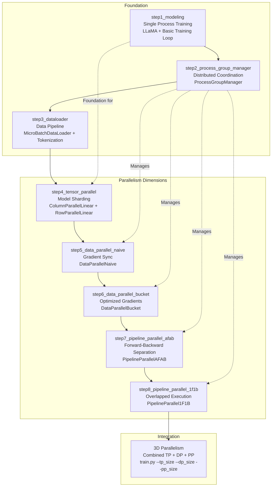
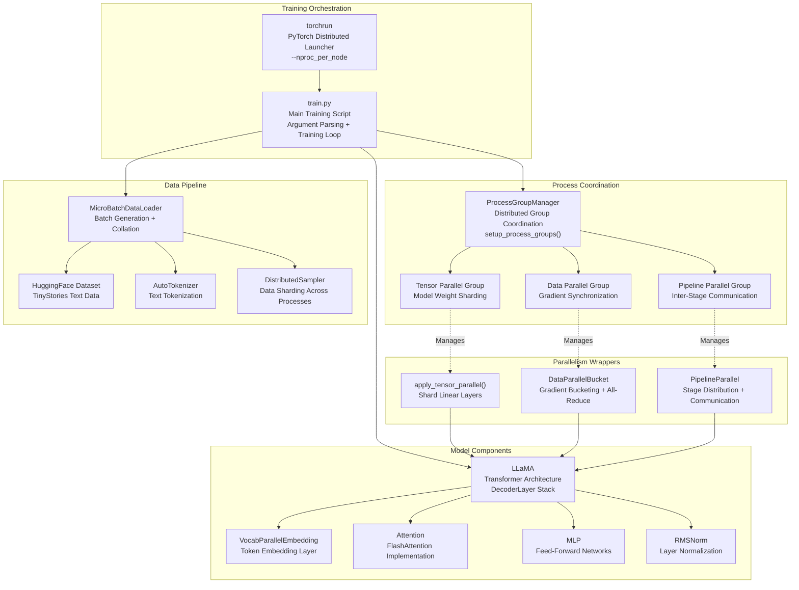
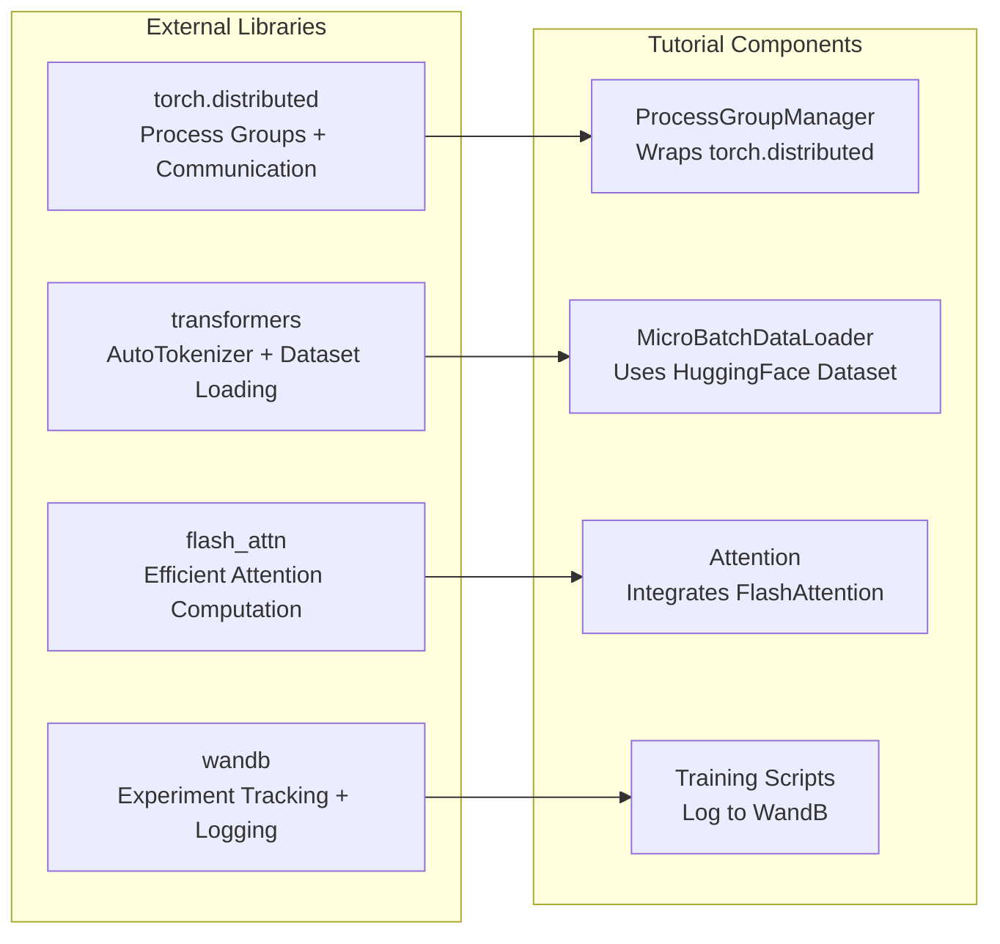

<!-- source: DeepWiki mcp.deepwiki.com · repo huggingface/picotron_tutorial · page 1 Overview · fetched 2026-10-26 -->

# Overview

<details>
<summary>Relevant source files</summary>

The following files were used as context for generating this wiki page:

- [.demo/step1_modeling.json](.demo/step1_modeling.json)
- [.vscode/settings.json](.vscode/settings.json)
- [README.md](README.md)
- [assets/llama1B_sanity_check.png](assets/llama1B_sanity_check.png)
- [requirements.txt](requirements.txt)
- [setup.py](setup.py)

</details>


## Purpose and Scope

This document provides a comprehensive overview of the Picotron tutorial framework, a step-by-step educational system designed to teach distributed training techniques for large language models from the ground up. The tutorial progressively builds complexity from single-process LLaMA model training to advanced 3D parallelism combining tensor, data, and pipeline parallelism strategies.

The material covered spans eight incremental tutorial steps plus a final 3D parallelism integration, each introducing new distributed training concepts while building upon previous foundations. For detailed information about specific parallelism strategies, see [Parallelism Strategies](#4). For implementation details of individual components, see [Core Architecture](#3).

**Sources:** [README.md:1-49]()

## Tutorial Learning Progression

The Picotron tutorial follows a carefully structured progression that introduces distributed training concepts incrementally:



**Tutorial Progression from Simple to Complex**

Each step builds systematically upon previous concepts while maintaining consistent patterns across the codebase. The progression ensures that learners understand both the theoretical foundations and practical implementation details of modern distributed training systems.

**Sources:** [README.md:29-48]()

## Core System Architecture

The tutorial framework is built around several key architectural components that work together to enable distributed training:



**Core System Integration Pattern**

The architecture follows a consistent pattern across all tutorial steps: a central training script coordinates process groups, applies parallelism transformations to the base LLaMA model, and manages the data pipeline. This modular design allows each tutorial step to focus on specific distributed training concepts while maintaining compatibility with other parallelism strategies.

**Sources:** [README.md:29-48]()

## Key Components and Dependencies

The tutorial framework relies on several essential components that provide the foundation for distributed training:

| Component | Purpose | Key Classes/Functions | Tutorial Introduction |
|-----------|---------|----------------------|---------------------|
| **LLaMA Model** | Transformer architecture implementation | `LLaMA`, `DecoderLayer`, `Attention`, `MLP` | Step 1 |
| **Process Management** | Distributed coordination | `ProcessGroupManager`, `setup_process_groups()` | Step 2 |
| **Data Pipeline** | Efficient data loading | `MicroBatchDataLoader`, `collate_fn` | Step 3 |
| **Tensor Parallelism** | Model weight sharding | `ColumnParallelLinear`, `RowParallelLinear` | Step 4 |
| **Data Parallelism** | Gradient synchronization | `DataParallelNaive`, `DataParallelBucket` | Steps 5-6 |
| **Pipeline Parallelism** | Inter-stage communication | `PipelineParallelAFAB`, `PipelineParallel1F1B` | Steps 7-8 |

**External Dependencies and Integration**



**Dependency Integration Strategy**

The tutorial maintains clean abstractions over external dependencies, allowing learners to focus on distributed training concepts rather than library-specific implementation details. Each external dependency is wrapped by tutorial-specific components that provide consistent interfaces across different parallelism strategies.

**Sources:** [requirements.txt:1-7](), [README.md:16-20]()

## Learning Path and Validation

The tutorial provides comprehensive validation mechanisms to ensure correct implementation of distributed training concepts:

**Convergence Testing and Sanity Checks**

The framework includes systematic convergence testing using a LLaMA 1B model trained on 4,096,000 tokens across different parallelism configurations. This validation ensures that all distributed training strategies produce mathematically equivalent results to the baseline single-process training.

**Command Pattern Consistency**

Each tutorial step follows consistent command-line interface patterns that scale from single-process to multi-dimensional parallelism:

```bash
# Progressive complexity in command structure
torchrun --nproc_per_node 1  train.py  # Step 1: Single process
torchrun --nproc_per_node 4  train.py --tp_size 4      # Step 4: Tensor parallel
torchrun --nproc_per_node 4  train.py --dp_size 4      # Step 6: Data parallel  
torchrun --nproc_per_node 4  train.py --pp_size 4      # Step 8: Pipeline parallel
torchrun --nproc_per_node 8  train.py --tp_size 2 --pp_size 2 --dp_size 2  # 3D parallelism
```

This progressive command structure allows learners to understand how distributed training parameters scale and interact as system complexity increases.

**Sources:** [README.md:24-48]()

---

