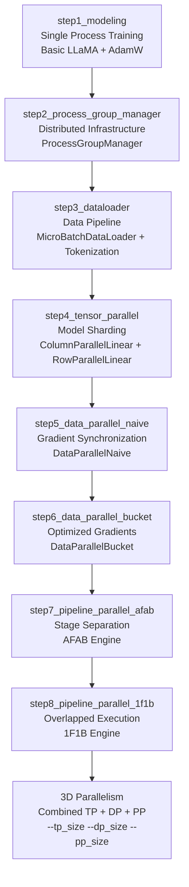
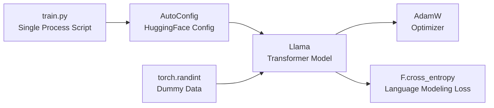
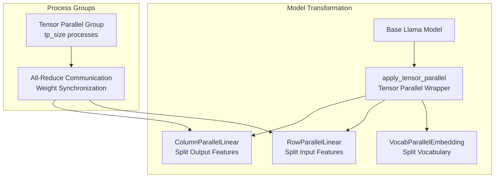
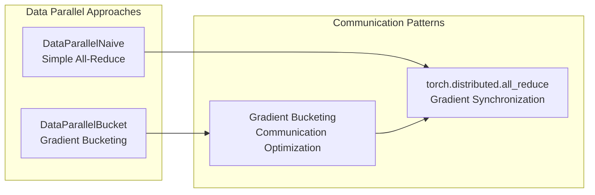
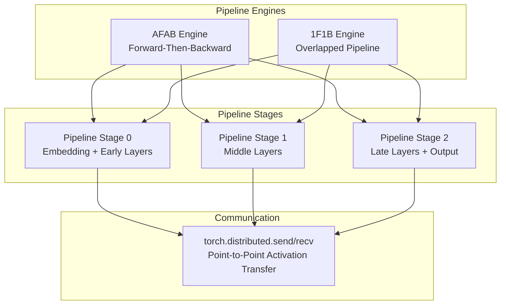
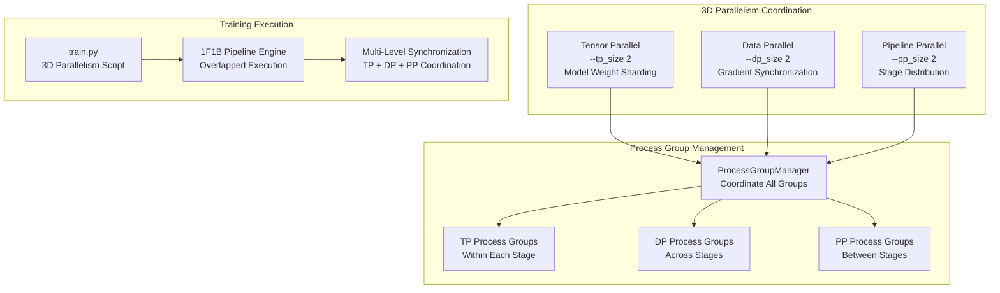

<!-- source: DeepWiki mcp.deepwiki.com · repo huggingface/picotron_tutorial · page 2 Tutorial Progression · fetched 2026-10-26 -->

# Tutorial Progression

Relevant source files

The following files were used as context for generating this wiki page:

- [README.md](README.md)
- [assets/llama1B_sanity_check.png](assets/llama1B_sanity_check.png)
- [requirements.txt](requirements.txt)
- [setup.py](setup.py)
- [step1_modeling/train.py](step1_modeling/train.py)

This document outlines the step-by-step progression of the Picotron tutorial, which systematically builds distributed training capabilities from a simple single-process model to full 3D parallelism. The tutorial demonstrates how to incrementally add tensor parallelism, data parallelism, and pipeline parallelism to a LLaMA transformer model.

For detailed implementation of individual components, see [Core Architecture](#3). For specific parallelism strategies, see [Parallelism Strategies](#4).

## Tutorial Overview

The Picotron tutorial follows a progressive complexity model, where each step builds upon the previous ones while introducing new distributed training concepts. The progression moves from basic model training to sophisticated 3D parallelism combining three parallelization strategies.

### Step Progression Flow

Sources: [README.md:29-48]()

### Command Line Evolution

The tutorial progression is reflected in the increasing complexity of command line arguments, showing how new parallelism dimensions are added:

| Step | Key Arguments | Purpose |
|------|---------------|---------|
| Step 1 | `--micro_batch_size`, `--seq_len` | Basic training parameters |
| Step 2 | `--nproc_per_node` | Multi-process setup |
| Step 3 | `--gradient_accumulation_steps`, `--num_proc` | Data pipeline optimization |
| Step 4 | `--tp_size` | Tensor parallelism dimension |
| Step 5-6 | `--dp_size` | Data parallelism dimension |
| Step 7-8 | `--pp_size`, `--pp_engine` | Pipeline parallelism dimension |
| 3D | `--tp_size --dp_size --pp_size` | All dimensions combined |

Sources: [README.md:29-48]()

## Foundation Steps (1-3)

### Step 1: Basic Model Training

Step 1 establishes the fundamental training loop with a LLaMA model running on a single process. The implementation in `step1_modeling/train.py` sets up the basic components: model initialization, optimizer setup, and a simple forward-backward pass with dummy data.

Key code entities:
- `Llama` class from `model.py`
- `torch.distributed.init_process_group` for basic distributed setup
- `AdamW` optimizer with learning rate scheduling
- Cross-entropy loss computation with vocabulary projection

Sources: [step1_modeling/train.py:1-97]()

### Step 2: Process Group Management

Step 2 introduces the `ProcessGroupManager` class, which becomes the central coordinator for all distributed training operations. This step doesn't change the training logic but establishes the infrastructure needed for multi-GPU coordination.

### Step 3: Data Loading Pipeline

Step 3 replaces dummy data with a real data pipeline featuring the `MicroBatchDataLoader` class. This step introduces tokenization, gradient accumulation, and proper batch management for distributed training scenarios.

Sources: [README.md:31-32]()

## Parallelism Integration Steps (4-8)

### Tensor Parallelism (Step 4)

Step 4 introduces tensor parallelism by sharding model weights across multiple GPUs. The `apply_tensor_parallel` function transforms linear layers into parallel variants that communicate through all-reduce operations.

Command: `torchrun --nproc_per_node 4 train.py --tp_size 4`

Sources: [README.md:34-36]()

### Data Parallelism (Steps 5-6)

Steps 5 and 6 implement two approaches to data parallelism:

- **Step 5 (Naive)**: `DataParallelNaive` performs simple all-reduce operations on gradients
- **Step 6 (Bucketed)**: `DataParallelBucket` optimizes communication by bucketing gradients

Command: `torchrun --nproc_per_node 4 train.py --dp_size 4`

Sources: [README.md:38-40]()

### Pipeline Parallelism (Steps 7-8)

Steps 7 and 8 implement pipeline parallelism with two execution engines:

- **Step 7 (AFAB)**: Activation Forward-Activation Backward engine with separated phases
- **Step 8 (1F1B)**: One Forward One Backward engine with overlapped execution

Command: `torchrun --nproc_per_node 4 train.py --pp_size 4 --pp_engine 1f1b`

Sources: [README.md:42-44]()

## 3D Parallelism Integration

The final step combines all three parallelism strategies into a single training run. This requires careful coordination between tensor parallel groups, data parallel groups, and pipeline parallel stages.

### 3D Parallelism Architecture

The 3D parallelism configuration demonstrates the full power of the tutorial's incremental complexity build-up, requiring 8 processes with a 2×2×2 configuration.

Command: `torchrun --nproc_per_node 8 train.py --tp_size 2 --pp_size 2 --pp_engine 1f1b --dp_size 2`

Sources: [README.md:46-47]()

## Tutorial Design Principles

### Incremental Complexity

Each step introduces exactly one new concept while preserving all previous functionality. This allows learners to isolate and understand individual distributed training components before combining them.

### Code Reusability

The tutorial follows a modular design where components from earlier steps are reused in later steps. For example, the `ProcessGroupManager` from Step 2 is used throughout all subsequent steps.

### Verification Strategy

The tutorial includes sanity checks that verify convergence behavior remains consistent across different parallelism configurations, ensuring correctness of the distributed implementations.

Sources: [README.md:24-26]()

---

