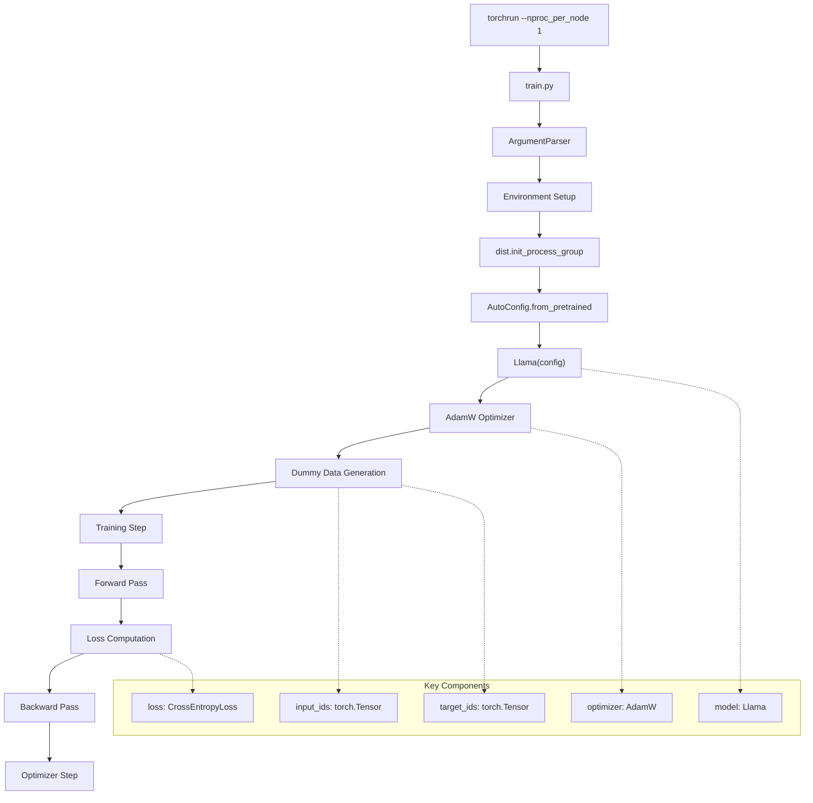
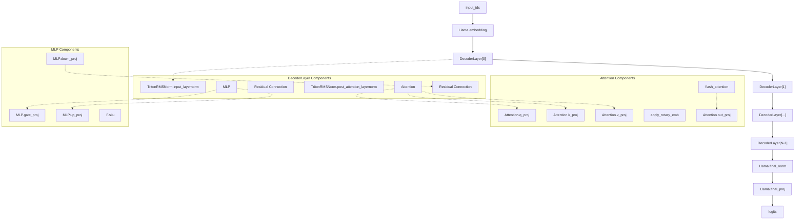
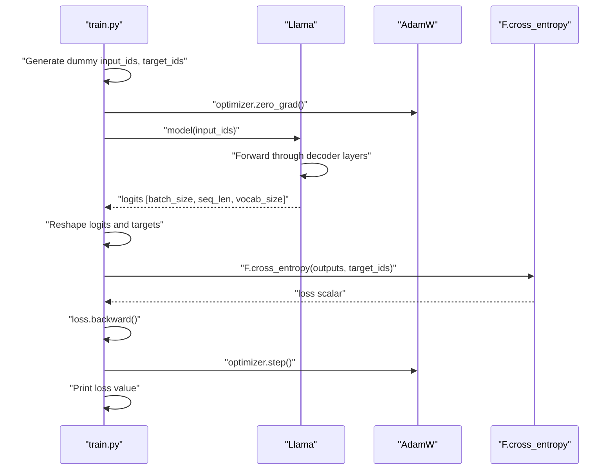
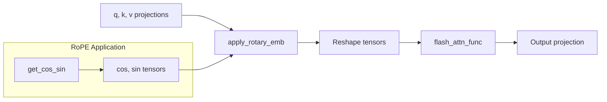

<!-- source: DeepWiki mcp.deepwiki.com · repo huggingface/picotron_tutorial · page 2.1 Step 1: Basic Model Training · fetched 2026-10-26 -->

# Step 1: Basic Model Training

Relevant source files

The following files were used as context for generating this wiki page:

- [step1_modeling/model.py](step1_modeling/model.py)
- [step1_modeling/train.py](step1_modeling/train.py)

This page covers the foundational step of the Picotron tutorial: single-process LLaMA model training. This step establishes the basic training infrastructure, model architecture, and training loop that will be extended with distributed training capabilities in subsequent steps.

This page focuses on the core model implementation and basic training setup. For distributed training concepts and process group management, see [2.2](#2.2). For advanced data loading pipelines, see [2.3](#2.3).

## Training Script Architecture

Step 1 provides a minimal training script that demonstrates the essential components needed for training a transformer model. Despite being single-process, it initializes PyTorch distributed to maintain consistency with later distributed training steps.

The training script [step1_modeling/train.py:16-97]() follows a standard structure:

| Component | Purpose | Key Code Elements |
|-----------|---------|-------------------|
| Argument Parsing | Configure model and training parameters | `argparse.ArgumentParser`, model configuration args |
| Environment Setup | Set CUDA device and distributed context | `torch.cuda.set_device`, `dist.init_process_group` |
| Model Creation | Instantiate LLaMA model with custom config | `Llama(config)`, `AutoConfig.from_pretrained` |
| Training Loop | Execute forward/backward passes | `model(input_ids)`, `loss.backward()`, `optimizer.step()` |

Sources: [step1_modeling/train.py:1-97]()

## LLaMA Model Architecture

The custom LLaMA implementation provides a complete transformer architecture optimized for efficient training with Flash Attention and RoPE positional embeddings.

The model architecture consists of several key classes:

- **`Llama`** [step1_modeling/model.py:118-148](): Main model class containing embedding, decoder layers, and final projection
- **`DecoderLayer`** [step1_modeling/model.py:100-116](): Individual transformer layer with attention and MLP blocks
- **`Attention`** [step1_modeling/model.py:48-87](): Multi-head attention with Flash Attention and RoPE
- **`MLP`** [step1_modeling/model.py:89-98](): Feed-forward network with SiLU activation and gating
- **`TritonRMSNorm`** [step1_modeling/model.py:25-46](): RMS normalization using Triton kernels

Sources: [step1_modeling/model.py:1-148]()

## Training Process Flow

The training process demonstrates the standard language modeling setup with next-token prediction using cross-entropy loss.

The training step [step1_modeling/train.py:78-95]() implements the core training loop:

1. **Data Preparation**: Generate random `input_ids` and `target_ids` tensors
2. **Forward Pass**: Compute model outputs via `model(input_ids=input_ids)`
3. **Loss Computation**: Calculate cross-entropy loss between predictions and targets
4. **Backward Pass**: Compute gradients via `loss.backward()`
5. **Parameter Update**: Apply gradients via `optimizer.step()`

Sources: [step1_modeling/train.py:74-96]()

## Key Model Components

### Flash Attention Implementation

The attention mechanism uses Flash Attention for memory-efficient computation:

The `flash_attention` function [step1_modeling/model.py:8-12]() and `get_cos_sin` function [step1_modeling/model.py:14-23]() provide optimized attention computation with rotary positional embeddings.

### Configuration and Initialization

Model configuration is loaded from HuggingFace and customized:

| Parameter | Purpose | Default Value |
|-----------|---------|---------------|
| `num_hidden_layers` | Number of decoder layers | 32 |
| `num_attention_heads` | Attention heads per layer | 16 |
| `num_key_value_heads` | KV heads for grouped-query attention | 4 |
| `max_position_embeddings` | Maximum sequence length | Matches `seq_len` |

The model is initialized with `torch.bfloat16` precision and moved to the CUDA device [step1_modeling/train.py:64-66]().

Sources: [step1_modeling/train.py:58-66](), [step1_modeling/model.py:14-23](), [step1_modeling/model.py:8-12]()

## Integration with Distributed Training

Although Step 1 runs on a single process, it initializes PyTorch distributed infrastructure to maintain consistency with later distributed training steps. The script uses `torchrun` launcher and calls `dist.init_process_group()` [step1_modeling/train.py:54](), establishing the foundation for the process group management introduced in [2.2](#2.2).

Sources: [step1_modeling/train.py:46-54]()

---

