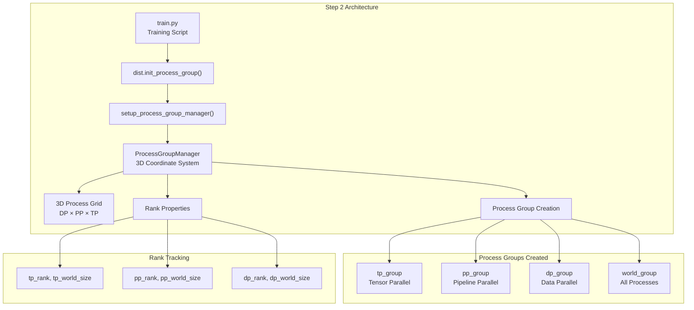
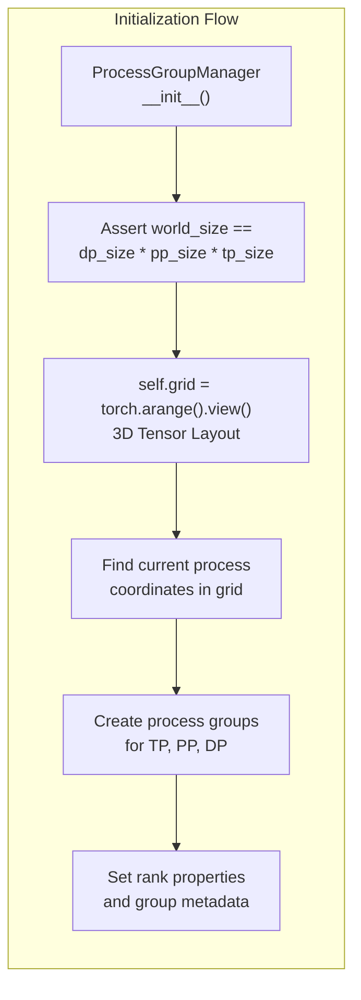
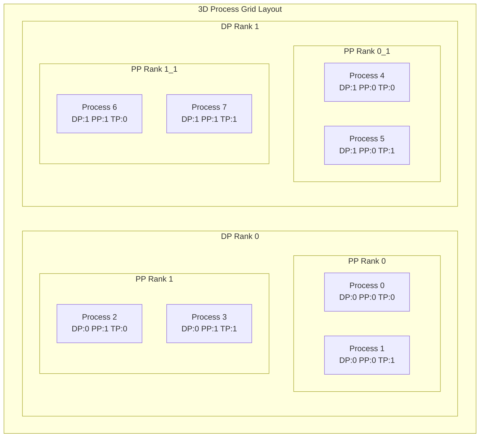
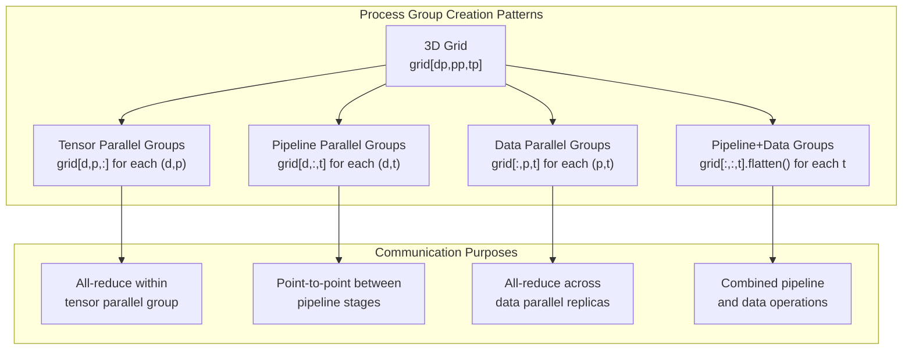
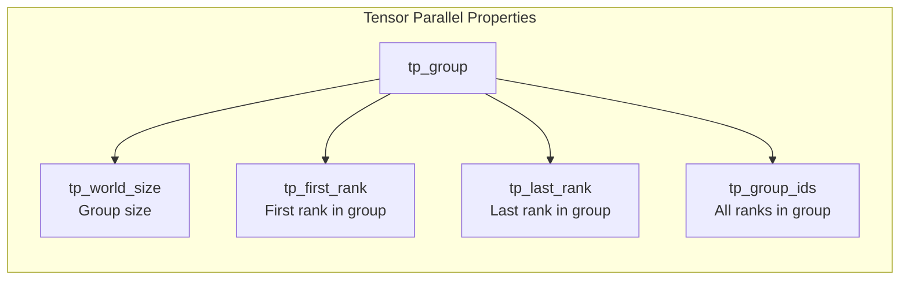
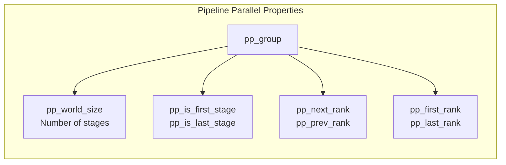
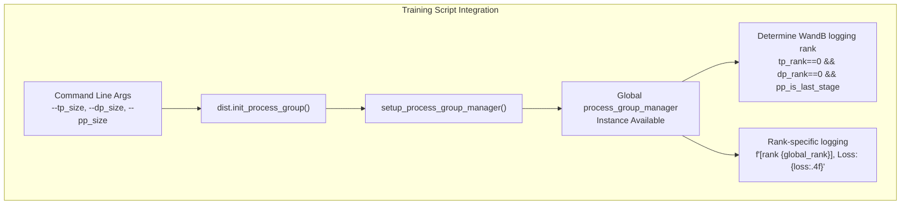
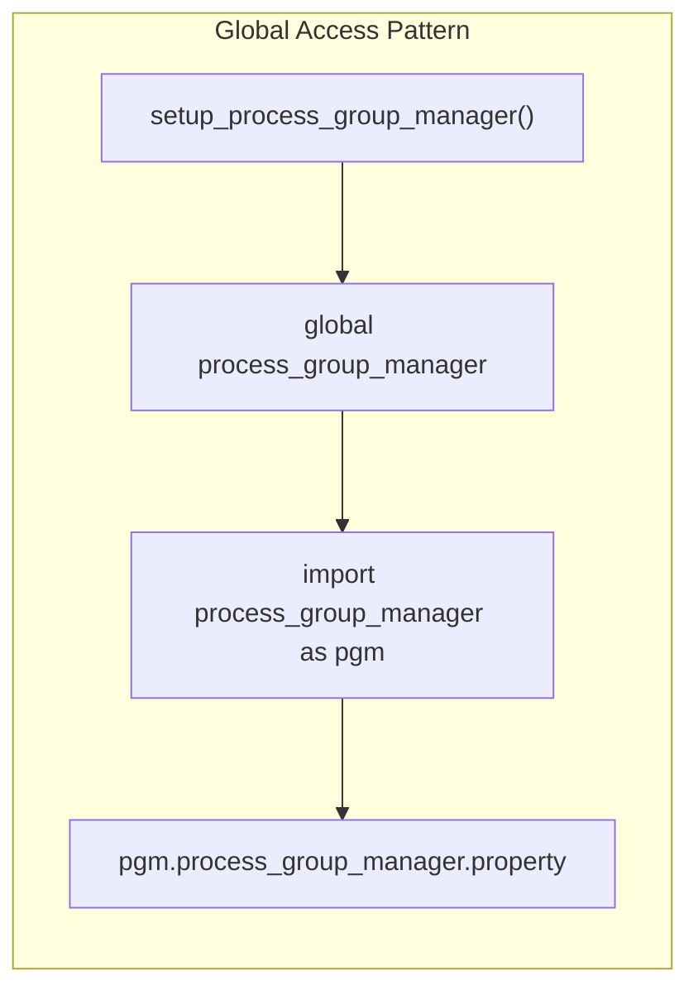

<!-- source: DeepWiki mcp.deepwiki.com · repo huggingface/picotron_tutorial · page 2.2 Step 2: Process Group Management · fetched 2026-10-26 -->

# Step 2: Process Group Management

Relevant source files

The following files were used as context for generating this wiki page:

- [.demo/step2_process_group_manager.json](.demo/step2_process_group_manager.json)
- [.gitignore](.gitignore)
- [step2_process_group_manager/model.py](step2_process_group_manager/model.py)
- [step2_process_group_manager/patch_step_2.diff](step2_process_group_manager/patch_step_2.diff)
- [step2_process_group_manager/process_group_manager.py](step2_process_group_manager/process_group_manager.py)
- [step2_process_group_manager/train.py](step2_process_group_manager/train.py)
- [step2_process_group_manager/utils.py](step2_process_group_manager/utils.py)

This document covers the introduction of distributed training infrastructure through the `ProcessGroupManager` class. This step establishes the foundation for 3D parallelism by setting up process groups and coordinate systems that will be used in subsequent steps for tensor, pipeline, and data parallelism implementations.

For actual parallelism implementations, see [Tensor Parallelism](#4.1), [Data Parallelism](#4.2), and [Pipeline Parallelism](#4.3). For comprehensive process group coordination details, see [Process Group Management](#3.3).

## Distributed Training Foundation

Step 2 introduces the core infrastructure needed for distributed training by implementing a centralized process group management system. The `ProcessGroupManager` class establishes a 3D coordinate system that organizes processes across data parallel (DP), pipeline parallel (PP), and tensor parallel (TP) dimensions.

Sources: [step2_process_group_manager/process_group_manager.py:1-54](), [step2_process_group_manager/train.py:63-64]()

## ProcessGroupManager Architecture

The `ProcessGroupManager` class serves as the central coordinator for all distributed training communication. It creates a 3D tensor that maps global ranks to their positions in the data parallel, pipeline parallel, and tensor parallel dimensions.

### Core Initialization Process

The class constructor performs several critical setup operations:

| Operation | Code Location | Purpose |
|-----------|---------------|---------|
| World size validation | [process_group_manager.py:11]() | Ensure process count matches parallelism dimensions |
| Grid creation | [process_group_manager.py:13]() | Create 3D tensor mapping ranks to coordinates |
| Coordinate finding | [process_group_manager.py:15]() | Locate current process in 3D space |
| Process group creation | [process_group_manager.py:18-21]() | Create communication groups for each parallelism type |

Sources: [step2_process_group_manager/process_group_manager.py:5-28]()

## 3D Process Grid Organization

The process grid uses a `torch.arange(world_size).view(dp_size, pp_size, tp_size)` layout to organize processes in 3D space. Each process can determine its coordinates and communicate with other processes along each dimension.

### Grid Layout Example

For a configuration with `dp_size=2, pp_size=2, tp_size=2` (8 total processes):

The coordinate finding logic uses `(self.grid == self.global_rank).nonzero().flatten().tolist()` to determine each process's position in this 3D space.

Sources: [step2_process_group_manager/process_group_manager.py:13-15]()

## Process Group Creation

The `ProcessGroupManager` creates four distinct process groups using `dist.new_subgroups_by_enumeration()`, each serving different communication patterns:

### Process Group Types

Each process group is created with specific rank lists:

| Process Group | Creation Pattern | Purpose |
|---------------|------------------|---------|
| `tp_group` | `grid[d, p, :]` for each (d,p) pair | Tensor parallel communication within model shards |
| `pp_group` | `grid[d, :, t]` for each (d,t) pair | Pipeline parallel communication between stages |
| `dp_group` | `grid[:, p, t]` for each (p,t) pair | Data parallel communication across replicas |
| `pp_dp_group` | `grid[:, :, t].flatten()` for each t | Combined pipeline and data parallel operations |

Sources: [step2_process_group_manager/process_group_manager.py:18-21]()

## Rank Properties and Metadata

The `ProcessGroupManager` computes and stores essential metadata for each parallelism dimension, enabling efficient communication and coordination.

### Tensor Parallelism Properties

### Pipeline Parallelism Properties

The pipeline parallel properties include critical neighbor rank calculations:
- `pp_next_rank`: Computed as `grid[dp_rank, pp_rank + 1, tp_rank]` or `None` for last stage
- `pp_prev_rank`: Computed as `grid[dp_rank, pp_rank - 1, tp_rank]` or `None` for first stage

Sources: [step2_process_group_manager/process_group_manager.py:30-47]()

## Training Script Integration

The training script integrates the `ProcessGroupManager` through a simple setup function call and uses the manager for logging and coordination.

### Integration Flow

### Key Integration Points

| Integration Point | Code Location | Purpose |
|-------------------|---------------|---------|
| Argument parsing | [train.py:39-41]() | Accept TP/PP/DP size parameters |
| Process group setup | [train.py:64]() | Initialize distributed coordination |
| WandB rank determination | [train.py:66]() | Select single rank for centralized logging |
| Rank-specific logging | [train.py:120]() | Include rank information in output |

The training script uses the manager's properties to determine which rank should handle WandB logging, ensuring only one process per tensor parallel group logs metrics while maintaining visibility across all processes.

Sources: [step2_process_group_manager/train.py:38-42](), [step2_process_group_manager/train.py:63-66](), [step2_process_group_manager/train.py:120]()

## Global Manager Access Pattern

The implementation uses a global variable pattern for accessing the process group manager throughout the codebase:

This pattern allows any module to access process group information without explicit parameter passing, which is essential for distributed training coordination across multiple components.

Sources: [step2_process_group_manager/process_group_manager.py:52-54](), [step2_process_group_manager/train.py:15-16]()

---

