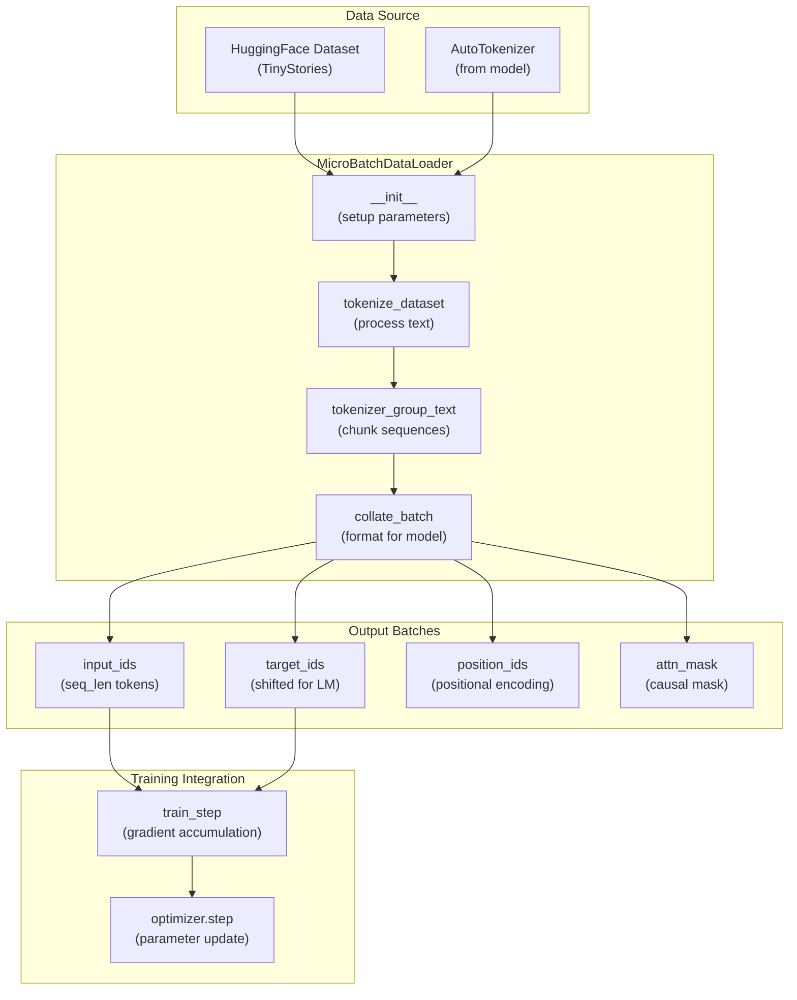
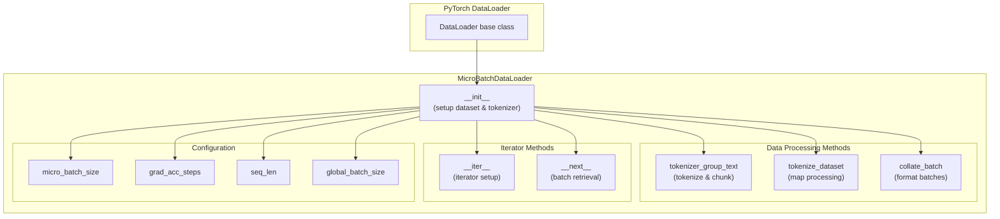
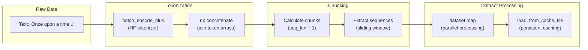
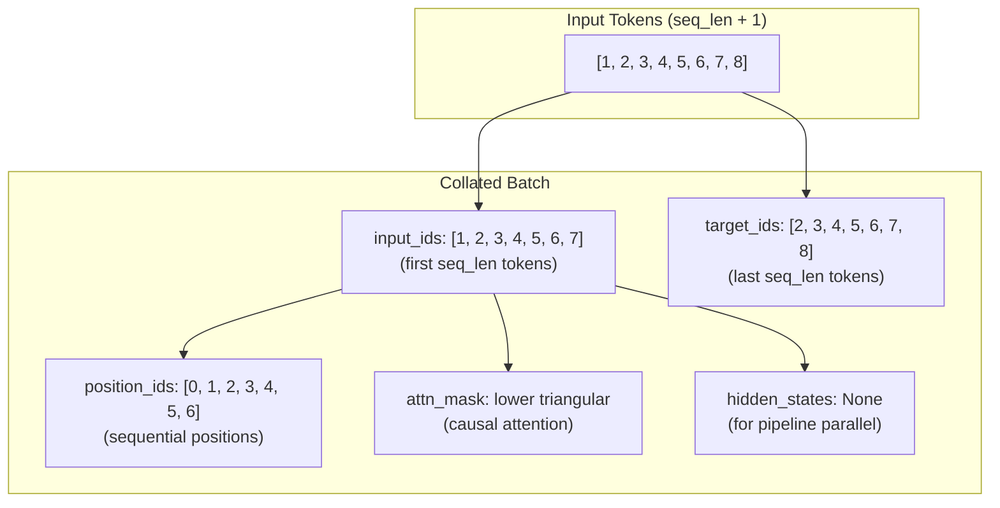
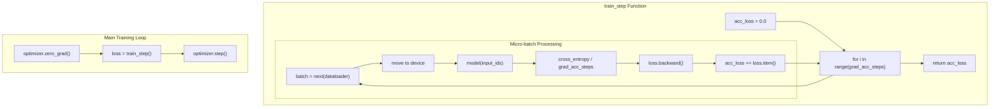

<!-- source: DeepWiki mcp.deepwiki.com · repo huggingface/picotron_tutorial · page 2.3 Step 3: Data Loading Pipeline · fetched 2026-10-26 -->

# Step 3: Data Loading Pipeline

Relevant source files

The following files were used as context for generating this wiki page:

- [step3_dataloader/patch_step_3.diff](step3_dataloader/patch_step_3.diff)
- [step3_dataloader/train.py](step3_dataloader/train.py)

This document covers the implementation of an efficient data loading pipeline for distributed language model training. Step 3 introduces the `MicroBatchDataLoader` class which handles tokenization, text chunking, micro-batching with gradient accumulation, and integration with distributed training processes.

For information about the model architecture that consumes this data, see [3.1](#3.1). For details about distributed process coordination, see [2.2](#2.2).

## Data Loading Architecture Overview

The data loading system transforms raw text from HuggingFace datasets into properly formatted batches for language model training. The pipeline handles tokenization, sequence chunking, and micro-batch generation while supporting gradient accumulation and distributed training.

**Data Loading Pipeline Architecture**

Sources: [step3_dataloader/dataloader.py:14-39](), [step3_dataloader/train.py:23-44]()

## MicroBatchDataLoader Implementation

The `MicroBatchDataLoader` class extends PyTorch's `DataLoader` to provide specialized functionality for language model training with gradient accumulation and distributed training support.

**MicroBatchDataLoader Class Structure**

The class initializer calculates the global batch size by considering micro-batch size, gradient accumulation steps, and data parallel world size: `global_batch_size = micro_batch_size * grad_acc_steps * dp_world_size`.

Sources: [step3_dataloader/dataloader.py:14-39](), [step3_dataloader/dataloader.py:21]()

## Data Preprocessing Pipeline

The preprocessing pipeline transforms raw text into tokenized sequences suitable for causal language modeling. This involves tokenization, concatenation, and chunking into fixed-length sequences.

| Stage | Function | Input | Output |
|-------|----------|-------|--------|
| Tokenization | `tokenizer_group_text` | Raw text strings | Token arrays |
| Concatenation | Token joining | Separate sequences | Single token stream |
| Chunking | Sequence splitting | Long token stream | Fixed-length chunks |
| Dataset Mapping | `tokenize_dataset` | HuggingFace Dataset | Tokenized Dataset |

**Text Processing Flow**

The chunking process creates sequences of `seq_len + 1` tokens to enable next-token prediction, where the first `seq_len` tokens serve as input and the last `seq_len` tokens (shifted by 1) serve as targets.

Sources: [step3_dataloader/dataloader.py:41-84](), [step3_dataloader/dataloader.py:52-60]()

## Batch Collation and Structure

The `collate_batch` method transforms tokenized sequences into properly formatted tensors for model consumption, including input/target separation and attention mask generation.

**Batch Structure**

The attention mask is a lower triangular matrix ensuring causal attention where each token can only attend to previous tokens in the sequence.

Sources: [step3_dataloader/dataloader.py:86-101](), [step3_dataloader/dataloader.py:89-93]()

## Training Loop Integration

The dataloader integrates with the training loop through gradient accumulation, where multiple micro-batches are processed before a single optimizer step. This enables effective larger batch sizes while managing memory constraints.

**Training Step with Gradient Accumulation**

The loss is scaled by `1/grad_acc_steps` to maintain consistent gradient magnitudes across different accumulation settings.

Sources: [step3_dataloader/train.py:23-44](), [step3_dataloader/train.py:38]()

## Iterator Management

The dataloader implements custom iterator methods to handle continuous data streaming and proper iterator lifecycle management for training loops.

The `__iter__` and `__next__` methods ensure proper iterator state management, automatically resetting when the iterator is exhausted and handling StopIteration exceptions for continuous training.

Sources: [step3_dataloader/dataloader.py:103-117]()

## Performance and Configuration

The training script tracks key performance metrics including tokens per second, memory usage, and throughput per GPU. The dataloader configuration supports:

| Parameter | Purpose | Default |
|-----------|---------|---------|
| `micro_batch_size` | Per-device batch size | 1 |
| `gradient_accumulation_steps` | Micro-batches per update | 1 |
| `seq_len` | Sequence length | 32 |
| `num_workers` | DataLoader workers | 1 |
| `num_proc` | Dataset processing cores | 4 |

Token throughput is calculated as `tokens_per_step = global_batch_size * seq_len`, where `global_batch_size = micro_batch_size * grad_acc_steps * dp_world_size`.

Sources: [step3_dataloader/train.py:145-147](), [step3_dataloader/train.py:167-174]()

---

