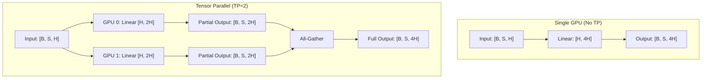
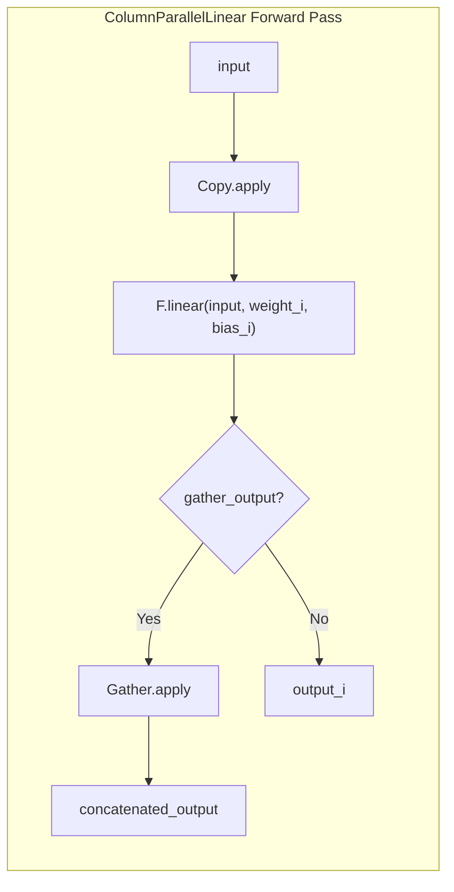
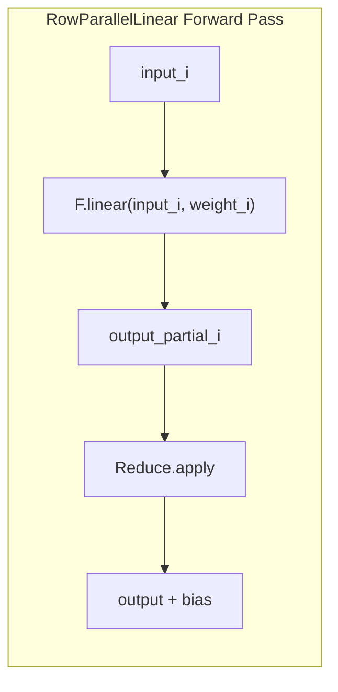
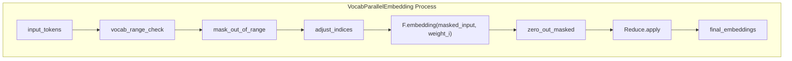
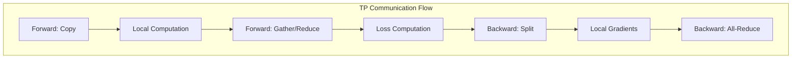
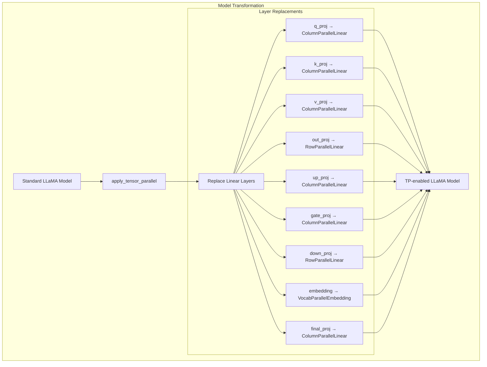
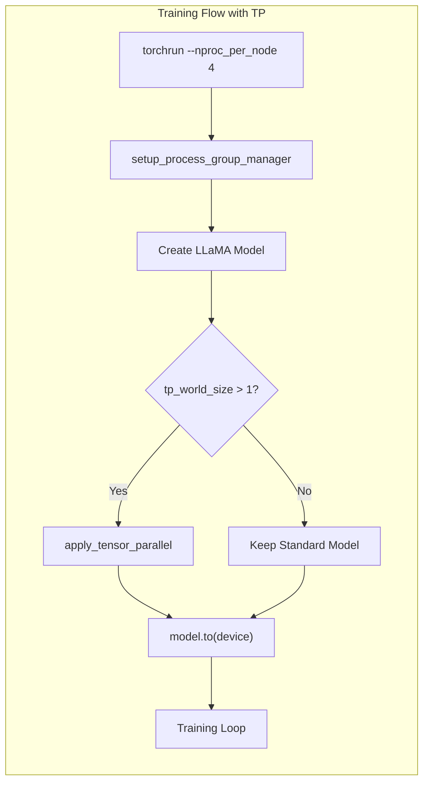
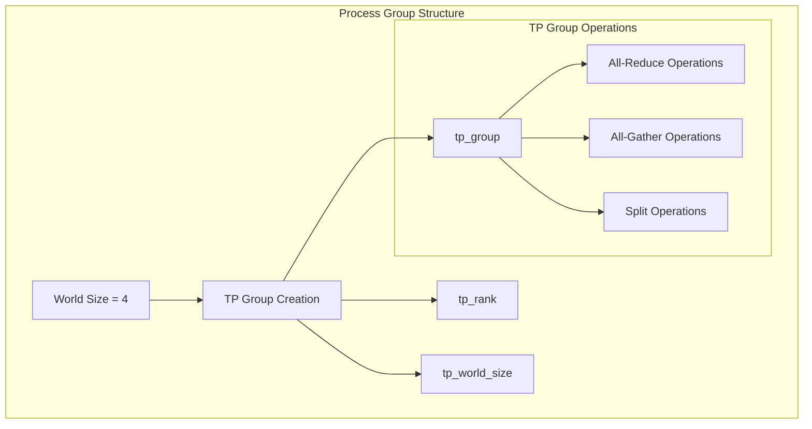

<!-- source: DeepWiki mcp.deepwiki.com · repo huggingface/picotron_tutorial · page 2.4 Step 4: Tensor Parallelism · fetched 2026-10-26 -->

# Step 4: Tensor Parallelism

<details>
<summary>Relevant source files</summary>

The following files were used as context for generating this wiki page:

- [.demo/step4_tensor_parallel.json](.demo/step4_tensor_parallel.json)
- [step3_dataloader/process_group_manager.py](step3_dataloader/process_group_manager.py)
- [step4_tensor_parallel/patch_step_4.diff](step4_tensor_parallel/patch_step_4.diff)
- [step4_tensor_parallel/train.py](step4_tensor_parallel/train.py)

</details>


This document covers the implementation of tensor parallelism in the Picotron tutorial, which enables splitting model weights across multiple GPUs to handle larger models. This step introduces parallel linear layers, communication primitives, and model transformation logic to distribute computation within each transformer layer.

For pipeline parallelism that splits models across stages, see [Step 7-8: Pipeline Parallelism](#2.6). For data parallelism that replicates models across processes, see [Step 5-6: Data Parallelism](#2.5).

## Overview

Tensor parallelism (TP) partitions individual layers of a neural network across multiple devices, allowing each device to compute only a portion of each layer's output. In this implementation, linear layers are split either column-wise or row-wise, with communication operations to synchronize results across the tensor parallel group.



Sources: [step4_tensor_parallel/tensor_parallel.py:146-198](), [step4_tensor_parallel/patch_step_4.diff:26-144]()

## Parallel Layer Implementations

### ColumnParallelLinear

The `ColumnParallelLinear` class splits linear layers along the output dimension, where each GPU computes a subset of output features.

| Property | Value |
|----------|-------|
| Weight Shape | `[output_size_per_partition, in_features]` |
| Input Processing | Identity (Copy operation) |
| Output Processing | Optional All-Gather |
| Bias Handling | Split per partition |



Sources: [step4_tensor_parallel/tensor_parallel.py:146-198]()

### RowParallelLinear

The `RowParallelLinear` class splits linear layers along the input dimension, requiring an all-reduce operation to combine partial results.

| Property | Value |
|----------|-------|
| Weight Shape | `[out_features, input_size_per_partition]` |
| Input Processing | No modification |
| Output Processing | All-Reduce |
| Bias Handling | Full bias on each GPU |



Sources: [step4_tensor_parallel/tensor_parallel.py:200-249]()

### VocabParallelEmbedding

The `VocabParallelEmbedding` class partitions the vocabulary across devices, with each GPU handling a subset of tokens.



Sources: [step4_tensor_parallel/tensor_parallel.py:251-332]()

## Communication Primitives

### Autograd Functions

The tensor parallel implementation uses custom autograd functions to handle forward and backward communication patterns:

| Function | Forward Pass | Backward Pass | Usage |
|----------|-------------|---------------|-------|
| `Copy` | Identity | All-Reduce | Column parallel input |
| `Reduce` | All-Reduce | Identity | Row parallel output |
| `Gather` | All-Gather | Split | Column parallel with gather |

### Communication Patterns



Sources: [step4_tensor_parallel/tensor_parallel.py:46-98]()

## Model Transformation Process

### apply_tensor_parallel Function

The `apply_tensor_parallel` function transforms a standard LLaMA model into a tensor-parallel version by replacing linear layers:



Sources: [step4_tensor_parallel/tensor_parallel.py:101-144]()

### Attention Layer Modifications

The attention mechanism requires special handling for tensor parallelism, with head count adjustments per GPU:

```python
# From model.py modifications
self.num_local_heads = config.num_attention_heads // pgm.process_group_manager.tp_world_size
self.num_local_kv_heads = config.num_key_value_heads // pgm.process_group_manager.tp_world_size
```

Sources: [step4_tensor_parallel/patch_step_4.diff:18-22]()

## Training Integration

### Training Script Changes

The training script integrates tensor parallelism with minimal changes:

| Component | Change |
|-----------|--------|
| Model Creation | Add `apply_tensor_parallel` call |
| Process Groups | TP size configuration via `--tp_size` |
| Initialization | Check `tp_world_size > 1` |



Sources: [step4_tensor_parallel/train.py:127-128](), [step4_tensor_parallel/train.py:2]()

### Process Group Management

Tensor parallelism requires coordination through the ProcessGroupManager:



Sources: [step3_dataloader/process_group_manager.py:17-18](), [step3_dataloader/process_group_manager.py:30-33]()

## Weight Initialization

### Master Weight Strategy

For tensor parallel layers, weights are initialized from a master weight tensor to ensure consistency:

1. Create full-size master weight tensor
2. Initialize using standard PyTorch method
3. Split master weight into partitions
4. Assign appropriate partition to each GPU

This ensures identical initialization across all tensor parallel ranks while maintaining the same statistical properties as single-GPU training.

Sources: [step4_tensor_parallel/tensor_parallel.py:181-190](), [step4_tensor_parallel/tensor_parallel.py:233-242](), [step4_tensor_parallel/tensor_parallel.py:299-305]()

---

