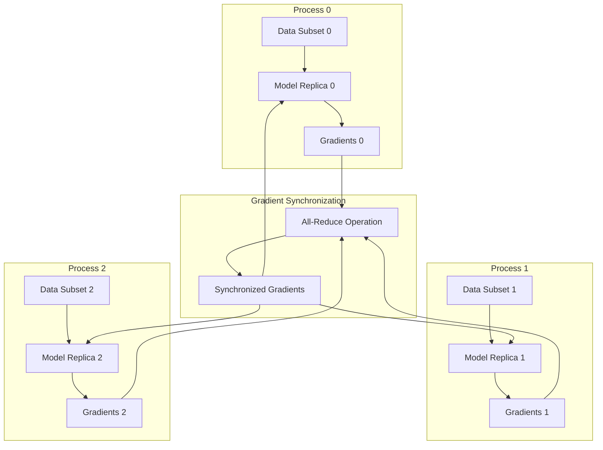
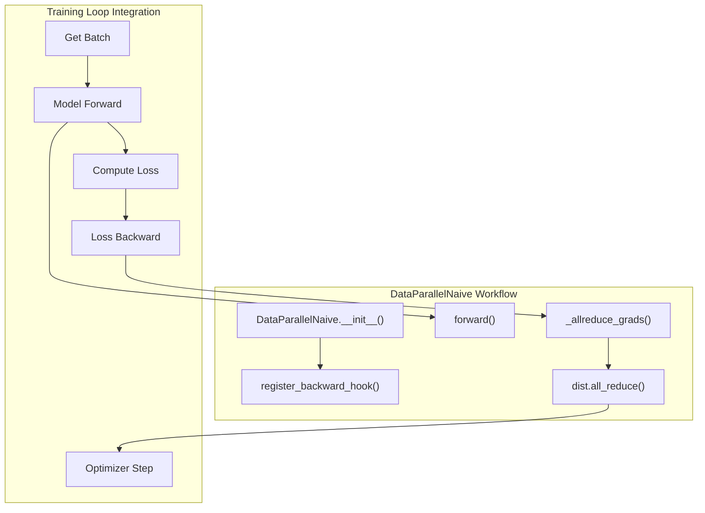
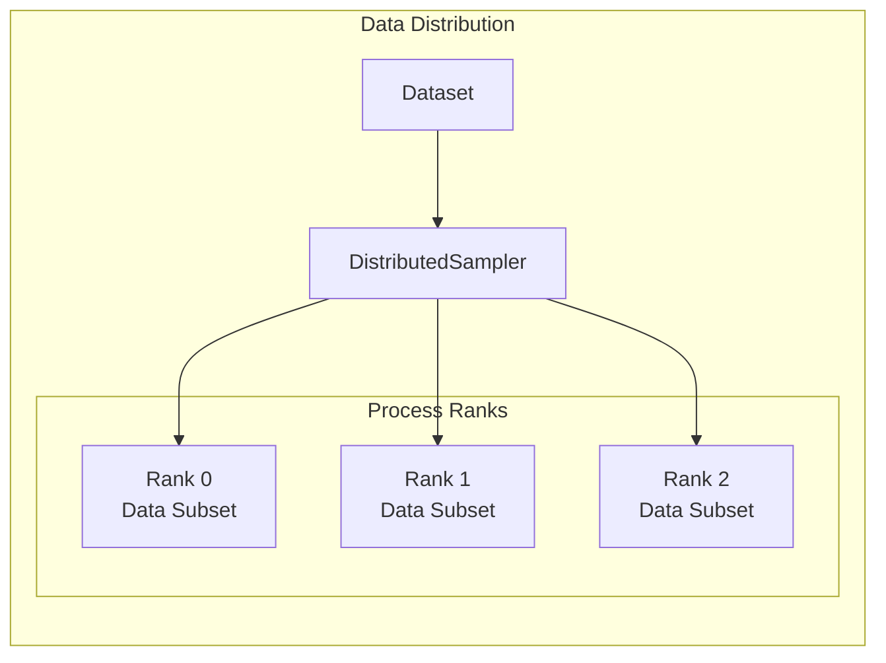
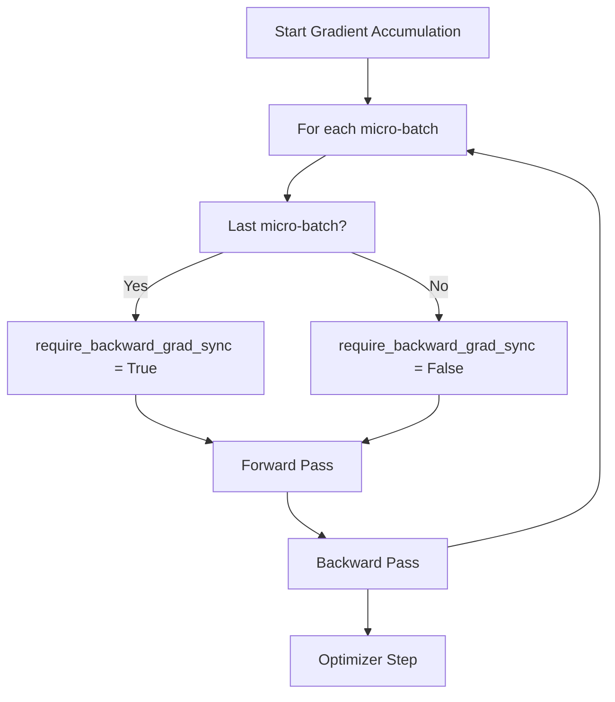
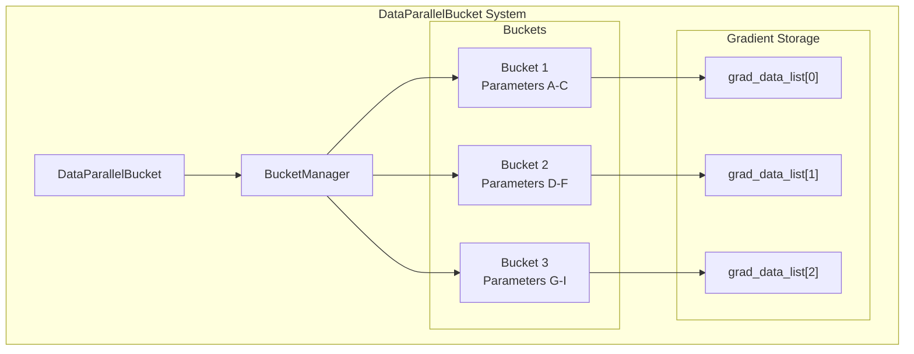
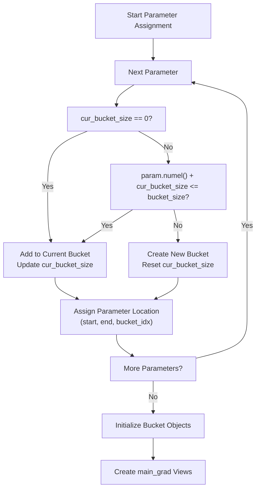
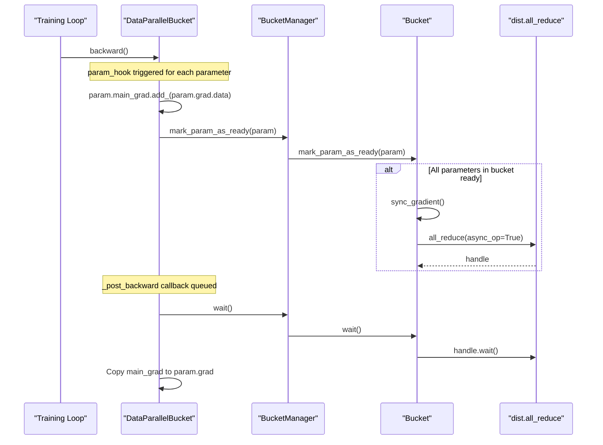
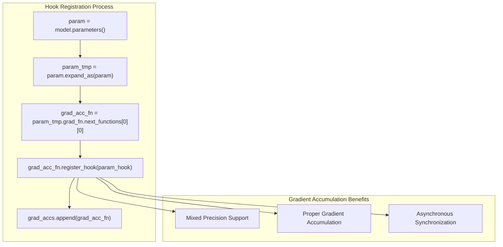
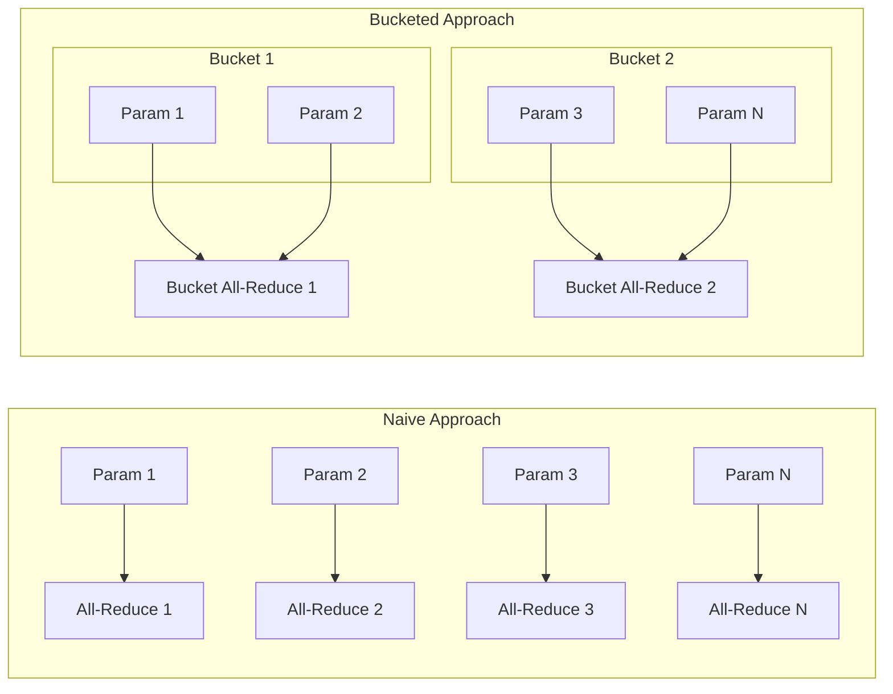

<!-- source: DeepWiki mcp.deepwiki.com · repo huggingface/picotron_tutorial · page 2.5 Step 5-6: Data Parallelism · fetched 2026-10-26 -->

# Step 5-6: Data Parallelism

Relevant source files

The following files were used as context for generating this wiki page:

- [.demo/step5_data_parallel_naive.json](.demo/step5_data_parallel_naive.json)
- [.demo/step6_data_parallel_bucket.json](.demo/step6_data_parallel_bucket.json)
- [step5_data_parallel_naive/patch_step_5.diff](step5_data_parallel_naive/patch_step_5.diff)
- [step6_data_parallel_bucket/data_parallel.py](step6_data_parallel_bucket/data_parallel.py)
- [step6_data_parallel_bucket/patch_step_6.diff](step6_data_parallel_bucket/patch_step_6.diff)

This document covers the implementation of data parallelism in steps 5 and 6 of the tutorial. Data parallelism distributes training data across multiple processes while maintaining identical model replicas, requiring gradient synchronization between processes. Step 5 implements a naive approach with simple all-reduce operations, while Step 6 introduces an optimized bucketing strategy for more efficient gradient communication.

For tensor parallelism which shards model weights across processes, see [Step 4: Tensor Parallelism](#2.4). For pipeline parallelism which distributes model layers across stages, see [Step 7-8: Pipeline Parallelism](#2.6).

## Data Parallelism Overview

Data parallelism replicates the entire model across multiple processes, with each process training on a different subset of the data. The key challenge is synchronizing gradients computed by different processes before applying optimizer updates.

Sources: [step5_data_parallel_naive/data_parallel.py:9-45](), [step6_data_parallel_bucket/data_parallel.py:165-259]()

## Step 5: Naive Data Parallelism

Step 5 introduces the foundational data parallelism implementation using straightforward all-reduce operations for gradient synchronization.

### DataParallelNaive Implementation

The `DataParallelNaive` class wraps the base model and adds gradient synchronization through backward hooks:

Sources: [step5_data_parallel_naive/data_parallel.py:21-44](), [step5_data_parallel_naive/train.py:104-152]()

### Key Components

| Component | Purpose | Implementation |
|-----------|---------|----------------|
| `require_backward_grad_sync` | Controls when gradients sync | Boolean flag set per micro-batch |
| `register_backward_hook()` | Attaches hooks to parameters | Iterates through `module.parameters()` |
| `_allreduce_grads()` | Synchronizes gradients | Uses `dist.all_reduce()` with dp_group |
| `DistributedSampler` | Distributes data across ranks | Added to dataloader configuration |

### Data Distribution

The dataloader is enhanced with `DistributedSampler` to ensure each process receives different data subsets:

Sources: [step5_data_parallel_naive/dataloader.py:70-85](), [step5_data_parallel_naive/train.py:140]()

### Gradient Accumulation Control

The training loop manages gradient synchronization timing to support gradient accumulation:

Sources: [step5_data_parallel_naive/train.py:115-118](), [step5_data_parallel_naive/data_parallel.py:41-43]()

## Step 6: Bucketed Data Parallelism

Step 6 introduces a sophisticated bucketing system that optimizes gradient communication by grouping parameters and enabling asynchronous operations.

### Architecture Overview

The bucketed approach uses three main classes working together:

Sources: [step6_data_parallel_bucket/data_parallel.py:165-176](), [step6_data_parallel_bucket/data_parallel.py:83-100](), [step6_data_parallel_bucket/data_parallel.py:39-53]()

### BucketManager Parameter Assignment

The `BucketManager` divides model parameters into buckets based on size constraints:

Sources: [step6_data_parallel_bucket/data_parallel.py:102-145](), [step6_data_parallel_bucket/data_parallel.py:113-125]()

### Gradient Synchronization Workflow

The bucketed approach enables asynchronous gradient synchronization:

Sources: [step6_data_parallel_bucket/data_parallel.py:218-239](), [step6_data_parallel_bucket/data_parallel.py:160-163](), [step6_data_parallel_bucket/data_parallel.py:75-81](), [step6_data_parallel_bucket/data_parallel.py:55-59]()

### Advanced Hook Registration

The bucketed implementation uses gradient accumulator function hooks for better integration with PyTorch's autograd system:

Sources: [step6_data_parallel_bucket/data_parallel.py:189-212](), [step6_data_parallel_bucket/data_parallel.py:204-211]()

## Key Differences and Optimizations

| Aspect | Step 5 (Naive) | Step 6 (Bucketed) |
|--------|----------------|-------------------|
| **Gradient Storage** | Uses `param.grad` directly | Uses `param.main_grad` with float32 |
| **Synchronization** | Synchronous all-reduce per parameter | Asynchronous all-reduce per bucket |
| **Memory Efficiency** | Individual parameter gradients | Contiguous bucket tensors |
| **Communication** | Multiple small messages | Fewer larger messages |
| **Hook Type** | Parameter hooks | Gradient accumulator hooks |
| **Mixed Precision** | Limited support | Full support via main_grad |

### Communication Pattern Comparison

Sources: [step5_data_parallel_naive/data_parallel.py:38-44](), [step6_data_parallel_bucket/data_parallel.py:55-59](), [step6_data_parallel_bucket/data_parallel.py:75-81]()

The bucketed approach significantly reduces communication overhead by batching multiple parameter gradients into single all-reduce operations, while the asynchronous execution allows computation and communication to overlap more effectively.

---

