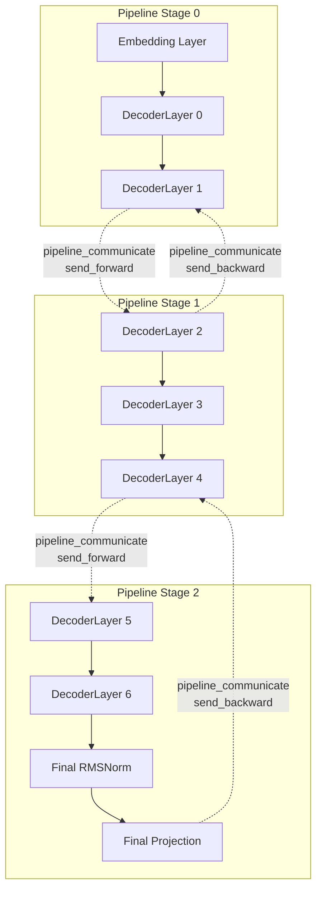
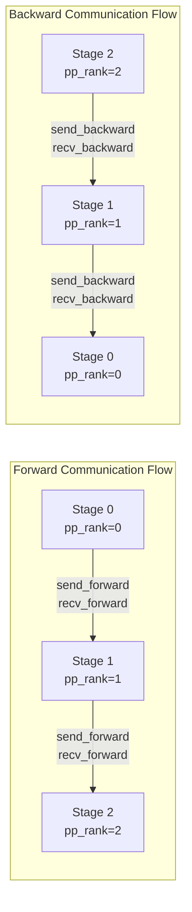
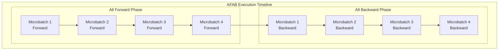
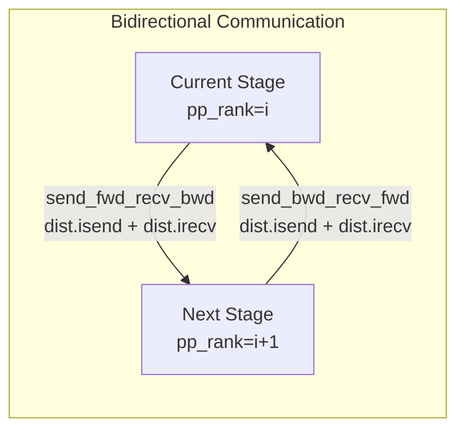
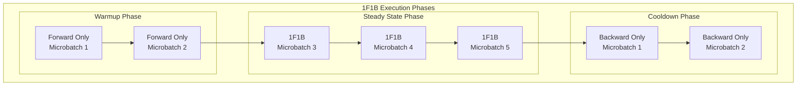
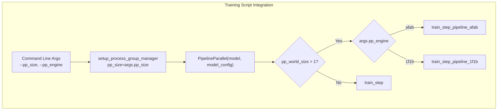
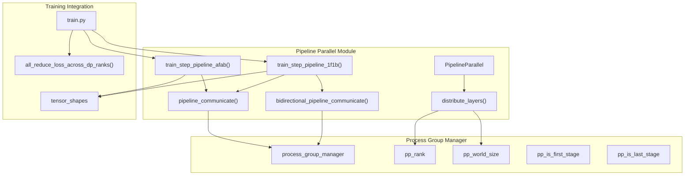

<!-- source: DeepWiki mcp.deepwiki.com · repo huggingface/picotron_tutorial · page 2.6 Step 7-8: Pipeline Parallelism · fetched 2026-10-26 -->

# Step 7-8: Pipeline Parallelism

Relevant source files

The following files were used as context for generating this wiki page:

- [step7_pipeline_parallel_afab/patch_step_7.diff](step7_pipeline_parallel_afab/patch_step_7.diff)
- [step7_pipeline_parallel_afab/train.py](step7_pipeline_parallel_afab/train.py)
- [step8_pipeline_parallel_1f1b/patch_step_8.diff](step8_pipeline_parallel_1f1b/patch_step_8.diff)
- [step8_pipeline_parallel_1f1b/train.py](step8_pipeline_parallel_1f1b/train.py)

## Purpose and Scope

This document covers the implementation of pipeline parallelism in steps 7 and 8 of the Picotron tutorial. Pipeline parallelism splits the model into sequential stages distributed across different devices, enabling training of larger models by reducing per-device memory requirements. Step 7 introduces the foundational pipeline infrastructure with the AFAB (Activation Forward - Activation Backward) execution engine, while Step 8 adds the more sophisticated 1F1B (One Forward One Backward) engine that overlaps computation and communication for improved efficiency.

For tensor parallelism strategies that split individual layers across devices, see [4.1](#4.1). For data parallelism approaches that replicate the model across devices, see [4.2](#4.2).

## Pipeline Stage Distribution and Communication

### Model Partitioning Strategy

Pipeline parallelism partitions the transformer model into sequential stages, with each stage containing a subset of decoder layers. The `PipelineParallel` class handles this distribution by calculating layer assignments based on the pipeline parallel world size.

The `distribute_layers` method in `PipelineParallel` calculates which layers each stage should own:

Sources: [step7_pipeline_parallel_afab/pipeline_parallel.py:96-99]()

### Point-to-Point Communication Primitives

Pipeline stages communicate through point-to-point operations coordinated by the `pipeline_communicate` function. This function handles four distinct communication patterns:

| Operation | Direction | Source Stage | Target Stage | Purpose |
|-----------|-----------|--------------|--------------|---------|
| `recv_forward` | Forward Pass | Previous Stage | Current Stage | Receive activations |
| `send_forward` | Forward Pass | Current Stage | Next Stage | Send activations |
| `recv_backward` | Backward Pass | Next Stage | Current Stage | Receive gradients |
| `send_backward` | Backward Pass | Current Stage | Previous Stage | Send gradients |

Sources: [step7_pipeline_parallel_afab/pipeline_parallel.py:23-83]()

## AFAB Pipeline Engine

### Execution Pattern

The AFAB (Activation Forward - Activation Backward) engine implements a two-phase execution strategy where all forward passes complete before any backward passes begin. This approach maximizes memory usage but provides simpler scheduling logic.

The `train_step_pipeline_afab` function stores intermediate activations and output tensors during the forward phase, then processes them in reverse order during the backward phase:

Sources: [step7_pipeline_parallel_afab/pipeline_parallel.py:117-152]()

### Memory and Synchronization Patterns

AFAB requires storing all forward pass outputs until the backward phase begins, leading to high peak memory usage. The engine coordinates gradient synchronization with data parallel groups by setting `require_backward_grad_sync` only on the final microbatch:

Sources: [step7_pipeline_parallel_afab/pipeline_parallel.py:143-146]()

## 1F1B Pipeline Engine

### Advanced Communication Primitives

Step 8 introduces `bidirectional_pipeline_communicate` for simultaneous send and receive operations, enabling the overlapped execution pattern of 1F1B:

Sources: [step8_pipeline_parallel_1f1b/pipeline_parallel.py:16-67]()

### Three-Phase Execution Strategy

The 1F1B engine implements a sophisticated three-phase execution pattern that overlaps forward and backward passes to reduce memory usage and improve pipeline efficiency:

The number of warmup microbatches is calculated as `min(pp_world_size - pp_rank - 1, grad_acc_steps)`, ensuring proper pipeline filling:

Sources: [step8_pipeline_parallel_1f1b/pipeline_parallel.py:76-77]()

### Gradient Synchronization Strategy

The 1F1B engine implements sophisticated gradient synchronization logic to ensure proper coordination with data parallel groups. Synchronization is triggered on the last microbatch, but only when the last pipeline stage (rank with `num_warmup_microbatches = 0`) completes its backward pass:

Sources: [step8_pipeline_parallel_1f1b/pipeline_parallel.py:117-118]()

## Integration with Training Pipeline

### Training Script Configuration

Both pipeline engines integrate into the training script through the `--pp_engine` argument, with the training loop dispatching to the appropriate engine based on configuration:

Sources: [step8_pipeline_parallel_1f1b/train.py:193-199]()

### Loss Aggregation Across Pipeline Stages

Since only the last pipeline stage computes the loss function, the `all_reduce_loss_across_dp_ranks` function coordinates loss values across data parallel groups while handling the pipeline distribution:

Sources: [step7_pipeline_parallel_afab/train.py:27-33]()

### Tensor Shape Coordination

Pipeline communication requires predefined tensor shapes for creating receive buffers. The training script calculates `tensor_shapes` as `(micro_batch_size, seq_len, hidden_size)` and passes it to the pipeline engines:

Sources: [step8_pipeline_parallel_1f1b/train.py:183]()

## Code Entity Relationships

Sources: [step7_pipeline_parallel_afab/pipeline_parallel.py:87-154](), [step8_pipeline_parallel_1f1b/pipeline_parallel.py:75-139](), [step8_pipeline_parallel_1f1b/train.py:193-199]()

---

