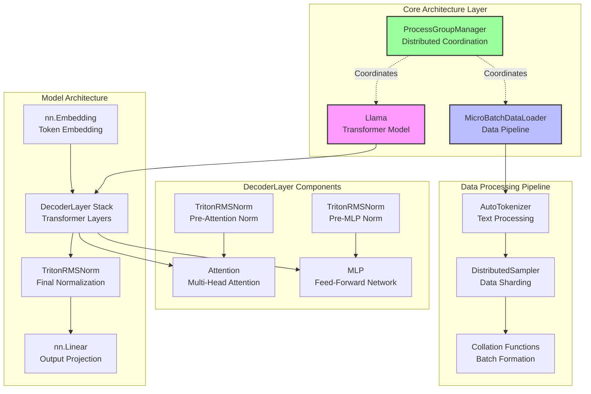
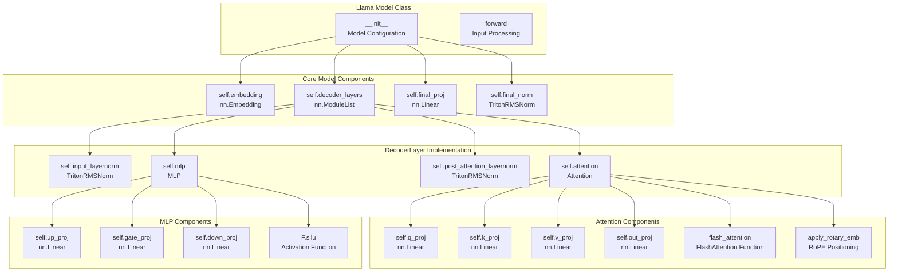
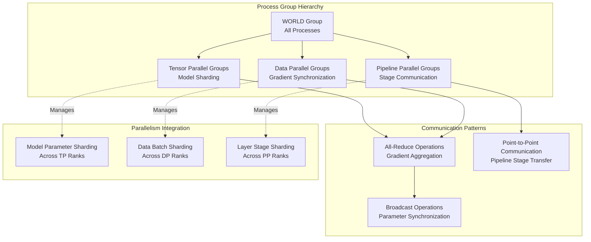

<!-- source: DeepWiki mcp.deepwiki.com · repo huggingface/picotron_tutorial · page 3 Core Architecture · fetched 2026-10-26 -->

# Core Architecture

Relevant source files

The following files were used as context for generating this wiki page:

- [step1_modeling/model.py](step1_modeling/model.py)
- [step3_dataloader/model.py](step3_dataloader/model.py)
- [step3_dataloader/utils.py](step3_dataloader/utils.py)

This document provides a comprehensive overview of the fundamental components that power the Picotron distributed training system. The core architecture consists of three primary subsystems: the LLaMA transformer model implementation, the data loading pipeline, and the process group management layer that coordinates distributed training operations.

For specific implementation details of tensor parallelism, data parallelism, and pipeline parallelism strategies, see [Parallelism Strategies](#4). For information about how these components integrate in complete training workflows, see [Training Integration](#5).

## System Overview

The Picotron architecture is designed around a modular approach where core components can be composed together to support different parallelism configurations. The system progresses from single-process training to sophisticated 3D parallelism while maintaining a consistent interface across all tutorial steps.

**Core Architecture Components**

Sources: [step1_modeling/model.py:118-148](), [step3_dataloader/model.py:118-148]()

## LLaMA Model Architecture

The `Llama` class serves as the main model interface and implements a standard transformer architecture optimized for autoregressive language modeling. The implementation uses several key architectural components that are designed for efficient distributed training.

**Model Component Hierarchy**

Sources: [step1_modeling/model.py:118-148](), [step1_modeling/model.py:100-117](), [step1_modeling/model.py:48-87](), [step1_modeling/model.py:89-98]()

### Key Architectural Features

The model implementation includes several optimizations for distributed training:

| Component | Implementation | Purpose |
|-----------|---------------|---------|
| **Attention Mechanism** | `flash_attention` function with `flash_attn_func` | Memory-efficient attention computation |
| **Positional Encoding** | `get_cos_sin` with RoPE via `apply_rotary_emb` | Rotary position embeddings for better length generalization |
| **Normalization** | `TritonRMSNorm` using `layer_norm_fn` | Efficient RMSNorm implementation via Triton |
| **Activation** | `F.silu` in MLP gating | SiLU activation for improved training dynamics |

The `DecoderLayer` follows the standard pre-normalization transformer pattern: `TritonRMSNorm -> Attention -> Residual -> TritonRMSNorm -> MLP -> Residual` as documented in [step1_modeling/model.py:101]().

Sources: [step1_modeling/model.py:8-12](), [step1_modeling/model.py:14-23](), [step1_modeling/model.py:25-46](), [step1_modeling/model.py:96-98]()

## Data Processing Pipeline

The data loading system provides efficient batch generation and distributed sampling capabilities. While the specific `MicroBatchDataLoader` implementation details are covered in [Data Loading System](#3.2), the core architecture establishes the foundation for gradient accumulation and distributed data handling.

**Data Flow Architecture**

```mermaid
graph LR
    subgraph "Input Data Sources"
        DATASET["HuggingFace Dataset<br/>TinyStories"]
        RAW_TEXT["Raw Text Strings<br/>Story Content"]
    end
    
    subgraph "Tokenization Layer"
        TOKENIZER["AutoTokenizer<br/>Text to Token Conversion"]
        ENCODING["encode() method<br/>String to List[int]"]
    end
    
    subgraph "Batch Formation"
        CHUNKING["Text Chunking<br/>seq_len + 1 Tokens"]
        INPUT_IDS["input_ids<br/>First seq_len Tokens"]
        TARGET_IDS["target_ids<br/>Last seq_len Tokens"]
    end
    
    subgraph "Distributed Sampling"
        DIST_SAMPLER["DistributedSampler<br/>Data Sharding"]
        RANK_SUBSET["Per-Rank Data<br/>Non-Overlapping Subsets"]
    end
    
    subgraph "Model Input"
        BATCHED_INPUT["Batched Tensors<br/>Shape: [batch_size, seq_len]"]
        MODEL_FORWARD["model.forward()<br/>Logits Generation"]
    end
    
    DATASET --> RAW_TEXT
    RAW_TEXT --> TOKENIZER
    TOKENIZER --> ENCODING
    ENCODING --> CHUNKING
    CHUNKING --> INPUT_IDS
    CHUNKING --> TARGET_IDS
    
    INPUT_IDS --> DIST_SAMPLER
    TARGET_IDS --> DIST_SAMPLER
    DIST_SAMPLER --> RANK_SUBSET
    RANK_SUBSET --> BATCHED_INPUT
    BATCHED_INPUT --> MODEL_FORWARD
```

Sources: [step3_dataloader/utils.py:1-40]()

## Process Group Management

The `ProcessGroupManager` coordinates distributed training operations across multiple parallelism dimensions. This component establishes the communication topology for tensor parallelism, data parallelism, and pipeline parallelism groups. The detailed implementation is covered in [Process Group Management](#3.3).

**Distributed Coordination Architecture**

Sources: Referenced from tutorial progression and distributed training patterns

## Component Integration

The three core architectural components work together to enable scalable distributed training. The integration patterns establish how models can be transformed from single-process implementations to sophisticated multi-dimensional parallel configurations.

| Integration Point | Mechanism | Purpose |
|------------------|-----------|---------|
| **Model-Data** | Batch shape coordination | Ensure consistent tensor dimensions across parallelism |
| **Model-ProcessGroup** | Communication group assignment | Map model components to appropriate process groups |
| **Data-ProcessGroup** | Distributed sampling | Coordinate data sharding across data parallel ranks |

The architecture supports progressive enhancement where each tutorial step adds new capabilities while maintaining compatibility with existing components. This design enables users to understand the impact of each parallelism strategy independently before combining them into full 3D parallelism configurations.

For detailed implementation of specific components, see:
- [LLaMA Model Implementation](#3.1) for transformer architecture details
- [Data Loading System](#3.2) for data pipeline implementation  
- [Process Group Management](#3.3) for distributed coordination mechanisms

Sources: [step1_modeling/model.py:1-148](), [step3_dataloader/model.py:1-148](), [step3_dataloader/utils.py:1-40]()

---

