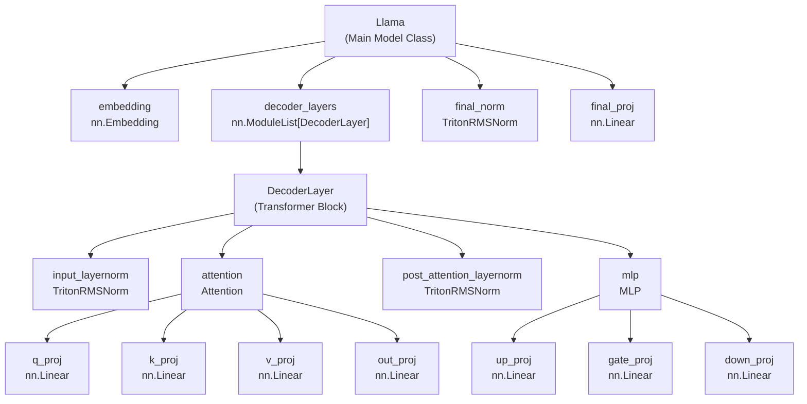
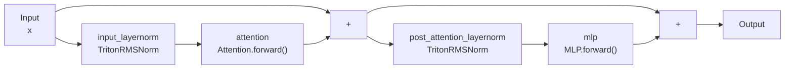
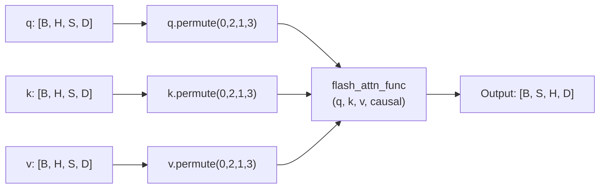
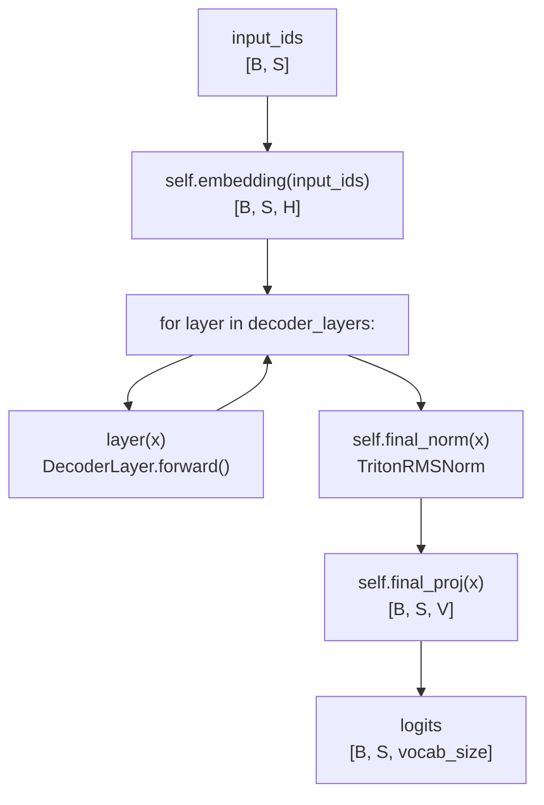

<!-- source: DeepWiki mcp.deepwiki.com · repo huggingface/picotron_tutorial · page 3.1 LLaMA Model Implementation · fetched 2026-10-26 -->

# LLaMA Model Implementation

<details>
<summary>Relevant source files</summary>

The following files were used as context for generating this wiki page:

- [step1_modeling/model.py](step1_modeling/model.py)
- [step1_modeling/train.py](step1_modeling/train.py)

</details>


This document provides a detailed technical breakdown of the LLaMA transformer model implementation that serves as the foundation for all distributed training tutorials. The implementation covers the complete transformer architecture including multi-head attention with FlashAttention, MLP layers, RMS normalization, and rotary positional embeddings (RoPE).

For information about how this model integrates with distributed training strategies, see [Tensor Parallelism](#4.1), [Data Parallelism](#4.2), and [Pipeline Parallelism](#4.3). For details on data loading and tokenization that feeds this model, see [Data Loading System](#3.2).

## Model Architecture Overview

The LLaMA implementation follows the standard transformer decoder architecture with several key optimizations including FlashAttention, grouped-query attention, and RMS normalization.



Sources: [step1_modeling/model.py:118-148]()

## Core Model Components

### Llama Main Class

The `Llama` class serves as the top-level model container that orchestrates the entire transformer architecture. It initializes with a HuggingFace configuration and creates all necessary sub-components.

| Component | Type | Purpose |
|-----------|------|---------|
| `embedding` | `nn.Embedding` | Token ID to hidden state conversion |
| `decoder_layers` | `nn.ModuleList[DecoderLayer]` | Stack of transformer blocks |
| `final_norm` | `TritonRMSNorm` | Final layer normalization |
| `final_proj` | `nn.Linear` | Hidden states to vocabulary logits |

The model performs configuration validation at initialization, ensuring that `hidden_size` is divisible by `num_attention_heads` and that grouped-query attention constraints are satisfied [step1_modeling/model.py:122-123]().

**Key Configuration Parameters:**
- `vocab_size`: Vocabulary size for embeddings and output projection
- `hidden_size`: Model dimension 
- `num_attention_heads`: Number of attention heads
- `num_key_value_heads`: Number of key/value heads for grouped-query attention
- `num_hidden_layers`: Number of decoder layers
- `max_position_embeddings`: Maximum sequence length

Sources: [step1_modeling/model.py:118-140]()

### DecoderLayer Architecture

Each `DecoderLayer` implements the standard transformer block with pre-normalization and residual connections. The layer follows the pattern: `LayerNorm → Attention → Residual → LayerNorm → MLP → Residual`.



The layer pre-computes rotary positional embeddings during initialization using `get_cos_sin()` with the configured `max_position_embeddings` and `rope_theta` parameters [step1_modeling/model.py:110]().

Sources: [step1_modeling/model.py:100-116]()

### Attention Mechanism

The `Attention` class implements multi-head attention with grouped-query attention support and FlashAttention optimization. It projects input to queries, keys, and values, applies rotary positional embeddings, and computes attention using the `flash_attention` function.

**Key Features:**
- **Grouped-Query Attention**: Uses `num_key_value_heads` for memory efficiency
- **FlashAttention**: Kernel-fused attention computation via `flash_attn_func`
- **RoPE Integration**: Rotary positional embeddings applied to queries and keys
- **Dynamic Causality**: Automatically detects causal vs non-causal attention based on sequence lengths

The attention mechanism handles key/value head repetition for grouped-query attention [step1_modeling/model.py:78-79]() and supports both training (causal) and inference modes.

Sources: [step1_modeling/model.py:48-87]()

### MLP Feed-Forward Network

The `MLP` class implements the SwiGLU activation variant used in LLaMA models. It consists of three linear projections with a gated activation pattern:

```python
# Equivalent computation in MLP.forward()
gate_output = F.silu(gate_proj(x))  # SiLU activation
up_output = up_proj(x)              # Linear projection  
return down_proj(gate_output * up_output)  # Element-wise multiply and project down
```

The MLP expands the hidden dimension to `config.intermediate_size` (typically 4x hidden size) and then projects back to the original dimension [step1_modeling/model.py:89-98]().

Sources: [step1_modeling/model.py:89-98]()

### RMS Normalization

The `TritonRMSNorm` class provides an optimized implementation of RMS (Root Mean Square) normalization using Triton kernels. Unlike standard LayerNorm, RMS normalization only normalizes by the variance without centering by the mean, making it computationally more efficient.

The implementation uses `layer_norm_fn` from FlashAttention's Triton utilities with `is_rms_norm=True` to enable RMS-specific behavior [step1_modeling/model.py:44]().

Sources: [step1_modeling/model.py:25-46]()

## Utility Functions

### FlashAttention Integration

The `flash_attention` function provides a wrapper around FlashAttention's optimized attention kernel:



The function transposes inputs from `[batch_size, num_heads, seq_length, head_dim]` to the expected `[batch_size, seq_length, num_heads, head_dim]` format for FlashAttention [step1_modeling/model.py:8-12]().

### Rotary Positional Embeddings

The `get_cos_sin` function computes rotary positional embeddings with careful device and precision handling to match the reference implementation:

1. **Frequency Computation**: Computed on CPU to ensure numerical consistency [step1_modeling/model.py:17]()
2. **Position Scaling**: Applied on GPU for performance [step1_modeling/model.py:22]()
3. **Dimension Expansion**: Frequencies repeated to match full head dimension [step1_modeling/model.py:23]()

Sources: [step1_modeling/model.py:8-23]()

## Model Forward Pass

The complete forward pass through the LLaMA model follows this sequence:



Each decoder layer applies the transformer block pattern internally, with attention and MLP operations wrapped by normalization and residual connections. The model returns raw logits that can be used for loss computation or token generation.

Sources: [step1_modeling/model.py:141-148]()

## Model Usage in Training

The model integrates with the training pipeline by accepting tokenized input sequences and producing vocabulary logits for cross-entropy loss computation. The training script demonstrates basic usage:

```python
# Model initialization with HuggingFace config
model = Llama(config=model_config)
model.to(dtype).to(device)

# Forward pass
outputs = model(input_ids=input_ids)  # [batch_size, seq_len, vocab_size]

# Loss computation  
loss = F.cross_entropy(outputs.view(-1, vocab_size), target_ids.reshape(-1))
```

This foundational implementation serves as the base for all distributed training modifications covered in subsequent tutorial steps.

Sources: [step1_modeling/train.py:64-87]()

---

