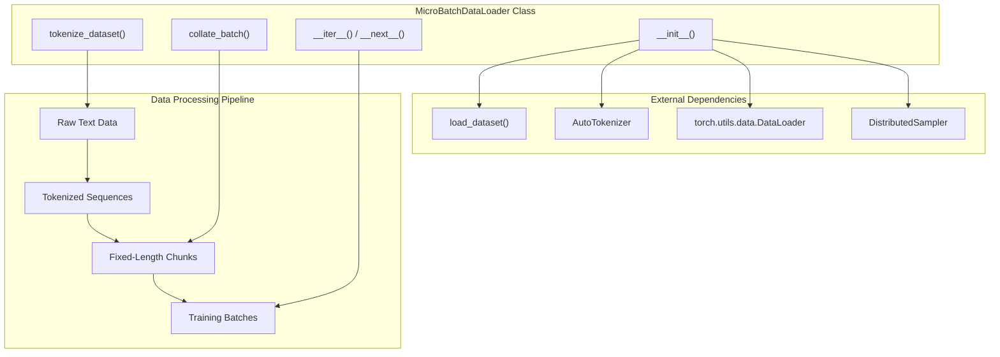
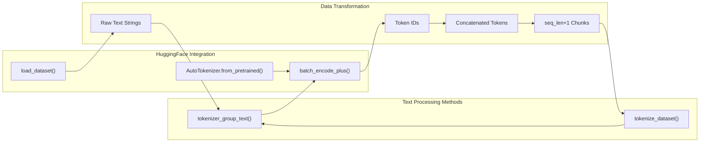
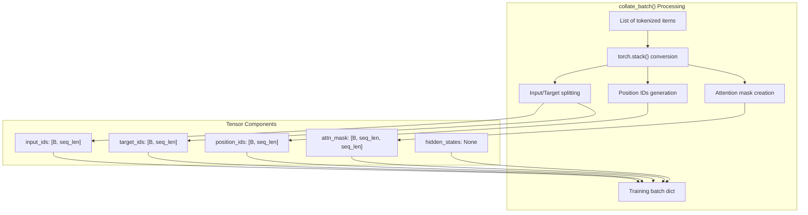
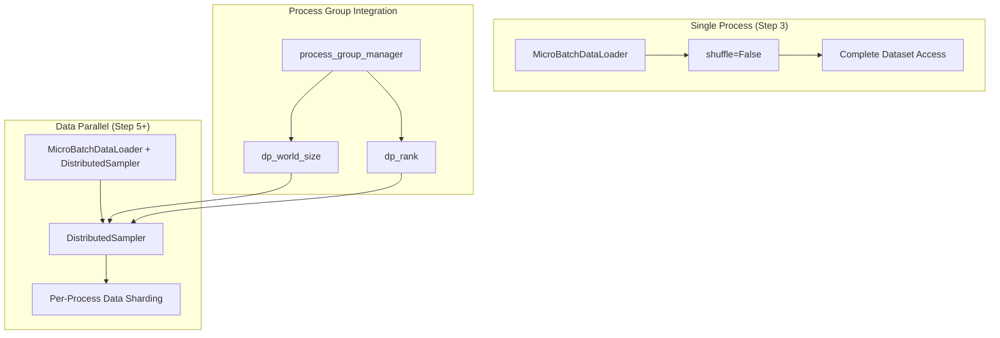
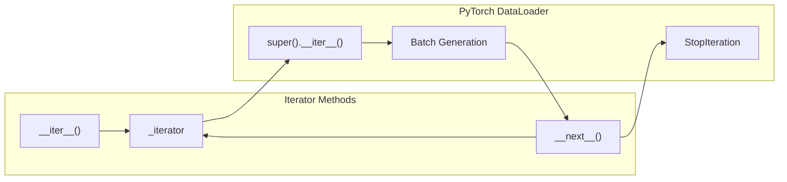
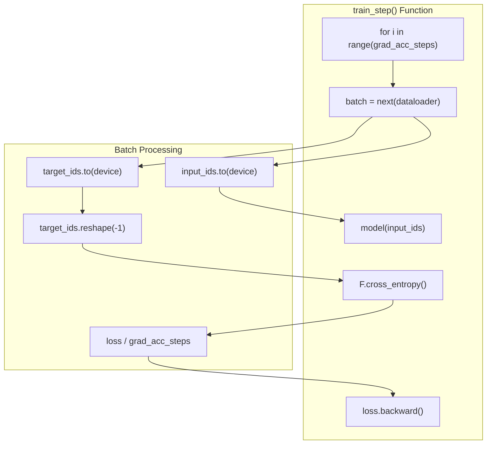

<!-- source: DeepWiki mcp.deepwiki.com · repo huggingface/picotron_tutorial · page 3.2 Data Loading System · fetched 2026-10-26 -->

# Data Loading System

<details>
<summary>Relevant source files</summary>

The following files were used as context for generating this wiki page:

- [step3_dataloader/dataloader.py](step3_dataloader/dataloader.py)
- [step3_dataloader/patch_step_3.diff](step3_dataloader/patch_step_3.diff)
- [step4_tensor_parallel/dataloader.py](step4_tensor_parallel/dataloader.py)
- [step5_data_parallel_naive/dataloader.py](step5_data_parallel_naive/dataloader.py)

</details>


The Data Loading System provides efficient data pipeline management for training LLaMA models in the Picotron tutorial framework. This system handles text tokenization, sequence chunking, batch creation, and distributed data sampling across multiple training processes. The system evolves from simple single-process data loading in Step 3 to distributed data parallelism in Steps 5-8.

For information about how data loading integrates with distributed training coordination, see [Process Group Management](#3.3). For details on training orchestration and gradient accumulation loops, see [Training Integration](#5).

## Core Architecture

The data loading system is built around the `MicroBatchDataLoader` class, which extends PyTorch's `DataLoader` to provide specialized functionality for language model training with gradient accumulation and distributed processing.

### MicroBatchDataLoader Design



**Sources:** [step3_dataloader/dataloader.py:10-44](), [step5_data_parallel_naive/dataloader.py:10-44]()

The `MicroBatchDataLoader` constructor takes the following key parameters:

| Parameter | Purpose | Default | Notes |
|-----------|---------|---------|-------|
| `seq_len` | Sequence length for training | - | Input sequences are this length |
| `micro_batch_size` | Batch size per micro-step | - | Used with gradient accumulation |
| `grad_acc_steps` | Gradient accumulation steps | - | Combined with micro batch size |
| `dataset_name` | HuggingFace dataset identifier | "roneneldan/TinyStories" | Text dataset for training |
| `tokenizer_name` | HuggingFace tokenizer identifier | - | Usually matches model name |
| `max_tokens` | Maximum tokens to process | 1e6 | Training duration control |
| `num_proc` | Parallel processes for tokenization | 4 | Dataset preprocessing |

**Sources:** [step3_dataloader/dataloader.py:11-15](), [step5_data_parallel_naive/dataloader.py:11-15]()

## Text Processing and Tokenization

### Dataset Loading and Tokenization Pipeline



**Sources:** [step3_dataloader/dataloader.py:41-88](), [step5_data_parallel_naive/dataloader.py:46-89]()

The tokenization process involves several key steps:

1. **Text Loading**: The system loads the TinyStories dataset using HuggingFace's `load_dataset()` function [step3_dataloader/dataloader.py:20]()

2. **Batch Tokenization**: The `tokenizer_group_text()` method processes text in batches using `batch_encode_plus()` [step3_dataloader/dataloader.py:43-48]()

3. **Token Concatenation**: Individual tokenized texts are concatenated into a continuous stream [step3_dataloader/dataloader.py:49]()

4. **Sequence Chunking**: The continuous token stream is split into fixed-length chunks of `seq_len + 1` tokens [step3_dataloader/dataloader.py:52-60]()

The extra token (+1) allows for creating input/target pairs where targets are shifted by one position for next-token prediction.

**Sources:** [step3_dataloader/dataloader.py:37-66](), [step5_data_parallel_naive/dataloader.py:46-66]()

## Batch Collation and Tensor Creation

### Batch Structure and Tensor Preparation

The `collate_batch()` method transforms tokenized sequences into training-ready tensors:



**Sources:** [step3_dataloader/dataloader.py:82-101](), [step5_data_parallel_naive/dataloader.py:91-106]()

The batch collation creates the following tensor components:

- **input_ids**: Token sequences for model input `[batch_size, seq_len]` [step3_dataloader/dataloader.py:89]()
- **target_ids**: Shifted tokens for loss computation `[batch_size, seq_len]` [step3_dataloader/dataloader.py:90]()
- **position_ids**: Sequential position indices for each token [step3_dataloader/dataloader.py:91]()
- **attn_mask**: Lower triangular attention mask for causal attention [step3_dataloader/dataloader.py:92-93]()
- **hidden_states**: Placeholder for pipeline parallelism (initially None) [step3_dataloader/dataloader.py:100]()

## Distributed Data Handling

### Evolution to Data Parallelism

The data loading system evolves to support distributed training by incorporating `DistributedSampler`:



**Sources:** [step5_data_parallel_naive/dataloader.py:28-43](), [step3_dataloader/dataloader.py:28-44]()

### Distributed Sampler Configuration

In data parallel configurations, the `DistributedSampler` ensures each process receives different data subsets:

| Parameter | Value | Source |
|-----------|-------|--------|
| `num_replicas` | `pgm.process_group_manager.dp_world_size` | Total DP processes |
| `rank` | `pgm.process_group_manager.dp_rank` | Current DP rank |
| `seed` | Training seed | Deterministic sampling |
| `shuffle` | `False` | Sequential processing |

**Sources:** [step5_data_parallel_naive/dataloader.py:28-34]()

## Global Batch Size Calculation

The system computes effective batch sizes across distributed processes:

```python
self.global_batch_size = micro_batch_size * grad_acc_steps * pgm.process_group_manager.dp_world_size
```

This calculation ensures consistent effective batch sizes regardless of the number of data parallel processes.

**Sources:** [step3_dataloader/dataloader.py:17](), [step5_data_parallel_naive/dataloader.py:17]()

## Iterator Implementation

### Custom Iterator Pattern

The `MicroBatchDataLoader` implements a custom iterator pattern to support gradient accumulation:



**Sources:** [step3_dataloader/dataloader.py:103-116](), [step5_data_parallel_naive/dataloader.py:108-121]()

The iterator implementation allows for:
- Lazy iterator initialization [step3_dataloader/dataloader.py:104-105]()
- Proper cleanup on exhaustion [step3_dataloader/dataloader.py:114-115]()
- Seamless integration with gradient accumulation loops [step3_dataloader/patch_step_3.diff:148-149]()

## Training Integration

### Integration with Training Loop

The data loader integrates with the training process through the `train_step()` function:



**Sources:** [step3_dataloader/patch_step_3.diff:144-165]()

The training integration demonstrates:
- Gradient accumulation loop control [step3_dataloader/patch_step_3.diff:147]()
- Device placement of tensors [step3_dataloader/patch_step_3.diff:150-151]()
- Loss scaling for gradient accumulation [step3_dataloader/patch_step_3.diff:159]()
- Proper tensor reshaping for loss computation [step3_dataloader/patch_step_3.diff:157-158]()

**Sources:** [step3_dataloader/patch_step_3.diff:144-165]()

---

