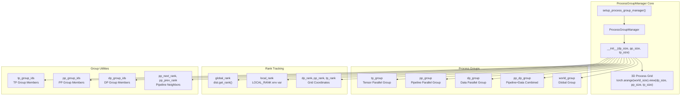
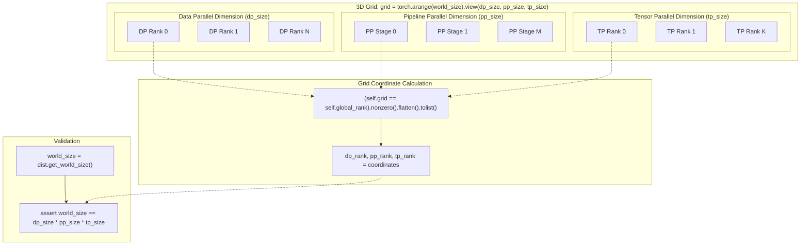
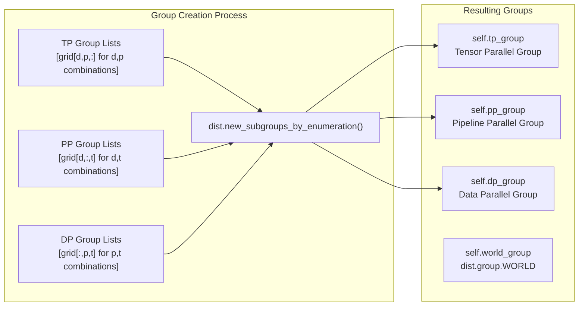
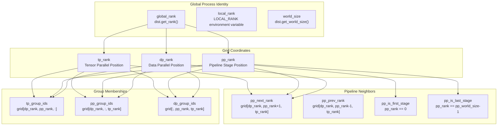
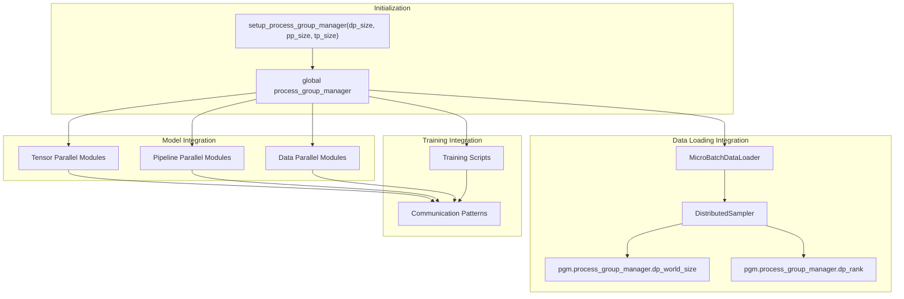

<!-- source: DeepWiki mcp.deepwiki.com · repo huggingface/picotron_tutorial · page 3.3 Process Group Management · fetched 2026-10-26 -->

# Process Group Management

<details>
<summary>Relevant source files</summary>

The following files were used as context for generating this wiki page:

- [step4_tensor_parallel/process_group_manager.py](step4_tensor_parallel/process_group_manager.py)
- [step7_pipeline_parallel_afab/dataloader.py](step7_pipeline_parallel_afab/dataloader.py)
- [step7_pipeline_parallel_afab/process_group_manager.py](step7_pipeline_parallel_afab/process_group_manager.py)
- [step8_pipeline_parallel_1f1b/dataloader.py](step8_pipeline_parallel_1f1b/dataloader.py)
- [step8_pipeline_parallel_1f1b/process_group_manager.py](step8_pipeline_parallel_1f1b/process_group_manager.py)

</details>


This document covers the technical implementation of distributed process coordination in the Picotron tutorial system. The `ProcessGroupManager` class serves as the central coordinator for organizing multiple processes across three dimensions of parallelism: data parallel (DP), pipeline parallel (PP), and tensor parallel (TP). This system handles the complex task of mapping distributed processes to logical groups and managing their communication patterns.

For information about how these process groups are used in specific parallelism strategies, see [Tensor Parallelism](#4.1), [Data Parallelism](#4.2), and [Pipeline Parallelism](#4.3). For details on training integration, see [Distributed Training Coordination](#5.2).

## Core Architecture

The `ProcessGroupManager` class provides a unified interface for managing distributed training across all parallelism dimensions. It creates and maintains separate process groups for tensor parallel, pipeline parallel, and data parallel communications while tracking the position of each process within the global 3D grid.



**Sources:** [step4_tensor_parallel/process_group_manager.py:5-54](), [step7_pipeline_parallel_afab/process_group_manager.py:5-54](), [step8_pipeline_parallel_1f1b/process_group_manager.py:5-54]()

## Process Grid Organization

The system organizes all distributed processes into a 3D grid structure with dimensions `[dp_size, pp_size, tp_size]`. Each process has a unique position within this grid, determining its role in each parallelism dimension.

#### 3D Process Grid Structure



**Sources:** [step4_tensor_parallel/process_group_manager.py:11-15]()

## Process Group Creation

The `ProcessGroupManager` creates distinct process groups for each parallelism dimension using PyTorch's `dist.new_subgroups_by_enumeration()`. Each group contains processes that need to communicate for a specific type of parallelism.

#### Process Group Formation Logic

| Group Type | Formation Logic | Purpose |
|------------|----------------|---------|
| `tp_group` | `[self.grid[d, p, :].tolist() for d in range(dp_size) for p in range(pp_size)]` | Tensor parallel communication within model shards |
| `pp_group` | `[self.grid[d, :, t].tolist() for d in range(dp_size) for t in range(tp_size)]` | Pipeline parallel activation passing between stages |
| `dp_group` | `[self.grid[:, p, t].tolist() for p in range(pp_size) for t in range(tp_size)]` | Data parallel gradient synchronization across data replicas |
| `pp_dp_group` | `[self.grid[:, :, t].flatten().tolist() for t in range(tp_size)]` | Combined pipeline and data parallel communications |



**Sources:** [step4_tensor_parallel/process_group_manager.py:17-23]()

## Rank Management and Utilities

The system tracks multiple rank identities for each process and provides utilities for neighbor identification, particularly important for pipeline parallelism.

#### Rank Tracking System



**Sources:** [step4_tensor_parallel/process_group_manager.py:25-47]()

## Integration with System Components

The `ProcessGroupManager` is used throughout the system as a global singleton, accessed by other components for distributed coordination. The `setup_process_group_manager()` function creates the global instance.

#### System Integration Pattern



**Sources:** [step4_tensor_parallel/process_group_manager.py:52-54](), [step7_pipeline_parallel_afab/dataloader.py:8](), [step8_pipeline_parallel_1f1b/dataloader.py:17](), [step8_pipeline_parallel_1f1b/dataloader.py:30-31]()

## String Representation and Debugging

The class provides a string representation for debugging and logging purposes, showing the configuration and current process rank.

```python
def __str__(self):
    return f"DP({self.dp_world_size})-PP({self.pp_world_size})-TP({self.tp_world_size})-Rank({self.global_rank})"
```

This creates output like `"DP(2)-PP(4)-TP(2)-Rank(3)"` indicating 2-way data parallel, 4-way pipeline parallel, 2-way tensor parallel configuration with the current process having global rank 3.

**Sources:** [step4_tensor_parallel/process_group_manager.py:49-50]()

---

