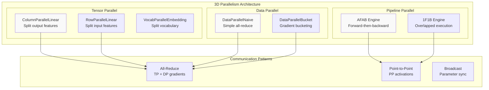
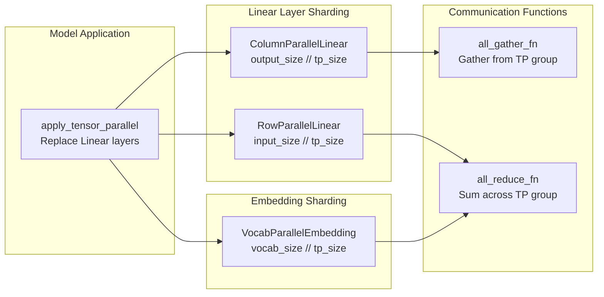
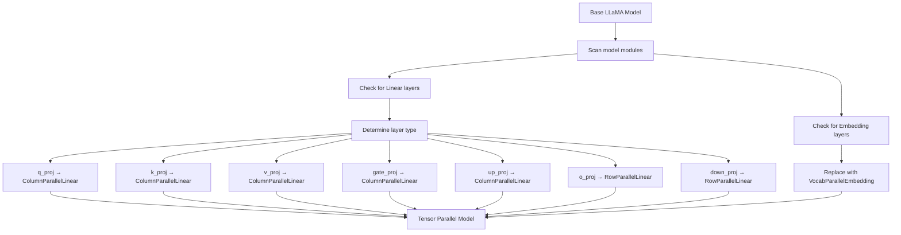
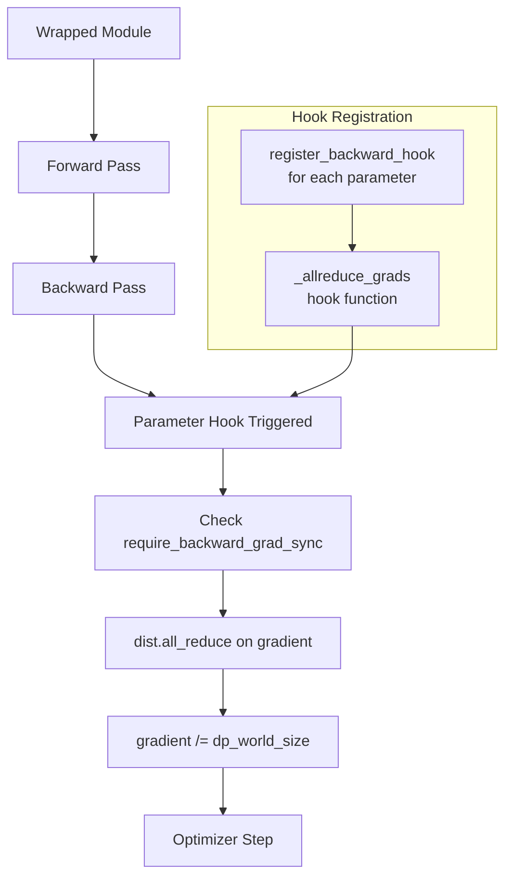
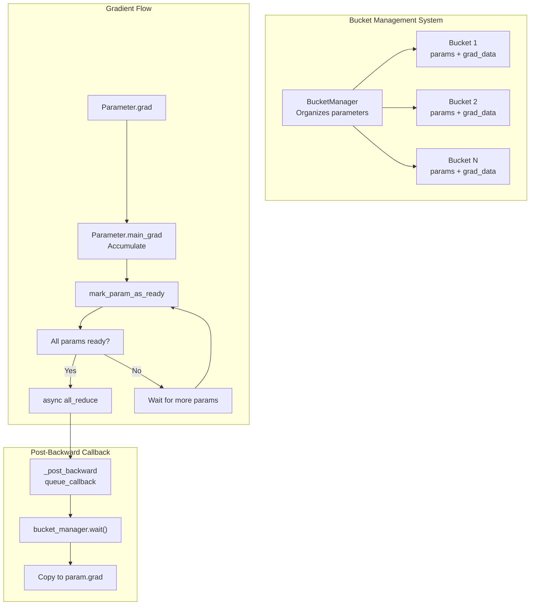
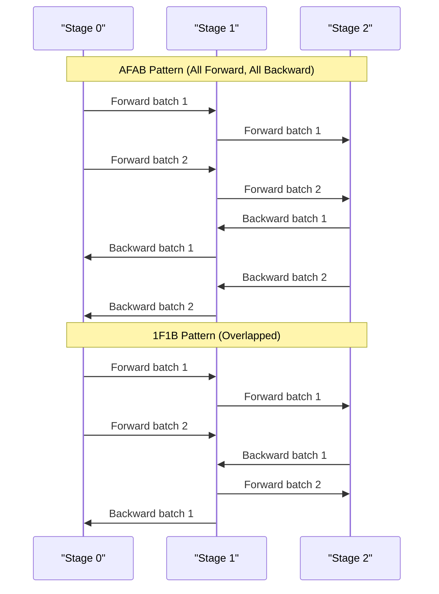
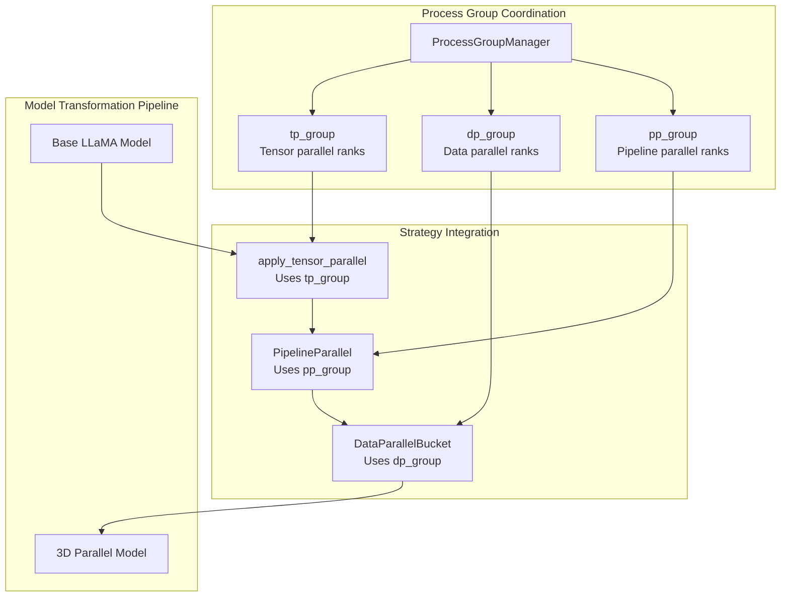

<!-- source: DeepWiki mcp.deepwiki.com · repo huggingface/picotron_tutorial · page 4 Parallelism Strategies · fetched 2026-10-26 -->

# Parallelism Strategies

Relevant source files

The following files were used as context for generating this wiki page:

- [.demo/step4_tensor_parallel.json](.demo/step4_tensor_parallel.json)
- [.demo/step5_data_parallel_naive.json](.demo/step5_data_parallel_naive.json)
- [.demo/step6_data_parallel_bucket.json](.demo/step6_data_parallel_bucket.json)
- [step6_data_parallel_bucket/data_parallel.py](step6_data_parallel_bucket/data_parallel.py)

This document covers the three fundamental parallelism strategies implemented in the Picotron tutorial system for distributed deep learning: Tensor Parallelism, Data Parallelism, and Pipeline Parallelism. These strategies enable training large language models by distributing computation and memory across multiple GPUs and processes.

For details on the process group coordination that enables these strategies, see [Process Group Management](#3.3). For information about how these strategies integrate in complete training scripts, see [Training Integration](#5).

## Overview of Parallelism Dimensions

The tutorial implements a 3D parallelism approach where each dimension addresses different scaling challenges:

**Sources:** [step4_tensor_parallel/tensor_parallel.py](), [step6_data_parallel_bucket/data_parallel.py](), [.demo/step4_tensor_parallel.json](), [.demo/step5_data_parallel_naive.json](), [.demo/step6_data_parallel_bucket.json]()

## Tensor Parallelism Implementation

Tensor Parallelism distributes model weights across multiple GPUs within each transformer layer. The implementation uses three core classes that handle different aspects of weight sharding.

### Core Tensor Parallel Classes

**Sources:** [step4_tensor_parallel/tensor_parallel.py:68-111](), [step4_tensor_parallel/tensor_parallel.py:128-165](), [step4_tensor_parallel/tensor_parallel.py:175-216]()

### Weight Initialization and Communication

The tensor parallel implementation handles weight initialization carefully to ensure consistent model behavior across different tensor parallel configurations:

| Class | Weight Initialization | Forward Communication | Backward Communication |
|-------|----------------------|----------------------|----------------------|
| `ColumnParallelLinear` | Local partition only | No communication | `all_gather_fn` |
| `RowParallelLinear` | Full weight, then slice | `all_reduce_fn` | No communication |
| `VocabParallelEmbedding` | Local vocabulary partition | `all_reduce_fn` | No communication |

**Sources:** [step4_tensor_parallel/tensor_parallel.py:139-157](), [step4_tensor_parallel/tensor_parallel.py:191-209](), [step4_tensor_parallel/tensor_parallel.py:242-245]()

### Tensor Parallel Application Process

The `apply_tensor_parallel` function transforms a standard model into a tensor-parallel version by replacing specific layer types:

**Sources:** [step4_tensor_parallel/tensor_parallel.py:68-111]()

## Data Parallelism Strategies

Data Parallelism replicates the model across multiple processes and synchronizes gradients after backward passes. The tutorial implements two approaches with different optimization strategies.

### Naive Data Parallelism

The `DataParallelNaive` class provides a straightforward implementation using parameter hooks:

**Sources:** [step6_data_parallel_bucket/data_parallel.py:10-36]()

### Bucketed Data Parallelism

The `DataParallelBucket` class optimizes gradient synchronization using gradient bucketing and asynchronous communication:

**Sources:** [step6_data_parallel_bucket/data_parallel.py:83-163](), [step6_data_parallel_bucket/data_parallel.py:165-258]()

### Gradient Bucketing Strategy

The bucketing system optimizes communication by grouping parameters and overlapping computation with communication:

| Component | Responsibility | Key Methods |
|-----------|---------------|-------------|
| `BucketManager` | Parameter organization, bucket allocation | `_initialize_buckets`, `mark_param_as_ready` |
| `Bucket` | Gradient storage, async communication | `sync_gradient`, `wait`, `mark_param_as_ready` |
| `DataParallelBucket` | Hook registration, gradient accumulation | `register_backward_hook`, `_make_param_hook` |

**Sources:** [step6_data_parallel_bucket/data_parallel.py:39-82](), [step6_data_parallel_bucket/data_parallel.py:102-148]()

## Pipeline Parallelism Engines

Pipeline Parallelism splits the model across multiple stages, with each stage executing on different processes. The tutorial implements two execution engines with different scheduling strategies.

### Pipeline Execution Patterns

**Sources:** [.demo/step4_tensor_parallel.json](), [.demo/step5_data_parallel_naive.json]()

## Integration and Communication Coordination

The parallelism strategies integrate through the `ProcessGroupManager` which coordinates different communication groups:

**Sources:** [step6_data_parallel_bucket/data_parallel.py:175](), [step4_tensor_parallel/tensor_parallel.py:68-111]()

The three parallelism dimensions work together to enable training of large models by:
- **Tensor Parallelism**: Reducing memory per GPU by splitting weights
- **Data Parallelism**: Increasing throughput by processing multiple batches
- **Pipeline Parallelism**: Enabling models larger than single GPU memory by splitting layers

Each strategy addresses different scaling bottlenecks and can be combined to achieve optimal performance for specific model sizes and hardware configurations.

---

