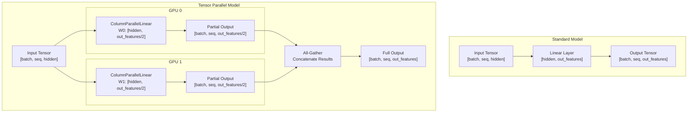
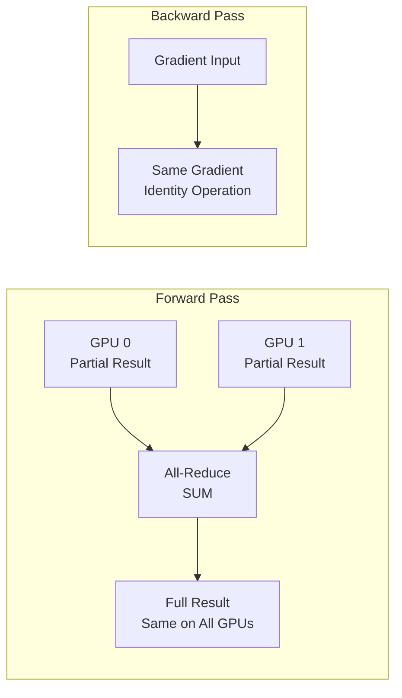
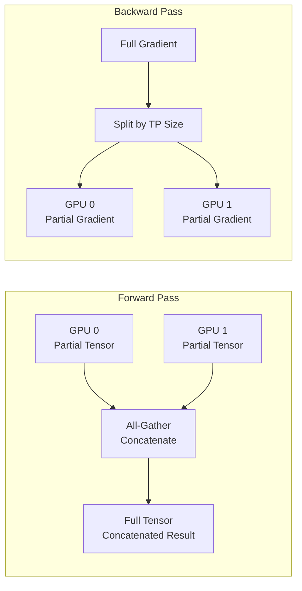
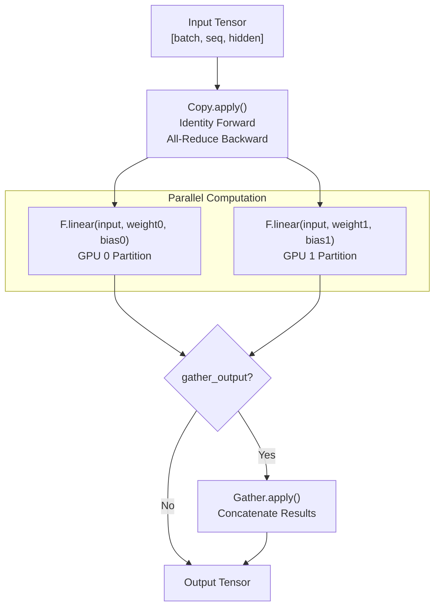
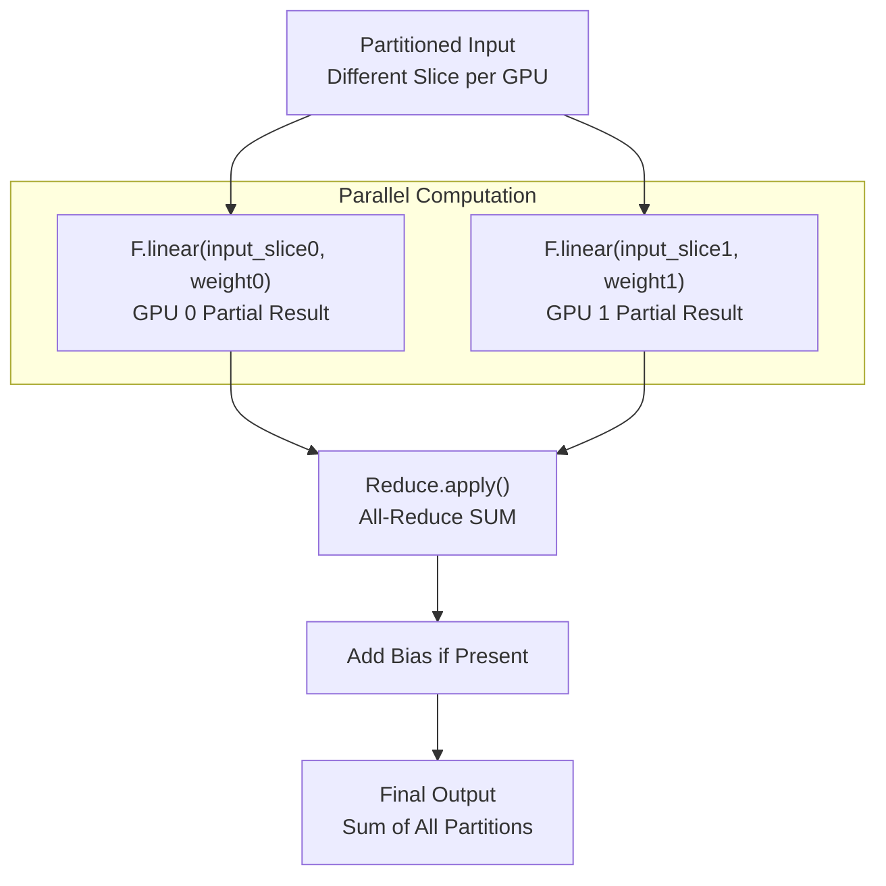
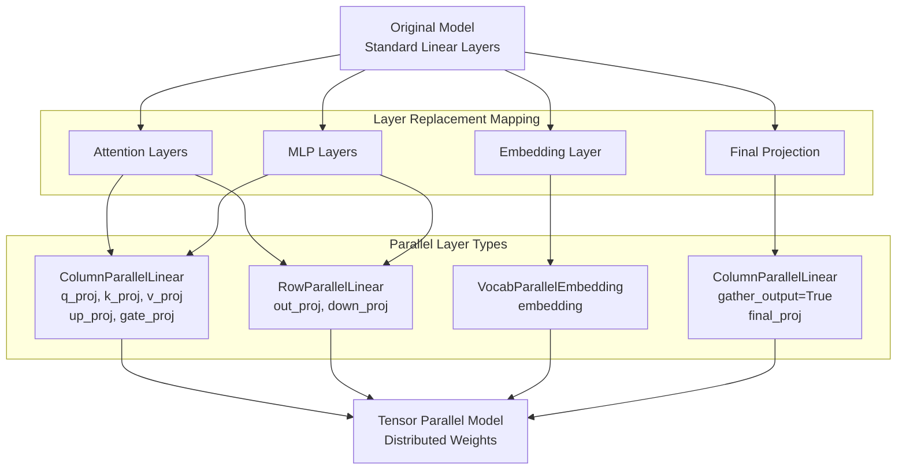
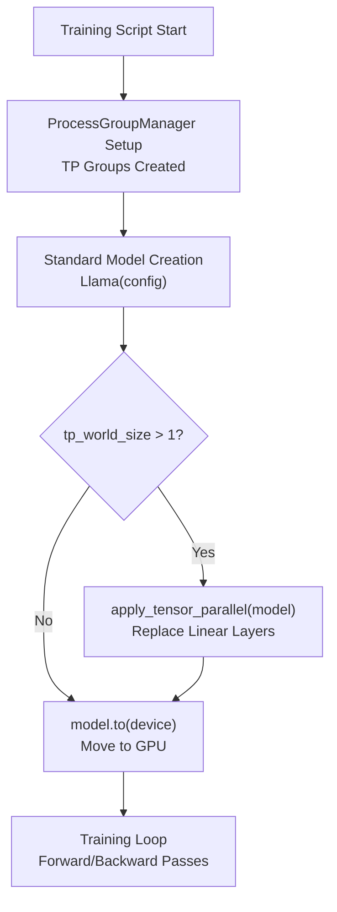

<!-- source: DeepWiki mcp.deepwiki.com · repo huggingface/picotron_tutorial · page 4.1 Tensor Parallelism · fetched 2026-10-26 -->

# Tensor Parallelism

Relevant source files

The following files were used as context for generating this wiki page:

- [.demo/step4_tensor_parallel.json](.demo/step4_tensor_parallel.json)
- [step3_dataloader/process_group_manager.py](step3_dataloader/process_group_manager.py)
- [step4_tensor_parallel/patch_step_4.diff](step4_tensor_parallel/patch_step_4.diff)

This document covers the tensor parallelism implementation in Step 4 of the Picotron tutorial. Tensor parallelism enables splitting model weights across multiple GPUs to handle models that don't fit on a single device. This includes the core communication primitives, parallel layer implementations, and the model transformation process.

For data parallelism approaches, see [Data Parallelism](#4.2). For pipeline parallelism, see [Pipeline Parallelism](#4.3). For process group coordination, see [Process Group Management](#3.3).

## Overview

Tensor parallelism partitions individual layers of a neural network across multiple devices. Unlike data parallelism which replicates the model, tensor parallelism splits the model parameters themselves. The implementation transforms standard linear layers into column-parallel and row-parallel variants that work together through collective communication operations.

Sources: [step4_tensor_parallel/tensor_parallel.py:101-144]()

## Communication Primitives

The tensor parallelism implementation uses three core communication primitives implemented as PyTorch autograd functions to handle forward and backward passes correctly.

### Reduce Operation

The `Reduce` class performs all-reduce in the forward pass and identity in the backward pass. This is used by row-parallel layers to sum partial results across tensor parallel ranks.

Sources: [step4_tensor_parallel/tensor_parallel.py:46-59]()

### Gather Operation

The `Gather` class concatenates tensors in the forward pass and splits gradients in the backward pass. This is used by column-parallel layers when `gather_output=True`.

Sources: [step4_tensor_parallel/tensor_parallel.py:61-82]()

### Copy Operation

The `Copy` class is identity in the forward pass and all-reduce in the backward pass. This ensures gradients are properly synchronized across tensor parallel ranks for column-parallel layers.

Sources: [step4_tensor_parallel/tensor_parallel.py:84-97]()

## Parallel Layer Implementations

### ColumnParallelLinear

The `ColumnParallelLinear` class splits the output features of a linear layer across tensor parallel ranks. Each rank holds a partition of the weight matrix and computes a partial output.

| Attribute | Description |
|-----------|-------------|
| `output_size_per_partition` | Output features divided by TP world size |
| `weight` | Parameter tensor of shape `[output_size_per_partition, in_features]` |
| `gather_output` | Whether to gather results across ranks in forward pass |

The forward pass applies the `Copy` operation to ensure input consistency, performs the linear transformation, and optionally gathers the output.

Sources: [step4_tensor_parallel/tensor_parallel.py:146-198]()

### RowParallelLinear

The `RowParallelLinear` class splits the input features of a linear layer across tensor parallel ranks. Each rank holds a partition of the weight matrix and the results are summed via all-reduce.

| Attribute | Description |
|-----------|-------------|
| `input_size_per_partition` | Input features divided by TP world size |
| `weight` | Parameter tensor of shape `[out_features, input_size_per_partition]` |

The forward pass performs the linear transformation on the partitioned input and uses `Reduce` to sum the partial results.

Sources: [step4_tensor_parallel/tensor_parallel.py:200-249]()

### VocabParallelEmbedding

The `VocabParallelEmbedding` class partitions the vocabulary dimension of embedding layers across tensor parallel ranks. Each rank handles a subset of the vocabulary and masks out-of-range tokens.

| Attribute | Description |
|-----------|-------------|
| `vocab_start_index` | Starting vocabulary index for this rank |
| `vocab_end_index` | Ending vocabulary index for this rank |
| `num_embeddings_per_partition` | Vocabulary size per rank |

The forward pass creates masks for out-of-vocabulary tokens, performs embedding lookup, zeros out invalid embeddings, and reduces across ranks.

Sources: [step4_tensor_parallel/tensor_parallel.py:251-332]()

## Model Transformation Process

The `apply_tensor_parallel` function transforms a standard model into a tensor-parallel model by replacing linear layers with their parallel counterparts.

The mapping table defines which layers get converted to which parallel type:

| Module | Layer | Parallel Type | Purpose |
|--------|--------|---------------|---------|
| attention | q_proj, k_proj, v_proj | ColumnParallel | Split attention heads |
| attention | out_proj | RowParallel | Combine attention outputs |
| mlp | up_proj, gate_proj | ColumnParallel | Split MLP hidden dimension |
| mlp | down_proj | RowParallel | Combine MLP outputs |
| model | embedding | VocabParallel | Split vocabulary |
| model | final_proj | ColumnParallel (gather) | Output full vocabulary logits |

Sources: [step4_tensor_parallel/tensor_parallel.py:101-144]()

## Integration with Training

The tensor parallel model integrates with the training pipeline through process group coordination. The training script checks if `tp_world_size > 1` and applies tensor parallelism before moving the model to device.

The tensor parallel layers use the process group manager to access TP-specific information like `tp_world_size`, `tp_rank`, and `tp_group` for communication operations.

Sources: [step4_tensor_parallel/train.py:359-362](), [step4_tensor_parallel/patch_step_4.diff:334-366]()

---

