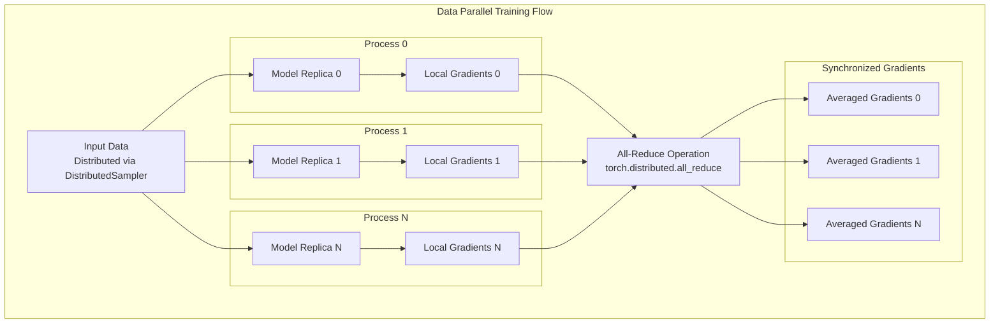
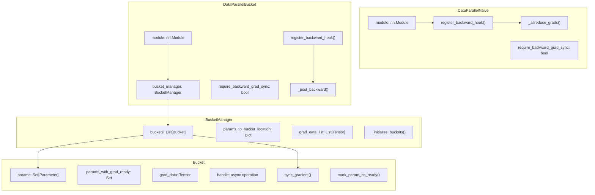
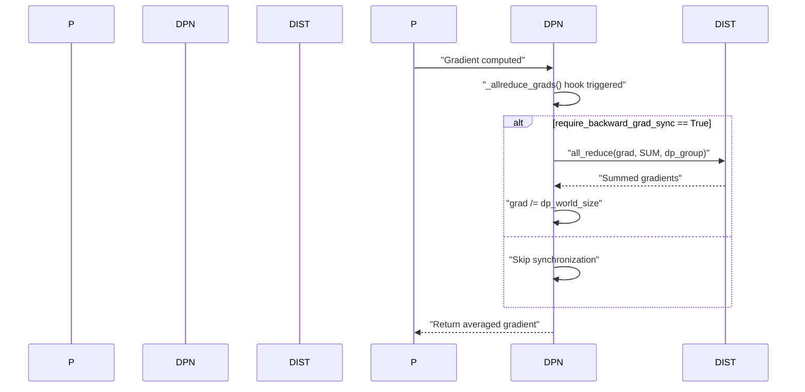
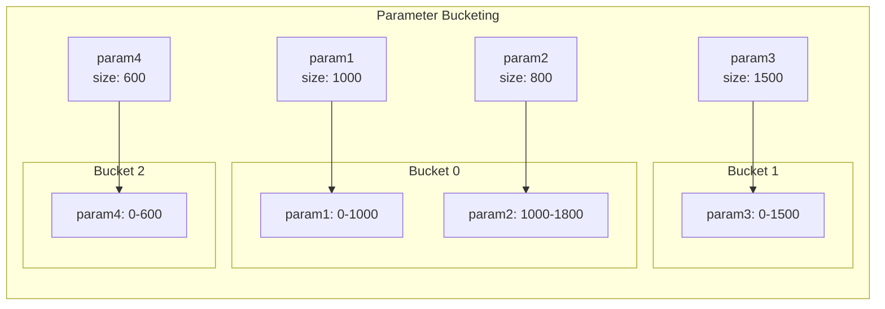
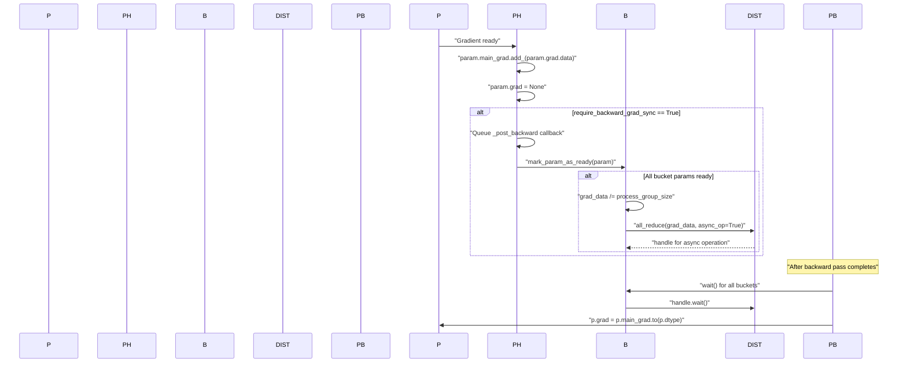

<!-- source: DeepWiki mcp.deepwiki.com · repo huggingface/picotron_tutorial · page 4.2 Data Parallelism · fetched 2026-10-26 -->

# Data Parallelism

<details>
<summary>Relevant source files</summary>

The following files were used as context for generating this wiki page:

- [.demo/step5_data_parallel_naive.json](.demo/step5_data_parallel_naive.json)
- [.demo/step6_data_parallel_bucket.json](.demo/step6_data_parallel_bucket.json)
- [step5_data_parallel_naive/data_parallel.py](step5_data_parallel_naive/data_parallel.py)
- [step6_data_parallel_bucket/data_parallel.py](step6_data_parallel_bucket/data_parallel.py)
- [step6_data_parallel_bucket/patch_step_6.diff](step6_data_parallel_bucket/patch_step_6.diff)

</details>


Data parallelism is a distributed training strategy that replicates the entire model across multiple processes, with each process training on a different subset of the data. This page covers two implementations of data parallelism: a naive approach with immediate gradient synchronization and an optimized bucketed approach with asynchronous communication. For information about tensor parallelism (model sharding), see [Tensor Parallelism](#4.1). For pipeline parallelism details, see [Pipeline Parallelism](#4.3).

## Overview

Data parallelism distributes training data across multiple processes while maintaining identical model replicas. After computing gradients on each process's data subset, gradients must be synchronized across all processes using all-reduce operations before parameter updates. The tutorial implements two approaches with different communication efficiency characteristics.



Sources: [step5_data_parallel_naive/data_parallel.py:1-34](), [step6_data_parallel_bucket/data_parallel.py:1-259]()

## Implementation Architecture

The tutorial provides two data parallelism implementations with different complexity and performance characteristics:



Sources: [step5_data_parallel_naive/data_parallel.py:10-34](), [step6_data_parallel_bucket/data_parallel.py:165-259](), [step6_data_parallel_bucket/data_parallel.py:83-163](), [step6_data_parallel_bucket/data_parallel.py:39-82]()

## Naive Data Parallelism

The `DataParallelNaive` class provides a straightforward implementation that synchronizes gradients immediately during the backward pass using parameter hooks.

### Key Components

| Component | Purpose |
|-----------|---------|
| `module` | Wrapped neural network module |
| `require_backward_grad_sync` | Controls when gradient synchronization occurs |
| `register_backward_hook()` | Attaches hooks to all parameters requiring gradients |
| `_allreduce_grads()` | Performs synchronous all-reduce operation |

### Gradient Synchronization Flow



Sources: [step5_data_parallel_naive/data_parallel.py:21-33]()

### Limitations

The naive approach has several constraints:
- **Gradient accumulation incompatibility**: Accumulates gradients in `bfloat16` instead of `float32`, causing precision issues
- **Synchronous communication**: Blocks training until all-reduce completes
- **Memory inefficiency**: Each parameter triggers a separate communication operation

Sources: [step5_data_parallel_naive/data_parallel.py:11]()

## Bucketed Data Parallelism  

The `DataParallelBucket` implementation optimizes communication by grouping parameters into buckets and using asynchronous operations with proper gradient accumulation.

### Bucket Management Strategy

The `BucketManager` divides model parameters into buckets based on a configurable size limit:



Sources: [step6_data_parallel_bucket/data_parallel.py:102-145]()

### Bucket Configuration

| Parameter | Default Value | Purpose |
|-----------|---------------|---------|
| `bucket_cap_mb` | 25 MB | Maximum bucket size in megabytes |
| `grad_size` | 2 bytes | Size of `bfloat16` gradient elements |
| `bucket_size` | ~13M elements | Calculated bucket capacity |
| `grad_type` | `torch.float32` | Precision for gradient accumulation |

Sources: [step6_data_parallel_bucket/data_parallel.py:166-175]()

### Asynchronous Gradient Synchronization

The bucketed approach uses a sophisticated hook system for gradient management:



Sources: [step6_data_parallel_bucket/data_parallel.py:214-254]()

### Advanced Hook Registration

The bucketed implementation uses gradient accumulator function hooks rather than parameter hooks to handle mixed-precision training correctly:

```python
# Creates gradient views in bucket tensors
param.main_grad = self._get_view_from_tensor(
    self.grad_data_list[bucket_id], 
    param.shape, 
    data_start_index, 
    data_end_index
)

# Registers on gradient accumulator function
param_tmp = param.expand_as(param)
grad_acc_fn = param_tmp.grad_fn.next_functions[0][0]
grad_acc_fn.register_hook(self._make_param_hook(param, self.bucket_manager))
```

Sources: [step6_data_parallel_bucket/data_parallel.py:189-212](), [step6_data_parallel_bucket/data_parallel.py:139-145]()

## Integration with Training Loop

Both data parallelism implementations integrate with the training scripts through a common interface:

| Method | Purpose |
|--------|---------|
| `forward(*inputs, **kwargs)` | Standard forward pass delegation |
| `backward(input_tensor, output_tensor, output_tensor_grad)` | Pipeline parallelism compatibility |
| `get_flops(*args, **kwargs)` | Performance monitoring support |
| `reset()` | Bucket state cleanup (bucketed only) |

The training loop conditionally applies data parallelism based on the data parallel world size:

```python
if pgm.process_group_manager.dp_world_size > 1:
    model = DataParallelBucket(model)  # or DataParallelNaive(model)
```

Sources: [step6_data_parallel_bucket/patch_step_6.diff:263-265](), [step6_data_parallel_bucket/data_parallel.py:180-187]()

## Performance Characteristics

| Aspect | Naive | Bucketed |
|--------|-------|----------|
| Communication | Synchronous per-parameter | Asynchronous per-bucket |
| Memory overhead | Low | Moderate (bucket tensors) |
| Gradient precision | Parameter dtype | `float32` accumulation |
| Setup complexity | Simple | Complex (bucket management) |
| Throughput | Lower | Higher |

The bucketed approach provides better performance for larger models by reducing communication overhead and supporting proper mixed-precision gradient accumulation, while the naive approach offers simplicity for smaller models or debugging scenarios.

Sources: [step5_data_parallel_naive/data_parallel.py:10-34](), [step6_data_parallel_bucket/data_parallel.py:165-259]()

---

