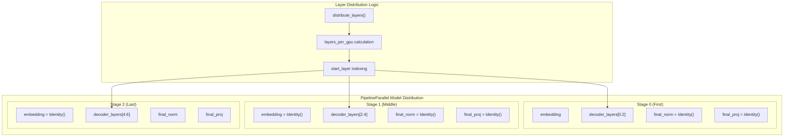
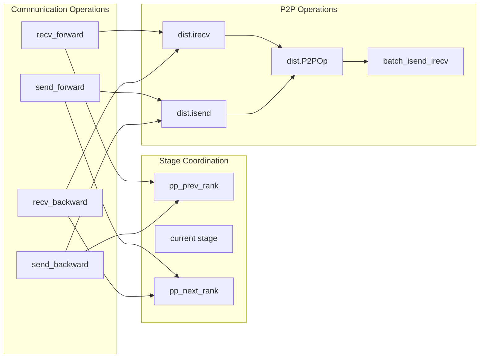
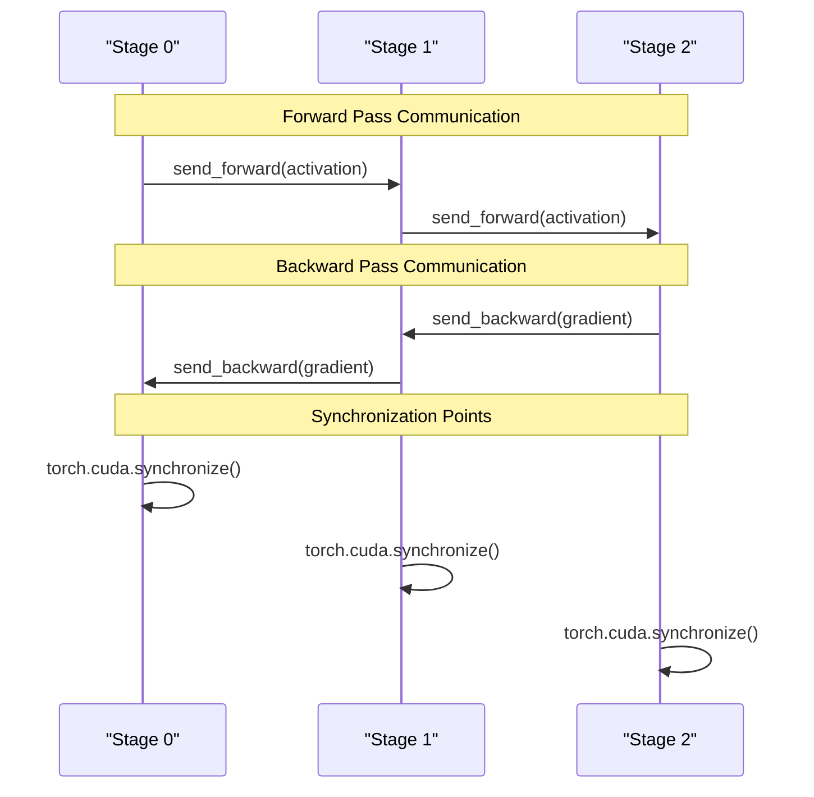
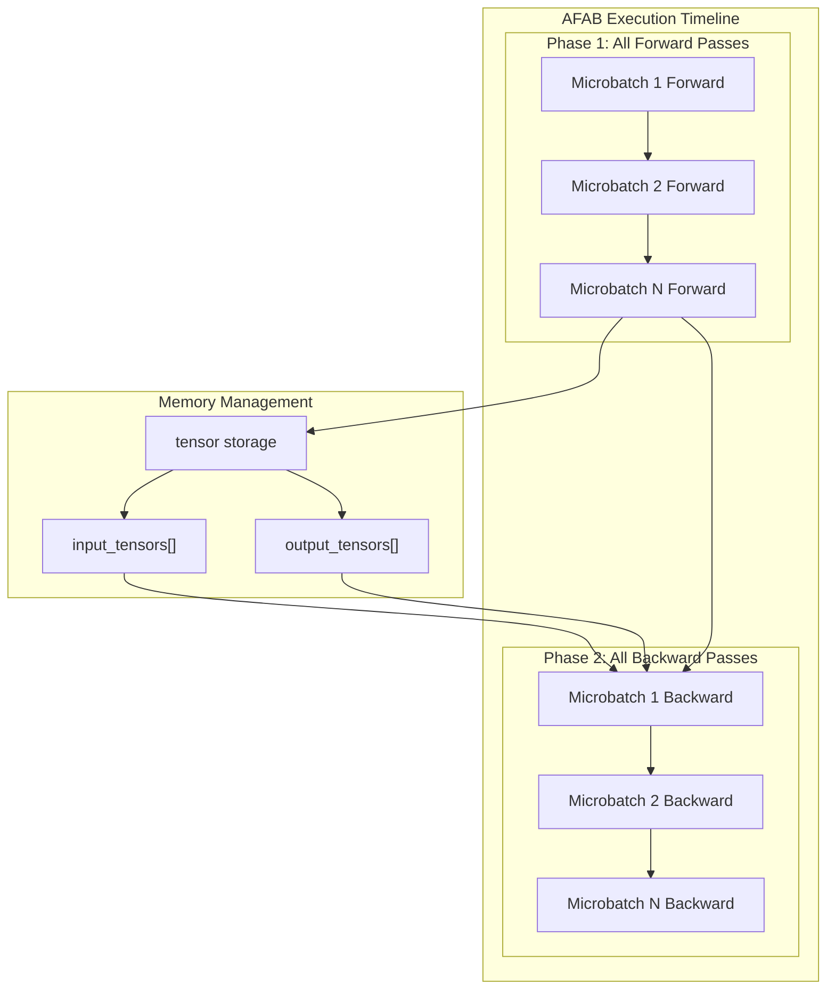
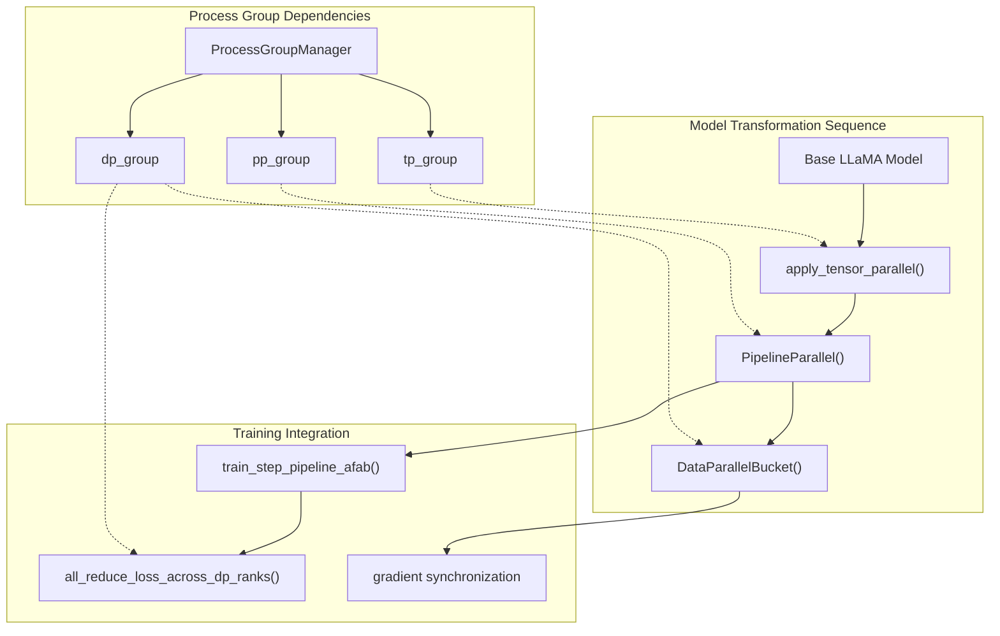

<!-- source: DeepWiki mcp.deepwiki.com · repo huggingface/picotron_tutorial · page 4.3 Pipeline Parallelism · fetched 2026-10-26 -->

# Pipeline Parallelism

<details>
<summary>Relevant source files</summary>

The following files were used as context for generating this wiki page:

- [step7_pipeline_parallel_afab/patch_step_7.diff](step7_pipeline_parallel_afab/patch_step_7.diff)
- [step7_pipeline_parallel_afab/pipeline_parallel.py](step7_pipeline_parallel_afab/pipeline_parallel.py)

</details>


## Purpose and Scope

This document covers the pipeline parallelism implementation in the Picotron tutorial system. Pipeline parallelism divides the model layers across multiple GPU devices, creating a pipeline where each device processes different stages of the model sequentially. This technique reduces memory usage per device by distributing the model parameters while maintaining training throughput through overlapped execution of microbatches.

For tensor parallelism (splitting individual layers), see [Tensor Parallelism](#4.1). For data parallelism (replicating models across devices), see [Data Parallelism](#4.2). For the specific pipeline execution engines, see [AFAB Pipeline Engine](#4.3.1) and [1F1B Pipeline Engine](#4.3.2).

## Core Architecture

### PipelineParallel Model Wrapper

The `PipelineParallel` class transforms a standard model into a distributed pipeline by partitioning layers across pipeline stages and selectively activating components based on the current stage position.



The `PipelineParallel` constructor uses the `distribute_layers` method to evenly partition model layers across pipeline stages, ensuring balanced workload distribution even when the number of layers doesn't divide evenly across stages.

**Sources:** [step7_pipeline_parallel_afab/pipeline_parallel.py:75-87]()

### Layer Distribution Algorithm

The layer distribution algorithm ensures approximately equal computational load across pipeline stages by implementing a fair division strategy:

| Component | Stage Assignment Logic |
|-----------|----------------------|
| `embedding` | Only active on first stage (`pp_is_first_stage`) |
| `decoder_layers` | Distributed using calculated ranges per stage |
| `final_norm` | Only active on last stage (`pp_is_last_stage`) |
| `final_proj` | Only active on last stage (`pp_is_last_stage`) |

The distribution calculation handles uneven divisions by assigning extra layers to earlier stages: `layers_per_gpu[i] = num_layers // pp_world_size + (1 if i < num_layers % pp_world_size else 0)`.

**Sources:** [step7_pipeline_parallel_afab/pipeline_parallel.py:84-87]()

## Communication System

### Point-to-Point Communication Protocol

Pipeline parallelism relies on `pipeline_communicate` for coordinating data flow between adjacent pipeline stages using PyTorch's point-to-point communication primitives.



The communication system handles four distinct operation types with appropriate source/destination rank selection and tensor preparation. Each operation includes boundary condition checking to skip communication for first/last stages where appropriate.

**Sources:** [step7_pipeline_parallel_afab/pipeline_parallel.py:11-83]()

### Communication Flow Pattern



Communication operations use asynchronous sends/receives with explicit synchronization to ensure proper ordering and completion before proceeding to the next pipeline step.

**Sources:** [step7_pipeline_parallel_afab/pipeline_parallel.py:57-78]()

## AFAB Execution Engine

### Activation Forward-Activation Backward Strategy

The `train_step_pipeline_afab` function implements a two-phase execution strategy that separates forward and backward passes across all microbatches to optimize memory usage and communication patterns.



The AFAB approach stores intermediate activations and tensors during the forward phase, then processes all backward passes in reverse order. This strategy provides predictable memory usage patterns and simplified communication coordination.

**Sources:** [step7_pipeline_parallel_afab/pipeline_parallel.py:105-140]()

### Gradient Synchronization Integration

The AFAB engine coordinates with data parallelism by controlling gradient synchronization timing through the `require_backward_grad_sync` flag:

| Condition | Synchronization Behavior |
|-----------|-------------------------|
| Single DP process (`dp_world_size == 1`) | No synchronization needed |
| Multiple DP processes | Sync only on last microbatch iteration |
| Pipeline stage coordination | All stages participate in gradient collection |

**Sources:** [step7_pipeline_parallel_afab/pipeline_parallel.py:131-134]()

## Integration with Other Parallelism Forms

### Multi-Dimensional Parallelism Coordination

Pipeline parallelism integrates with tensor and data parallelism through the `ProcessGroupManager` coordination system and careful ordering of model transformations:



The transformation sequence ensures tensor parallelism splits individual layers before pipeline parallelism distributes those split layers across stages, with data parallelism handling gradient aggregation across the entire configuration.

**Sources:** [step7_pipeline_parallel_afab/train.py:184-189](), [step7_pipeline_parallel_afab/train.py:173-179]()

### Loss Aggregation Across Pipeline Stages

Since only the last pipeline stage computes the actual loss value, the `all_reduce_loss_across_dp_ranks` function ensures proper loss averaging across data parallel groups:

```python
# Only last stage has meaningful loss values
if pgm.process_group_manager.pp_is_last_stage:
    dist.all_reduce(reduced_loss, op=dist.ReduceOp.AVG, group=pgm.process_group_manager.dp_group)
```

This pattern ensures consistent loss reporting and gradient scaling across all parallel dimensions.

**Sources:** [step7_pipeline_parallel_afab/train.py:173-179]()

---

