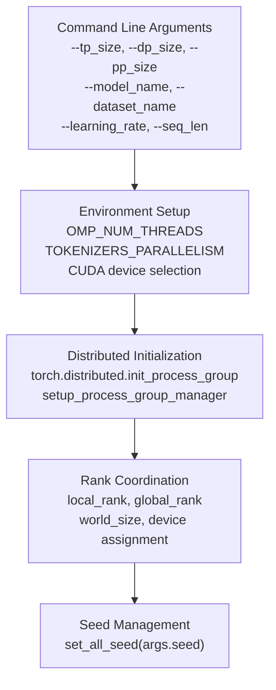
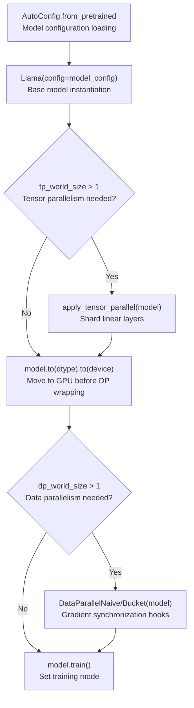
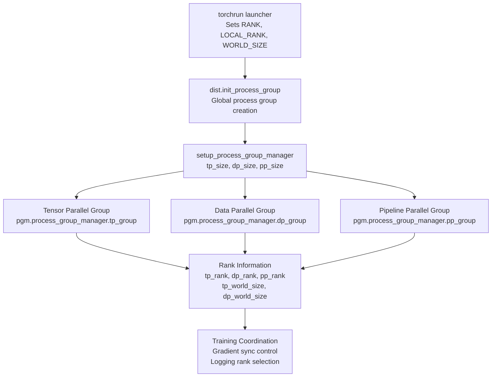
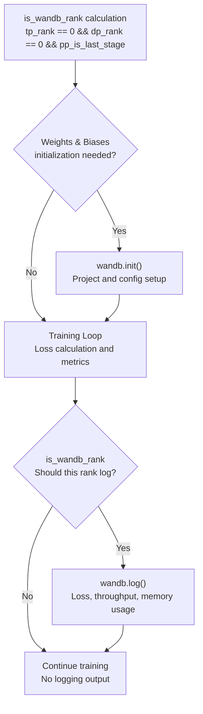

<!-- source: DeepWiki mcp.deepwiki.com · repo huggingface/picotron_tutorial · page 5 Training Integration · fetched 2026-10-26 -->

# Training Integration

Relevant source files

The following files were used as context for generating this wiki page:

- [step5_data_parallel_naive/train.py](step5_data_parallel_naive/train.py)
- [step6_data_parallel_bucket/train.py](step6_data_parallel_bucket/train.py)

This document covers how all distributed training components integrate within the training scripts to coordinate model training across different parallelism configurations. It focuses on the common patterns used in training script architecture and how process groups, parallelism strategies, and data loading work together during distributed training execution.

For implementation details of individual parallelism strategies, see [Parallelism Strategies](#4). For details on the core model and data loading components, see [Core Architecture](#3).

## Training Script Architecture

The training scripts across different tutorial steps follow a consistent architectural pattern that orchestrates initialization, model setup, and training execution. This architecture handles the complexity of coordinating multiple distributed training components while maintaining a clean separation of concerns.

### Argument Processing and Environment Setup

All training scripts use a standardized argument parsing structure that covers environment configuration, model parameters, dataset settings, training hyperparameters, and distributed training dimensions. The scripts handle environment variable configuration for OpenMP threading, tokenizer parallelism, and CUDA device selection.

**Training Script Initialization Flow**

The environment setup phase establishes the foundation for distributed coordination by extracting rank information from environment variables set by `torchrun`, initializing the distributed process group, and configuring the process group manager with the specified parallelism dimensions.

Sources: [step5_data_parallel_naive/train.py:56-107](), [step6_data_parallel_bucket/train.py:56-107]()

### Model Initialization and Parallelism Integration

The model initialization follows a layered approach where parallelism strategies are applied in a specific sequence. The base model is created first, followed by tensor parallelism application, device placement, and finally data parallelism wrapping.

**Model Parallelism Integration Sequence**

The critical ordering ensures that tensor parallelism modifications occur before device placement, and data parallelism hooks are attached after the model is moved to GPU memory. This sequence prevents hook attachment issues and ensures proper gradient synchronization behavior.

Sources: [step5_data_parallel_naive/train.py:126-144](), [step6_data_parallel_bucket/train.py:126-144]()

### Training Loop and Gradient Management

The training loop implements gradient accumulation with conditional synchronization control. The `train_step` function manages micro-batch processing and coordinates gradient synchronization timing across data parallel groups.

| Component | Purpose | Key Integration Point |
|-----------|---------|----------------------|
| `train_step` | Micro-batch processing and loss accumulation | Gradient sync timing control |
| `require_backward_grad_sync` | Controls when gradients synchronize | Set only on final micro-batch |
| `optimizer.zero_grad()` | Clears gradients before accumulation | Called once per training step |
| `model.reset()` | Resets data parallel state | Called after optimizer step |

The gradient accumulation loop processes multiple micro-batches before synchronizing gradients, improving communication efficiency in data parallel configurations. Gradient synchronization is enabled only for the final micro-batch in each accumulation cycle.

Sources: [step5_data_parallel_naive/train.py:26-53](), [step6_data_parallel_bucket/train.py:26-53]()

## Distributed Training Coordination

Distributed training coordination involves managing communication patterns, synchronization points, and rank-specific responsibilities across multiple processes. The system handles different types of coordination based on the active parallelism strategies.

### Process Group Management Integration

The `ProcessGroupManager` serves as the central coordinator for all distributed operations, managing separate process groups for tensor parallelism, data parallelism, and pipeline parallelism while providing unified access to rank information and communication primitives.

**Process Group Coordination Architecture**

The process group manager calculates rank assignments and world sizes for each parallelism dimension, enabling components to make rank-specific decisions for gradient synchronization, logging, and communication patterns.

Sources: [step5_data_parallel_naive/train.py:107-109](), [step6_data_parallel_bucket/train.py:107-109]()

### Synchronization Points and Barriers

Training scripts include explicit synchronization barriers at critical points to ensure all processes reach the same execution state before proceeding. These barriers prevent race conditions and ensure consistent initialization across all distributed processes.

| Synchronization Point | Purpose | Location |
|----------------------|---------|----------|
| `dist.barrier()` after model setup | Ensure all processes complete model initialization | Before optimizer creation |
| `dist.barrier()` after optimizer setup | Ensure consistent optimizer state | Before dataloader creation |
| `dist.barrier()` before training loop | Synchronize before training begins | After dataloader initialization |

The synchronization strategy ensures that resource-intensive operations like model initialization and dataloader preparation complete on all processes before training begins, preventing hanging or inconsistent states.

Sources: [step5_data_parallel_naive/train.py:146-171](), [step6_data_parallel_bucket/train.py:146-171]()

### Logging and Metrics Coordination

Logging coordination prevents duplicate outputs and metrics reporting by designating specific ranks as logging ranks. The system uses rank-based filtering to ensure metrics are collected and reported only once per logical training step.

**Distributed Logging Architecture**

The logging rank selection ensures that only one process per logical training unit reports metrics, preventing duplicate entries and maintaining clean experiment tracking. The selection criteria consider all parallelism dimensions to choose an appropriate representative rank.

Sources: [step5_data_parallel_naive/train.py:109-124](), [step5_data_parallel_naive/train.py:191-202](), [step6_data_parallel_bucket/train.py:109-124](), [step6_data_parallel_bucket/train.py:191-202]()

---

