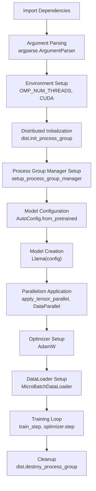
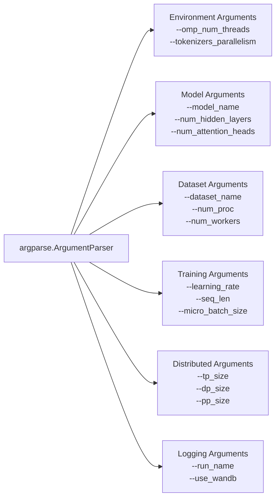
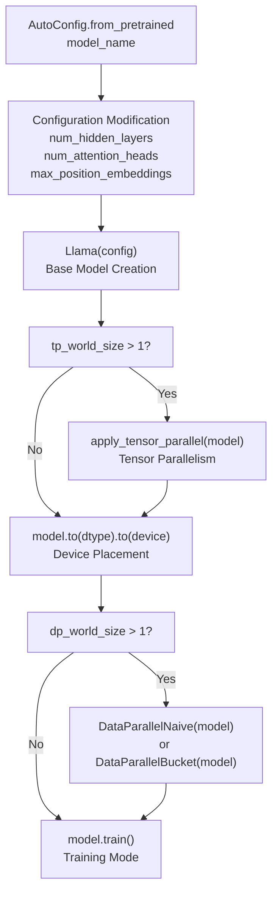
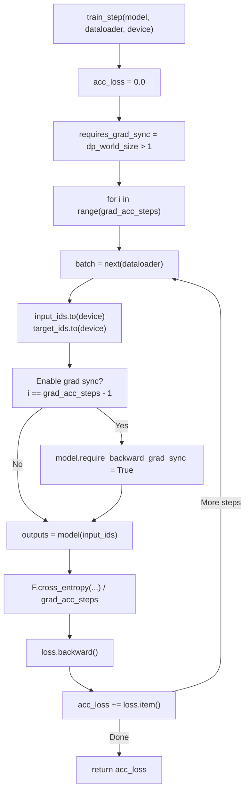
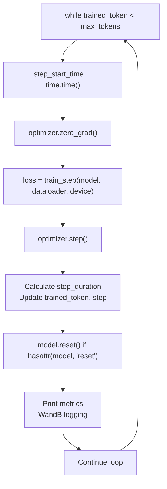
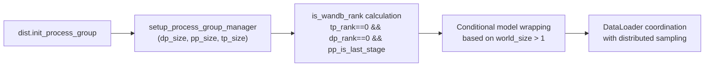

<!-- source: DeepWiki mcp.deepwiki.com · repo huggingface/picotron_tutorial · page 5.1 Training Script Architecture · fetched 2026-10-26 -->

# Training Script Architecture

Relevant source files

The following files were used as context for generating this wiki page:

- [step4_tensor_parallel/train.py](step4_tensor_parallel/train.py)
- [step5_data_parallel_naive/train.py](step5_data_parallel_naive/train.py)

This document covers the common architectural patterns found across all training scripts in the Picotron tutorial, including argument handling, model initialization pipelines, and training loop structures. These patterns provide a consistent framework that scales from single-process training to complex 3D parallelism configurations.

For specific parallelism implementation details, see [Tensor Parallelism](#4.1), [Data Parallelism](#4.2), and [Pipeline Parallelism](#4.3). For distributed coordination details, see [Distributed Training Coordination](#5.2).

## Script Structure Overview

All training scripts follow a consistent architectural pattern that builds complexity incrementally while maintaining the same core structure:

**Sources:** [step4_tensor_parallel/train.py:1-189](), [step5_data_parallel_naive/train.py:1-207]()

## Argument Handling Architecture

The training scripts use a structured approach to command-line argument parsing that organizes parameters into logical categories:

### Argument Categories

| Category | Purpose | Key Parameters |
|----------|---------|----------------|
| Environment | Process-level configuration | `omp_num_threads`, `tokenizers_parallelism` |
| Model | Model architecture settings | `model_name`, `num_hidden_layers`, `num_attention_heads` |
| Dataset | Data loading configuration | `dataset_name`, `num_proc`, `num_workers` |
| Training | Core training hyperparameters | `learning_rate`, `seq_len`, `micro_batch_size` |
| Distributed | Parallelism configuration | `tp_size`, `dp_size`, `pp_size`, `pp_engine` |
| Logging | Experiment tracking | `run_name`, `use_wandb` |

The argument parser follows this pattern across all scripts:

**Sources:** [step4_tensor_parallel/train.py:49-84](), [step5_data_parallel_naive/train.py:56-91]()

## Model Initialization Pipeline

The model initialization follows a consistent pipeline that applies parallelism transformations in a specific order:

This pipeline ensures that parallelism transformations are applied in the correct order, with tensor parallelism applied before device placement, and data parallelism applied after device placement.

**Sources:** [step4_tensor_parallel/train.py:119-131](), [step5_data_parallel_naive/train.py:126-144]()

## Training Step Function Architecture

All training scripts implement a consistent `train_step` function that handles gradient accumulation and conditional gradient synchronization:

The key innovation here is the conditional gradient synchronization logic that only enables synchronization on the final micro-batch to optimize communication efficiency.

**Sources:** [step4_tensor_parallel/train.py:25-46](), [step5_data_parallel_naive/train.py:26-53]()

## Main Training Loop Pattern

The main training loop follows a consistent pattern across all scripts:

The loop includes comprehensive metrics tracking for throughput analysis and optional model reset for data parallel implementations.

**Sources:** [step4_tensor_parallel/train.py:160-185](), [step5_data_parallel_naive/train.py:174-202]()

## Process Group Manager Integration

Training scripts integrate closely with the `ProcessGroupManager` for distributed coordination:

The integration determines which processes handle logging, applies appropriate parallelism wrappers, and coordinates data loading across processes.

**Sources:** [step4_tensor_parallel/train.py:99-102](), [step5_data_parallel_naive/train.py:106-109]()

## Environment and Device Management

All scripts follow consistent patterns for environment setup and device management:

| Component | Implementation | Purpose |
|-----------|----------------|---------|
| Environment Variables | `os.environ["OMP_NUM_THREADS"]` | Control threading behavior |
| CUDA Device | `torch.cuda.set_device(local_rank)` | Set device per process |  
| Data Type | `dtype = torch.bfloat16` | Mixed precision training |
| Backend | `backend = "nccl"` | Communication backend |
| Barriers | `dist.barrier()` | Synchronization points |

The environment setup ensures optimal performance and correct distributed behavior across different hardware configurations.

**Sources:** [step4_tensor_parallel/train.py:86-97](), [step5_data_parallel_naive/train.py:93-104]()

---

