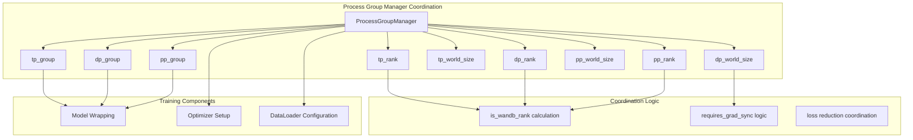
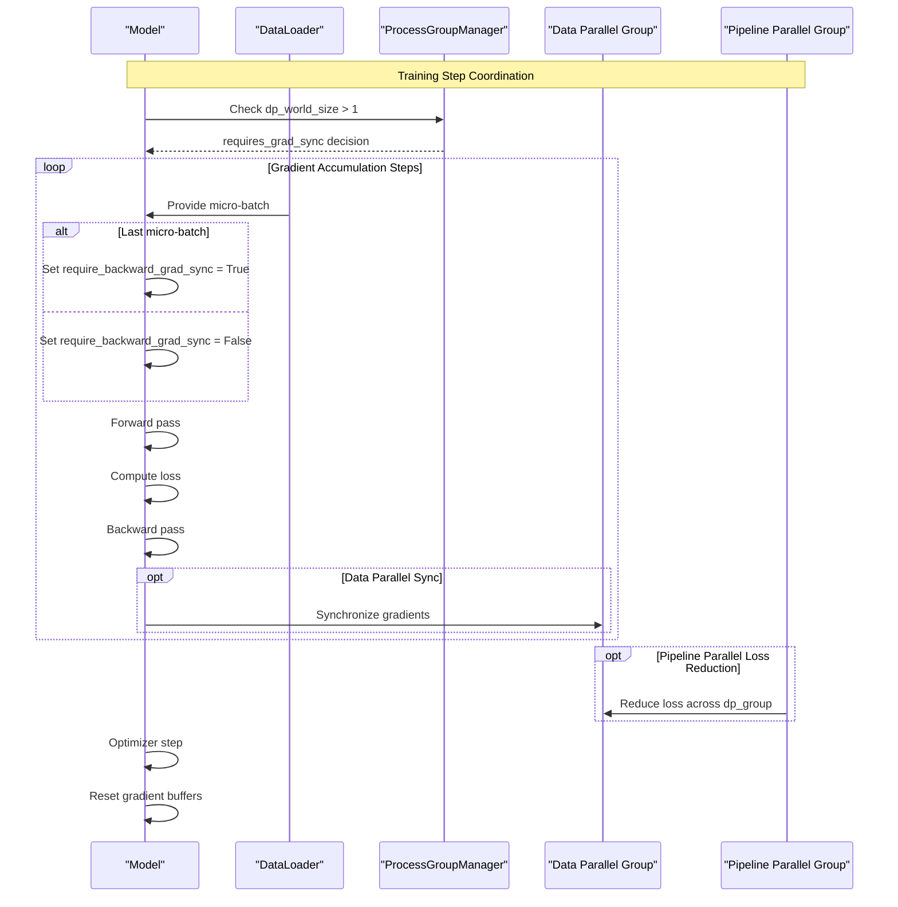
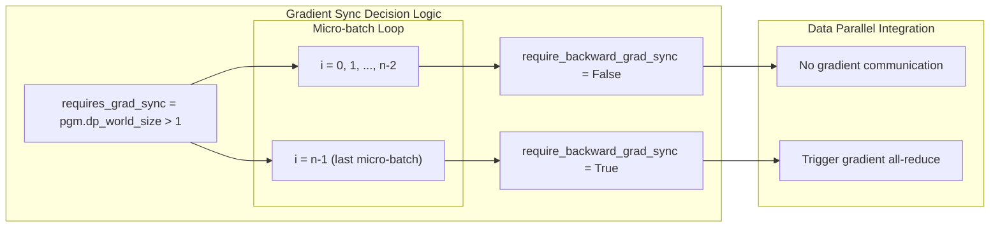
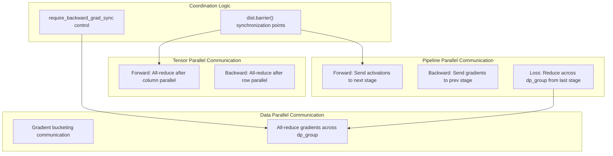
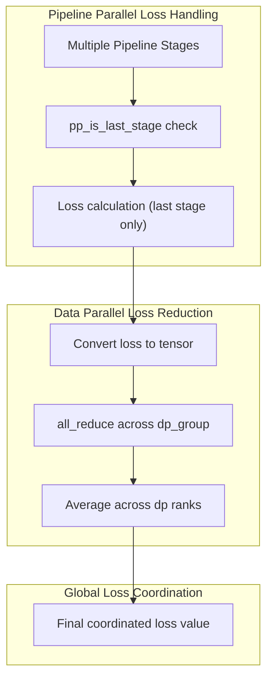
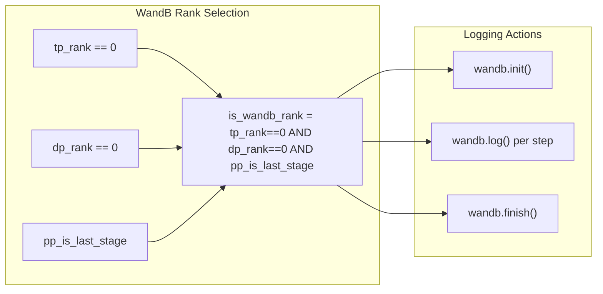

<!-- source: DeepWiki mcp.deepwiki.com · repo huggingface/picotron_tutorial · page 5.2 Distributed Training Coordination · fetched 2026-10-26 -->

# Distributed Training Coordination

<details>
<summary>Relevant source files</summary>

The following files were used as context for generating this wiki page:

- [step6_data_parallel_bucket/train.py](step6_data_parallel_bucket/train.py)
- [step7_pipeline_parallel_afab/train.py](step7_pipeline_parallel_afab/train.py)
- [step8_pipeline_parallel_1f1b/train.py](step8_pipeline_parallel_1f1b/train.py)

</details>


This document explains how process groups, communication patterns, and synchronization work together during distributed training execution. It covers the practical coordination mechanisms that enable tensor parallelism, data parallelism, and pipeline parallelism to operate simultaneously within the training loop.

For information about the individual parallelism strategies, see [Parallelism Strategies](#4). For details about training script architecture patterns, see [Training Script Architecture](#5.1).

## Process Group Coordination

The `ProcessGroupManager` serves as the central coordinator for all distributed training operations, managing multiple process group dimensions simultaneously.



**Sources:** [step6_data_parallel_bucket/train.py:107](), [step7_pipeline_parallel_afab/train.py:116](), [step8_pipeline_parallel_1f1b/train.py:116]()

### Process Group Setup Pattern

All training scripts follow a consistent setup pattern for distributed coordination:

| Setup Phase | Action | Code Location |
|-------------|--------|---------------|
| Environment Setup | Extract rank information from environment variables | `local_rank = int(os.environ["LOCAL_RANK"])` |
| Process Group Init | Initialize PyTorch distributed backend | `dist.init_process_group(...)` |
| Process Group Manager | Setup parallelism-aware process groups | `setup_process_group_manager(dp_size, pp_size, tp_size)` |
| Role Determination | Calculate logging and coordination roles | `is_wandb_rank = pgm.process_group_manager.tp_rank == 0 and ...` |

**Sources:** [step6_data_parallel_bucket/train.py:98-109](), [step7_pipeline_parallel_afab/train.py:107-118](), [step8_pipeline_parallel_1f1b/train.py:107-118]()

## Training Step Synchronization

The coordination of training steps involves multiple synchronization points to ensure correct distributed execution across all parallelism dimensions.



**Sources:** [step6_data_parallel_bucket/train.py:26-53](), [step7_pipeline_parallel_afab/train.py:35-62](), [step8_pipeline_parallel_1f1b/train.py:35-62]()

### Gradient Synchronization Control

The coordination system controls when gradient synchronization occurs based on process group configuration:



**Sources:** [step6_data_parallel_bucket/train.py:29-39](), [step7_pipeline_parallel_afab/train.py:38-48](), [step8_pipeline_parallel_1f1b/train.py:38-48]()

## Communication Patterns

Different parallelism strategies require coordinated communication patterns that must work together without interference.

### Multi-Dimensional Communication Coordination



**Sources:** [step6_data_parallel_bucket/train.py:29](), [step7_pipeline_parallel_afab/train.py:27-33](), [step8_pipeline_parallel_1f1b/train.py:27-33]()

### Barrier Synchronization Points

Critical synchronization barriers ensure proper coordination across all processes:

| Barrier Location | Purpose | Process Groups Affected |
|------------------|---------|------------------------|
| After model setup | Ensure all processes complete model initialization | All process groups |
| After optimizer creation | Synchronize optimizer state across processes | All process groups |
| Before training loop | Coordinate training start across all processes | All process groups |

**Sources:** [step6_data_parallel_bucket/train.py:146-150](), [step7_pipeline_parallel_afab/train.py:158-162](), [step8_pipeline_parallel_1f1b/train.py:158-162]()

## Loss and Logging Coordination

Distributed training requires coordinated loss aggregation and logging to ensure accurate metrics across process groups.

### Loss Reduction Pattern



The `all_reduce_loss_across_dp_ranks` function coordinates loss aggregation:

```python
def all_reduce_loss_across_dp_ranks(loss, device):
    reduced_loss = torch.tensor([loss if loss is not None else 0.0], dtype=torch.float32, device=device)
    if pgm.process_group_manager.pp_is_last_stage:
        dist.all_reduce(reduced_loss, op=dist.ReduceOp.AVG, group=pgm.process_group_manager.dp_group)
    return reduced_loss.item()
```

**Sources:** [step7_pipeline_parallel_afab/train.py:27-33](), [step8_pipeline_parallel_1f1b/train.py:27-33]()

### Logging Coordination



The logging coordination ensures only one process per data parallel replica logs to avoid duplicate metrics:

| Condition | Value | Purpose |
|-----------|-------|---------|
| `tp_rank == 0` | First tensor parallel rank | Avoid duplicate logs within TP group |
| `dp_rank == 0` | First data parallel rank | Avoid duplicate logs within DP group |  
| `pp_is_last_stage` | Last pipeline stage | Only stage with loss logs metrics |

**Sources:** [step6_data_parallel_bucket/train.py:109](), [step7_pipeline_parallel_afab/train.py:118](), [step8_pipeline_parallel_1f1b/train.py:118]()

---

