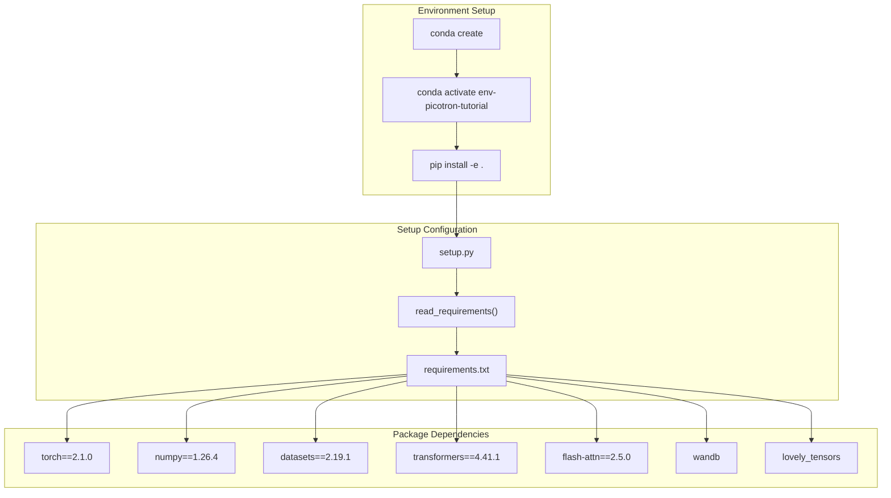
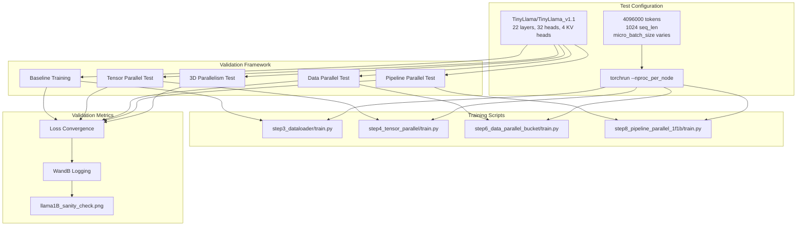
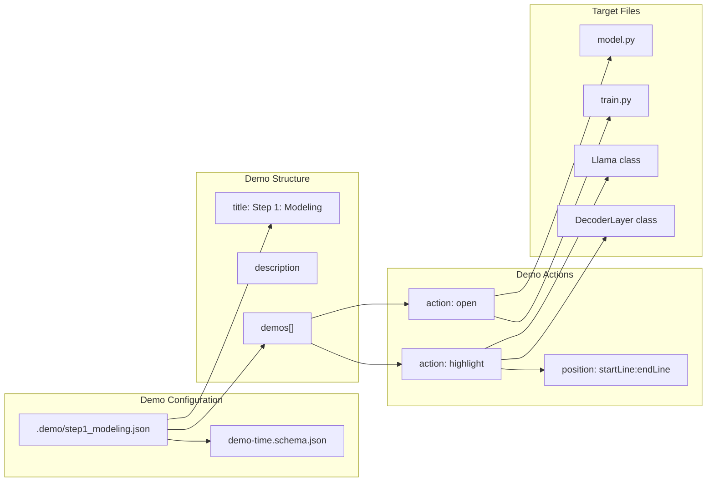
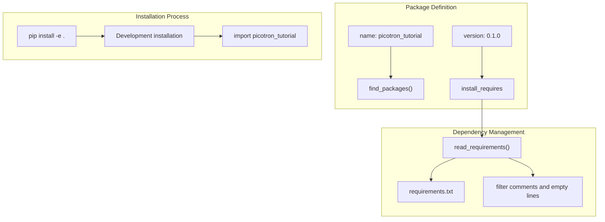

<!-- source: DeepWiki mcp.deepwiki.com · repo huggingface/picotron_tutorial · page 6 Development and Setup · fetched 2026-10-26 -->

# Development and Setup

Relevant source files

The following files were used as context for generating this wiki page:

- [.demo/step1_modeling.json](.demo/step1_modeling.json)
- [.vscode/settings.json](.vscode/settings.json)
- [README.md](README.md)
- [assets/llama1B_sanity_check.png](assets/llama1B_sanity_check.png)
- [requirements.txt](requirements.txt)
- [setup.py](setup.py)

This page covers the supporting infrastructure for developing, testing, and demonstrating the Picotron tutorial framework. It includes environment configuration, dependency management, development tooling, validation procedures, and demonstration infrastructure.

For information about the tutorial progression and training components, see [Tutorial Progression](#2) and [Training Integration](#5).

## Environment Configuration

The tutorial requires a specific Python environment with distributed training dependencies. The setup process follows a standard conda-based workflow with pip installation for the package itself.

The environment configuration is managed through standard Python packaging tools. The `setup.py` file defines the package metadata and reads dependencies from `requirements.txt` using the `read_requirements()` function.

**Sources:** [README.md:16-20](), [setup.py:3-12](), [requirements.txt:1-7]()

## Development Tooling

The codebase includes VS Code configuration for consistent development experience and presentation capabilities.

| Tool | Configuration | Purpose |
|------|---------------|---------|
| VS Code | `.vscode/settings.json` | Editor configuration for demos |
| Demo Time Extension | `demoTime.*` settings | Presentation and tutorial delivery |
| Editor Customization | `workbench.colorCustomizations` | Visual highlighting for demonstrations |

The VS Code configuration includes specialized settings for demonstration purposes, with custom highlighting and timer functionality for educational presentations.

**Sources:** [.vscode/settings.json:1-9]()

## Validation and Testing

The tutorial includes comprehensive sanity checking procedures to validate that distributed training implementations produce equivalent results to baseline single-process training.

### Test Execution Commands

The validation framework provides specific command-line invocations for each parallelism strategy:

| Strategy | Command Parameters | Key Differences |
|----------|-------------------|-----------------|
| Baseline | `--nproc_per_node 1` | Single process, micro_batch_size 4 |
| Tensor Parallel | `--nproc_per_node 4 --tp_size 4` | 4-way tensor parallelism |
| Data Parallel | `--nproc_per_node 4 --dp_size 4` | 4-way data parallelism, micro_batch_size 1 |
| Pipeline Parallel | `--nproc_per_node 4 --pp_size 4 --pp_engine 1f1b` | 4-stage pipeline with 1F1B engine |
| 3D Parallelism | `--nproc_per_node 8 --tp_size 2 --pp_size 2 --dp_size 2` | Combined parallelism strategies |

All tests use identical model configuration (`TinyLlama_v1.1` with 22 layers, 32 attention heads, 4 key-value heads) and training parameters (4096000 tokens, 1024 sequence length) to ensure fair comparison.

**Sources:** [README.md:24-48]()

## Demo Infrastructure

The tutorial includes structured demonstration configurations for educational presentation and video content creation.

### Demo Step Configuration

The demonstration framework defines specific highlighting sequences for educational walkthroughs:

| Demo Section | Target Component | Line Range | Purpose |
|--------------|------------------|------------|---------|
| `model.py -> Llama` | `Llama` class | 135:148 | Model architecture overview |
| `model.py -> DecoderLayer` | `DecoderLayer` class | 100:116 | Layer implementation details |
| `train.py -> args` | Argument parsing | 17:39 | Configuration parameters |
| `train.py -> distributed setup` | Process initialization | 41:54 | Distributed training setup |
| `train.py -> model init` | Model instantiation | 58:66 | Model creation process |
| `train.py -> optimizer init` | Optimizer setup | 70 | Training optimization |
| `train.py -> simple training loop` | Training iteration | 74:97 | Basic training logic |

The demo configuration supports the video tutorial series referenced in the README, providing structured navigation through code components for educational presentation.

**Sources:** [.demo/step1_modeling.json:1-88](), [README.md:5-12]()

## Package Structure

The setup configuration defines the tutorial as an installable Python package with proper dependency management.

The `read_requirements()` function in `setup.py` processes the requirements file to extract clean dependency specifications, filtering out comments and empty lines for proper package installation.

**Sources:** [setup.py:1-12](), [requirements.txt:1-7]()