# Page: Overview

# Overview

<details>
<summary>Relevant source files</summary>

The following files were used as context for generating this wiki page:

- [.demo/step1_modeling.json](.demo/step1_modeling.json)
- [.vscode/settings.json](.vscode/settings.json)
- [README.md](README.md)
- [assets/llama1B_sanity_check.png](assets/llama1B_sanity_check.png)
- [requirements.txt](requirements.txt)
- [setup.py](setup.py)

</details>


## Purpose and Scope

This document provides a comprehensive overview of the Picotron tutorial framework, a step-by-step educational system designed to teach distributed training techniques for large language models from the ground up. The tutorial progressively builds complexity from single-process LLaMA model training to advanced 3D parallelism combining tensor, data, and pipeline parallelism strategies.

The material covered spans eight incremental tutorial steps plus a final 3D parallelism integration, each introducing new distributed training concepts while building upon previous foundations. For detailed information about specific parallelism strategies, see [Parallelism Strategies](#4). For implementation details of individual components, see [Core Architecture](#3).

**Sources:** [README.md:1-49]()

## Tutorial Learning Progression

The Picotron tutorial follows a carefully structured progression that introduces distributed training concepts incrementally:

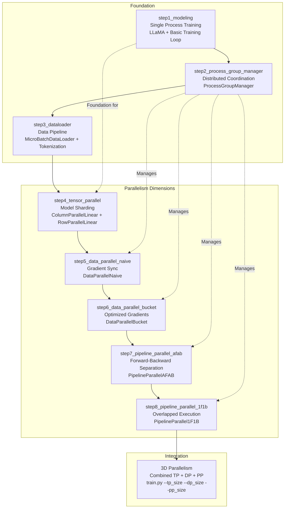

**Tutorial Progression from Simple to Complex**

Each step builds systematically upon previous concepts while maintaining consistent patterns across the codebase. The progression ensures that learners understand both the theoretical foundations and practical implementation details of modern distributed training systems.

**Sources:** [README.md:29-48]()

## Core System Architecture

The tutorial framework is built around several key architectural components that work together to enable distributed training:

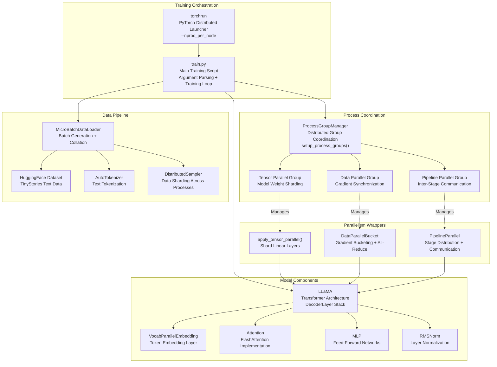

**Core System Integration Pattern**

The architecture follows a consistent pattern across all tutorial steps: a central training script coordinates process groups, applies parallelism transformations to the base LLaMA model, and manages the data pipeline. This modular design allows each tutorial step to focus on specific distributed training concepts while maintaining compatibility with other parallelism strategies.

**Sources:** [README.md:29-48]()

## Key Components and Dependencies

The tutorial framework relies on several essential components that provide the foundation for distributed training:

| Component | Purpose | Key Classes/Functions | Tutorial Introduction |
|-----------|---------|----------------------|---------------------|
| **LLaMA Model** | Transformer architecture implementation | `LLaMA`, `DecoderLayer`, `Attention`, `MLP` | Step 1 |
| **Process Management** | Distributed coordination | `ProcessGroupManager`, `setup_process_groups()` | Step 2 |
| **Data Pipeline** | Efficient data loading | `MicroBatchDataLoader`, `collate_fn` | Step 3 |
| **Tensor Parallelism** | Model weight sharding | `ColumnParallelLinear`, `RowParallelLinear` | Step 4 |
| **Data Parallelism** | Gradient synchronization | `DataParallelNaive`, `DataParallelBucket` | Steps 5-6 |
| **Pipeline Parallelism** | Inter-stage communication | `PipelineParallelAFAB`, `PipelineParallel1F1B` | Steps 7-8 |

**External Dependencies and Integration**

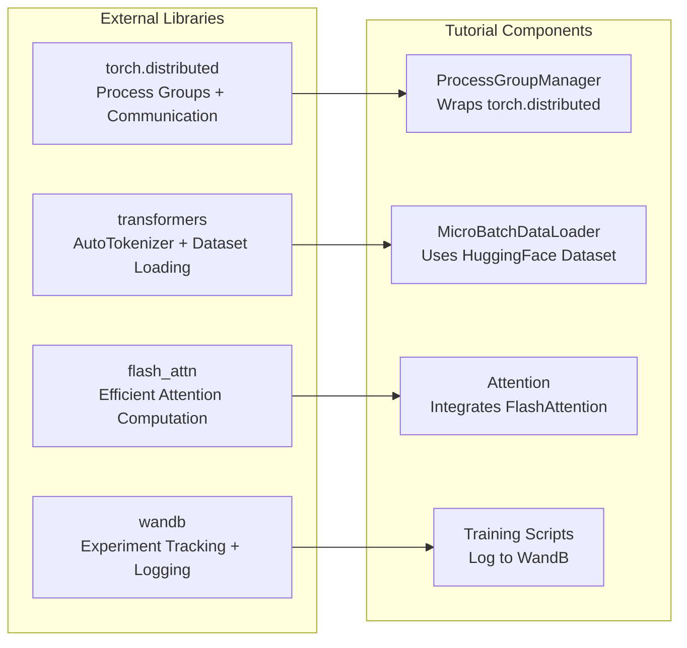

**Dependency Integration Strategy**

The tutorial maintains clean abstractions over external dependencies, allowing learners to focus on distributed training concepts rather than library-specific implementation details. Each external dependency is wrapped by tutorial-specific components that provide consistent interfaces across different parallelism strategies.

**Sources:** [requirements.txt:1-7](), [README.md:16-20]()

## Learning Path and Validation

The tutorial provides comprehensive validation mechanisms to ensure correct implementation of distributed training concepts:

**Convergence Testing and Sanity Checks**

The framework includes systematic convergence testing using a LLaMA 1B model trained on 4,096,000 tokens across different parallelism configurations. This validation ensures that all distributed training strategies produce mathematically equivalent results to the baseline single-process training.

**Command Pattern Consistency**

Each tutorial step follows consistent command-line interface patterns that scale from single-process to multi-dimensional parallelism:

```bash
# Progressive complexity in command structure
torchrun --nproc_per_node 1  train.py  # Step 1: Single process
torchrun --nproc_per_node 4  train.py --tp_size 4      # Step 4: Tensor parallel
torchrun --nproc_per_node 4  train.py --dp_size 4      # Step 6: Data parallel  
torchrun --nproc_per_node 4  train.py --pp_size 4      # Step 8: Pipeline parallel
torchrun --nproc_per_node 8  train.py --tp_size 2 --pp_size 2 --dp_size 2  # 3D parallelism
```

This progressive command structure allows learners to understand how distributed training parameters scale and interact as system complexity increases.

**Sources:** [README.md:24-48]()

---

# Page: Tutorial Progression

# Tutorial Progression

<details>
<summary>Relevant source files</summary>

The following files were used as context for generating this wiki page:

- [README.md](README.md)
- [assets/llama1B_sanity_check.png](assets/llama1B_sanity_check.png)
- [requirements.txt](requirements.txt)
- [setup.py](setup.py)
- [step1_modeling/train.py](step1_modeling/train.py)

</details>


This document outlines the step-by-step progression of the Picotron tutorial, which systematically builds distributed training capabilities from a simple single-process model to full 3D parallelism. The tutorial demonstrates how to incrementally add tensor parallelism, data parallelism, and pipeline parallelism to a LLaMA transformer model.

For detailed implementation of individual components, see [Core Architecture](#3). For specific parallelism strategies, see [Parallelism Strategies](#4).

## Tutorial Overview

The Picotron tutorial follows a progressive complexity model, where each step builds upon the previous ones while introducing new distributed training concepts. The progression moves from basic model training to sophisticated 3D parallelism combining three parallelization strategies.

### Step Progression Flow

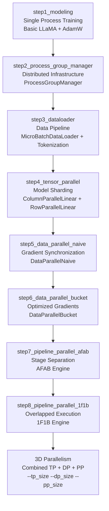

Sources: [README.md:29-48]()

### Command Line Evolution

The tutorial progression is reflected in the increasing complexity of command line arguments, showing how new parallelism dimensions are added:

| Step | Key Arguments | Purpose |
|------|---------------|---------|
| Step 1 | `--micro_batch_size`, `--seq_len` | Basic training parameters |
| Step 2 | `--nproc_per_node` | Multi-process setup |
| Step 3 | `--gradient_accumulation_steps`, `--num_proc` | Data pipeline optimization |
| Step 4 | `--tp_size` | Tensor parallelism dimension |
| Step 5-6 | `--dp_size` | Data parallelism dimension |
| Step 7-8 | `--pp_size`, `--pp_engine` | Pipeline parallelism dimension |
| 3D | `--tp_size --dp_size --pp_size` | All dimensions combined |

Sources: [README.md:29-48]()

## Foundation Steps (1-3)

### Step 1: Basic Model Training

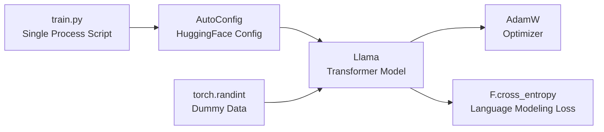

Step 1 establishes the fundamental training loop with a LLaMA model running on a single process. The implementation in `step1_modeling/train.py` sets up the basic components: model initialization, optimizer setup, and a simple forward-backward pass with dummy data.

Key code entities:
- `Llama` class from `model.py`
- `torch.distributed.init_process_group` for basic distributed setup
- `AdamW` optimizer with learning rate scheduling
- Cross-entropy loss computation with vocabulary projection

Sources: [step1_modeling/train.py:1-97]()

### Step 2: Process Group Management

Step 2 introduces the `ProcessGroupManager` class, which becomes the central coordinator for all distributed training operations. This step doesn't change the training logic but establishes the infrastructure needed for multi-GPU coordination.

### Step 3: Data Loading Pipeline

Step 3 replaces dummy data with a real data pipeline featuring the `MicroBatchDataLoader` class. This step introduces tokenization, gradient accumulation, and proper batch management for distributed training scenarios.

Sources: [README.md:31-32]()

## Parallelism Integration Steps (4-8)

### Tensor Parallelism (Step 4)

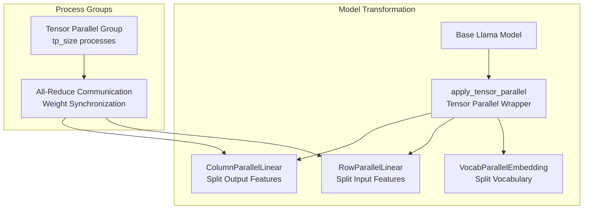

Step 4 introduces tensor parallelism by sharding model weights across multiple GPUs. The `apply_tensor_parallel` function transforms linear layers into parallel variants that communicate through all-reduce operations.

Command: `torchrun --nproc_per_node 4 train.py --tp_size 4`

Sources: [README.md:34-36]()

### Data Parallelism (Steps 5-6)

Steps 5 and 6 implement two approaches to data parallelism:

- **Step 5 (Naive)**: `DataParallelNaive` performs simple all-reduce operations on gradients
- **Step 6 (Bucketed)**: `DataParallelBucket` optimizes communication by bucketing gradients

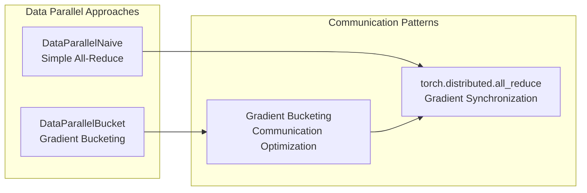

Command: `torchrun --nproc_per_node 4 train.py --dp_size 4`

Sources: [README.md:38-40]()

### Pipeline Parallelism (Steps 7-8)

Steps 7 and 8 implement pipeline parallelism with two execution engines:

- **Step 7 (AFAB)**: Activation Forward-Activation Backward engine with separated phases
- **Step 8 (1F1B)**: One Forward One Backward engine with overlapped execution

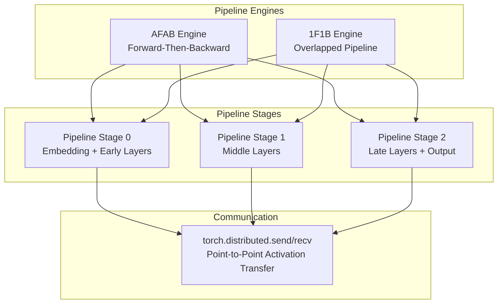

Command: `torchrun --nproc_per_node 4 train.py --pp_size 4 --pp_engine 1f1b`

Sources: [README.md:42-44]()

## 3D Parallelism Integration

The final step combines all three parallelism strategies into a single training run. This requires careful coordination between tensor parallel groups, data parallel groups, and pipeline parallel stages.

### 3D Parallelism Architecture

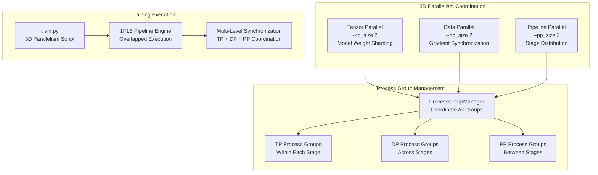

The 3D parallelism configuration demonstrates the full power of the tutorial's incremental complexity build-up, requiring 8 processes with a 2×2×2 configuration.

Command: `torchrun --nproc_per_node 8 train.py --tp_size 2 --pp_size 2 --pp_engine 1f1b --dp_size 2`

Sources: [README.md:46-47]()

## Tutorial Design Principles

### Incremental Complexity

Each step introduces exactly one new concept while preserving all previous functionality. This allows learners to isolate and understand individual distributed training components before combining them.

### Code Reusability

The tutorial follows a modular design where components from earlier steps are reused in later steps. For example, the `ProcessGroupManager` from Step 2 is used throughout all subsequent steps.

### Verification Strategy

The tutorial includes sanity checks that verify convergence behavior remains consistent across different parallelism configurations, ensuring correctness of the distributed implementations.

Sources: [README.md:24-26]()

---

# Page: Step 1: Basic Model Training

# Step 1: Basic Model Training

<details>
<summary>Relevant source files</summary>

The following files were used as context for generating this wiki page:

- [step1_modeling/model.py](step1_modeling/model.py)
- [step1_modeling/train.py](step1_modeling/train.py)

</details>


This page covers the foundational step of the Picotron tutorial: single-process LLaMA model training. This step establishes the basic training infrastructure, model architecture, and training loop that will be extended with distributed training capabilities in subsequent steps.

This page focuses on the core model implementation and basic training setup. For distributed training concepts and process group management, see [2.2](#2.2). For advanced data loading pipelines, see [2.3](#2.3).

## Training Script Architecture

Step 1 provides a minimal training script that demonstrates the essential components needed for training a transformer model. Despite being single-process, it initializes PyTorch distributed to maintain consistency with later distributed training steps.

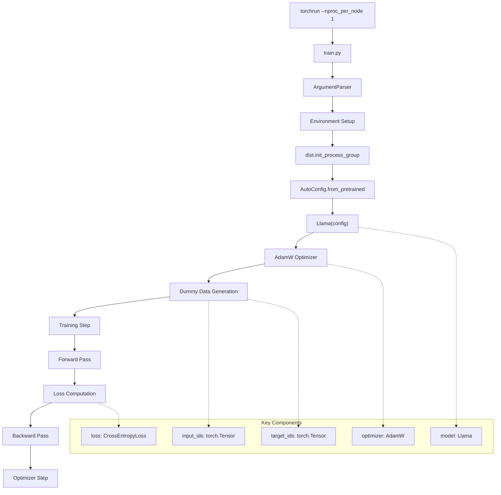

The training script [step1_modeling/train.py:16-97]() follows a standard structure:

| Component | Purpose | Key Code Elements |
|-----------|---------|-------------------|
| Argument Parsing | Configure model and training parameters | `argparse.ArgumentParser`, model configuration args |
| Environment Setup | Set CUDA device and distributed context | `torch.cuda.set_device`, `dist.init_process_group` |
| Model Creation | Instantiate LLaMA model with custom config | `Llama(config)`, `AutoConfig.from_pretrained` |
| Training Loop | Execute forward/backward passes | `model(input_ids)`, `loss.backward()`, `optimizer.step()` |

Sources: [step1_modeling/train.py:1-97]()

## LLaMA Model Architecture

The custom LLaMA implementation provides a complete transformer architecture optimized for efficient training with Flash Attention and RoPE positional embeddings.

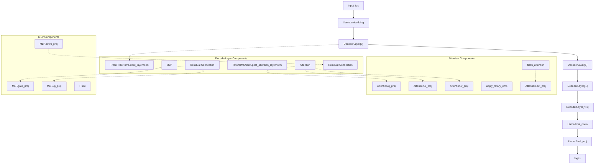

The model architecture consists of several key classes:

- **`Llama`** [step1_modeling/model.py:118-148](): Main model class containing embedding, decoder layers, and final projection
- **`DecoderLayer`** [step1_modeling/model.py:100-116](): Individual transformer layer with attention and MLP blocks
- **`Attention`** [step1_modeling/model.py:48-87](): Multi-head attention with Flash Attention and RoPE
- **`MLP`** [step1_modeling/model.py:89-98](): Feed-forward network with SiLU activation and gating
- **`TritonRMSNorm`** [step1_modeling/model.py:25-46](): RMS normalization using Triton kernels

Sources: [step1_modeling/model.py:1-148]()

## Training Process Flow

The training process demonstrates the standard language modeling setup with next-token prediction using cross-entropy loss.

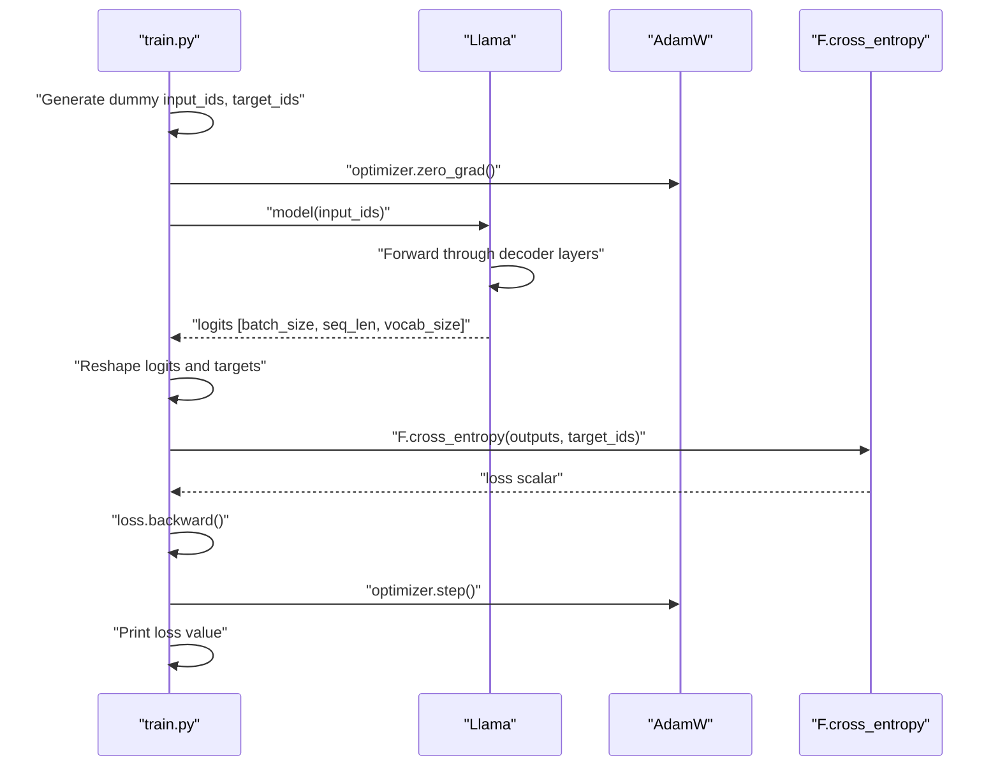

The training step [step1_modeling/train.py:78-95]() implements the core training loop:

1. **Data Preparation**: Generate random `input_ids` and `target_ids` tensors
2. **Forward Pass**: Compute model outputs via `model(input_ids=input_ids)`
3. **Loss Computation**: Calculate cross-entropy loss between predictions and targets
4. **Backward Pass**: Compute gradients via `loss.backward()`
5. **Parameter Update**: Apply gradients via `optimizer.step()`

Sources: [step1_modeling/train.py:74-96]()

## Key Model Components

### Flash Attention Implementation

The attention mechanism uses Flash Attention for memory-efficient computation:

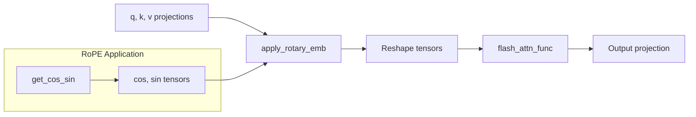

The `flash_attention` function [step1_modeling/model.py:8-12]() and `get_cos_sin` function [step1_modeling/model.py:14-23]() provide optimized attention computation with rotary positional embeddings.

### Configuration and Initialization

Model configuration is loaded from HuggingFace and customized:

| Parameter | Purpose | Default Value |
|-----------|---------|---------------|
| `num_hidden_layers` | Number of decoder layers | 32 |
| `num_attention_heads` | Attention heads per layer | 16 |
| `num_key_value_heads` | KV heads for grouped-query attention | 4 |
| `max_position_embeddings` | Maximum sequence length | Matches `seq_len` |

The model is initialized with `torch.bfloat16` precision and moved to the CUDA device [step1_modeling/train.py:64-66]().

Sources: [step1_modeling/train.py:58-66](), [step1_modeling/model.py:14-23](), [step1_modeling/model.py:8-12]()

## Integration with Distributed Training

Although Step 1 runs on a single process, it initializes PyTorch distributed infrastructure to maintain consistency with later distributed training steps. The script uses `torchrun` launcher and calls `dist.init_process_group()` [step1_modeling/train.py:54](), establishing the foundation for the process group management introduced in [2.2](#2.2).

Sources: [step1_modeling/train.py:46-54]()

---

# Page: Step 2: Process Group Management

# Step 2: Process Group Management

<details>
<summary>Relevant source files</summary>

The following files were used as context for generating this wiki page:

- [.demo/step2_process_group_manager.json](.demo/step2_process_group_manager.json)
- [.gitignore](.gitignore)
- [step2_process_group_manager/model.py](step2_process_group_manager/model.py)
- [step2_process_group_manager/patch_step_2.diff](step2_process_group_manager/patch_step_2.diff)
- [step2_process_group_manager/process_group_manager.py](step2_process_group_manager/process_group_manager.py)
- [step2_process_group_manager/train.py](step2_process_group_manager/train.py)
- [step2_process_group_manager/utils.py](step2_process_group_manager/utils.py)

</details>


This document covers the introduction of distributed training infrastructure through the `ProcessGroupManager` class. This step establishes the foundation for 3D parallelism by setting up process groups and coordinate systems that will be used in subsequent steps for tensor, pipeline, and data parallelism implementations.

For actual parallelism implementations, see [Tensor Parallelism](#4.1), [Data Parallelism](#4.2), and [Pipeline Parallelism](#4.3). For comprehensive process group coordination details, see [Process Group Management](#3.3).

## Distributed Training Foundation

Step 2 introduces the core infrastructure needed for distributed training by implementing a centralized process group management system. The `ProcessGroupManager` class establishes a 3D coordinate system that organizes processes across data parallel (DP), pipeline parallel (PP), and tensor parallel (TP) dimensions.

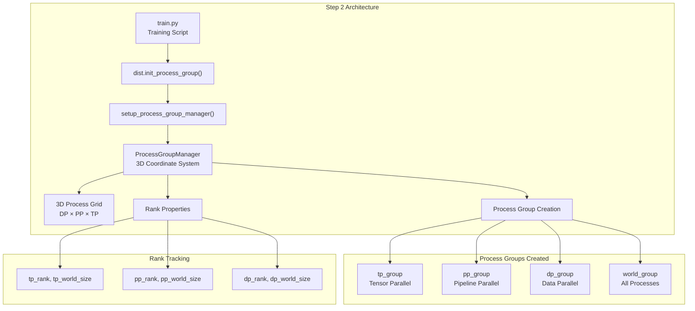

Sources: [step2_process_group_manager/process_group_manager.py:1-54](), [step2_process_group_manager/train.py:63-64]()

## ProcessGroupManager Architecture

The `ProcessGroupManager` class serves as the central coordinator for all distributed training communication. It creates a 3D tensor that maps global ranks to their positions in the data parallel, pipeline parallel, and tensor parallel dimensions.

### Core Initialization Process

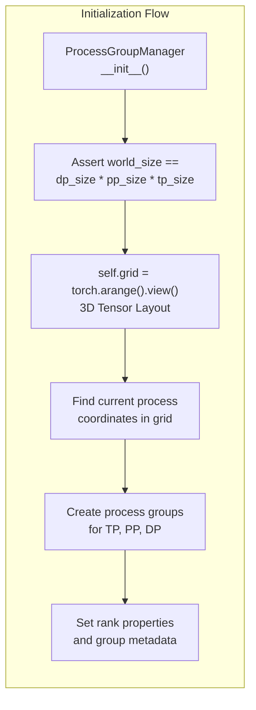

The class constructor performs several critical setup operations:

| Operation | Code Location | Purpose |
|-----------|---------------|---------|
| World size validation | [process_group_manager.py:11]() | Ensure process count matches parallelism dimensions |
| Grid creation | [process_group_manager.py:13]() | Create 3D tensor mapping ranks to coordinates |
| Coordinate finding | [process_group_manager.py:15]() | Locate current process in 3D space |
| Process group creation | [process_group_manager.py:18-21]() | Create communication groups for each parallelism type |

Sources: [step2_process_group_manager/process_group_manager.py:5-28]()

## 3D Process Grid Organization

The process grid uses a `torch.arange(world_size).view(dp_size, pp_size, tp_size)` layout to organize processes in 3D space. Each process can determine its coordinates and communicate with other processes along each dimension.

### Grid Layout Example

For a configuration with `dp_size=2, pp_size=2, tp_size=2` (8 total processes):

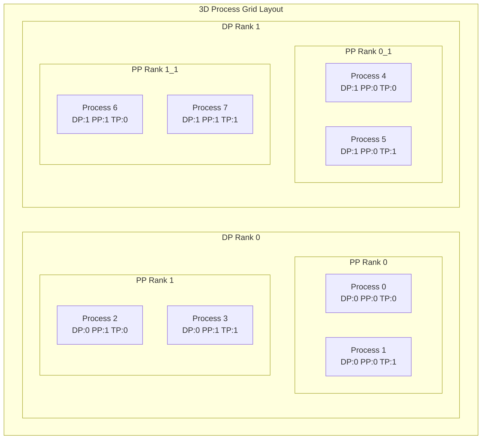

The coordinate finding logic uses `(self.grid == self.global_rank).nonzero().flatten().tolist()` to determine each process's position in this 3D space.

Sources: [step2_process_group_manager/process_group_manager.py:13-15]()

## Process Group Creation

The `ProcessGroupManager` creates four distinct process groups using `dist.new_subgroups_by_enumeration()`, each serving different communication patterns:

### Process Group Types

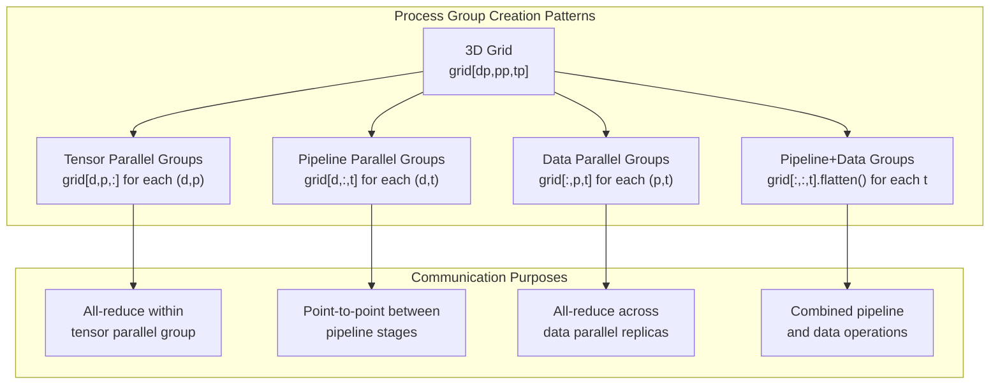

Each process group is created with specific rank lists:

| Process Group | Creation Pattern | Purpose |
|---------------|------------------|---------|
| `tp_group` | `grid[d, p, :]` for each (d,p) pair | Tensor parallel communication within model shards |
| `pp_group` | `grid[d, :, t]` for each (d,t) pair | Pipeline parallel communication between stages |
| `dp_group` | `grid[:, p, t]` for each (p,t) pair | Data parallel communication across replicas |
| `pp_dp_group` | `grid[:, :, t].flatten()` for each t | Combined pipeline and data parallel operations |

Sources: [step2_process_group_manager/process_group_manager.py:18-21]()

## Rank Properties and Metadata

The `ProcessGroupManager` computes and stores essential metadata for each parallelism dimension, enabling efficient communication and coordination.

### Tensor Parallelism Properties

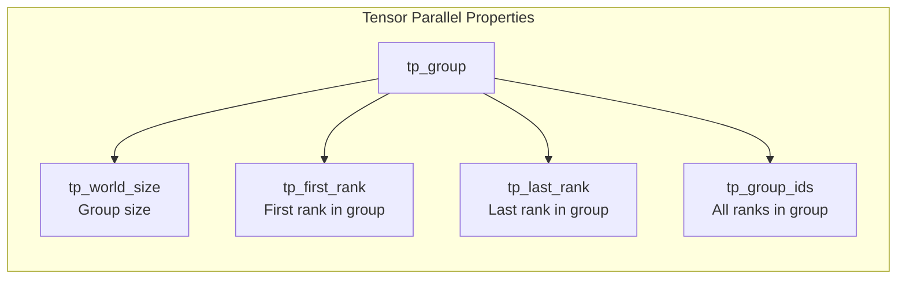

### Pipeline Parallelism Properties

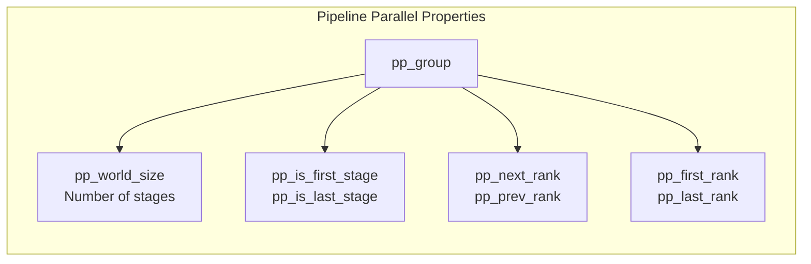

The pipeline parallel properties include critical neighbor rank calculations:
- `pp_next_rank`: Computed as `grid[dp_rank, pp_rank + 1, tp_rank]` or `None` for last stage
- `pp_prev_rank`: Computed as `grid[dp_rank, pp_rank - 1, tp_rank]` or `None` for first stage

Sources: [step2_process_group_manager/process_group_manager.py:30-47]()

## Training Script Integration

The training script integrates the `ProcessGroupManager` through a simple setup function call and uses the manager for logging and coordination.

### Integration Flow

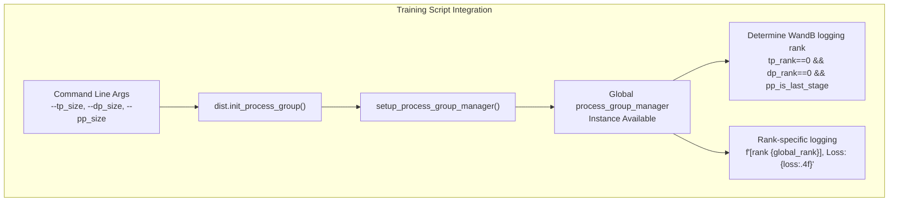

### Key Integration Points

| Integration Point | Code Location | Purpose |
|-------------------|---------------|---------|
| Argument parsing | [train.py:39-41]() | Accept TP/PP/DP size parameters |
| Process group setup | [train.py:64]() | Initialize distributed coordination |
| WandB rank determination | [train.py:66]() | Select single rank for centralized logging |
| Rank-specific logging | [train.py:120]() | Include rank information in output |

The training script uses the manager's properties to determine which rank should handle WandB logging, ensuring only one process per tensor parallel group logs metrics while maintaining visibility across all processes.

Sources: [step2_process_group_manager/train.py:38-42](), [step2_process_group_manager/train.py:63-66](), [step2_process_group_manager/train.py:120]()

## Global Manager Access Pattern

The implementation uses a global variable pattern for accessing the process group manager throughout the codebase:

```mermaid
graph LR
    subgraph "Global Access Pattern"
        SETUP["setup_process_group_manager()"] --> GLOBAL["global process_group_manager"]
        GLOBAL --> IMPORT["import process_group_manager as pgm"]
        IMPORT --> ACCESS["pgm.process_group_manager.property"]
    end
```

This pattern allows any module to access process group information without explicit parameter passing, which is essential for distributed training coordination across multiple components.

Sources: [step2_process_group_manager/process_group_manager.py:52-54](), [step2_process_group_manager/train.py:15-16]()

---

# Page: Step 3: Data Loading Pipeline

# Step 3: Data Loading Pipeline

<details>
<summary>Relevant source files</summary>

The following files were used as context for generating this wiki page:

- [step3_dataloader/patch_step_3.diff](step3_dataloader/patch_step_3.diff)
- [step3_dataloader/train.py](step3_dataloader/train.py)

</details>


This document covers the implementation of an efficient data loading pipeline for distributed language model training. Step 3 introduces the `MicroBatchDataLoader` class which handles tokenization, text chunking, micro-batching with gradient accumulation, and integration with distributed training processes.

For information about the model architecture that consumes this data, see [3.1](#3.1). For details about distributed process coordination, see [2.2](#2.2).

## Data Loading Architecture Overview

The data loading system transforms raw text from HuggingFace datasets into properly formatted batches for language model training. The pipeline handles tokenization, sequence chunking, and micro-batch generation while supporting gradient accumulation and distributed training.

**Data Loading Pipeline Architecture**
```mermaid
graph TD
    subgraph "Data Source"
        DS["HuggingFace Dataset\n(TinyStories)"]
        TK["AutoTokenizer\n(from model)"]
    end
    
    subgraph "MicroBatchDataLoader"
        INIT["__init__\n(setup parameters)"]
        TOK_DS["tokenize_dataset\n(process text)"]
        TOK_GT["tokenizer_group_text\n(chunk sequences)"]
        COLLATE["collate_batch\n(format for model)"]
    end
    
    subgraph "Output Batches"
        INPUT["input_ids\n(seq_len tokens)"]
        TARGET["target_ids\n(shifted for LM)"]
        POS["position_ids\n(positional encoding)"]
        MASK["attn_mask\n(causal mask)"]
    end
    
    subgraph "Training Integration"
        TRAIN_STEP["train_step\n(gradient accumulation)"]
        OPTIMIZER["optimizer.step\n(parameter update)"]
    end
    
    DS --> INIT
    TK --> INIT
    INIT --> TOK_DS
    TOK_DS --> TOK_GT
    TOK_GT --> COLLATE
    
    COLLATE --> INPUT
    COLLATE --> TARGET
    COLLATE --> POS
    COLLATE --> MASK
    
    INPUT --> TRAIN_STEP
    TARGET --> TRAIN_STEP
    TRAIN_STEP --> OPTIMIZER
```

Sources: [step3_dataloader/dataloader.py:14-39](), [step3_dataloader/train.py:23-44]()

## MicroBatchDataLoader Implementation

The `MicroBatchDataLoader` class extends PyTorch's `DataLoader` to provide specialized functionality for language model training with gradient accumulation and distributed training support.

**MicroBatchDataLoader Class Structure**
```mermaid
graph TB
    subgraph "MicroBatchDataLoader"
        CONSTRUCTOR["__init__\n(setup dataset & tokenizer)"]
        
        subgraph "Data Processing Methods"
            TOK_GROUP["tokenizer_group_text\n(tokenize & chunk)"]
            TOK_DATASET["tokenize_dataset\n(map processing)"]
            COLLATE["collate_batch\n(format batches)"]
        end
        
        subgraph "Iterator Methods"
            ITER["__iter__\n(iterator setup)"]
            NEXT["__next__\n(batch retrieval)"]
        end
        
        subgraph "Configuration"
            MICRO_BS["micro_batch_size"]
            GRAD_ACC["grad_acc_steps"] 
            SEQ_LEN["seq_len"]
            GLOBAL_BS["global_batch_size"]
        end
    end
    
    subgraph "PyTorch DataLoader"
        PARENT["DataLoader base class"]
    end
    
    PARENT --> CONSTRUCTOR
    CONSTRUCTOR --> TOK_GROUP
    CONSTRUCTOR --> TOK_DATASET
    CONSTRUCTOR --> COLLATE
    CONSTRUCTOR --> ITER
    CONSTRUCTOR --> NEXT
    
    CONSTRUCTOR --> MICRO_BS
    CONSTRUCTOR --> GRAD_ACC
    CONSTRUCTOR --> SEQ_LEN
    CONSTRUCTOR --> GLOBAL_BS
```

The class initializer calculates the global batch size by considering micro-batch size, gradient accumulation steps, and data parallel world size: `global_batch_size = micro_batch_size * grad_acc_steps * dp_world_size`.

Sources: [step3_dataloader/dataloader.py:14-39](), [step3_dataloader/dataloader.py:21]()

## Data Preprocessing Pipeline

The preprocessing pipeline transforms raw text into tokenized sequences suitable for causal language modeling. This involves tokenization, concatenation, and chunking into fixed-length sequences.

| Stage | Function | Input | Output |
|-------|----------|-------|--------|
| Tokenization | `tokenizer_group_text` | Raw text strings | Token arrays |
| Concatenation | Token joining | Separate sequences | Single token stream |
| Chunking | Sequence splitting | Long token stream | Fixed-length chunks |
| Dataset Mapping | `tokenize_dataset` | HuggingFace Dataset | Tokenized Dataset |

**Text Processing Flow**
```mermaid
graph LR
    subgraph "Raw Data"
        TEXT["Text: 'Once upon a time...'"]
    end
    
    subgraph "Tokenization"
        BATCH_ENCODE["batch_encode_plus\n(HF tokenizer)"]
        CONCAT["np.concatenate\n(join token arrays)"]
    end
    
    subgraph "Chunking"
        CHUNK_CALC["Calculate chunks\n(seq_len + 1)"]
        EXTRACT["Extract sequences\n(sliding window)"]
    end
    
    subgraph "Dataset Processing"
        MAP_FUNC["dataset.map\n(parallel processing)"]
        CACHE["load_from_cache_file\n(persistent caching)"]
    end
    
    TEXT --> BATCH_ENCODE
    BATCH_ENCODE --> CONCAT
    CONCAT --> CHUNK_CALC
    CHUNK_CALC --> EXTRACT
    EXTRACT --> MAP_FUNC
    MAP_FUNC --> CACHE
```

The chunking process creates sequences of `seq_len + 1` tokens to enable next-token prediction, where the first `seq_len` tokens serve as input and the last `seq_len` tokens (shifted by 1) serve as targets.

Sources: [step3_dataloader/dataloader.py:41-84](), [step3_dataloader/dataloader.py:52-60]()

## Batch Collation and Structure

The `collate_batch` method transforms tokenized sequences into properly formatted tensors for model consumption, including input/target separation and attention mask generation.

**Batch Structure**
```mermaid
graph TB
    subgraph "Input Tokens (seq_len + 1)"
        RAW["[1, 2, 3, 4, 5, 6, 7, 8]"]
    end
    
    subgraph "Collated Batch"
        INPUT_IDS["input_ids: [1, 2, 3, 4, 5, 6, 7]\n(first seq_len tokens)"]
        TARGET_IDS["target_ids: [2, 3, 4, 5, 6, 7, 8]\n(last seq_len tokens)"]
        POS_IDS["position_ids: [0, 1, 2, 3, 4, 5, 6]\n(sequential positions)"]
        ATTN_MASK["attn_mask: lower triangular\n(causal attention)"]
        HIDDEN["hidden_states: None\n(for pipeline parallel)"]
    end
    
    RAW --> INPUT_IDS
    RAW --> TARGET_IDS
    INPUT_IDS --> POS_IDS
    INPUT_IDS --> ATTN_MASK
    INPUT_IDS --> HIDDEN
```

The attention mask is a lower triangular matrix ensuring causal attention where each token can only attend to previous tokens in the sequence.

Sources: [step3_dataloader/dataloader.py:86-101](), [step3_dataloader/dataloader.py:89-93]()

## Training Loop Integration

The dataloader integrates with the training loop through gradient accumulation, where multiple micro-batches are processed before a single optimizer step. This enables effective larger batch sizes while managing memory constraints.

**Training Step with Gradient Accumulation**
```mermaid
graph TD
    subgraph "train_step Function"
        INIT_LOSS["acc_loss = 0.0"]
        LOOP_START["for i in range(grad_acc_steps)"]
        
        subgraph "Micro-batch Processing"
            GET_BATCH["batch = next(dataloader)"]
            TO_DEVICE["move to device"]
            FORWARD["model(input_ids)"]
            COMPUTE_LOSS["cross_entropy / grad_acc_steps"]
            BACKWARD["loss.backward()"]
            ACC_LOSS["acc_loss += loss.item()"]
        end
        
        RETURN["return acc_loss"]
    end
    
    subgraph "Main Training Loop"
        ZERO_GRAD["optimizer.zero_grad()"]
        CALL_TRAIN["loss = train_step()"]
        OPT_STEP["optimizer.step()"]
    end
    
    INIT_LOSS --> LOOP_START
    LOOP_START --> GET_BATCH
    GET_BATCH --> TO_DEVICE
    TO_DEVICE --> FORWARD
    FORWARD --> COMPUTE_LOSS
    COMPUTE_LOSS --> BACKWARD
    BACKWARD --> ACC_LOSS
    ACC_LOSS --> LOOP_START
    LOOP_START --> RETURN
    
    ZERO_GRAD --> CALL_TRAIN
    CALL_TRAIN --> OPT_STEP
```

The loss is scaled by `1/grad_acc_steps` to maintain consistent gradient magnitudes across different accumulation settings.

Sources: [step3_dataloader/train.py:23-44](), [step3_dataloader/train.py:38]()

## Iterator Management

The dataloader implements custom iterator methods to handle continuous data streaming and proper iterator lifecycle management for training loops.

The `__iter__` and `__next__` methods ensure proper iterator state management, automatically resetting when the iterator is exhausted and handling StopIteration exceptions for continuous training.

Sources: [step3_dataloader/dataloader.py:103-117]()

## Performance and Configuration

The training script tracks key performance metrics including tokens per second, memory usage, and throughput per GPU. The dataloader configuration supports:

| Parameter | Purpose | Default |
|-----------|---------|---------|
| `micro_batch_size` | Per-device batch size | 1 |
| `gradient_accumulation_steps` | Micro-batches per update | 1 |
| `seq_len` | Sequence length | 32 |
| `num_workers` | DataLoader workers | 1 |
| `num_proc` | Dataset processing cores | 4 |

Token throughput is calculated as `tokens_per_step = global_batch_size * seq_len`, where `global_batch_size = micro_batch_size * grad_acc_steps * dp_world_size`.

Sources: [step3_dataloader/train.py:145-147](), [step3_dataloader/train.py:167-174]()

---

# Page: Step 4: Tensor Parallelism

# Step 4: Tensor Parallelism

<details>
<summary>Relevant source files</summary>

The following files were used as context for generating this wiki page:

- [.demo/step4_tensor_parallel.json](.demo/step4_tensor_parallel.json)
- [step3_dataloader/process_group_manager.py](step3_dataloader/process_group_manager.py)
- [step4_tensor_parallel/patch_step_4.diff](step4_tensor_parallel/patch_step_4.diff)
- [step4_tensor_parallel/train.py](step4_tensor_parallel/train.py)

</details>


This document covers the implementation of tensor parallelism in the Picotron tutorial, which enables splitting model weights across multiple GPUs to handle larger models. This step introduces parallel linear layers, communication primitives, and model transformation logic to distribute computation within each transformer layer.

For pipeline parallelism that splits models across stages, see [Step 7-8: Pipeline Parallelism](#2.6). For data parallelism that replicates models across processes, see [Step 5-6: Data Parallelism](#2.5).

## Overview

Tensor parallelism (TP) partitions individual layers of a neural network across multiple devices, allowing each device to compute only a portion of each layer's output. In this implementation, linear layers are split either column-wise or row-wise, with communication operations to synchronize results across the tensor parallel group.

```mermaid
graph TB
    subgraph "Single GPU (No TP)"
        A1["Input: [B, S, H]"] --> B1["Linear: [H, 4H]"]
        B1 --> C1["Output: [B, S, 4H]"]
    end
    
    subgraph "Tensor Parallel (TP=2)"
        A2["Input: [B, S, H]"] 
        A2 --> B2["GPU 0: Linear [H, 2H]"]
        A2 --> B3["GPU 1: Linear [H, 2H]"]
        B2 --> C2["Partial Output: [B, S, 2H]"]
        B3 --> C3["Partial Output: [B, S, 2H]"]
        C2 --> D2["All-Gather"]
        C3 --> D2
        D2 --> E2["Full Output: [B, S, 4H]"]
    end
```

Sources: [step4_tensor_parallel/tensor_parallel.py:146-198](), [step4_tensor_parallel/patch_step_4.diff:26-144]()

## Parallel Layer Implementations

### ColumnParallelLinear

The `ColumnParallelLinear` class splits linear layers along the output dimension, where each GPU computes a subset of output features.

| Property | Value |
|----------|-------|
| Weight Shape | `[output_size_per_partition, in_features]` |
| Input Processing | Identity (Copy operation) |
| Output Processing | Optional All-Gather |
| Bias Handling | Split per partition |

```mermaid
graph LR
    subgraph "ColumnParallelLinear Forward Pass"
        A["input"] --> B["Copy.apply"]
        B --> C["F.linear(input, weight_i, bias_i)"]
        C --> D{"gather_output?"}
        D -->|Yes| E["Gather.apply"]
        D -->|No| F["output_i"]
        E --> G["concatenated_output"]
    end
```

Sources: [step4_tensor_parallel/tensor_parallel.py:146-198]()

### RowParallelLinear

The `RowParallelLinear` class splits linear layers along the input dimension, requiring an all-reduce operation to combine partial results.

| Property | Value |
|----------|-------|
| Weight Shape | `[out_features, input_size_per_partition]` |
| Input Processing | No modification |
| Output Processing | All-Reduce |
| Bias Handling | Full bias on each GPU |

```mermaid
graph LR
    subgraph "RowParallelLinear Forward Pass"
        A["input_i"] --> B["F.linear(input_i, weight_i)"]
        B --> C["output_partial_i"]
        C --> D["Reduce.apply"]
        D --> E["output + bias"]
    end
```

Sources: [step4_tensor_parallel/tensor_parallel.py:200-249]()

### VocabParallelEmbedding

The `VocabParallelEmbedding` class partitions the vocabulary across devices, with each GPU handling a subset of tokens.

```mermaid
graph TB
    subgraph "VocabParallelEmbedding Process"
        A["input_tokens"] --> B["vocab_range_check"]
        B --> C["mask_out_of_range"]
        C --> D["adjust_indices"]
        D --> E["F.embedding(masked_input, weight_i)"]
        E --> F["zero_out_masked"]
        F --> G["Reduce.apply"]
        G --> H["final_embeddings"]
    end
```

Sources: [step4_tensor_parallel/tensor_parallel.py:251-332]()

## Communication Primitives

### Autograd Functions

The tensor parallel implementation uses custom autograd functions to handle forward and backward communication patterns:

| Function | Forward Pass | Backward Pass | Usage |
|----------|-------------|---------------|-------|
| `Copy` | Identity | All-Reduce | Column parallel input |
| `Reduce` | All-Reduce | Identity | Row parallel output |
| `Gather` | All-Gather | Split | Column parallel with gather |

### Communication Patterns

```mermaid
graph TB
    subgraph "TP Communication Flow"
        A["Forward: Copy"] --> B["Local Computation"]
        B --> C["Forward: Gather/Reduce"]
        C --> D["Loss Computation"]
        D --> E["Backward: Split"]
        E --> F["Local Gradients"]
        F --> G["Backward: All-Reduce"]
    end
```

Sources: [step4_tensor_parallel/tensor_parallel.py:46-98]()

## Model Transformation Process

### apply_tensor_parallel Function

The `apply_tensor_parallel` function transforms a standard LLaMA model into a tensor-parallel version by replacing linear layers:

```mermaid
graph TD
    subgraph "Model Transformation"
        A["Standard LLaMA Model"] --> B["apply_tensor_parallel"]
        B --> C["Replace Linear Layers"]
        
        subgraph "Layer Replacements"
            C --> D["q_proj → ColumnParallelLinear"]
            C --> E["k_proj → ColumnParallelLinear"]
            C --> F["v_proj → ColumnParallelLinear"]
            C --> G["out_proj → RowParallelLinear"]
            C --> H["up_proj → ColumnParallelLinear"]
            C --> I["gate_proj → ColumnParallelLinear"]
            C --> J["down_proj → RowParallelLinear"]
            C --> K["embedding → VocabParallelEmbedding"]
            C --> L["final_proj → ColumnParallelLinear"]
        end
        
        D --> M["TP-enabled LLaMA Model"]
        E --> M
        F --> M
        G --> M
        H --> M
        I --> M
        J --> M
        K --> M
        L --> M
    end
```

Sources: [step4_tensor_parallel/tensor_parallel.py:101-144]()

### Attention Layer Modifications

The attention mechanism requires special handling for tensor parallelism, with head count adjustments per GPU:

```python
# From model.py modifications
self.num_local_heads = config.num_attention_heads // pgm.process_group_manager.tp_world_size
self.num_local_kv_heads = config.num_key_value_heads // pgm.process_group_manager.tp_world_size
```

Sources: [step4_tensor_parallel/patch_step_4.diff:18-22]()

## Training Integration

### Training Script Changes

The training script integrates tensor parallelism with minimal changes:

| Component | Change |
|-----------|--------|
| Model Creation | Add `apply_tensor_parallel` call |
| Process Groups | TP size configuration via `--tp_size` |
| Initialization | Check `tp_world_size > 1` |

```mermaid
graph LR
    subgraph "Training Flow with TP"
        A["torchrun --nproc_per_node 4"] --> B["setup_process_group_manager"]
        B --> C["Create LLaMA Model"]
        C --> D{"tp_world_size > 1?"}
        D -->|Yes| E["apply_tensor_parallel"]
        D -->|No| F["Keep Standard Model"]
        E --> G["model.to(device)"]
        F --> G
        G --> H["Training Loop"]
    end
```

Sources: [step4_tensor_parallel/train.py:127-128](), [step4_tensor_parallel/train.py:2]()

### Process Group Management

Tensor parallelism requires coordination through the ProcessGroupManager:

```mermaid
graph TB
    subgraph "Process Group Structure"
        A["World Size = 4"] --> B["TP Group Creation"]
        B --> C["tp_group"]
        B --> D["tp_rank"]
        B --> E["tp_world_size"]
        
        subgraph "TP Group Operations"
            C --> F["All-Reduce Operations"]
            C --> G["All-Gather Operations"]
            C --> H["Split Operations"]
        end
    end
```

Sources: [step3_dataloader/process_group_manager.py:17-18](), [step3_dataloader/process_group_manager.py:30-33]()

## Weight Initialization

### Master Weight Strategy

For tensor parallel layers, weights are initialized from a master weight tensor to ensure consistency:

1. Create full-size master weight tensor
2. Initialize using standard PyTorch method
3. Split master weight into partitions
4. Assign appropriate partition to each GPU

This ensures identical initialization across all tensor parallel ranks while maintaining the same statistical properties as single-GPU training.

Sources: [step4_tensor_parallel/tensor_parallel.py:181-190](), [step4_tensor_parallel/tensor_parallel.py:233-242](), [step4_tensor_parallel/tensor_parallel.py:299-305]()

---

# Page: Step 5-6: Data Parallelism

# Step 5-6: Data Parallelism

<details>
<summary>Relevant source files</summary>

The following files were used as context for generating this wiki page:

- [.demo/step5_data_parallel_naive.json](.demo/step5_data_parallel_naive.json)
- [.demo/step6_data_parallel_bucket.json](.demo/step6_data_parallel_bucket.json)
- [step5_data_parallel_naive/patch_step_5.diff](step5_data_parallel_naive/patch_step_5.diff)
- [step6_data_parallel_bucket/data_parallel.py](step6_data_parallel_bucket/data_parallel.py)
- [step6_data_parallel_bucket/patch_step_6.diff](step6_data_parallel_bucket/patch_step_6.diff)

</details>


This document covers the implementation of data parallelism in steps 5 and 6 of the tutorial. Data parallelism distributes training data across multiple processes while maintaining identical model replicas, requiring gradient synchronization between processes. Step 5 implements a naive approach with simple all-reduce operations, while Step 6 introduces an optimized bucketing strategy for more efficient gradient communication.

For tensor parallelism which shards model weights across processes, see [Step 4: Tensor Parallelism](#2.4). For pipeline parallelism which distributes model layers across stages, see [Step 7-8: Pipeline Parallelism](#2.6).

## Data Parallelism Overview

Data parallelism replicates the entire model across multiple processes, with each process training on a different subset of the data. The key challenge is synchronizing gradients computed by different processes before applying optimizer updates.

```mermaid
graph TB
    subgraph "Process 0"
        M0["Model Replica 0"]
        D0["Data Subset 0"]
        G0["Gradients 0"]
    end
    
    subgraph "Process 1" 
        M1["Model Replica 1"]
        D1["Data Subset 1"]
        G1["Gradients 1"]
    end
    
    subgraph "Process 2"
        M2["Model Replica 2"] 
        D2["Data Subset 2"]
        G2["Gradients 2"]
    end
    
    subgraph "Gradient Synchronization"
        AR["All-Reduce Operation"]
        SG["Synchronized Gradients"]
    end
    
    D0 --> M0
    D1 --> M1  
    D2 --> M2
    
    M0 --> G0
    M1 --> G1
    M2 --> G2
    
    G0 --> AR
    G1 --> AR
    G2 --> AR
    
    AR --> SG
    SG --> M0
    SG --> M1
    SG --> M2
```

Sources: [step5_data_parallel_naive/data_parallel.py:9-45](), [step6_data_parallel_bucket/data_parallel.py:165-259]()

## Step 5: Naive Data Parallelism

Step 5 introduces the foundational data parallelism implementation using straightforward all-reduce operations for gradient synchronization.

### DataParallelNaive Implementation

The `DataParallelNaive` class wraps the base model and adds gradient synchronization through backward hooks:

```mermaid
graph TD
    subgraph "DataParallelNaive Workflow"
        INIT["DataParallelNaive.__init__()"]
        HOOK["register_backward_hook()"]
        FWD["forward()"]
        BWD["_allreduce_grads()"]
        SYNC["dist.all_reduce()"]
    end
    
    subgraph "Training Loop Integration"
        BATCH["Get Batch"]
        FORWARD["Model Forward"]
        LOSS["Compute Loss"]
        BACKWARD["Loss Backward"]
        OPT["Optimizer Step"]
    end
    
    INIT --> HOOK
    BATCH --> FORWARD
    FORWARD --> FWD
    FORWARD --> LOSS
    LOSS --> BACKWARD
    BACKWARD --> BWD
    BWD --> SYNC
    SYNC --> OPT
```

Sources: [step5_data_parallel_naive/data_parallel.py:21-44](), [step5_data_parallel_naive/train.py:104-152]()

### Key Components

| Component | Purpose | Implementation |
|-----------|---------|----------------|
| `require_backward_grad_sync` | Controls when gradients sync | Boolean flag set per micro-batch |
| `register_backward_hook()` | Attaches hooks to parameters | Iterates through `module.parameters()` |
| `_allreduce_grads()` | Synchronizes gradients | Uses `dist.all_reduce()` with dp_group |
| `DistributedSampler` | Distributes data across ranks | Added to dataloader configuration |

### Data Distribution

The dataloader is enhanced with `DistributedSampler` to ensure each process receives different data subsets:

```mermaid
graph LR
    subgraph "Data Distribution"
        DS["Dataset"]
        SAMP["DistributedSampler"]
        
        subgraph "Process Ranks"
            R0["Rank 0<br/>Data Subset"]
            R1["Rank 1<br/>Data Subset"] 
            R2["Rank 2<br/>Data Subset"]
        end
    end
    
    DS --> SAMP
    SAMP --> R0
    SAMP --> R1
    SAMP --> R2
```

Sources: [step5_data_parallel_naive/dataloader.py:70-85](), [step5_data_parallel_naive/train.py:140]()

### Gradient Accumulation Control

The training loop manages gradient synchronization timing to support gradient accumulation:

```mermaid
graph TD
    START["Start Gradient Accumulation"]
    LOOP["For each micro-batch"]
    CHECK["Last micro-batch?"]
    SYNC_ON["require_backward_grad_sync = True"]
    SYNC_OFF["require_backward_grad_sync = False"]
    FORWARD["Forward Pass"]
    BACKWARD["Backward Pass"]
    END["Optimizer Step"]
    
    START --> LOOP
    LOOP --> CHECK
    CHECK -->|Yes| SYNC_ON
    CHECK -->|No| SYNC_OFF
    SYNC_ON --> FORWARD
    SYNC_OFF --> FORWARD
    FORWARD --> BACKWARD
    BACKWARD --> LOOP
    BACKWARD --> END
```

Sources: [step5_data_parallel_naive/train.py:115-118](), [step5_data_parallel_naive/data_parallel.py:41-43]()

## Step 6: Bucketed Data Parallelism

Step 6 introduces a sophisticated bucketing system that optimizes gradient communication by grouping parameters and enabling asynchronous operations.

### Architecture Overview

The bucketed approach uses three main classes working together:

```mermaid
graph TB
    subgraph "DataParallelBucket System"
        DPB["DataParallelBucket"]
        BM["BucketManager"]
        
        subgraph "Buckets"
            B1["Bucket 1<br/>Parameters A-C"]
            B2["Bucket 2<br/>Parameters D-F"]
            B3["Bucket 3<br/>Parameters G-I"]
        end
        
        subgraph "Gradient Storage"
            GD1["grad_data_list[0]"]
            GD2["grad_data_list[1]"]
            GD3["grad_data_list[2]"]
        end
    end
    
    DPB --> BM
    BM --> B1
    BM --> B2
    BM --> B3
    B1 --> GD1
    B2 --> GD2
    B3 --> GD3
```

Sources: [step6_data_parallel_bucket/data_parallel.py:165-176](), [step6_data_parallel_bucket/data_parallel.py:83-100](), [step6_data_parallel_bucket/data_parallel.py:39-53]()

### BucketManager Parameter Assignment

The `BucketManager` divides model parameters into buckets based on size constraints:

```mermaid
graph TD
    START["Start Parameter Assignment"]
    PARAM["Next Parameter"]
    EMPTY["cur_bucket_size == 0?"]
    FITS["param.numel() + cur_bucket_size <= bucket_size?"]
    ADD_NEW["Add to Current Bucket<br/>Update cur_bucket_size"]
    NEW_BUCKET["Create New Bucket<br/>Reset cur_bucket_size"]
    ASSIGN["Assign Parameter Location<br/>(start, end, bucket_idx)"]
    MORE["More Parameters?"]
    INIT_BUCKETS["Initialize Bucket Objects"]
    CREATE_VIEWS["Create main_grad Views"]
    
    START --> PARAM
    PARAM --> EMPTY
    EMPTY -->|Yes| ADD_NEW
    EMPTY -->|No| FITS
    FITS -->|Yes| ADD_NEW  
    FITS -->|No| NEW_BUCKET
    NEW_BUCKET --> ASSIGN
    ADD_NEW --> ASSIGN
    ASSIGN --> MORE
    MORE -->|Yes| PARAM
    MORE -->|No| INIT_BUCKETS
    INIT_BUCKETS --> CREATE_VIEWS
```

Sources: [step6_data_parallel_bucket/data_parallel.py:102-145](), [step6_data_parallel_bucket/data_parallel.py:113-125]()

### Gradient Synchronization Workflow

The bucketed approach enables asynchronous gradient synchronization:

```mermaid
sequenceDiagram
    participant TL as "Training Loop"
    participant DPB as "DataParallelBucket"
    participant BM as "BucketManager"
    participant B as "Bucket"
    participant DG as "dist.all_reduce"
    
    TL->>DPB: backward()
    Note over DPB: param_hook triggered for each parameter
    DPB->>DPB: param.main_grad.add_(param.grad.data)
    DPB->>BM: mark_param_as_ready(param)
    BM->>B: mark_param_as_ready(param)
    
    alt All parameters in bucket ready
        B->>B: sync_gradient()
        B->>DG: all_reduce(async_op=True)
        DG-->>B: handle
    end
    
    Note over DPB: _post_backward callback queued
    DPB->>BM: wait()
    BM->>B: wait()
    B->>DG: handle.wait()
    DPB->>DPB: Copy main_grad to param.grad
```

Sources: [step6_data_parallel_bucket/data_parallel.py:218-239](), [step6_data_parallel_bucket/data_parallel.py:160-163](), [step6_data_parallel_bucket/data_parallel.py:75-81](), [step6_data_parallel_bucket/data_parallel.py:55-59]()

### Advanced Hook Registration

The bucketed implementation uses gradient accumulator function hooks for better integration with PyTorch's autograd system:

```mermaid
graph TD
    subgraph "Hook Registration Process"
        PARAM["param = model.parameters()"]
        EXPAND["param_tmp = param.expand_as(param)"]
        GRAD_FN["grad_acc_fn = param_tmp.grad_fn.next_functions[0][0]"]
        HOOK["grad_acc_fn.register_hook(param_hook)"]
        STORE["grad_accs.append(grad_acc_fn)"]
    end
    
    subgraph "Gradient Accumulation Benefits"
        MP["Mixed Precision Support"]
        GA["Proper Gradient Accumulation"]
        AS["Asynchronous Synchronization"]
    end
    
    PARAM --> EXPAND
    EXPAND --> GRAD_FN
    GRAD_FN --> HOOK
    HOOK --> STORE
    HOOK --> MP
    HOOK --> GA
    HOOK --> AS
```

Sources: [step6_data_parallel_bucket/data_parallel.py:189-212](), [step6_data_parallel_bucket/data_parallel.py:204-211]()

## Key Differences and Optimizations

| Aspect | Step 5 (Naive) | Step 6 (Bucketed) |
|--------|----------------|-------------------|
| **Gradient Storage** | Uses `param.grad` directly | Uses `param.main_grad` with float32 |
| **Synchronization** | Synchronous all-reduce per parameter | Asynchronous all-reduce per bucket |
| **Memory Efficiency** | Individual parameter gradients | Contiguous bucket tensors |
| **Communication** | Multiple small messages | Fewer larger messages |
| **Hook Type** | Parameter hooks | Gradient accumulator hooks |
| **Mixed Precision** | Limited support | Full support via main_grad |

### Communication Pattern Comparison

```mermaid
graph LR
    subgraph "Naive Approach"
        P1["Param 1"] --> AR1["All-Reduce 1"]
        P2["Param 2"] --> AR2["All-Reduce 2"]  
        P3["Param 3"] --> AR3["All-Reduce 3"]
        PN["Param N"] --> ARN["All-Reduce N"]
    end
    
    subgraph "Bucketed Approach"
        subgraph "Bucket 1"
            BP1["Param 1"]
            BP2["Param 2"]
        end
        subgraph "Bucket 2"  
            BP3["Param 3"]
            BPN["Param N"]
        end
        
        BP1 --> BAR1["Bucket All-Reduce 1"]
        BP2 --> BAR1
        BP3 --> BAR2["Bucket All-Reduce 2"] 
        BPN --> BAR2
    end
```

Sources: [step5_data_parallel_naive/data_parallel.py:38-44](), [step6_data_parallel_bucket/data_parallel.py:55-59](), [step6_data_parallel_bucket/data_parallel.py:75-81]()

The bucketed approach significantly reduces communication overhead by batching multiple parameter gradients into single all-reduce operations, while the asynchronous execution allows computation and communication to overlap more effectively.

---

# Page: Step 7-8: Pipeline Parallelism

# Step 7-8: Pipeline Parallelism

<details>
<summary>Relevant source files</summary>

The following files were used as context for generating this wiki page:

- [step7_pipeline_parallel_afab/patch_step_7.diff](step7_pipeline_parallel_afab/patch_step_7.diff)
- [step7_pipeline_parallel_afab/train.py](step7_pipeline_parallel_afab/train.py)
- [step8_pipeline_parallel_1f1b/patch_step_8.diff](step8_pipeline_parallel_1f1b/patch_step_8.diff)
- [step8_pipeline_parallel_1f1b/train.py](step8_pipeline_parallel_1f1b/train.py)

</details>


## Purpose and Scope

This document covers the implementation of pipeline parallelism in steps 7 and 8 of the Picotron tutorial. Pipeline parallelism splits the model into sequential stages distributed across different devices, enabling training of larger models by reducing per-device memory requirements. Step 7 introduces the foundational pipeline infrastructure with the AFAB (Activation Forward - Activation Backward) execution engine, while Step 8 adds the more sophisticated 1F1B (One Forward One Backward) engine that overlaps computation and communication for improved efficiency.

For tensor parallelism strategies that split individual layers across devices, see [4.1](#4.1). For data parallelism approaches that replicate the model across devices, see [4.2](#4.2).

## Pipeline Stage Distribution and Communication

### Model Partitioning Strategy

Pipeline parallelism partitions the transformer model into sequential stages, with each stage containing a subset of decoder layers. The `PipelineParallel` class handles this distribution by calculating layer assignments based on the pipeline parallel world size.

```mermaid
graph TB
    subgraph "Pipeline Stage 0"
        EMB["Embedding Layer"]
        DEC0["DecoderLayer 0"]
        DEC1["DecoderLayer 1"]
    end
    
    subgraph "Pipeline Stage 1" 
        DEC2["DecoderLayer 2"]
        DEC3["DecoderLayer 3"]
        DEC4["DecoderLayer 4"]
    end
    
    subgraph "Pipeline Stage 2"
        DEC5["DecoderLayer 5"]
        DEC6["DecoderLayer 6"]
        NORM["Final RMSNorm"]
        PROJ["Final Projection"]
    end
    
    EMB --> DEC0
    DEC0 --> DEC1
    DEC1 -.->|"pipeline_communicate<br/>send_forward"| DEC2
    DEC2 --> DEC3
    DEC3 --> DEC4
    DEC4 -.->|"pipeline_communicate<br/>send_forward"| DEC5
    DEC5 --> DEC6
    DEC6 --> NORM
    NORM --> PROJ
    
    PROJ -.->|"pipeline_communicate<br/>send_backward"| DEC4
    DEC2 -.->|"pipeline_communicate<br/>send_backward"| DEC1
```

The `distribute_layers` method in `PipelineParallel` calculates which layers each stage should own:

Sources: [step7_pipeline_parallel_afab/pipeline_parallel.py:96-99]()

### Point-to-Point Communication Primitives

Pipeline stages communicate through point-to-point operations coordinated by the `pipeline_communicate` function. This function handles four distinct communication patterns:

| Operation | Direction | Source Stage | Target Stage | Purpose |
|-----------|-----------|--------------|--------------|---------|
| `recv_forward` | Forward Pass | Previous Stage | Current Stage | Receive activations |
| `send_forward` | Forward Pass | Current Stage | Next Stage | Send activations |
| `recv_backward` | Backward Pass | Next Stage | Current Stage | Receive gradients |
| `send_backward` | Backward Pass | Current Stage | Previous Stage | Send gradients |

```mermaid
graph LR
    subgraph "Forward Communication Flow"
        STAGE0["Stage 0<br/>pp_rank=0"] 
        STAGE1["Stage 1<br/>pp_rank=1"]
        STAGE2["Stage 2<br/>pp_rank=2"]
        
        STAGE0 -->|"send_forward<br/>recv_forward"| STAGE1
        STAGE1 -->|"send_forward<br/>recv_forward"| STAGE2
    end
    
    subgraph "Backward Communication Flow"
        STAGE2B["Stage 2<br/>pp_rank=2"]
        STAGE1B["Stage 1<br/>pp_rank=1"] 
        STAGE0B["Stage 0<br/>pp_rank=0"]
        
        STAGE2B -->|"send_backward<br/>recv_backward"| STAGE1B
        STAGE1B -->|"send_backward<br/>recv_backward"| STAGE0B
    end
```

Sources: [step7_pipeline_parallel_afab/pipeline_parallel.py:23-83]()

## AFAB Pipeline Engine

### Execution Pattern

The AFAB (Activation Forward - Activation Backward) engine implements a two-phase execution strategy where all forward passes complete before any backward passes begin. This approach maximizes memory usage but provides simpler scheduling logic.

```mermaid
graph TB
    subgraph "AFAB Execution Timeline"
        subgraph "All Forward Phase"
            F1["Microbatch 1<br/>Forward"]
            F2["Microbatch 2<br/>Forward"] 
            F3["Microbatch 3<br/>Forward"]
            F4["Microbatch 4<br/>Forward"]
        end
        
        subgraph "All Backward Phase"
            B1["Microbatch 1<br/>Backward"]
            B2["Microbatch 2<br/>Backward"]
            B3["Microbatch 3<br/>Backward"] 
            B4["Microbatch 4<br/>Backward"]
        end
        
        F1 --> F2 --> F3 --> F4
        F4 --> B1 --> B2 --> B3 --> B4
    end
```

The `train_step_pipeline_afab` function stores intermediate activations and output tensors during the forward phase, then processes them in reverse order during the backward phase:

Sources: [step7_pipeline_parallel_afab/pipeline_parallel.py:117-152]()

### Memory and Synchronization Patterns

AFAB requires storing all forward pass outputs until the backward phase begins, leading to high peak memory usage. The engine coordinates gradient synchronization with data parallel groups by setting `require_backward_grad_sync` only on the final microbatch:

Sources: [step7_pipeline_parallel_afab/pipeline_parallel.py:143-146]()

## 1F1B Pipeline Engine

### Advanced Communication Primitives

Step 8 introduces `bidirectional_pipeline_communicate` for simultaneous send and receive operations, enabling the overlapped execution pattern of 1F1B:

```mermaid
graph LR
    subgraph "Bidirectional Communication"
        CURR["Current Stage<br/>pp_rank=i"]
        NEXT["Next Stage<br/>pp_rank=i+1"]
        
        CURR -->|"send_fwd_recv_bwd<br/>dist.isend + dist.irecv"| NEXT
        NEXT -->|"send_bwd_recv_fwd<br/>dist.isend + dist.irecv"| CURR
    end
```

Sources: [step8_pipeline_parallel_1f1b/pipeline_parallel.py:16-67]()

### Three-Phase Execution Strategy

The 1F1B engine implements a sophisticated three-phase execution pattern that overlaps forward and backward passes to reduce memory usage and improve pipeline efficiency:

```mermaid
graph TB
    subgraph "1F1B Execution Phases"
        subgraph "Warmup Phase"
            W1["Forward Only<br/>Microbatch 1"]
            W2["Forward Only<br/>Microbatch 2"]
        end
        
        subgraph "Steady State Phase"
            SS1["1F1B<br/>Microbatch 3"]
            SS2["1F1B<br/>Microbatch 4"] 
            SS3["1F1B<br/>Microbatch 5"]
        end
        
        subgraph "Cooldown Phase"
            C1["Backward Only<br/>Microbatch 1"]
            C2["Backward Only<br/>Microbatch 2"]
        end
        
        W1 --> W2 --> SS1 --> SS2 --> SS3 --> C1 --> C2
    end
```

The number of warmup microbatches is calculated as `min(pp_world_size - pp_rank - 1, grad_acc_steps)`, ensuring proper pipeline filling:

Sources: [step8_pipeline_parallel_1f1b/pipeline_parallel.py:76-77]()

### Gradient Synchronization Strategy

The 1F1B engine implements sophisticated gradient synchronization logic to ensure proper coordination with data parallel groups. Synchronization is triggered on the last microbatch, but only when the last pipeline stage (rank with `num_warmup_microbatches = 0`) completes its backward pass:

Sources: [step8_pipeline_parallel_1f1b/pipeline_parallel.py:117-118]()

## Integration with Training Pipeline

### Training Script Configuration

Both pipeline engines integrate into the training script through the `--pp_engine` argument, with the training loop dispatching to the appropriate engine based on configuration:

```mermaid
graph TD
    subgraph "Training Script Integration"
        ARGS["Command Line Args<br/>--pp_size, --pp_engine"]
        PGM_SETUP["setup_process_group_manager<br/>pp_size=args.pp_size"]
        MODEL_WRAP["PipelineParallel(model, model_config)"]
        
        TRAIN_DISPATCH{"pp_world_size > 1?"}
        ENGINE_CHOICE{"args.pp_engine"}
        
        AFAB_ENGINE["train_step_pipeline_afab"]
        F1B1_ENGINE["train_step_pipeline_1f1b"]
        REGULAR["train_step"]
        
        ARGS --> PGM_SETUP
        PGM_SETUP --> MODEL_WRAP
        MODEL_WRAP --> TRAIN_DISPATCH
        
        TRAIN_DISPATCH -->|"Yes"| ENGINE_CHOICE
        TRAIN_DISPATCH -->|"No"| REGULAR
        
        ENGINE_CHOICE -->|"afab"| AFAB_ENGINE
        ENGINE_CHOICE -->|"1f1b"| F1B1_ENGINE
    end
```

Sources: [step8_pipeline_parallel_1f1b/train.py:193-199]()

### Loss Aggregation Across Pipeline Stages

Since only the last pipeline stage computes the loss function, the `all_reduce_loss_across_dp_ranks` function coordinates loss values across data parallel groups while handling the pipeline distribution:

Sources: [step7_pipeline_parallel_afab/train.py:27-33]()

### Tensor Shape Coordination

Pipeline communication requires predefined tensor shapes for creating receive buffers. The training script calculates `tensor_shapes` as `(micro_batch_size, seq_len, hidden_size)` and passes it to the pipeline engines:

Sources: [step8_pipeline_parallel_1f1b/train.py:183]()

## Code Entity Relationships

```mermaid
graph TB
    subgraph "Pipeline Parallel Module"
        PP_CLASS["PipelineParallel"]
        DIST_LAYERS["distribute_layers()"]
        PP_COMM["pipeline_communicate()"]
        BIDIR_COMM["bidirectional_pipeline_communicate()"]
        AFAB_TRAIN["train_step_pipeline_afab()"]
        F1B1_TRAIN["train_step_pipeline_1f1b()"]
    end
    
    subgraph "Process Group Manager"
        PGM["process_group_manager"]
        PP_RANK["pp_rank"]
        PP_WORLD["pp_world_size"]
        PP_FIRST["pp_is_first_stage"]
        PP_LAST["pp_is_last_stage"]
    end
    
    subgraph "Training Integration"
        TRAIN_PY["train.py"]
        ALL_REDUCE["all_reduce_loss_across_dp_ranks()"]
        TENSOR_SHAPES["tensor_shapes"]
    end
    
    PP_CLASS --> DIST_LAYERS
    AFAB_TRAIN --> PP_COMM
    F1B1_TRAIN --> PP_COMM
    F1B1_TRAIN --> BIDIR_COMM
    
    PP_COMM --> PGM
    BIDIR_COMM --> PGM
    DIST_LAYERS --> PP_RANK
    DIST_LAYERS --> PP_WORLD
    
    TRAIN_PY --> AFAB_TRAIN
    TRAIN_PY --> F1B1_TRAIN
    TRAIN_PY --> ALL_REDUCE
    AFAB_TRAIN --> TENSOR_SHAPES
    F1B1_TRAIN --> TENSOR_SHAPES
```

Sources: [step7_pipeline_parallel_afab/pipeline_parallel.py:87-154](), [step8_pipeline_parallel_1f1b/pipeline_parallel.py:75-139](), [step8_pipeline_parallel_1f1b/train.py:193-199]()

---

# Page: Core Architecture

# Core Architecture

<details>
<summary>Relevant source files</summary>

The following files were used as context for generating this wiki page:

- [step1_modeling/model.py](step1_modeling/model.py)
- [step3_dataloader/model.py](step3_dataloader/model.py)
- [step3_dataloader/utils.py](step3_dataloader/utils.py)

</details>


This document provides a comprehensive overview of the fundamental components that power the Picotron distributed training system. The core architecture consists of three primary subsystems: the LLaMA transformer model implementation, the data loading pipeline, and the process group management layer that coordinates distributed training operations.

For specific implementation details of tensor parallelism, data parallelism, and pipeline parallelism strategies, see [Parallelism Strategies](#4). For information about how these components integrate in complete training workflows, see [Training Integration](#5).

## System Overview

The Picotron architecture is designed around a modular approach where core components can be composed together to support different parallelism configurations. The system progresses from single-process training to sophisticated 3D parallelism while maintaining a consistent interface across all tutorial steps.

**Core Architecture Components**

```mermaid
graph TB
    subgraph "Core Architecture Layer"
        MODEL["Llama<br/>Transformer Model"]
        DATALOADER["MicroBatchDataLoader<br/>Data Pipeline"]
        PGM["ProcessGroupManager<br/>Distributed Coordination"]
    end
    
    subgraph "Model Architecture"
        EMBED["nn.Embedding<br/>Token Embedding"]
        DECODER_STACK["DecoderLayer Stack<br/>Transformer Layers"]
        FINAL_NORM["TritonRMSNorm<br/>Final Normalization"]
        PROJ["nn.Linear<br/>Output Projection"]
        
        EMBED --> DECODER_STACK
        DECODER_STACK --> FINAL_NORM
        FINAL_NORM --> PROJ
    end
    
    subgraph "DecoderLayer Components"
        ATTN["Attention<br/>Multi-Head Attention"]
        MLP_BLOCK["MLP<br/>Feed-Forward Network"]
        NORM1["TritonRMSNorm<br/>Pre-Attention Norm"]
        NORM2["TritonRMSNorm<br/>Pre-MLP Norm"]
        
        NORM1 --> ATTN
        NORM2 --> MLP_BLOCK
    end
    
    subgraph "Data Processing Pipeline"
        TOKENIZER["AutoTokenizer<br/>Text Processing"]
        SAMPLER["DistributedSampler<br/>Data Sharding"]
        COLLATOR["Collation Functions<br/>Batch Formation"]
        
        TOKENIZER --> SAMPLER
        SAMPLER --> COLLATOR
    end
    
    MODEL --> DECODER_STACK
    DECODER_STACK --> ATTN
    DECODER_STACK --> MLP_BLOCK
    
    DATALOADER --> TOKENIZER
    
    PGM -.->|"Coordinates"| MODEL
    PGM -.->|"Coordinates"| DATALOADER
    
    style MODEL fill:#f9f,stroke:#333,stroke-width:2px
    style DATALOADER fill:#bbf,stroke:#333,stroke-width:2px
    style PGM fill:#9f9,stroke:#333,stroke-width:2px
```

Sources: [step1_modeling/model.py:118-148](), [step3_dataloader/model.py:118-148]()

## LLaMA Model Architecture

The `Llama` class serves as the main model interface and implements a standard transformer architecture optimized for autoregressive language modeling. The implementation uses several key architectural components that are designed for efficient distributed training.

**Model Component Hierarchy**

```mermaid
graph TD
    subgraph "Llama Model Class"
        LLAMA_INIT["__init__<br/>Model Configuration"]
        LLAMA_FORWARD["forward<br/>Input Processing"]
    end
    
    subgraph "Core Model Components"
        EMBEDDING["self.embedding<br/>nn.Embedding"]
        DECODER_LAYERS["self.decoder_layers<br/>nn.ModuleList"]
        FINAL_PROJ["self.final_proj<br/>nn.Linear"]
        FINAL_NORM["self.final_norm<br/>TritonRMSNorm"]
    end
    
    subgraph "DecoderLayer Implementation"
        INPUT_NORM["self.input_layernorm<br/>TritonRMSNorm"]
        ATTENTION["self.attention<br/>Attention"]
        POST_ATTN_NORM["self.post_attention_layernorm<br/>TritonRMSNorm"]
        MLP["self.mlp<br/>MLP"]
    end
    
    subgraph "Attention Components"
        Q_PROJ["self.q_proj<br/>nn.Linear"]
        K_PROJ["self.k_proj<br/>nn.Linear"]
        V_PROJ["self.v_proj<br/>nn.Linear"]
        OUT_PROJ["self.out_proj<br/>nn.Linear"]
        FLASH_ATTN["flash_attention<br/>FlashAttention Function"]
        ROPE["apply_rotary_emb<br/>RoPE Positioning"]
    end
    
    subgraph "MLP Components"
        UP_PROJ["self.up_proj<br/>nn.Linear"]
        GATE_PROJ["self.gate_proj<br/>nn.Linear"]
        DOWN_PROJ["self.down_proj<br/>nn.Linear"]
        SILU["F.silu<br/>Activation Function"]
    end
    
    LLAMA_INIT --> EMBEDDING
    LLAMA_INIT --> DECODER_LAYERS
    LLAMA_INIT --> FINAL_PROJ
    LLAMA_INIT --> FINAL_NORM
    
    DECODER_LAYERS --> INPUT_NORM
    DECODER_LAYERS --> ATTENTION
    DECODER_LAYERS --> POST_ATTN_NORM
    DECODER_LAYERS --> MLP
    
    ATTENTION --> Q_PROJ
    ATTENTION --> K_PROJ
    ATTENTION --> V_PROJ
    ATTENTION --> OUT_PROJ
    ATTENTION --> FLASH_ATTN
    ATTENTION --> ROPE
    
    MLP --> UP_PROJ
    MLP --> GATE_PROJ
    MLP --> DOWN_PROJ
    MLP --> SILU
```

Sources: [step1_modeling/model.py:118-148](), [step1_modeling/model.py:100-117](), [step1_modeling/model.py:48-87](), [step1_modeling/model.py:89-98]()

### Key Architectural Features

The model implementation includes several optimizations for distributed training:

| Component | Implementation | Purpose |
|-----------|---------------|---------|
| **Attention Mechanism** | `flash_attention` function with `flash_attn_func` | Memory-efficient attention computation |
| **Positional Encoding** | `get_cos_sin` with RoPE via `apply_rotary_emb` | Rotary position embeddings for better length generalization |
| **Normalization** | `TritonRMSNorm` using `layer_norm_fn` | Efficient RMSNorm implementation via Triton |
| **Activation** | `F.silu` in MLP gating | SiLU activation for improved training dynamics |

The `DecoderLayer` follows the standard pre-normalization transformer pattern: `TritonRMSNorm -> Attention -> Residual -> TritonRMSNorm -> MLP -> Residual` as documented in [step1_modeling/model.py:101]().

Sources: [step1_modeling/model.py:8-12](), [step1_modeling/model.py:14-23](), [step1_modeling/model.py:25-46](), [step1_modeling/model.py:96-98]()

## Data Processing Pipeline

The data loading system provides efficient batch generation and distributed sampling capabilities. While the specific `MicroBatchDataLoader` implementation details are covered in [Data Loading System](#3.2), the core architecture establishes the foundation for gradient accumulation and distributed data handling.

**Data Flow Architecture**

```mermaid
graph LR
    subgraph "Input Data Sources"
        DATASET["HuggingFace Dataset<br/>TinyStories"]
        RAW_TEXT["Raw Text Strings<br/>Story Content"]
    end
    
    subgraph "Tokenization Layer"
        TOKENIZER["AutoTokenizer<br/>Text to Token Conversion"]
        ENCODING["encode() method<br/>String to List[int]"]
    end
    
    subgraph "Batch Formation"
        CHUNKING["Text Chunking<br/>seq_len + 1 Tokens"]
        INPUT_IDS["input_ids<br/>First seq_len Tokens"]
        TARGET_IDS["target_ids<br/>Last seq_len Tokens"]
    end
    
    subgraph "Distributed Sampling"
        DIST_SAMPLER["DistributedSampler<br/>Data Sharding"]
        RANK_SUBSET["Per-Rank Data<br/>Non-Overlapping Subsets"]
    end
    
    subgraph "Model Input"
        BATCHED_INPUT["Batched Tensors<br/>Shape: [batch_size, seq_len]"]
        MODEL_FORWARD["model.forward()<br/>Logits Generation"]
    end
    
    DATASET --> RAW_TEXT
    RAW_TEXT --> TOKENIZER
    TOKENIZER --> ENCODING
    ENCODING --> CHUNKING
    CHUNKING --> INPUT_IDS
    CHUNKING --> TARGET_IDS
    
    INPUT_IDS --> DIST_SAMPLER
    TARGET_IDS --> DIST_SAMPLER
    DIST_SAMPLER --> RANK_SUBSET
    RANK_SUBSET --> BATCHED_INPUT
    BATCHED_INPUT --> MODEL_FORWARD
```

Sources: [step3_dataloader/utils.py:1-40]()

## Process Group Management

The `ProcessGroupManager` coordinates distributed training operations across multiple parallelism dimensions. This component establishes the communication topology for tensor parallelism, data parallelism, and pipeline parallelism groups. The detailed implementation is covered in [Process Group Management](#3.3).

**Distributed Coordination Architecture**

```mermaid
graph TB
    subgraph "Process Group Hierarchy"
        WORLD_GROUP["WORLD Group<br/>All Processes"]
        TP_GROUP["Tensor Parallel Groups<br/>Model Sharding"]
        DP_GROUP["Data Parallel Groups<br/>Gradient Synchronization"]
        PP_GROUP["Pipeline Parallel Groups<br/>Stage Communication"]
    end
    
    subgraph "Communication Patterns"
        ALL_REDUCE["All-Reduce Operations<br/>Gradient Aggregation"]
        P2P_COMM["Point-to-Point Communication<br/>Pipeline Stage Transfer"]
        BROADCAST["Broadcast Operations<br/>Parameter Synchronization"]
    end
    
    subgraph "Parallelism Integration"
        MODEL_SHARDING["Model Parameter Sharding<br/>Across TP Ranks"]
        DATA_SHARDING["Data Batch Sharding<br/>Across DP Ranks"]
        STAGE_SHARDING["Layer Stage Sharding<br/>Across PP Ranks"]
    end
    
    WORLD_GROUP --> TP_GROUP
    WORLD_GROUP --> DP_GROUP
    WORLD_GROUP --> PP_GROUP
    
    TP_GROUP --> ALL_REDUCE
    DP_GROUP --> ALL_REDUCE
    PP_GROUP --> P2P_COMM
    
    TP_GROUP -.->|"Manages"| MODEL_SHARDING
    DP_GROUP -.->|"Manages"| DATA_SHARDING
    PP_GROUP -.->|"Manages"| STAGE_SHARDING
    
    ALL_REDUCE --> BROADCAST
```

Sources: Referenced from tutorial progression and distributed training patterns

## Component Integration

The three core architectural components work together to enable scalable distributed training. The integration patterns establish how models can be transformed from single-process implementations to sophisticated multi-dimensional parallel configurations.

| Integration Point | Mechanism | Purpose |
|------------------|-----------|---------|
| **Model-Data** | Batch shape coordination | Ensure consistent tensor dimensions across parallelism |
| **Model-ProcessGroup** | Communication group assignment | Map model components to appropriate process groups |
| **Data-ProcessGroup** | Distributed sampling | Coordinate data sharding across data parallel ranks |

The architecture supports progressive enhancement where each tutorial step adds new capabilities while maintaining compatibility with existing components. This design enables users to understand the impact of each parallelism strategy independently before combining them into full 3D parallelism configurations.

For detailed implementation of specific components, see:
- [LLaMA Model Implementation](#3.1) for transformer architecture details
- [Data Loading System](#3.2) for data pipeline implementation  
- [Process Group Management](#3.3) for distributed coordination mechanisms

Sources: [step1_modeling/model.py:1-148](), [step3_dataloader/model.py:1-148](), [step3_dataloader/utils.py:1-40]()

---

# Page: LLaMA Model Implementation

# LLaMA Model Implementation

<details>
<summary>Relevant source files</summary>

The following files were used as context for generating this wiki page:

- [step1_modeling/model.py](step1_modeling/model.py)
- [step1_modeling/train.py](step1_modeling/train.py)

</details>


This document provides a detailed technical breakdown of the LLaMA transformer model implementation that serves as the foundation for all distributed training tutorials. The implementation covers the complete transformer architecture including multi-head attention with FlashAttention, MLP layers, RMS normalization, and rotary positional embeddings (RoPE).

For information about how this model integrates with distributed training strategies, see [Tensor Parallelism](#4.1), [Data Parallelism](#4.2), and [Pipeline Parallelism](#4.3). For details on data loading and tokenization that feeds this model, see [Data Loading System](#3.2).

## Model Architecture Overview

The LLaMA implementation follows the standard transformer decoder architecture with several key optimizations including FlashAttention, grouped-query attention, and RMS normalization.

```mermaid
graph TD
    Llama["Llama<br/>(Main Model Class)"] --> embedding["embedding<br/>nn.Embedding"]
    Llama --> decoder_layers["decoder_layers<br/>nn.ModuleList[DecoderLayer]"]
    Llama --> final_norm["final_norm<br/>TritonRMSNorm"]
    Llama --> final_proj["final_proj<br/>nn.Linear"]
    
    decoder_layers --> DecoderLayer["DecoderLayer<br/>(Transformer Block)"]
    
    DecoderLayer --> input_layernorm["input_layernorm<br/>TritonRMSNorm"]
    DecoderLayer --> attention["attention<br/>Attention"]
    DecoderLayer --> post_attention_layernorm["post_attention_layernorm<br/>TritonRMSNorm"]
    DecoderLayer --> mlp["mlp<br/>MLP"]
    
    attention --> q_proj["q_proj<br/>nn.Linear"]
    attention --> k_proj["k_proj<br/>nn.Linear"] 
    attention --> v_proj["v_proj<br/>nn.Linear"]
    attention --> out_proj["out_proj<br/>nn.Linear"]
    
    mlp --> up_proj["up_proj<br/>nn.Linear"]
    mlp --> gate_proj["gate_proj<br/>nn.Linear"]
    mlp --> down_proj["down_proj<br/>nn.Linear"]
```

Sources: [step1_modeling/model.py:118-148]()

## Core Model Components

### Llama Main Class

The `Llama` class serves as the top-level model container that orchestrates the entire transformer architecture. It initializes with a HuggingFace configuration and creates all necessary sub-components.

| Component | Type | Purpose |
|-----------|------|---------|
| `embedding` | `nn.Embedding` | Token ID to hidden state conversion |
| `decoder_layers` | `nn.ModuleList[DecoderLayer]` | Stack of transformer blocks |
| `final_norm` | `TritonRMSNorm` | Final layer normalization |
| `final_proj` | `nn.Linear` | Hidden states to vocabulary logits |

The model performs configuration validation at initialization, ensuring that `hidden_size` is divisible by `num_attention_heads` and that grouped-query attention constraints are satisfied [step1_modeling/model.py:122-123]().

**Key Configuration Parameters:**
- `vocab_size`: Vocabulary size for embeddings and output projection
- `hidden_size`: Model dimension 
- `num_attention_heads`: Number of attention heads
- `num_key_value_heads`: Number of key/value heads for grouped-query attention
- `num_hidden_layers`: Number of decoder layers
- `max_position_embeddings`: Maximum sequence length

Sources: [step1_modeling/model.py:118-140]()

### DecoderLayer Architecture

Each `DecoderLayer` implements the standard transformer block with pre-normalization and residual connections. The layer follows the pattern: `LayerNorm → Attention → Residual → LayerNorm → MLP → Residual`.

```mermaid
graph LR
    input["Input<br/>x"] --> input_norm["input_layernorm<br/>TritonRMSNorm"]
    input_norm --> attn["attention<br/>Attention.forward()"]
    input --> residual1["+"]
    attn --> residual1
    residual1 --> post_norm["post_attention_layernorm<br/>TritonRMSNorm"]
    post_norm --> mlp_layer["mlp<br/>MLP.forward()"]
    residual1 --> residual2["+"]
    mlp_layer --> residual2
    residual2 --> output["Output"]
```

The layer pre-computes rotary positional embeddings during initialization using `get_cos_sin()` with the configured `max_position_embeddings` and `rope_theta` parameters [step1_modeling/model.py:110]().

Sources: [step1_modeling/model.py:100-116]()

### Attention Mechanism

The `Attention` class implements multi-head attention with grouped-query attention support and FlashAttention optimization. It projects input to queries, keys, and values, applies rotary positional embeddings, and computes attention using the `flash_attention` function.

**Key Features:**
- **Grouped-Query Attention**: Uses `num_key_value_heads` for memory efficiency
- **FlashAttention**: Kernel-fused attention computation via `flash_attn_func`
- **RoPE Integration**: Rotary positional embeddings applied to queries and keys
- **Dynamic Causality**: Automatically detects causal vs non-causal attention based on sequence lengths

The attention mechanism handles key/value head repetition for grouped-query attention [step1_modeling/model.py:78-79]() and supports both training (causal) and inference modes.

Sources: [step1_modeling/model.py:48-87]()

### MLP Feed-Forward Network

The `MLP` class implements the SwiGLU activation variant used in LLaMA models. It consists of three linear projections with a gated activation pattern:

```python
# Equivalent computation in MLP.forward()
gate_output = F.silu(gate_proj(x))  # SiLU activation
up_output = up_proj(x)              # Linear projection  
return down_proj(gate_output * up_output)  # Element-wise multiply and project down
```

The MLP expands the hidden dimension to `config.intermediate_size` (typically 4x hidden size) and then projects back to the original dimension [step1_modeling/model.py:89-98]().

Sources: [step1_modeling/model.py:89-98]()

### RMS Normalization

The `TritonRMSNorm` class provides an optimized implementation of RMS (Root Mean Square) normalization using Triton kernels. Unlike standard LayerNorm, RMS normalization only normalizes by the variance without centering by the mean, making it computationally more efficient.

The implementation uses `layer_norm_fn` from FlashAttention's Triton utilities with `is_rms_norm=True` to enable RMS-specific behavior [step1_modeling/model.py:44]().

Sources: [step1_modeling/model.py:25-46]()

## Utility Functions

### FlashAttention Integration

The `flash_attention` function provides a wrapper around FlashAttention's optimized attention kernel:

```mermaid
graph LR
    q_input["q: [B, H, S, D]"] --> permute_q["q.permute(0,2,1,3)"]
    k_input["k: [B, H, S, D]"] --> permute_k["k.permute(0,2,1,3)"]  
    v_input["v: [B, H, S, D]"] --> permute_v["v.permute(0,2,1,3)"]
    
    permute_q --> flash_attn["flash_attn_func<br/>(q, k, v, causal)"]
    permute_k --> flash_attn
    permute_v --> flash_attn
    
    flash_attn --> output["Output: [B, S, H, D]"]
```

The function transposes inputs from `[batch_size, num_heads, seq_length, head_dim]` to the expected `[batch_size, seq_length, num_heads, head_dim]` format for FlashAttention [step1_modeling/model.py:8-12]().

### Rotary Positional Embeddings

The `get_cos_sin` function computes rotary positional embeddings with careful device and precision handling to match the reference implementation:

1. **Frequency Computation**: Computed on CPU to ensure numerical consistency [step1_modeling/model.py:17]()
2. **Position Scaling**: Applied on GPU for performance [step1_modeling/model.py:22]()
3. **Dimension Expansion**: Frequencies repeated to match full head dimension [step1_modeling/model.py:23]()

Sources: [step1_modeling/model.py:8-23]()

## Model Forward Pass

The complete forward pass through the LLaMA model follows this sequence:

```mermaid
graph TD
    input_ids["input_ids<br/>[B, S]"] --> embedding_lookup["self.embedding(input_ids)<br/>[B, S, H]"]
    
    embedding_lookup --> layer_loop["for layer in decoder_layers:"]
    layer_loop --> layer_forward["layer(x)<br/>DecoderLayer.forward()"]
    layer_forward --> layer_loop
    
    layer_loop --> final_norm_step["self.final_norm(x)<br/>TritonRMSNorm"]
    final_norm_step --> final_projection["self.final_proj(x)<br/>[B, S, V]"]
    final_projection --> logits["logits<br/>[B, S, vocab_size]"]
```

Each decoder layer applies the transformer block pattern internally, with attention and MLP operations wrapped by normalization and residual connections. The model returns raw logits that can be used for loss computation or token generation.

Sources: [step1_modeling/model.py:141-148]()

## Model Usage in Training

The model integrates with the training pipeline by accepting tokenized input sequences and producing vocabulary logits for cross-entropy loss computation. The training script demonstrates basic usage:

```python
# Model initialization with HuggingFace config
model = Llama(config=model_config)
model.to(dtype).to(device)

# Forward pass
outputs = model(input_ids=input_ids)  # [batch_size, seq_len, vocab_size]

# Loss computation  
loss = F.cross_entropy(outputs.view(-1, vocab_size), target_ids.reshape(-1))
```

This foundational implementation serves as the base for all distributed training modifications covered in subsequent tutorial steps.

Sources: [step1_modeling/train.py:64-87]()

---

# Page: Data Loading System

# Data Loading System

<details>
<summary>Relevant source files</summary>

The following files were used as context for generating this wiki page:

- [step3_dataloader/dataloader.py](step3_dataloader/dataloader.py)
- [step3_dataloader/patch_step_3.diff](step3_dataloader/patch_step_3.diff)
- [step4_tensor_parallel/dataloader.py](step4_tensor_parallel/dataloader.py)
- [step5_data_parallel_naive/dataloader.py](step5_data_parallel_naive/dataloader.py)

</details>


The Data Loading System provides efficient data pipeline management for training LLaMA models in the Picotron tutorial framework. This system handles text tokenization, sequence chunking, batch creation, and distributed data sampling across multiple training processes. The system evolves from simple single-process data loading in Step 3 to distributed data parallelism in Steps 5-8.

For information about how data loading integrates with distributed training coordination, see [Process Group Management](#3.3). For details on training orchestration and gradient accumulation loops, see [Training Integration](#5).

## Core Architecture

The data loading system is built around the `MicroBatchDataLoader` class, which extends PyTorch's `DataLoader` to provide specialized functionality for language model training with gradient accumulation and distributed processing.

### MicroBatchDataLoader Design

```mermaid
graph TB
    subgraph "MicroBatchDataLoader Class"
        INIT["__init__()"]
        TOKENIZE["tokenize_dataset()"]
        COLLATE["collate_batch()"]
        ITER["__iter__() / __next__()"]
    end
    
    subgraph "External Dependencies"
        HF_DATASET["load_dataset()"]
        HF_TOKENIZER["AutoTokenizer"]
        TORCH_DATALOADER["torch.utils.data.DataLoader"]
        DIST_SAMPLER["DistributedSampler"]
    end
    
    subgraph "Data Processing Pipeline"
        RAW_TEXT["Raw Text Data"]
        TOKENIZED["Tokenized Sequences"]
        CHUNKED["Fixed-Length Chunks"]
        BATCHED["Training Batches"]
    end
    
    INIT --> HF_DATASET
    INIT --> HF_TOKENIZER
    INIT --> TORCH_DATALOADER
    INIT --> DIST_SAMPLER
    
    TOKENIZE --> RAW_TEXT
    RAW_TEXT --> TOKENIZED
    TOKENIZED --> CHUNKED
    COLLATE --> CHUNKED
    CHUNKED --> BATCHED
    
    ITER --> BATCHED
```

**Sources:** [step3_dataloader/dataloader.py:10-44](), [step5_data_parallel_naive/dataloader.py:10-44]()

The `MicroBatchDataLoader` constructor takes the following key parameters:

| Parameter | Purpose | Default | Notes |
|-----------|---------|---------|-------|
| `seq_len` | Sequence length for training | - | Input sequences are this length |
| `micro_batch_size` | Batch size per micro-step | - | Used with gradient accumulation |
| `grad_acc_steps` | Gradient accumulation steps | - | Combined with micro batch size |
| `dataset_name` | HuggingFace dataset identifier | "roneneldan/TinyStories" | Text dataset for training |
| `tokenizer_name` | HuggingFace tokenizer identifier | - | Usually matches model name |
| `max_tokens` | Maximum tokens to process | 1e6 | Training duration control |
| `num_proc` | Parallel processes for tokenization | 4 | Dataset preprocessing |

**Sources:** [step3_dataloader/dataloader.py:11-15](), [step5_data_parallel_naive/dataloader.py:11-15]()

## Text Processing and Tokenization

### Dataset Loading and Tokenization Pipeline

```mermaid
graph LR
    subgraph "Text Processing Methods"
        TOKENIZER_GROUP["tokenizer_group_text()"]
        TOKENIZE_DATASET["tokenize_dataset()"]
    end
    
    subgraph "HuggingFace Integration"
        LOAD_DATASET["load_dataset()"]
        AUTO_TOKENIZER["AutoTokenizer.from_pretrained()"]
        BATCH_ENCODE["batch_encode_plus()"]
    end
    
    subgraph "Data Transformation"
        RAW["Raw Text Strings"]
        TOKENS["Token IDs"]
        CONCAT["Concatenated Tokens"]
        CHUNKS["seq_len+1 Chunks"]
    end
    
    LOAD_DATASET --> RAW
    AUTO_TOKENIZER --> BATCH_ENCODE
    RAW --> TOKENIZER_GROUP
    TOKENIZER_GROUP --> BATCH_ENCODE
    BATCH_ENCODE --> TOKENS
    TOKENS --> CONCAT
    CONCAT --> CHUNKS
    
    TOKENIZE_DATASET --> TOKENIZER_GROUP
    CHUNKS --> TOKENIZE_DATASET
```

**Sources:** [step3_dataloader/dataloader.py:41-88](), [step5_data_parallel_naive/dataloader.py:46-89]()

The tokenization process involves several key steps:

1. **Text Loading**: The system loads the TinyStories dataset using HuggingFace's `load_dataset()` function [step3_dataloader/dataloader.py:20]()

2. **Batch Tokenization**: The `tokenizer_group_text()` method processes text in batches using `batch_encode_plus()` [step3_dataloader/dataloader.py:43-48]()

3. **Token Concatenation**: Individual tokenized texts are concatenated into a continuous stream [step3_dataloader/dataloader.py:49]()

4. **Sequence Chunking**: The continuous token stream is split into fixed-length chunks of `seq_len + 1` tokens [step3_dataloader/dataloader.py:52-60]()

The extra token (+1) allows for creating input/target pairs where targets are shifted by one position for next-token prediction.

**Sources:** [step3_dataloader/dataloader.py:37-66](), [step5_data_parallel_naive/dataloader.py:46-66]()

## Batch Collation and Tensor Creation

### Batch Structure and Tensor Preparation

The `collate_batch()` method transforms tokenized sequences into training-ready tensors:

```mermaid
graph TB
    subgraph "collate_batch() Processing"
        INPUT_BATCH["List of tokenized items"]
        STACK["torch.stack() conversion"]
        SPLIT["Input/Target splitting"]
        POSITION["Position IDs generation"]
        ATTENTION["Attention mask creation"]
        OUTPUT["Training batch dict"]
    end
    
    subgraph "Tensor Components"
        INPUT_IDS["input_ids: [B, seq_len]"]
        TARGET_IDS["target_ids: [B, seq_len]"]
        POSITION_IDS["position_ids: [B, seq_len]"]
        ATTN_MASK["attn_mask: [B, seq_len, seq_len]"]
        HIDDEN_STATES["hidden_states: None"]
    end
    
    INPUT_BATCH --> STACK
    STACK --> SPLIT
    SPLIT --> INPUT_IDS
    SPLIT --> TARGET_IDS
    STACK --> POSITION
    POSITION --> POSITION_IDS
    STACK --> ATTENTION
    ATTENTION --> ATTN_MASK
    
    INPUT_IDS --> OUTPUT
    TARGET_IDS --> OUTPUT
    POSITION_IDS --> OUTPUT
    ATTN_MASK --> OUTPUT
    HIDDEN_STATES --> OUTPUT
```

**Sources:** [step3_dataloader/dataloader.py:82-101](), [step5_data_parallel_naive/dataloader.py:91-106]()

The batch collation creates the following tensor components:

- **input_ids**: Token sequences for model input `[batch_size, seq_len]` [step3_dataloader/dataloader.py:89]()
- **target_ids**: Shifted tokens for loss computation `[batch_size, seq_len]` [step3_dataloader/dataloader.py:90]()
- **position_ids**: Sequential position indices for each token [step3_dataloader/dataloader.py:91]()
- **attn_mask**: Lower triangular attention mask for causal attention [step3_dataloader/dataloader.py:92-93]()
- **hidden_states**: Placeholder for pipeline parallelism (initially None) [step3_dataloader/dataloader.py:100]()

## Distributed Data Handling

### Evolution to Data Parallelism

The data loading system evolves to support distributed training by incorporating `DistributedSampler`:

```mermaid
graph TB
    subgraph "Single Process (Step 3)"
        BASIC_LOADER["MicroBatchDataLoader"]
        NO_SAMPLER["shuffle=False"]
        FULL_DATASET["Complete Dataset Access"]
    end
    
    subgraph "Data Parallel (Step 5+)"
        DIST_LOADER["MicroBatchDataLoader + DistributedSampler"]
        DIST_SAMPLER["DistributedSampler"]
        SHARDED_DATA["Per-Process Data Sharding"]
    end
    
    subgraph "Process Group Integration"
        PGM["process_group_manager"]
        DP_WORLD_SIZE["dp_world_size"]
        DP_RANK["dp_rank"]
    end
    
    BASIC_LOADER --> NO_SAMPLER
    NO_SAMPLER --> FULL_DATASET
    
    DIST_LOADER --> DIST_SAMPLER
    DIST_SAMPLER --> SHARDED_DATA
    
    PGM --> DP_WORLD_SIZE
    PGM --> DP_RANK
    DP_WORLD_SIZE --> DIST_SAMPLER
    DP_RANK --> DIST_SAMPLER
```

**Sources:** [step5_data_parallel_naive/dataloader.py:28-43](), [step3_dataloader/dataloader.py:28-44]()

### Distributed Sampler Configuration

In data parallel configurations, the `DistributedSampler` ensures each process receives different data subsets:

| Parameter | Value | Source |
|-----------|-------|--------|
| `num_replicas` | `pgm.process_group_manager.dp_world_size` | Total DP processes |
| `rank` | `pgm.process_group_manager.dp_rank` | Current DP rank |
| `seed` | Training seed | Deterministic sampling |
| `shuffle` | `False` | Sequential processing |

**Sources:** [step5_data_parallel_naive/dataloader.py:28-34]()

## Global Batch Size Calculation

The system computes effective batch sizes across distributed processes:

```python
self.global_batch_size = micro_batch_size * grad_acc_steps * pgm.process_group_manager.dp_world_size
```

This calculation ensures consistent effective batch sizes regardless of the number of data parallel processes.

**Sources:** [step3_dataloader/dataloader.py:17](), [step5_data_parallel_naive/dataloader.py:17]()

## Iterator Implementation

### Custom Iterator Pattern

The `MicroBatchDataLoader` implements a custom iterator pattern to support gradient accumulation:

```mermaid
graph LR
    subgraph "Iterator Methods"
        ITER_METHOD["__iter__()"]
        NEXT_METHOD["__next__()"]
        ITERATOR_STATE["_iterator"]
    end
    
    subgraph "PyTorch DataLoader"
        SUPER_ITER["super().__iter__()"]
        BATCH_GENERATION["Batch Generation"]
        STOP_ITERATION["StopIteration"]
    end
    
    ITER_METHOD --> ITERATOR_STATE
    ITERATOR_STATE --> SUPER_ITER
    NEXT_METHOD --> ITERATOR_STATE
    SUPER_ITER --> BATCH_GENERATION
    BATCH_GENERATION --> NEXT_METHOD
    NEXT_METHOD --> STOP_ITERATION
```

**Sources:** [step3_dataloader/dataloader.py:103-116](), [step5_data_parallel_naive/dataloader.py:108-121]()

The iterator implementation allows for:
- Lazy iterator initialization [step3_dataloader/dataloader.py:104-105]()
- Proper cleanup on exhaustion [step3_dataloader/dataloader.py:114-115]()
- Seamless integration with gradient accumulation loops [step3_dataloader/patch_step_3.diff:148-149]()

## Training Integration

### Integration with Training Loop

The data loader integrates with the training process through the `train_step()` function:

```mermaid
graph TB
    subgraph "train_step() Function"
        GRAD_ACC_LOOP["for i in range(grad_acc_steps)"]
        NEXT_BATCH["batch = next(dataloader)"]
        FORWARD_PASS["model(input_ids)"]
        LOSS_CALC["F.cross_entropy()"]
        BACKWARD_PASS["loss.backward()"]
    end
    
    subgraph "Batch Processing"
        INPUT_IDS["input_ids.to(device)"]
        TARGET_IDS["target_ids.to(device)"]
        RESHAPE["target_ids.reshape(-1)"]
        LOSS_SCALE["loss / grad_acc_steps"]
    end
    
    GRAD_ACC_LOOP --> NEXT_BATCH
    NEXT_BATCH --> INPUT_IDS
    NEXT_BATCH --> TARGET_IDS
    INPUT_IDS --> FORWARD_PASS
    TARGET_IDS --> RESHAPE
    RESHAPE --> LOSS_CALC
    LOSS_CALC --> LOSS_SCALE
    LOSS_SCALE --> BACKWARD_PASS
```

**Sources:** [step3_dataloader/patch_step_3.diff:144-165]()

The training integration demonstrates:
- Gradient accumulation loop control [step3_dataloader/patch_step_3.diff:147]()
- Device placement of tensors [step3_dataloader/patch_step_3.diff:150-151]()
- Loss scaling for gradient accumulation [step3_dataloader/patch_step_3.diff:159]()
- Proper tensor reshaping for loss computation [step3_dataloader/patch_step_3.diff:157-158]()

**Sources:** [step3_dataloader/patch_step_3.diff:144-165]()

---

# Page: Process Group Management

# Process Group Management

<details>
<summary>Relevant source files</summary>

The following files were used as context for generating this wiki page:

- [step4_tensor_parallel/process_group_manager.py](step4_tensor_parallel/process_group_manager.py)
- [step7_pipeline_parallel_afab/dataloader.py](step7_pipeline_parallel_afab/dataloader.py)
- [step7_pipeline_parallel_afab/process_group_manager.py](step7_pipeline_parallel_afab/process_group_manager.py)
- [step8_pipeline_parallel_1f1b/dataloader.py](step8_pipeline_parallel_1f1b/dataloader.py)
- [step8_pipeline_parallel_1f1b/process_group_manager.py](step8_pipeline_parallel_1f1b/process_group_manager.py)

</details>


This document covers the technical implementation of distributed process coordination in the Picotron tutorial system. The `ProcessGroupManager` class serves as the central coordinator for organizing multiple processes across three dimensions of parallelism: data parallel (DP), pipeline parallel (PP), and tensor parallel (TP). This system handles the complex task of mapping distributed processes to logical groups and managing their communication patterns.

For information about how these process groups are used in specific parallelism strategies, see [Tensor Parallelism](#4.1), [Data Parallelism](#4.2), and [Pipeline Parallelism](#4.3). For details on training integration, see [Distributed Training Coordination](#5.2).

## Core Architecture

The `ProcessGroupManager` class provides a unified interface for managing distributed training across all parallelism dimensions. It creates and maintains separate process groups for tensor parallel, pipeline parallel, and data parallel communications while tracking the position of each process within the global 3D grid.

```mermaid
graph TB
    subgraph "ProcessGroupManager Core"
        PGM["ProcessGroupManager"]
        INIT["__init__(dp_size, pp_size, tp_size)"]
        GRID["3D Process Grid<br/>torch.arange(world_size).view(dp_size, pp_size, tp_size)"]
        SETUP["setup_process_group_manager()"]
    end
    
    subgraph "Process Groups"
        TPG["tp_group<br/>Tensor Parallel Group"]
        PPG["pp_group<br/>Pipeline Parallel Group"] 
        DPG["dp_group<br/>Data Parallel Group"]
        PPDPG["pp_dp_group<br/>Pipeline+Data Combined"]
        WORLD["world_group<br/>Global Group"]
    end
    
    subgraph "Rank Tracking"
        GLOBAL["global_rank<br/>dist.get_rank()"]
        LOCAL["local_rank<br/>LOCAL_RANK env var"]
        COORDS["dp_rank, pp_rank, tp_rank<br/>Grid Coordinates"]
    end
    
    subgraph "Group Utilities"
        TPIDS["tp_group_ids<br/>TP Group Members"]
        PPIDS["pp_group_ids<br/>PP Group Members"]
        DPIDS["dp_group_ids<br/>DP Group Members"]
        NEIGHBORS["pp_next_rank, pp_prev_rank<br/>Pipeline Neighbors"]
    end
    
    PGM --> INIT
    INIT --> GRID
    INIT --> TPG
    INIT --> PPG
    INIT --> DPG
    INIT --> PPDPG
    INIT --> WORLD
    
    INIT --> GLOBAL
    INIT --> LOCAL
    INIT --> COORDS
    
    INIT --> TPIDS
    INIT --> PPIDS
    INIT --> DPIDS
    INIT --> NEIGHBORS
    
    SETUP --> PGM
```

**Sources:** [step4_tensor_parallel/process_group_manager.py:5-54](), [step7_pipeline_parallel_afab/process_group_manager.py:5-54](), [step8_pipeline_parallel_1f1b/process_group_manager.py:5-54]()

## Process Grid Organization

The system organizes all distributed processes into a 3D grid structure with dimensions `[dp_size, pp_size, tp_size]`. Each process has a unique position within this grid, determining its role in each parallelism dimension.

#### 3D Process Grid Structure

```mermaid
graph TB
    subgraph "3D Grid: grid = torch.arange(world_size).view(dp_size, pp_size, tp_size)"
        subgraph "Data Parallel Dimension (dp_size)"
            DP0["DP Rank 0"]
            DP1["DP Rank 1"]
            DPN["DP Rank N"]
        end
        
        subgraph "Pipeline Parallel Dimension (pp_size)"
            PP0["PP Stage 0"]
            PP1["PP Stage 1"] 
            PPM["PP Stage M"]
        end
        
        subgraph "Tensor Parallel Dimension (tp_size)"
            TP0["TP Rank 0"]
            TP1["TP Rank 1"]
            TPK["TP Rank K"]
        end
    end
    
    subgraph "Grid Coordinate Calculation"
        FIND["(self.grid == self.global_rank).nonzero().flatten().tolist()"]
        COORDS["dp_rank, pp_rank, tp_rank = coordinates"]
    end
    
    subgraph "Validation"
        ASSERT["assert world_size == dp_size * pp_size * tp_size"]
        WORLDSIZE["world_size = dist.get_world_size()"]
    end
    
    DP0 -.-> FIND
    PP0 -.-> FIND  
    TP0 -.-> FIND
    FIND --> COORDS
    
    WORLDSIZE --> ASSERT
    COORDS -.-> ASSERT
```

**Sources:** [step4_tensor_parallel/process_group_manager.py:11-15]()

## Process Group Creation

The `ProcessGroupManager` creates distinct process groups for each parallelism dimension using PyTorch's `dist.new_subgroups_by_enumeration()`. Each group contains processes that need to communicate for a specific type of parallelism.

#### Process Group Formation Logic

| Group Type | Formation Logic | Purpose |
|------------|----------------|---------|
| `tp_group` | `[self.grid[d, p, :].tolist() for d in range(dp_size) for p in range(pp_size)]` | Tensor parallel communication within model shards |
| `pp_group` | `[self.grid[d, :, t].tolist() for d in range(dp_size) for t in range(tp_size)]` | Pipeline parallel activation passing between stages |
| `dp_group` | `[self.grid[:, p, t].tolist() for p in range(pp_size) for t in range(tp_size)]` | Data parallel gradient synchronization across data replicas |
| `pp_dp_group` | `[self.grid[:, :, t].flatten().tolist() for t in range(tp_size)]` | Combined pipeline and data parallel communications |

```mermaid
graph LR
    subgraph "Group Creation Process"
        ENUM["dist.new_subgroups_by_enumeration()"]
        TPLIST["TP Group Lists<br/>[grid[d,p,:] for d,p combinations]"]
        PPLIST["PP Group Lists<br/>[grid[d,:,t] for d,t combinations]"]
        DPLIST["DP Group Lists<br/>[grid[:,p,t] for p,t combinations]"]
    end
    
    subgraph "Resulting Groups"
        TPGROUP["self.tp_group<br/>Tensor Parallel Group"]
        PPGROUP["self.pp_group<br/>Pipeline Parallel Group"] 
        DPGROUP["self.dp_group<br/>Data Parallel Group"]
        WORLDGROUP["self.world_group<br/>dist.group.WORLD"]
    end
    
    TPLIST --> ENUM
    PPLIST --> ENUM
    DPLIST --> ENUM
    
    ENUM --> TPGROUP
    ENUM --> PPGROUP  
    ENUM --> DPGROUP
    WORLDGROUP
```

**Sources:** [step4_tensor_parallel/process_group_manager.py:17-23]()

## Rank Management and Utilities

The system tracks multiple rank identities for each process and provides utilities for neighbor identification, particularly important for pipeline parallelism.

#### Rank Tracking System

```mermaid
graph TB
    subgraph "Global Process Identity"
        GLOBALRANK["global_rank<br/>dist.get_rank()"]
        LOCALRANK["local_rank<br/>LOCAL_RANK environment variable"]
        WORLDSIZE["world_size<br/>dist.get_world_size()"]
    end
    
    subgraph "Grid Coordinates"
        DPRANK["dp_rank<br/>Data Parallel Position"]
        PPRANK["pp_rank<br/>Pipeline Stage Position"]
        TPRANK["tp_rank<br/>Tensor Parallel Position"]
    end
    
    subgraph "Group Memberships"
        TPIDS["tp_group_ids<br/>grid[dp_rank, pp_rank, :]"]
        PPIDS["pp_group_ids<br/>grid[dp_rank, :, tp_rank]"]
        DPIDS["dp_group_ids<br/>grid[:, pp_rank, tp_rank]"]
    end
    
    subgraph "Pipeline Neighbors"
        PPNEXT["pp_next_rank<br/>grid[dp_rank, pp_rank+1, tp_rank]"]
        PPPREV["pp_prev_rank<br/>grid[dp_rank, pp_rank-1, tp_rank]"]
        PPFIRST["pp_is_first_stage<br/>pp_rank == 0"]
        PPLAST["pp_is_last_stage<br/>pp_rank == pp_world_size-1"]
    end
    
    GLOBALRANK --> DPRANK
    GLOBALRANK --> PPRANK  
    GLOBALRANK --> TPRANK
    
    DPRANK --> TPIDS
    PPRANK --> TPIDS
    TPRANK --> TPIDS
    
    DPRANK --> PPIDS
    PPRANK --> PPIDS
    TPRANK --> PPIDS
    
    DPRANK --> DPIDS
    PPRANK --> DPIDS
    TPRANK --> DPIDS
    
    DPRANK --> PPNEXT
    PPRANK --> PPNEXT
    TPRANK --> PPNEXT
    
    PPRANK --> PPFIRST
    PPRANK --> PPLAST
```

**Sources:** [step4_tensor_parallel/process_group_manager.py:25-47]()

## Integration with System Components

The `ProcessGroupManager` is used throughout the system as a global singleton, accessed by other components for distributed coordination. The `setup_process_group_manager()` function creates the global instance.

#### System Integration Pattern

```mermaid
graph TB
    subgraph "Initialization"
        SETUP["setup_process_group_manager(dp_size, pp_size, tp_size)"]
        GLOBAL["global process_group_manager"]
    end
    
    subgraph "Data Loading Integration"
        DATALOADER["MicroBatchDataLoader"]
        SAMPLER["DistributedSampler"]
        DPWORLD["pgm.process_group_manager.dp_world_size"]  
        DPRANK["pgm.process_group_manager.dp_rank"]
    end
    
    subgraph "Model Integration"
        TPMODULES["Tensor Parallel Modules"]
        PPMODULES["Pipeline Parallel Modules"]
        DPMODULES["Data Parallel Modules"]
    end
    
    subgraph "Training Integration"
        TRAINSCRIPT["Training Scripts"]
        COMMPATTERNS["Communication Patterns"]
    end
    
    SETUP --> GLOBAL
    GLOBAL --> DATALOADER
    GLOBAL --> TPMODULES
    GLOBAL --> PPMODULES  
    GLOBAL --> DPMODULES
    GLOBAL --> TRAINSCRIPT
    
    DATALOADER --> SAMPLER
    SAMPLER --> DPWORLD
    SAMPLER --> DPRANK
    
    TPMODULES --> COMMPATTERNS
    PPMODULES --> COMMPATTERNS
    DPMODULES --> COMMPATTERNS
    TRAINSCRIPT --> COMMPATTERNS
```

**Sources:** [step4_tensor_parallel/process_group_manager.py:52-54](), [step7_pipeline_parallel_afab/dataloader.py:8](), [step8_pipeline_parallel_1f1b/dataloader.py:17](), [step8_pipeline_parallel_1f1b/dataloader.py:30-31]()

## String Representation and Debugging

The class provides a string representation for debugging and logging purposes, showing the configuration and current process rank.

```python
def __str__(self):
    return f"DP({self.dp_world_size})-PP({self.pp_world_size})-TP({self.tp_world_size})-Rank({self.global_rank})"
```

This creates output like `"DP(2)-PP(4)-TP(2)-Rank(3)"` indicating 2-way data parallel, 4-way pipeline parallel, 2-way tensor parallel configuration with the current process having global rank 3.

**Sources:** [step4_tensor_parallel/process_group_manager.py:49-50]()

---

# Page: Parallelism Strategies

# Parallelism Strategies

<details>
<summary>Relevant source files</summary>

The following files were used as context for generating this wiki page:

- [.demo/step4_tensor_parallel.json](.demo/step4_tensor_parallel.json)
- [.demo/step5_data_parallel_naive.json](.demo/step5_data_parallel_naive.json)
- [.demo/step6_data_parallel_bucket.json](.demo/step6_data_parallel_bucket.json)
- [step6_data_parallel_bucket/data_parallel.py](step6_data_parallel_bucket/data_parallel.py)

</details>


This document covers the three fundamental parallelism strategies implemented in the Picotron tutorial system for distributed deep learning: Tensor Parallelism, Data Parallelism, and Pipeline Parallelism. These strategies enable training large language models by distributing computation and memory across multiple GPUs and processes.

For details on the process group coordination that enables these strategies, see [Process Group Management](#3.3). For information about how these strategies integrate in complete training scripts, see [Training Integration](#5).

## Overview of Parallelism Dimensions

The tutorial implements a 3D parallelism approach where each dimension addresses different scaling challenges:

```mermaid
graph TB
    subgraph "3D Parallelism Architecture"
        subgraph "Tensor Parallel"
            TP1["ColumnParallelLinear<br/>Split output features"]
            TP2["RowParallelLinear<br/>Split input features"] 
            TP3["VocabParallelEmbedding<br/>Split vocabulary"]
        end
        
        subgraph "Data Parallel"
            DP1["DataParallelNaive<br/>Simple all-reduce"]
            DP2["DataParallelBucket<br/>Gradient bucketing"]
        end
        
        subgraph "Pipeline Parallel"
            PP1["AFAB Engine<br/>Forward-then-backward"]
            PP2["1F1B Engine<br/>Overlapped execution"]
        end
    end
    
    subgraph "Communication Patterns"
        COMM1["All-Reduce<br/>TP + DP gradients"]
        COMM2["Point-to-Point<br/>PP activations"]
        COMM3["Broadcast<br/>Parameter sync"]
    end
    
    TP1 --> COMM1
    TP2 --> COMM1
    DP1 --> COMM1
    DP2 --> COMM1
    PP1 --> COMM2
    PP2 --> COMM2
    
    style TP1 fill:#f9f9f9
    style DP1 fill:#f9f9f9
    style PP1 fill:#f9f9f9
```

**Sources:** [step4_tensor_parallel/tensor_parallel.py](), [step6_data_parallel_bucket/data_parallel.py](), [.demo/step4_tensor_parallel.json](), [.demo/step5_data_parallel_naive.json](), [.demo/step6_data_parallel_bucket.json]()

## Tensor Parallelism Implementation

Tensor Parallelism distributes model weights across multiple GPUs within each transformer layer. The implementation uses three core classes that handle different aspects of weight sharding.

### Core Tensor Parallel Classes

```mermaid
graph LR
    subgraph "Linear Layer Sharding"
        COL["ColumnParallelLinear<br/>output_size // tp_size"]
        ROW["RowParallelLinear<br/>input_size // tp_size"]
    end
    
    subgraph "Embedding Sharding"
        VOCAB["VocabParallelEmbedding<br/>vocab_size // tp_size"]
    end
    
    subgraph "Communication Functions"
        ALL_REDUCE["all_reduce_fn<br/>Sum across TP group"]
        ALL_GATHER["all_gather_fn<br/>Gather from TP group"]
    end
    
    COL --> ALL_GATHER
    ROW --> ALL_REDUCE
    VOCAB --> ALL_REDUCE
    
    subgraph "Model Application"
        APPLY["apply_tensor_parallel<br/>Replace Linear layers"]
    end
    
    APPLY --> COL
    APPLY --> ROW
    APPLY --> VOCAB
```

**Sources:** [step4_tensor_parallel/tensor_parallel.py:68-111](), [step4_tensor_parallel/tensor_parallel.py:128-165](), [step4_tensor_parallel/tensor_parallel.py:175-216]()

### Weight Initialization and Communication

The tensor parallel implementation handles weight initialization carefully to ensure consistent model behavior across different tensor parallel configurations:

| Class | Weight Initialization | Forward Communication | Backward Communication |
|-------|----------------------|----------------------|----------------------|
| `ColumnParallelLinear` | Local partition only | No communication | `all_gather_fn` |
| `RowParallelLinear` | Full weight, then slice | `all_reduce_fn` | No communication |
| `VocabParallelEmbedding` | Local vocabulary partition | `all_reduce_fn` | No communication |

**Sources:** [step4_tensor_parallel/tensor_parallel.py:139-157](), [step4_tensor_parallel/tensor_parallel.py:191-209](), [step4_tensor_parallel/tensor_parallel.py:242-245]()

### Tensor Parallel Application Process

The `apply_tensor_parallel` function transforms a standard model into a tensor-parallel version by replacing specific layer types:

```mermaid
flowchart TD
    MODEL["Base LLaMA Model"] --> SCAN["Scan model modules"]
    SCAN --> CHECK_EMBED["Check for Embedding layers"]
    SCAN --> CHECK_LINEAR["Check for Linear layers"]
    
    CHECK_EMBED --> VOCAB_REPLACE["Replace with VocabParallelEmbedding"]
    CHECK_LINEAR --> LAYER_TYPE["Determine layer type"]
    
    LAYER_TYPE --> Q_PROJ["q_proj → ColumnParallelLinear"]
    LAYER_TYPE --> K_PROJ["k_proj → ColumnParallelLinear"] 
    LAYER_TYPE --> V_PROJ["v_proj → ColumnParallelLinear"]
    LAYER_TYPE --> GATE_PROJ["gate_proj → ColumnParallelLinear"]
    LAYER_TYPE --> UP_PROJ["up_proj → ColumnParallelLinear"]
    
    LAYER_TYPE --> O_PROJ["o_proj → RowParallelLinear"]
    LAYER_TYPE --> DOWN_PROJ["down_proj → RowParallelLinear"]
    
    Q_PROJ --> FINAL["Tensor Parallel Model"]
    K_PROJ --> FINAL
    V_PROJ --> FINAL
    GATE_PROJ --> FINAL
    UP_PROJ --> FINAL
    O_PROJ --> FINAL
    DOWN_PROJ --> FINAL
    VOCAB_REPLACE --> FINAL
```

**Sources:** [step4_tensor_parallel/tensor_parallel.py:68-111]()

## Data Parallelism Strategies

Data Parallelism replicates the model across multiple processes and synchronizes gradients after backward passes. The tutorial implements two approaches with different optimization strategies.

### Naive Data Parallelism

The `DataParallelNaive` class provides a straightforward implementation using parameter hooks:

```mermaid
graph TB
    MODULE["Wrapped Module"] --> FORWARD["Forward Pass"]
    FORWARD --> BACKWARD["Backward Pass"]
    BACKWARD --> HOOK["Parameter Hook Triggered"]
    HOOK --> SYNC_CHECK["Check require_backward_grad_sync"]
    SYNC_CHECK --> ALL_REDUCE["dist.all_reduce on gradient"]
    ALL_REDUCE --> SCALE["gradient /= dp_world_size"]
    SCALE --> OPTIMIZER["Optimizer Step"]
    
    subgraph "Hook Registration"
        REG_HOOK["register_backward_hook<br/>for each parameter"]
        ALLREDUCE_GRADS["_allreduce_grads<br/>hook function"]
    end
    
    REG_HOOK --> ALLREDUCE_GRADS
    ALLREDUCE_GRADS --> HOOK
```

**Sources:** [step6_data_parallel_bucket/data_parallel.py:10-36]()

### Bucketed Data Parallelism

The `DataParallelBucket` class optimizes gradient synchronization using gradient bucketing and asynchronous communication:

```mermaid
graph TB
    subgraph "Bucket Management System"
        MGR["BucketManager<br/>Organizes parameters"]
        BUCKET1["Bucket 1<br/>params + grad_data"]
        BUCKET2["Bucket 2<br/>params + grad_data"]
        BUCKETN["Bucket N<br/>params + grad_data"]
        
        MGR --> BUCKET1
        MGR --> BUCKET2
        MGR --> BUCKETN
    end
    
    subgraph "Gradient Flow"
        PARAM["Parameter.grad"] --> MAIN_GRAD["Parameter.main_grad<br/>Accumulate"]
        MAIN_GRAD --> MARK_READY["mark_param_as_ready"]
        MARK_READY --> CHECK_BUCKET["All params ready?"]
        CHECK_BUCKET -->|Yes| ASYNC_REDUCE["async all_reduce"]
        CHECK_BUCKET -->|No| WAIT["Wait for more params"]
        WAIT --> MARK_READY
    end
    
    subgraph "Post-Backward Callback"
        CALLBACK["_post_backward<br/>queue_callback"]
        WAIT_ALL["bucket_manager.wait()"]
        COPY_BACK["Copy to param.grad"]
        
        CALLBACK --> WAIT_ALL
        WAIT_ALL --> COPY_BACK
    end
    
    ASYNC_REDUCE --> CALLBACK
```

**Sources:** [step6_data_parallel_bucket/data_parallel.py:83-163](), [step6_data_parallel_bucket/data_parallel.py:165-258]()

### Gradient Bucketing Strategy

The bucketing system optimizes communication by grouping parameters and overlapping computation with communication:

| Component | Responsibility | Key Methods |
|-----------|---------------|-------------|
| `BucketManager` | Parameter organization, bucket allocation | `_initialize_buckets`, `mark_param_as_ready` |
| `Bucket` | Gradient storage, async communication | `sync_gradient`, `wait`, `mark_param_as_ready` |
| `DataParallelBucket` | Hook registration, gradient accumulation | `register_backward_hook`, `_make_param_hook` |

**Sources:** [step6_data_parallel_bucket/data_parallel.py:39-82](), [step6_data_parallel_bucket/data_parallel.py:102-148]()

## Pipeline Parallelism Engines

Pipeline Parallelism splits the model across multiple stages, with each stage executing on different processes. The tutorial implements two execution engines with different scheduling strategies.

### Pipeline Execution Patterns

```mermaid
sequenceDiagram
    participant S0 as "Stage 0"
    participant S1 as "Stage 1" 
    participant S2 as "Stage 2"
    
    Note over S0,S2: AFAB Pattern (All Forward, All Backward)
    S0->>S1: Forward batch 1
    S1->>S2: Forward batch 1
    S0->>S1: Forward batch 2
    S1->>S2: Forward batch 2
    S2->>S1: Backward batch 1
    S1->>S0: Backward batch 1
    S2->>S1: Backward batch 2
    S1->>S0: Backward batch 2
    
    Note over S0,S2: 1F1B Pattern (Overlapped)
    S0->>S1: Forward batch 1
    S1->>S2: Forward batch 1
    S0->>S1: Forward batch 2
    S2->>S1: Backward batch 1
    S1->>S2: Forward batch 2
    S1->>S0: Backward batch 1
```

**Sources:** [.demo/step4_tensor_parallel.json](), [.demo/step5_data_parallel_naive.json]()

## Integration and Communication Coordination

The parallelism strategies integrate through the `ProcessGroupManager` which coordinates different communication groups:

```mermaid
graph TB
    subgraph "Process Group Coordination"
        PGM["ProcessGroupManager"] --> TP_GROUP["tp_group<br/>Tensor parallel ranks"]
        PGM --> DP_GROUP["dp_group<br/>Data parallel ranks"]
        PGM --> PP_GROUP["pp_group<br/>Pipeline parallel ranks"]
    end
    
    subgraph "Strategy Integration"
        TP_WRAP["apply_tensor_parallel<br/>Uses tp_group"]
        DP_WRAP["DataParallelBucket<br/>Uses dp_group"]
        PP_WRAP["PipelineParallel<br/>Uses pp_group"]
    end
    
    TP_GROUP --> TP_WRAP
    DP_GROUP --> DP_WRAP
    PP_GROUP --> PP_WRAP
    
    subgraph "Model Transformation Pipeline"
        BASE_MODEL["Base LLaMA Model"]
        BASE_MODEL --> TP_WRAP
        TP_WRAP --> PP_WRAP
        PP_WRAP --> DP_WRAP
        DP_WRAP --> FINAL_MODEL["3D Parallel Model"]
    end
```

**Sources:** [step6_data_parallel_bucket/data_parallel.py:175](), [step4_tensor_parallel/tensor_parallel.py:68-111]()

The three parallelism dimensions work together to enable training of large models by:
- **Tensor Parallelism**: Reducing memory per GPU by splitting weights
- **Data Parallelism**: Increasing throughput by processing multiple batches
- **Pipeline Parallelism**: Enabling models larger than single GPU memory by splitting layers

Each strategy addresses different scaling bottlenecks and can be combined to achieve optimal performance for specific model sizes and hardware configurations.

---

# Page: Tensor Parallelism

# Tensor Parallelism

<details>
<summary>Relevant source files</summary>

The following files were used as context for generating this wiki page:

- [.demo/step4_tensor_parallel.json](.demo/step4_tensor_parallel.json)
- [step3_dataloader/process_group_manager.py](step3_dataloader/process_group_manager.py)
- [step4_tensor_parallel/patch_step_4.diff](step4_tensor_parallel/patch_step_4.diff)

</details>


This document covers the tensor parallelism implementation in Step 4 of the Picotron tutorial. Tensor parallelism enables splitting model weights across multiple GPUs to handle models that don't fit on a single device. This includes the core communication primitives, parallel layer implementations, and the model transformation process.

For data parallelism approaches, see [Data Parallelism](#4.2). For pipeline parallelism, see [Pipeline Parallelism](#4.3). For process group coordination, see [Process Group Management](#3.3).

## Overview

Tensor parallelism partitions individual layers of a neural network across multiple devices. Unlike data parallelism which replicates the model, tensor parallelism splits the model parameters themselves. The implementation transforms standard linear layers into column-parallel and row-parallel variants that work together through collective communication operations.

```mermaid
graph TB
    subgraph "Standard Model"
        STD_INPUT["Input Tensor<br/>[batch, seq, hidden]"]
        STD_LINEAR["Linear Layer<br/>[hidden, out_features]"]
        STD_OUTPUT["Output Tensor<br/>[batch, seq, out_features]"]
    end
    
    subgraph "Tensor Parallel Model"
        TP_INPUT["Input Tensor<br/>[batch, seq, hidden]"]
        
        subgraph "GPU 0"
            COL_0["ColumnParallelLinear<br/>W0: [hidden, out_features/2]"]
            OUT_0["Partial Output<br/>[batch, seq, out_features/2]"]
        end
        
        subgraph "GPU 1" 
            COL_1["ColumnParallelLinear<br/>W1: [hidden, out_features/2]"]
            OUT_1["Partial Output<br/>[batch, seq, out_features/2]"]
        end
        
        GATHER["All-Gather<br/>Concatenate Results"]
        TP_OUTPUT["Full Output<br/>[batch, seq, out_features]"]
    end
    
    STD_INPUT --> STD_LINEAR
    STD_LINEAR --> STD_OUTPUT
    
    TP_INPUT --> COL_0
    TP_INPUT --> COL_1
    COL_0 --> OUT_0
    COL_1 --> OUT_1
    OUT_0 --> GATHER
    OUT_1 --> GATHER
    GATHER --> TP_OUTPUT
```

Sources: [step4_tensor_parallel/tensor_parallel.py:101-144]()

## Communication Primitives

The tensor parallelism implementation uses three core communication primitives implemented as PyTorch autograd functions to handle forward and backward passes correctly.

### Reduce Operation

The `Reduce` class performs all-reduce in the forward pass and identity in the backward pass. This is used by row-parallel layers to sum partial results across tensor parallel ranks.

```mermaid
graph LR
    subgraph "Forward Pass"
        F_IN0["GPU 0<br/>Partial Result"]
        F_IN1["GPU 1<br/>Partial Result"] 
        F_REDUCE["All-Reduce<br/>SUM"]
        F_OUT["Full Result<br/>Same on All GPUs"]
    end
    
    subgraph "Backward Pass"
        B_IN["Gradient Input"]
        B_OUT["Same Gradient<br/>Identity Operation"]
    end
    
    F_IN0 --> F_REDUCE
    F_IN1 --> F_REDUCE
    F_REDUCE --> F_OUT
    
    B_IN --> B_OUT
```

Sources: [step4_tensor_parallel/tensor_parallel.py:46-59]()

### Gather Operation

The `Gather` class concatenates tensors in the forward pass and splits gradients in the backward pass. This is used by column-parallel layers when `gather_output=True`.

```mermaid
graph LR
    subgraph "Forward Pass"
        F_IN0["GPU 0<br/>Partial Tensor"]
        F_IN1["GPU 1<br/>Partial Tensor"]
        F_GATHER["All-Gather<br/>Concatenate"]
        F_OUT["Full Tensor<br/>Concatenated Result"]
    end
    
    subgraph "Backward Pass"
        B_IN["Full Gradient"]
        B_SPLIT["Split by TP Size"]
        B_OUT0["GPU 0<br/>Partial Gradient"]
        B_OUT1["GPU 1<br/>Partial Gradient"]
    end
    
    F_IN0 --> F_GATHER
    F_IN1 --> F_GATHER
    F_GATHER --> F_OUT
    
    B_IN --> B_SPLIT
    B_SPLIT --> B_OUT0
    B_SPLIT --> B_OUT1
```

Sources: [step4_tensor_parallel/tensor_parallel.py:61-82]()

### Copy Operation

The `Copy` class is identity in the forward pass and all-reduce in the backward pass. This ensures gradients are properly synchronized across tensor parallel ranks for column-parallel layers.

Sources: [step4_tensor_parallel/tensor_parallel.py:84-97]()

## Parallel Layer Implementations

### ColumnParallelLinear

The `ColumnParallelLinear` class splits the output features of a linear layer across tensor parallel ranks. Each rank holds a partition of the weight matrix and computes a partial output.

| Attribute | Description |
|-----------|-------------|
| `output_size_per_partition` | Output features divided by TP world size |
| `weight` | Parameter tensor of shape `[output_size_per_partition, in_features]` |
| `gather_output` | Whether to gather results across ranks in forward pass |

The forward pass applies the `Copy` operation to ensure input consistency, performs the linear transformation, and optionally gathers the output.

```mermaid
graph TD
    INPUT["Input Tensor<br/>[batch, seq, hidden]"]
    COPY["Copy.apply()<br/>Identity Forward<br/>All-Reduce Backward"]
    
    subgraph "Parallel Computation"
        LINEAR0["F.linear(input, weight0, bias0)<br/>GPU 0 Partition"]
        LINEAR1["F.linear(input, weight1, bias1)<br/>GPU 1 Partition"] 
    end
    
    GATHER_CHECK{"gather_output?"}
    GATHER_OP["Gather.apply()<br/>Concatenate Results"]
    OUTPUT["Output Tensor"]
    
    INPUT --> COPY
    COPY --> LINEAR0
    COPY --> LINEAR1
    LINEAR0 --> GATHER_CHECK
    LINEAR1 --> GATHER_CHECK
    GATHER_CHECK -->|Yes| GATHER_OP
    GATHER_CHECK -->|No| OUTPUT
    GATHER_OP --> OUTPUT
```

Sources: [step4_tensor_parallel/tensor_parallel.py:146-198]()

### RowParallelLinear

The `RowParallelLinear` class splits the input features of a linear layer across tensor parallel ranks. Each rank holds a partition of the weight matrix and the results are summed via all-reduce.

| Attribute | Description |
|-----------|-------------|
| `input_size_per_partition` | Input features divided by TP world size |
| `weight` | Parameter tensor of shape `[out_features, input_size_per_partition]` |

The forward pass performs the linear transformation on the partitioned input and uses `Reduce` to sum the partial results.

```mermaid
graph TD
    INPUT["Partitioned Input<br/>Different Slice per GPU"]
    
    subgraph "Parallel Computation"
        LINEAR0["F.linear(input_slice0, weight0)<br/>GPU 0 Partial Result"]
        LINEAR1["F.linear(input_slice1, weight1)<br/>GPU 1 Partial Result"]
    end
    
    REDUCE["Reduce.apply()<br/>All-Reduce SUM"]
    BIAS_ADD["Add Bias if Present"]
    OUTPUT["Final Output<br/>Sum of All Partitions"]
    
    INPUT --> LINEAR0
    INPUT --> LINEAR1
    LINEAR0 --> REDUCE
    LINEAR1 --> REDUCE
    REDUCE --> BIAS_ADD
    BIAS_ADD --> OUTPUT
```

Sources: [step4_tensor_parallel/tensor_parallel.py:200-249]()

### VocabParallelEmbedding

The `VocabParallelEmbedding` class partitions the vocabulary dimension of embedding layers across tensor parallel ranks. Each rank handles a subset of the vocabulary and masks out-of-range tokens.

| Attribute | Description |
|-----------|-------------|
| `vocab_start_index` | Starting vocabulary index for this rank |
| `vocab_end_index` | Ending vocabulary index for this rank |
| `num_embeddings_per_partition` | Vocabulary size per rank |

The forward pass creates masks for out-of-vocabulary tokens, performs embedding lookup, zeros out invalid embeddings, and reduces across ranks.

Sources: [step4_tensor_parallel/tensor_parallel.py:251-332]()

## Model Transformation Process

The `apply_tensor_parallel` function transforms a standard model into a tensor-parallel model by replacing linear layers with their parallel counterparts.

```mermaid
graph TD
    MODEL["Original Model<br/>Standard Linear Layers"]
    
    subgraph "Layer Replacement Mapping"
        ATTENTION["Attention Layers"]
        MLP["MLP Layers"]
        EMBED["Embedding Layer"]
        FINAL["Final Projection"]
    end
    
    subgraph "Parallel Layer Types"
        COL_PAR["ColumnParallelLinear<br/>q_proj, k_proj, v_proj<br/>up_proj, gate_proj"]
        ROW_PAR["RowParallelLinear<br/>out_proj, down_proj"]
        VOCAB_PAR["VocabParallelEmbedding<br/>embedding"]
        COL_GATHER["ColumnParallelLinear<br/>gather_output=True<br/>final_proj"]
    end
    
    TP_MODEL["Tensor Parallel Model<br/>Distributed Weights"]
    
    MODEL --> ATTENTION
    MODEL --> MLP
    MODEL --> EMBED
    MODEL --> FINAL
    
    ATTENTION --> COL_PAR
    ATTENTION --> ROW_PAR
    MLP --> COL_PAR
    MLP --> ROW_PAR
    EMBED --> VOCAB_PAR
    FINAL --> COL_GATHER
    
    COL_PAR --> TP_MODEL
    ROW_PAR --> TP_MODEL
    VOCAB_PAR --> TP_MODEL
    COL_GATHER --> TP_MODEL
```

The mapping table defines which layers get converted to which parallel type:

| Module | Layer | Parallel Type | Purpose |
|--------|--------|---------------|---------|
| attention | q_proj, k_proj, v_proj | ColumnParallel | Split attention heads |
| attention | out_proj | RowParallel | Combine attention outputs |
| mlp | up_proj, gate_proj | ColumnParallel | Split MLP hidden dimension |
| mlp | down_proj | RowParallel | Combine MLP outputs |
| model | embedding | VocabParallel | Split vocabulary |
| model | final_proj | ColumnParallel (gather) | Output full vocabulary logits |

Sources: [step4_tensor_parallel/tensor_parallel.py:101-144]()

## Integration with Training

The tensor parallel model integrates with the training pipeline through process group coordination. The training script checks if `tp_world_size > 1` and applies tensor parallelism before moving the model to device.

```mermaid
graph TD
    TRAIN_START["Training Script Start"]
    PGM_SETUP["ProcessGroupManager Setup<br/>TP Groups Created"]
    MODEL_INIT["Standard Model Creation<br/>Llama(config)"]
    
    TP_CHECK{"tp_world_size > 1?"}
    APPLY_TP["apply_tensor_parallel(model)<br/>Replace Linear Layers"]
    TO_DEVICE["model.to(device)<br/>Move to GPU"]
    
    TRAINING["Training Loop<br/>Forward/Backward Passes"]
    
    TRAIN_START --> PGM_SETUP
    PGM_SETUP --> MODEL_INIT
    MODEL_INIT --> TP_CHECK
    TP_CHECK -->|Yes| APPLY_TP
    TP_CHECK -->|No| TO_DEVICE
    APPLY_TP --> TO_DEVICE
    TO_DEVICE --> TRAINING
```

The tensor parallel layers use the process group manager to access TP-specific information like `tp_world_size`, `tp_rank`, and `tp_group` for communication operations.

Sources: [step4_tensor_parallel/train.py:359-362](), [step4_tensor_parallel/patch_step_4.diff:334-366]()

---

# Page: Data Parallelism

# Data Parallelism

<details>
<summary>Relevant source files</summary>

The following files were used as context for generating this wiki page:

- [.demo/step5_data_parallel_naive.json](.demo/step5_data_parallel_naive.json)
- [.demo/step6_data_parallel_bucket.json](.demo/step6_data_parallel_bucket.json)
- [step5_data_parallel_naive/data_parallel.py](step5_data_parallel_naive/data_parallel.py)
- [step6_data_parallel_bucket/data_parallel.py](step6_data_parallel_bucket/data_parallel.py)
- [step6_data_parallel_bucket/patch_step_6.diff](step6_data_parallel_bucket/patch_step_6.diff)

</details>


Data parallelism is a distributed training strategy that replicates the entire model across multiple processes, with each process training on a different subset of the data. This page covers two implementations of data parallelism: a naive approach with immediate gradient synchronization and an optimized bucketed approach with asynchronous communication. For information about tensor parallelism (model sharding), see [Tensor Parallelism](#4.1). For pipeline parallelism details, see [Pipeline Parallelism](#4.3).

## Overview

Data parallelism distributes training data across multiple processes while maintaining identical model replicas. After computing gradients on each process's data subset, gradients must be synchronized across all processes using all-reduce operations before parameter updates. The tutorial implements two approaches with different communication efficiency characteristics.

```mermaid
graph TB
    subgraph "Data Parallel Training Flow"
        DATA["Input Data<br/>Distributed via DistributedSampler"]
        
        subgraph "Process 0"
            MODEL0["Model Replica 0"]
            GRAD0["Local Gradients 0"]
        end
        
        subgraph "Process 1"  
            MODEL1["Model Replica 1"]
            GRAD1["Local Gradients 1"]
        end
        
        subgraph "Process N"
            MODELN["Model Replica N"]
            GRADN["Local Gradients N"]
        end
        
        ALLREDUCE["All-Reduce Operation<br/>torch.distributed.all_reduce"]
        
        subgraph "Synchronized Gradients"
            SYNCGRAD0["Averaged Gradients 0"]
            SYNCGRAD1["Averaged Gradients 1"]
            SYNCGRADN["Averaged Gradients N"]
        end
    end
    
    DATA --> MODEL0
    DATA --> MODEL1  
    DATA --> MODELN
    
    MODEL0 --> GRAD0
    MODEL1 --> GRAD1
    MODELN --> GRADN
    
    GRAD0 --> ALLREDUCE
    GRAD1 --> ALLREDUCE
    GRADN --> ALLREDUCE
    
    ALLREDUCE --> SYNCGRAD0
    ALLREDUCE --> SYNCGRAD1
    ALLREDUCE --> SYNCGRADN
```

Sources: [step5_data_parallel_naive/data_parallel.py:1-34](), [step6_data_parallel_bucket/data_parallel.py:1-259]()

## Implementation Architecture

The tutorial provides two data parallelism implementations with different complexity and performance characteristics:

```mermaid
graph TB
    subgraph "DataParallelNaive"
        NAIVE_MODULE["module: nn.Module"]
        NAIVE_SYNC["require_backward_grad_sync: bool"]
        NAIVE_HOOK["register_backward_hook()"]
        NAIVE_ALLREDUCE["_allreduce_grads()"]
    end
    
    subgraph "DataParallelBucket"
        BUCKET_MODULE["module: nn.Module"]
        BUCKET_MANAGER["bucket_manager: BucketManager"]
        BUCKET_SYNC["require_backward_grad_sync: bool"]
        BUCKET_HOOK["register_backward_hook()"]
        BUCKET_CALLBACK["_post_backward()"]
    end
    
    subgraph "BucketManager"
        BUCKETS["buckets: List[Bucket]"]
        PARAMS_MAP["params_to_bucket_location: Dict"]
        GRAD_DATA["grad_data_list: List[Tensor]"]
        INIT_BUCKETS["_initialize_buckets()"]
    end
    
    subgraph "Bucket"
        BUCKET_PARAMS["params: Set[Parameter]"]
        BUCKET_READY["params_with_grad_ready: Set"]
        BUCKET_GRAD_DATA["grad_data: Tensor"]
        BUCKET_HANDLE["handle: async operation"]
        SYNC_GRADIENT["sync_gradient()"]
        MARK_READY["mark_param_as_ready()"]
    end
    
    NAIVE_MODULE --> NAIVE_HOOK
    NAIVE_HOOK --> NAIVE_ALLREDUCE
    
    BUCKET_MODULE --> BUCKET_MANAGER
    BUCKET_MANAGER --> BUCKETS
    BUCKETS --> BUCKET_PARAMS
    BUCKETS --> SYNC_GRADIENT
    
    BUCKET_HOOK --> BUCKET_CALLBACK
```

Sources: [step5_data_parallel_naive/data_parallel.py:10-34](), [step6_data_parallel_bucket/data_parallel.py:165-259](), [step6_data_parallel_bucket/data_parallel.py:83-163](), [step6_data_parallel_bucket/data_parallel.py:39-82]()

## Naive Data Parallelism

The `DataParallelNaive` class provides a straightforward implementation that synchronizes gradients immediately during the backward pass using parameter hooks.

### Key Components

| Component | Purpose |
|-----------|---------|
| `module` | Wrapped neural network module |
| `require_backward_grad_sync` | Controls when gradient synchronization occurs |
| `register_backward_hook()` | Attaches hooks to all parameters requiring gradients |
| `_allreduce_grads()` | Performs synchronous all-reduce operation |

### Gradient Synchronization Flow

```mermaid
sequenceDiagram
    participant "Parameter" as P
    participant "DataParallelNaive" as DPN
    participant "torch.distributed" as DIST
    
    P->>DPN: "Gradient computed"
    DPN->>DPN: "_allreduce_grads() hook triggered"
    
    alt require_backward_grad_sync == True
        DPN->>DIST: "all_reduce(grad, SUM, dp_group)"
        DIST-->>DPN: "Summed gradients"
        DPN->>DPN: "grad /= dp_world_size"
    else
        DPN->>DPN: "Skip synchronization"
    end
    
    DPN-->>P: "Return averaged gradient"
```

Sources: [step5_data_parallel_naive/data_parallel.py:21-33]()

### Limitations

The naive approach has several constraints:
- **Gradient accumulation incompatibility**: Accumulates gradients in `bfloat16` instead of `float32`, causing precision issues
- **Synchronous communication**: Blocks training until all-reduce completes
- **Memory inefficiency**: Each parameter triggers a separate communication operation

Sources: [step5_data_parallel_naive/data_parallel.py:11]()

## Bucketed Data Parallelism  

The `DataParallelBucket` implementation optimizes communication by grouping parameters into buckets and using asynchronous operations with proper gradient accumulation.

### Bucket Management Strategy

The `BucketManager` divides model parameters into buckets based on a configurable size limit:

```mermaid
graph LR
    subgraph "Parameter Bucketing"
        PARAM1["param1<br/>size: 1000"]
        PARAM2["param2<br/>size: 800"] 
        PARAM3["param3<br/>size: 1500"]
        PARAM4["param4<br/>size: 600"]
        
        subgraph "Bucket 0"
            B0_PARAM1["param1: 0-1000"]
            B0_PARAM2["param2: 1000-1800"]
        end
        
        subgraph "Bucket 1"
            B1_PARAM3["param3: 0-1500"]
        end
        
        subgraph "Bucket 2"  
            B2_PARAM4["param4: 0-600"]
        end
    end
    
    PARAM1 --> B0_PARAM1
    PARAM2 --> B0_PARAM2
    PARAM3 --> B1_PARAM3
    PARAM4 --> B2_PARAM4
```

Sources: [step6_data_parallel_bucket/data_parallel.py:102-145]()

### Bucket Configuration

| Parameter | Default Value | Purpose |
|-----------|---------------|---------|
| `bucket_cap_mb` | 25 MB | Maximum bucket size in megabytes |
| `grad_size` | 2 bytes | Size of `bfloat16` gradient elements |
| `bucket_size` | ~13M elements | Calculated bucket capacity |
| `grad_type` | `torch.float32` | Precision for gradient accumulation |

Sources: [step6_data_parallel_bucket/data_parallel.py:166-175]()

### Asynchronous Gradient Synchronization

The bucketed approach uses a sophisticated hook system for gradient management:

```mermaid
sequenceDiagram
    participant "Parameter" as P
    participant "param_hook" as PH
    participant "Bucket" as B
    participant "torch.distributed" as DIST
    participant "_post_backward" as PB
    
    P->>PH: "Gradient ready"
    PH->>PH: "param.main_grad.add_(param.grad.data)"
    PH->>PH: "param.grad = None"
    
    alt require_backward_grad_sync == True
        PH->>PH: "Queue _post_backward callback"
        PH->>B: "mark_param_as_ready(param)"
        
        alt All bucket params ready
            B->>B: "grad_data /= process_group_size"
            B->>DIST: "all_reduce(grad_data, async_op=True)"
            DIST-->>B: "handle for async operation"
        end
    end
    
    Note over PB: "After backward pass completes"
    PB->>B: "wait() for all buckets"
    B->>DIST: "handle.wait()"
    PB->>P: "p.grad = p.main_grad.to(p.dtype)"
```

Sources: [step6_data_parallel_bucket/data_parallel.py:214-254]()

### Advanced Hook Registration

The bucketed implementation uses gradient accumulator function hooks rather than parameter hooks to handle mixed-precision training correctly:

```python
# Creates gradient views in bucket tensors
param.main_grad = self._get_view_from_tensor(
    self.grad_data_list[bucket_id], 
    param.shape, 
    data_start_index, 
    data_end_index
)

# Registers on gradient accumulator function
param_tmp = param.expand_as(param)
grad_acc_fn = param_tmp.grad_fn.next_functions[0][0]
grad_acc_fn.register_hook(self._make_param_hook(param, self.bucket_manager))
```

Sources: [step6_data_parallel_bucket/data_parallel.py:189-212](), [step6_data_parallel_bucket/data_parallel.py:139-145]()

## Integration with Training Loop

Both data parallelism implementations integrate with the training scripts through a common interface:

| Method | Purpose |
|--------|---------|
| `forward(*inputs, **kwargs)` | Standard forward pass delegation |
| `backward(input_tensor, output_tensor, output_tensor_grad)` | Pipeline parallelism compatibility |
| `get_flops(*args, **kwargs)` | Performance monitoring support |
| `reset()` | Bucket state cleanup (bucketed only) |

The training loop conditionally applies data parallelism based on the data parallel world size:

```python
if pgm.process_group_manager.dp_world_size > 1:
    model = DataParallelBucket(model)  # or DataParallelNaive(model)
```

Sources: [step6_data_parallel_bucket/patch_step_6.diff:263-265](), [step6_data_parallel_bucket/data_parallel.py:180-187]()

## Performance Characteristics

| Aspect | Naive | Bucketed |
|--------|-------|----------|
| Communication | Synchronous per-parameter | Asynchronous per-bucket |
| Memory overhead | Low | Moderate (bucket tensors) |
| Gradient precision | Parameter dtype | `float32` accumulation |
| Setup complexity | Simple | Complex (bucket management) |
| Throughput | Lower | Higher |

The bucketed approach provides better performance for larger models by reducing communication overhead and supporting proper mixed-precision gradient accumulation, while the naive approach offers simplicity for smaller models or debugging scenarios.

Sources: [step5_data_parallel_naive/data_parallel.py:10-34](), [step6_data_parallel_bucket/data_parallel.py:165-259]()

---

# Page: Naive Data Parallelism

# Naive Data Parallelism

<details>
<summary>Relevant source files</summary>

The following files were used as context for generating this wiki page:

- [step5_data_parallel_naive/data_parallel.py](step5_data_parallel_naive/data_parallel.py)
- [step5_data_parallel_naive/patch_step_5.diff](step5_data_parallel_naive/patch_step_5.diff)

</details>


This document covers the naive data parallelism implementation in the Picotron tutorial, which provides the simplest approach to synchronizing gradients across multiple processes in distributed training. This implementation uses straightforward all-reduce operations to average gradients after backward passes.

The naive approach forms the foundation for understanding data parallelism concepts before moving to more optimized implementations. For the advanced bucketed approach that improves communication efficiency, see [Bucketed Data Parallelism](#4.2.2). For tensor parallelism strategies, see [Tensor Parallelism](#4.1).

## System Architecture

The naive data parallelism implementation operates as a wrapper around the base model, intercepting gradient computations to perform synchronization across data parallel process groups.

### High-Level Integration

```mermaid
graph TB
    subgraph "Training Process Flow"
        MODEL["Base LLaMA Model"]
        TP_WRAP["apply_tensor_parallel"]
        DP_WRAP["DataParallelNaive"]
        DEVICE["model.to(device)"]
    end
    
    subgraph "Data Pipeline"
        DATASET["Dataset"]
        SAMPLER["DistributedSampler"]
        DATALOADER["MicroBatchDataLoader"]
    end
    
    subgraph "Process Groups"
        PGM["ProcessGroupManager"]
        DP_GROUP["dp_group"]
        TP_GROUP["tp_group"]
    end
    
    subgraph "Training Loop"
        FORWARD["Forward Pass"]
        BACKWARD["Backward Pass"]
        SYNC["Gradient All-Reduce"]
        OPTIMIZER["Optimizer Step"]
    end
    
    MODEL --> TP_WRAP
    TP_WRAP --> DEVICE
    DEVICE --> DP_WRAP
    
    PGM --> DP_GROUP
    PGM --> TP_GROUP
    
    DATASET --> SAMPLER
    SAMPLER --> DATALOADER
    
    DP_WRAP --> FORWARD
    FORWARD --> BACKWARD
    BACKWARD --> SYNC
    SYNC --> OPTIMIZER
    
    DP_GROUP -.->|"coordinates"| SAMPLER
    DP_GROUP -.->|"synchronizes"| SYNC
```

Sources: [step5_data_parallel_naive/patch_step_5.diff:88-132](), [step5_data_parallel_naive/data_parallel.py:9-34]()

## DataParallelNaive Implementation

The core implementation wraps the base model and manages gradient synchronization through PyTorch's backward hook mechanism.

### Class Structure

```mermaid
graph LR
    subgraph "DataParallelNaive Class"
        INIT["__init__"]
        FORWARD["forward"]
        HOOK_REG["register_backward_hook"]
        ALLREDUCE["_allreduce_grads"]
    end
    
    subgraph "State Management"
        MODULE["self.module"]
        SYNC_FLAG["require_backward_grad_sync"]
    end
    
    subgraph "PyTorch Integration"
        PARAM["parameter.register_hook"]
        DIST_ALL_REDUCE["dist.all_reduce"]
        DP_GROUP["pgm.dp_group"]
    end
    
    INIT --> MODULE
    INIT --> SYNC_FLAG
    INIT --> HOOK_REG
    
    HOOK_REG --> PARAM
    PARAM --> ALLREDUCE
    
    ALLREDUCE --> DIST_ALL_REDUCE
    DIST_ALL_REDUCE --> DP_GROUP
    
    FORWARD --> MODULE
```

Sources: [step5_data_parallel_naive/data_parallel.py:10-34]()

### Key Components

| Component | Purpose | Implementation |
|-----------|---------|----------------|
| `module` | Wrapped base model | Stores reference to original model |
| `require_backward_grad_sync` | Controls synchronization timing | Boolean flag for gradient accumulation |
| `register_backward_hook` | Hook registration | Attaches `_allreduce_grads` to all parameters |
| `_allreduce_grads` | Gradient synchronization | Performs all-reduce and averaging |

## Gradient Synchronization Mechanism

The naive approach uses PyTorch's parameter hooks to intercept gradients during backward passes and synchronize them across the data parallel group.

### Synchronization Flow

```mermaid
graph TD
    subgraph "Backward Pass Flow"
        LOSS["Loss Computation"]
        BACKWARD["loss.backward()"]
        PARAM_GRADS["Parameter Gradients"]
    end
    
    subgraph "Hook Execution"
        HOOK_TRIGGER["Hook Triggered"]
        CHECK_SYNC["Check require_backward_grad_sync"]
        ALLREDUCE_CALL["dist.all_reduce()"]
        AVERAGE["grad /= dp_world_size"]
    end
    
    subgraph "Distributed Communication"
        DP_RANKS["DP Rank 0, 1, 2, 3"]
        SUM_OP["ReduceOp.SUM"]
        RESULT["Averaged Gradients"]
    end
    
    LOSS --> BACKWARD
    BACKWARD --> PARAM_GRADS
    PARAM_GRADS --> HOOK_TRIGGER
    
    HOOK_TRIGGER --> CHECK_SYNC
    CHECK_SYNC -->|"True"| ALLREDUCE_CALL
    CHECK_SYNC -->|"False"| PARAM_GRADS
    
    ALLREDUCE_CALL --> DP_RANKS
    DP_RANKS --> SUM_OP
    SUM_OP --> AVERAGE
    AVERAGE --> RESULT
```

Sources: [step5_data_parallel_naive/data_parallel.py:27-33]()

### Gradient Accumulation Integration

The implementation coordinates with gradient accumulation by only synchronizing gradients on the final accumulation step:

```mermaid
graph LR
    subgraph "Micro-batch Loop"
        MB1["Micro-batch 1"]
        MB2["Micro-batch 2"] 
        MB3["Micro-batch N"]
    end
    
    subgraph "Sync Control"
        SYNC_OFF["require_backward_grad_sync = False"]
        SYNC_ON["require_backward_grad_sync = True"]
    end
    
    subgraph "Operations"
        LOCAL_GRAD["Local Gradient Accumulation"]
        ALLREDUCE["All-Reduce Synchronization"]
        OPT_STEP["Optimizer Step"]
    end
    
    MB1 --> SYNC_OFF
    MB2 --> SYNC_OFF
    MB3 --> SYNC_ON
    
    SYNC_OFF --> LOCAL_GRAD
    SYNC_ON --> ALLREDUCE
    ALLREDUCE --> OPT_STEP
```

Sources: [step5_data_parallel_naive/patch_step_5.diff:108-118]()

## Training Integration

The naive data parallelism is integrated into the training pipeline with specific coordination between the model wrapper, data loading, and gradient accumulation.

### Model Initialization Sequence

The model undergoes a specific initialization sequence to ensure proper device placement and wrapper ordering:

| Step | Operation | Code Location |
|------|-----------|---------------|
| 1 | Create base model | [step5_data_parallel_naive/patch_step_5.diff:123]() |
| 2 | Apply tensor parallelism | [step5_data_parallel_naive/patch_step_5.diff:124]() |
| 3 | Move to device | [step5_data_parallel_naive/patch_step_5.diff:128]() |
| 4 | Wrap with DataParallelNaive | [step5_data_parallel_naive/patch_step_5.diff:130-131]() |

### Data Loading Coordination

The data loading pipeline integrates with data parallelism through `DistributedSampler`:

```mermaid
graph LR
    subgraph "Data Distribution"
        DATASET["Full Dataset"]
        SAMPLER["DistributedSampler"]
        DP_SHARD_0["DP Rank 0 Data"]
        DP_SHARD_1["DP Rank 1 Data"]
        DP_SHARD_N["DP Rank N Data"]
    end
    
    subgraph "Sampler Configuration"
        NUM_REPLICAS["num_replicas = dp_world_size"]
        RANK["rank = dp_rank"]
        SEED["seed = args.seed"]
    end
    
    DATASET --> SAMPLER
    NUM_REPLICAS --> SAMPLER
    RANK --> SAMPLER  
    SEED --> SAMPLER
    
    SAMPLER --> DP_SHARD_0
    SAMPLER --> DP_SHARD_1
    SAMPLER --> DP_SHARD_N
```

Sources: [step5_data_parallel_naive/patch_step_5.diff:70-85]()

### Training Step Coordination

Each training step coordinates gradient synchronization with gradient accumulation:

```mermaid
graph TD
    subgraph "Training Step Loop"
        START["Start Training Step"]
        CHECK_DP["dp_world_size > 1?"]
        MICRO_LOOP["For each micro-batch"]
        SET_SYNC["Set require_backward_grad_sync"]
        FORWARD["Forward Pass"]
        BACKWARD["Backward Pass"]
        CHECK_LAST["Last micro-batch?"]
        OPTIMIZER["Optimizer Step"]
    end
    
    START --> CHECK_DP
    CHECK_DP -->|"Yes"| MICRO_LOOP
    CHECK_DP -->|"No"| MICRO_LOOP
    
    MICRO_LOOP --> SET_SYNC
    SET_SYNC --> FORWARD
    FORWARD --> BACKWARD
    BACKWARD --> CHECK_LAST
    
    CHECK_LAST -->|"No"| MICRO_LOOP
    CHECK_LAST -->|"Yes"| OPTIMIZER
```

Sources: [step5_data_parallel_naive/patch_step_5.diff:104-118]()

## Communication Patterns

The naive implementation uses simple all-reduce operations without optimization, resulting in straightforward but potentially inefficient communication patterns.

### All-Reduce Operation Details

| Aspect | Implementation | Code Reference |
|--------|----------------|----------------|
| Operation | `dist.all_reduce()` | [step5_data_parallel_naive/data_parallel.py:31]() |
| Reduce Operation | `ReduceOp.SUM` | [step5_data_parallel_naive/data_parallel.py:31]() |
| Process Group | `pgm.process_group_manager.dp_group` | [step5_data_parallel_naive/data_parallel.py:31]() |
| Averaging | `grad /= dp_world_size` | [step5_data_parallel_naive/data_parallel.py:32]() |

### Performance Characteristics

The naive approach has the following performance characteristics:

- **Simplicity**: Straightforward implementation with minimal complexity
- **Synchronous**: All processes must wait for gradient synchronization to complete
- **Per-parameter**: Each parameter gradient triggers a separate all-reduce operation
- **Memory Overhead**: Minimal additional memory usage beyond the base model

Sources: [step5_data_parallel_naive/data_parallel.py:27-33]()

---

# Page: Bucketed Data Parallelism

# Bucketed Data Parallelism

<details>
<summary>Relevant source files</summary>

The following files were used as context for generating this wiki page:

- [step6_data_parallel_bucket/patch_step_6.diff](step6_data_parallel_bucket/patch_step_6.diff)
- [step6_data_parallel_bucket/train.py](step6_data_parallel_bucket/train.py)

</details>


This document covers the bucketed data parallelism implementation in the Picotron tutorial, which provides an optimized approach to gradient synchronization across data-parallel processes. This implementation groups model parameters into buckets to enable overlapped computation and communication, improving training efficiency compared to the naive all-reduce approach.

For information about the simpler naive data parallelism approach, see [Naive Data Parallelism](#4.2.1). For details on tensor parallelism strategies, see [Tensor Parallelism](#4.1).

## Overview and Benefits

Bucketed data parallelism addresses the communication bottleneck in naive data parallelism by grouping model parameters into buckets and performing asynchronous gradient synchronization. Instead of waiting for all gradients to be computed before starting communication, this approach begins synchronizing gradients as soon as complete buckets are ready.

The key benefits include:
- **Overlapped Communication**: Gradient synchronization begins before all gradients are computed
- **Reduced Memory Pressure**: Gradients are organized into fixed-size buckets
- **Improved Throughput**: Less idle time waiting for synchronization
- **Asynchronous Operations**: Non-blocking all-reduce operations

## System Architecture

The bucketed data parallelism system consists of three main components that work together to manage gradient synchronization:

```mermaid
graph TB
    subgraph "DataParallelBucket Wrapper"
        DPB[DataParallelBucket]
        HOOKS[Backward Hooks]
        CALLBACK[Post-Backward Callback]
    end
    
    subgraph "BucketManager Coordination"
        BM[BucketManager]
        PARAM_MAP[params_to_bucket_location]
        GRAD_DATA[grad_data_list]
    end
    
    subgraph "Bucket Storage and Sync"
        B1[Bucket_0]
        B2[Bucket_1]
        BN[Bucket_N]
        HANDLE1[async_handle_0]
        HANDLE2[async_handle_1]
        HANDLEN[async_handle_N]
    end
    
    subgraph "Model Parameters"
        PARAM1[param.main_grad]
        PARAM2[param.main_grad]
        PARAMN[param.main_grad]
    end
    
    DPB --> BM
    DPB --> HOOKS
    HOOKS --> CALLBACK
    
    BM --> PARAM_MAP
    BM --> GRAD_DATA
    BM --> B1
    BM --> B2
    BM --> BN
    
    B1 --> HANDLE1
    B2 --> HANDLE2
    BN --> HANDLEN
    
    PARAM_MAP -.-> PARAM1
    PARAM_MAP -.-> PARAM2
    PARAM_MAP -.-> PARAMN
    
    GRAD_DATA -.-> PARAM1
    GRAD_DATA -.-> PARAM2
    GRAD_DATA -.-> PARAMN
```

Sources: [step6_data_parallel_bucket/patch_step_6.diff:146-238](), [step6_data_parallel_bucket/patch_step_6.diff:64-144](), [step6_data_parallel_bucket/patch_step_6.diff:20-62]()

## Core Components

### DataParallelBucket Class

The `DataParallelBucket` class serves as the main interface, wrapping the model and coordinating gradient synchronization. It manages the overall process including gradient accumulation and backward hook registration.

| Component | Purpose | Key Methods |
|-----------|---------|-------------|
| `module` | Wrapped model reference | `forward()`, `backward()` |
| `bucket_manager` | Coordinates bucket operations | `mark_param_as_ready()`, `wait()` |
| `require_backward_grad_sync` | Controls sync timing | Set per micro-batch |
| `grad_accs` | Gradient accumulator functions | Registered as hooks |

The class automatically calculates bucket size based on a configurable capacity (default 25MB) and gradient data type size.

Sources: [step6_data_parallel_bucket/patch_step_6.diff:146-156]()

### BucketManager Class  

The `BucketManager` divides model parameters into buckets and manages the mapping between parameters and their storage locations within buckets.

```mermaid
graph LR
    subgraph "Parameter Division Process"
        PARAMS[Model Parameters]
        BUCKET_LOGIC[Bucket Assignment Logic]
        BUCKET_STORAGE[Bucket Storage Tensors]
    end
    
    subgraph "Bucket Organization"
        BUCKET0["Bucket 0<br/>params: [p1, p2]<br/>size: 12MB"]
        BUCKET1["Bucket 1<br/>params: [p3, p4, p5]<br/>size: 18MB"]  
        BUCKET2["Bucket 2<br/>params: [p6]<br/>size: 8MB"]
    end
    
    subgraph "Parameter Mapping"
        MAP["params_to_bucket_location<br/>{param: (start, end, bucket_id)}"]
        VIEWS["Parameter Views<br/>param.main_grad"]
    end
    
    PARAMS --> BUCKET_LOGIC
    BUCKET_LOGIC --> BUCKET0
    BUCKET_LOGIC --> BUCKET1  
    BUCKET_LOGIC --> BUCKET2
    
    BUCKET0 --> MAP
    BUCKET1 --> MAP
    BUCKET2 --> MAP
    
    MAP --> VIEWS
    BUCKET_STORAGE --> VIEWS
```

The bucket assignment algorithm works sequentially through parameters, creating new buckets when the size limit would be exceeded.

Sources: [step6_data_parallel_bucket/patch_step_6.diff:83-127]()

### Bucket Class

Individual `Bucket` instances manage gradient synchronization for their assigned parameters. Each bucket tracks parameter readiness and launches asynchronous all-reduce operations.

| Attribute | Purpose |
|-----------|---------|
| `params` | Set of parameters in this bucket |
| `params_with_grad_ready` | Parameters ready for synchronization |
| `grad_data` | Tensor storing gradients for this bucket |
| `process_group` | Data parallel process group |
| `handle` | Async all-reduce operation handle |

Sources: [step6_data_parallel_bucket/patch_step_6.diff:20-34]()

## Gradient Synchronization Flow

The gradient synchronization process involves multiple stages, from parameter readiness detection to final gradient application:

```mermaid
sequenceDiagram
    participant BP as Backward Pass
    participant PH as Parameter Hook
    participant BM as BucketManager  
    participant B as Bucket
    participant AR as All-Reduce
    participant CB as Post-Backward Callback
    
    BP->>PH: Parameter gradient ready
    PH->>PH: Accumulate to main_grad
    PH->>BM: mark_param_as_ready(param)
    BM->>B: mark_param_as_ready(param)
    
    alt All bucket params ready
        B->>B: Average gradients
        B->>AR: async all_reduce(grad_data)
        AR-->>B: Return handle
    end
    
    BP->>CB: Backward pass complete
    CB->>BM: wait()
    BM->>B: wait()
    B->>AR: handle.wait()
    CB->>CB: Copy main_grad to param.grad
```

The key optimization is that all-reduce operations begin as soon as individual buckets are complete, rather than waiting for all parameters to be ready.

Sources: [step6_data_parallel_bucket/patch_step_6.diff:194-220](), [step6_data_parallel_bucket/patch_step_6.diff:56-62]()

## Integration with Training Loop

The bucketed data parallelism integrates seamlessly with the training process through the `require_backward_grad_sync` flag and gradient accumulation control.

### Training Step Integration

```mermaid
graph TD
    subgraph "Training Step Process"
        START[Start Training Step]
        MICRO1[Micro-batch 1]
        MICRO2[Micro-batch 2]
        MICRON[Micro-batch N]
        OPT[Optimizer Step]
        RESET[Reset Buckets]
    end
    
    subgraph "Gradient Sync Control"
        SYNC_OFF[require_backward_grad_sync = False]
        SYNC_ON[require_backward_grad_sync = True]
        ACCUMULATE[Accumulate Gradients Only]
        SYNCHRONIZE[Synchronize + Accumulate]
    end
    
    START --> MICRO1
    MICRO1 --> MICRO2
    MICRO2 --> MICRON
    MICRON --> OPT
    OPT --> RESET
    
    MICRO1 --> SYNC_OFF
    MICRO2 --> SYNC_OFF
    MICRON --> SYNC_ON
    
    SYNC_OFF --> ACCUMULATE
    SYNC_ON --> SYNCHRONIZE
```

The training script controls synchronization timing by setting `model.require_backward_grad_sync = (i == dataloader.grad_acc_steps - 1)` to enable synchronization only on the final micro-batch.

Sources: [step6_data_parallel_bucket/train.py:29-40]()

### Model Wrapping Process

The model is wrapped with `DataParallelBucket` after tensor parallel application and device placement:

| Step | Code Location | Purpose |
|------|---------------|---------|
| Apply tensor parallel | [step6_data_parallel_bucket/train.py:134-135]() | Shard model weights |
| Move to device | [step6_data_parallel_bucket/train.py:139]() | Place on GPU before hook registration |
| Wrap with DataParallelBucket | [step6_data_parallel_bucket/train.py:141-142]() | Enable gradient bucketing |

The device placement before wrapping is critical because backward hooks must be attached to the GPU model instance.

Sources: [step6_data_parallel_bucket/train.py:134-144]()

## Memory and Communication Optimization

The bucketed approach provides several optimization benefits compared to naive data parallelism:

### Bucket Size Configuration

The default bucket capacity is 25MB, calculated as:
```
bucket_size = bucket_cap_mb * 1024 * 1024 // grad_size
```

Where `grad_size = 2` bytes for bfloat16 gradients, resulting in approximately 13M gradient elements per bucket.

### Gradient Data Type Handling

The system supports mixed precision by storing gradients in a configurable type (default `torch.float32`) while copying them back to parameter dtype during the post-backward callback. This prevents precision loss during accumulation while maintaining compatibility with the optimizer.

Sources: [step6_data_parallel_bucket/patch_step_6.diff:147-155](), [step6_data_parallel_bucket/patch_step_6.diff:234]()

### Asynchronous Communication Pattern

Unlike naive data parallelism which performs blocking all-reduce operations, the bucketed approach uses `async_op=True` to enable computation-communication overlap. The `handle.wait()` call is deferred until the post-backward callback, allowing gradient computation to continue while communication proceeds.

Sources: [step6_data_parallel_bucket/patch_step_6.diff:40](), [step6_data_parallel_bucket/patch_step_6.diff:52-54]()

---

# Page: Pipeline Parallelism

# Pipeline Parallelism

<details>
<summary>Relevant source files</summary>

The following files were used as context for generating this wiki page:

- [step7_pipeline_parallel_afab/patch_step_7.diff](step7_pipeline_parallel_afab/patch_step_7.diff)
- [step7_pipeline_parallel_afab/pipeline_parallel.py](step7_pipeline_parallel_afab/pipeline_parallel.py)

</details>


## Purpose and Scope

This document covers the pipeline parallelism implementation in the Picotron tutorial system. Pipeline parallelism divides the model layers across multiple GPU devices, creating a pipeline where each device processes different stages of the model sequentially. This technique reduces memory usage per device by distributing the model parameters while maintaining training throughput through overlapped execution of microbatches.

For tensor parallelism (splitting individual layers), see [Tensor Parallelism](#4.1). For data parallelism (replicating models across devices), see [Data Parallelism](#4.2). For the specific pipeline execution engines, see [AFAB Pipeline Engine](#4.3.1) and [1F1B Pipeline Engine](#4.3.2).

## Core Architecture

### PipelineParallel Model Wrapper

The `PipelineParallel` class transforms a standard model into a distributed pipeline by partitioning layers across pipeline stages and selectively activating components based on the current stage position.

```mermaid
graph TB
    subgraph "PipelineParallel Model Distribution"
        subgraph "Stage 0 (First)"
            E0["embedding"]
            L0["decoder_layers[0:2]"]
            FN0["final_norm = Identity()"]
            FP0["final_proj = Identity()"]
        end
        
        subgraph "Stage 1 (Middle)"  
            E1["embedding = Identity()"]
            L1["decoder_layers[2:4]"]
            FN1["final_norm = Identity()"]
            FP1["final_proj = Identity()"]
        end
        
        subgraph "Stage 2 (Last)"
            E2["embedding = Identity()"]
            L2["decoder_layers[4:6]"]
            FN2["final_norm"]
            FP2["final_proj"]
        end
    end
    
    subgraph "Layer Distribution Logic"
        DL["distribute_layers()"]
        LPG["layers_per_gpu calculation"]
        SL["start_layer indexing"]
    end
    
    DL --> LPG
    LPG --> SL
    SL --> L0
    SL --> L1  
    SL --> L2
```

The `PipelineParallel` constructor uses the `distribute_layers` method to evenly partition model layers across pipeline stages, ensuring balanced workload distribution even when the number of layers doesn't divide evenly across stages.

**Sources:** [step7_pipeline_parallel_afab/pipeline_parallel.py:75-87]()

### Layer Distribution Algorithm

The layer distribution algorithm ensures approximately equal computational load across pipeline stages by implementing a fair division strategy:

| Component | Stage Assignment Logic |
|-----------|----------------------|
| `embedding` | Only active on first stage (`pp_is_first_stage`) |
| `decoder_layers` | Distributed using calculated ranges per stage |
| `final_norm` | Only active on last stage (`pp_is_last_stage`) |
| `final_proj` | Only active on last stage (`pp_is_last_stage`) |

The distribution calculation handles uneven divisions by assigning extra layers to earlier stages: `layers_per_gpu[i] = num_layers // pp_world_size + (1 if i < num_layers % pp_world_size else 0)`.

**Sources:** [step7_pipeline_parallel_afab/pipeline_parallel.py:84-87]()

## Communication System

### Point-to-Point Communication Protocol

Pipeline parallelism relies on `pipeline_communicate` for coordinating data flow between adjacent pipeline stages using PyTorch's point-to-point communication primitives.

```mermaid
graph LR
    subgraph "Communication Operations"
        RF["recv_forward"]
        SF["send_forward"] 
        RB["recv_backward"]
        SB["send_backward"]
    end
    
    subgraph "Stage Coordination"
        PREV["pp_prev_rank"]
        CURR["current stage"]
        NEXT["pp_next_rank"]
    end
    
    subgraph "P2P Operations"
        ISEND["dist.isend"]
        IRECV["dist.irecv"]
        P2POP["dist.P2POp"]
        BATCH["batch_isend_irecv"]
    end
    
    RF --> PREV
    SF --> NEXT
    RB --> NEXT  
    SB --> PREV
    
    RF --> IRECV
    SF --> ISEND
    RB --> IRECV
    SB --> ISEND
    
    IRECV --> P2POP
    ISEND --> P2POP
    P2POP --> BATCH
```

The communication system handles four distinct operation types with appropriate source/destination rank selection and tensor preparation. Each operation includes boundary condition checking to skip communication for first/last stages where appropriate.

**Sources:** [step7_pipeline_parallel_afab/pipeline_parallel.py:11-83]()

### Communication Flow Pattern

```mermaid
sequenceDiagram
    participant S0 as "Stage 0"
    participant S1 as "Stage 1" 
    participant S2 as "Stage 2"
    
    Note over S0,S2: Forward Pass Communication
    S0->>S1: send_forward(activation)
    S1->>S2: send_forward(activation)
    
    Note over S0,S2: Backward Pass Communication  
    S2->>S1: send_backward(gradient)
    S1->>S0: send_backward(gradient)
    
    Note over S0,S2: Synchronization Points
    S0->>S0: torch.cuda.synchronize()
    S1->>S1: torch.cuda.synchronize()
    S2->>S2: torch.cuda.synchronize()
```

Communication operations use asynchronous sends/receives with explicit synchronization to ensure proper ordering and completion before proceeding to the next pipeline step.

**Sources:** [step7_pipeline_parallel_afab/pipeline_parallel.py:57-78]()

## AFAB Execution Engine

### Activation Forward-Activation Backward Strategy

The `train_step_pipeline_afab` function implements a two-phase execution strategy that separates forward and backward passes across all microbatches to optimize memory usage and communication patterns.

```mermaid
graph TD
    subgraph "AFAB Execution Timeline"
        subgraph "Phase 1: All Forward Passes"
            F1["Microbatch 1 Forward"]
            F2["Microbatch 2 Forward"] 
            F3["Microbatch N Forward"]
            
            F1 --> F2
            F2 --> F3
        end
        
        subgraph "Phase 2: All Backward Passes"
            B1["Microbatch 1 Backward"]
            B2["Microbatch 2 Backward"]
            B3["Microbatch N Backward"]
            
            B1 --> B2
            B2 --> B3
        end
    end
    
    subgraph "Memory Management"
        IT["input_tensors[]"]
        OT["output_tensors[]"] 
        STORE["tensor storage"]
        
        F3 --> STORE
        STORE --> IT
        STORE --> OT
        IT --> B1
        OT --> B1
    end
    
    F3 --> B1
```

The AFAB approach stores intermediate activations and tensors during the forward phase, then processes all backward passes in reverse order. This strategy provides predictable memory usage patterns and simplified communication coordination.

**Sources:** [step7_pipeline_parallel_afab/pipeline_parallel.py:105-140]()

### Gradient Synchronization Integration

The AFAB engine coordinates with data parallelism by controlling gradient synchronization timing through the `require_backward_grad_sync` flag:

| Condition | Synchronization Behavior |
|-----------|-------------------------|
| Single DP process (`dp_world_size == 1`) | No synchronization needed |
| Multiple DP processes | Sync only on last microbatch iteration |
| Pipeline stage coordination | All stages participate in gradient collection |

**Sources:** [step7_pipeline_parallel_afab/pipeline_parallel.py:131-134]()

## Integration with Other Parallelism Forms

### Multi-Dimensional Parallelism Coordination

Pipeline parallelism integrates with tensor and data parallelism through the `ProcessGroupManager` coordination system and careful ordering of model transformations:

```mermaid
graph TB
    subgraph "Model Transformation Sequence"
        BASE["Base LLaMA Model"]
        TP["apply_tensor_parallel()"]
        PP["PipelineParallel()"]
        DP["DataParallelBucket()"]
    end
    
    subgraph "Process Group Dependencies"
        PGM["ProcessGroupManager"]
        TPG["tp_group"]
        PPG["pp_group"] 
        DPG["dp_group"]
    end
    
    subgraph "Training Integration"
        ENGINE["train_step_pipeline_afab()"]
        LOSS["all_reduce_loss_across_dp_ranks()"]
        SYNC["gradient synchronization"]
    end
    
    BASE --> TP
    TP --> PP
    PP --> DP
    
    PGM --> TPG
    PGM --> PPG
    PGM --> DPG
    
    TPG -.-> TP
    PPG -.-> PP
    DPG -.-> DP
    
    PP --> ENGINE
    ENGINE --> LOSS
    DPG -.-> LOSS
    DP --> SYNC
```

The transformation sequence ensures tensor parallelism splits individual layers before pipeline parallelism distributes those split layers across stages, with data parallelism handling gradient aggregation across the entire configuration.

**Sources:** [step7_pipeline_parallel_afab/train.py:184-189](), [step7_pipeline_parallel_afab/train.py:173-179]()

### Loss Aggregation Across Pipeline Stages

Since only the last pipeline stage computes the actual loss value, the `all_reduce_loss_across_dp_ranks` function ensures proper loss averaging across data parallel groups:

```python
# Only last stage has meaningful loss values
if pgm.process_group_manager.pp_is_last_stage:
    dist.all_reduce(reduced_loss, op=dist.ReduceOp.AVG, group=pgm.process_group_manager.dp_group)
```

This pattern ensures consistent loss reporting and gradient scaling across all parallel dimensions.

**Sources:** [step7_pipeline_parallel_afab/train.py:173-179]()

---

# Page: AFAB Pipeline Engine

# AFAB Pipeline Engine

<details>
<summary>Relevant source files</summary>

The following files were used as context for generating this wiki page:

- [step7_pipeline_parallel_afab/patch_step_7.diff](step7_pipeline_parallel_afab/patch_step_7.diff)
- [step7_pipeline_parallel_afab/pipeline_parallel.py](step7_pipeline_parallel_afab/pipeline_parallel.py)

</details>


## Purpose and Scope

The AFAB (Activation Forward-Activation Backward) Pipeline Engine implements a pipeline parallelism strategy that completely separates forward and backward computation phases. This engine distributes model layers across multiple pipeline stages and processes microbatches in two distinct phases: all forward passes first, followed by all backward passes. This approach optimizes memory usage by storing intermediate activations and gradients separately.

For the alternative 1F1B pipeline approach that overlaps forward and backward passes, see [1F1B Pipeline Engine](#4.3.2). For tensor parallelism implementation details, see [Tensor Parallelism](#4.1).

## Architecture Overview

The AFAB pipeline engine consists of three main components that work together to distribute model execution across pipeline stages:

```mermaid
graph TB
    subgraph "AFAB Pipeline Components"
        PP["PipelineParallel"] --> COMM["pipeline_communicate"]
        PP --> TRAIN["train_step_pipeline_afab"]
        COMM --> TRAIN
    end
    
    subgraph "Model Distribution"
        EMBED["embedding layer"] --> DECODER["decoder_layers"]
        DECODER --> NORM["final_norm"]
        NORM --> PROJ["final_proj"]
    end
    
    subgraph "Communication Operations"
        RECV_F["recv_forward"] --> SEND_F["send_forward"]
        RECV_B["recv_backward"] --> SEND_B["send_backward"]
    end
    
    subgraph "Execution Phases"
        FORWARD["All Forward Phase"] --> BACKWARD["All Backward Phase"]
        FORWARD --> STORE["Store Activations"]
        STORE --> BACKWARD
    end
    
    PP --> EMBED
    PP --> DECODER
    PP --> NORM
    PP --> PROJ
    
    COMM --> RECV_F
    COMM --> SEND_F
    COMM --> RECV_B
    COMM --> SEND_B
    
    TRAIN --> FORWARD
    TRAIN --> BACKWARD
```

Sources: [step7_pipeline_parallel_afab/pipeline_parallel.py:75-142]()

## PipelineParallel Model Wrapper

The `PipelineParallel` class wraps the base LLaMA model and distributes its components across pipeline stages based on the pipeline rank. Each stage only instantiates the model components it needs to execute.

### Layer Distribution Strategy

The model layers are distributed evenly across pipeline stages using a balanced allocation algorithm:

```mermaid
graph LR
    subgraph "Stage 0 (First)"
        EMB0["embedding"] --> DEC0["decoder_layers[0:n]"]
    end
    
    subgraph "Stage 1 (Middle)"
        DEC1["decoder_layers[n:m]"]
    end
    
    subgraph "Stage K (Last)"
        DECK["decoder_layers[m:end]"] --> NORM["final_norm"]
        NORM --> PROJ["final_proj"]
    end
    
    DEC0 -.->|"hidden_states"| DEC1
    DEC1 -.->|"hidden_states"| DECK
```

| Stage Type | Components | Purpose |
|------------|------------|---------|
| First Stage | `embedding`, assigned `decoder_layers` | Input tokenization and initial processing |
| Middle Stages | assigned `decoder_layers` only | Core transformer computation |
| Last Stage | assigned `decoder_layers`, `final_norm`, `final_proj` | Output generation and loss computation |

The layer distribution is calculated in the `distribute_layers` method, which ensures balanced workload across all pipeline stages.

Sources: [step7_pipeline_parallel_afab/pipeline_parallel.py:75-87]()

### Model Component Initialization

The `PipelineParallel.__init__` method conditionally instantiates model components based on pipeline stage position:

- **First stage**: Gets `embedding` layer, others get `nn.Identity()`
- **All stages**: Get their assigned subset of `decoder_layers`
- **Last stage**: Gets `final_norm` and `final_proj`, others get `nn.Identity()`

This selective instantiation minimizes memory usage on each stage by only loading required components.

Sources: [step7_pipeline_parallel_afab/pipeline_parallel.py:78-82]()

## Pipeline Communication System

The `pipeline_communicate` function handles all point-to-point communication between adjacent pipeline stages. It supports four distinct communication operations that correspond to forward and backward pass data flow.

### Communication Operations

```mermaid
graph LR
    subgraph "Forward Pass Communication"
        STAGE0["Stage 0"] -->|"send_forward"| STAGE1["Stage 1"]
        STAGE1 -->|"recv_forward"| STAGE1
        STAGE1 -->|"send_forward"| STAGE2["Stage 2"]
        STAGE2 -->|"recv_forward"| STAGE2
    end
    
    subgraph "Backward Pass Communication"
        STAGE2 -->|"send_backward"| STAGE1
        STAGE1 -->|"recv_backward"| STAGE1
        STAGE1 -->|"send_backward"| STAGE0
        STAGE0 -->|"recv_backward"| STAGE0
    end
```

| Operation | Direction | Source Stage | Destination Stage | Purpose |
|-----------|-----------|--------------|-------------------|---------|
| `recv_forward` | → | Previous stage | Current stage | Receive input activations |
| `send_forward` | → | Current stage | Next stage | Send output activations |
| `recv_backward` | ← | Next stage | Current stage | Receive output gradients |
| `send_backward` | ← | Current stage | Previous stage | Send input gradients |

### Communication Implementation

The communication system uses PyTorch's distributed P2P operations (`dist.P2POp`) with asynchronous send/receive (`dist.isend`/`dist.irecv`) for efficient tensor transfer between stages.

Key implementation details:
- Empty tensors are pre-allocated for receive operations using provided `shapes`
- `torch.cuda.synchronize()` ensures completion before proceeding
- Border stages (first/last) skip unnecessary communication operations
- Optional verbose logging tracks communication flow for debugging

Sources: [step7_pipeline_parallel_afab/pipeline_parallel.py:11-71]()

## AFAB Training Execution

The `train_step_pipeline_afab` function implements the core AFAB execution pattern, processing all microbatches in two completely separate phases.

### Execution Flow

```mermaid
graph TB
    subgraph "All Forward Phase"
        START["Start Forward Phase"] --> LOOP1["For each microbatch"]
        LOOP1 --> RECV_F["Receive input activations"]
        RECV_F --> FORWARD_COMP["Forward computation"]
        FORWARD_COMP --> SEND_F["Send output activations"]
        SEND_F --> STORE_ACT["Store input/output tensors"]
        STORE_ACT --> LOSS_COMP["Compute loss (last stage only)"]
        LOSS_COMP --> LOOP1
        LOOP1 --> END_F["End Forward Phase"]
    end
    
    subgraph "All Backward Phase"
        START_B["Start Backward Phase"] --> LOOP2["For each stored microbatch"]
        LOOP2 --> RECV_B["Receive output gradients"]
        RECV_B --> BACKWARD_COMP["Backward computation"]
        BACKWARD_COMP --> SEND_B["Send input gradients"]
        SEND_B --> GRAD_SYNC["Handle gradient sync"]
        GRAD_SYNC --> LOOP2
        LOOP2 --> END_B["End Backward Phase"]
    end
    
    END_F --> START_B
```

### Memory Management Strategy

The AFAB approach stores intermediate tensors in memory during the forward phase for use in the backward phase:

| Storage Lists | Contents | Purpose |
|---------------|----------|---------|
| `input_tensors` | Input activations for each microbatch | Required for backward pass computation |
| `output_tensors` | Output activations/loss for each microbatch | Source tensors for gradient computation |

The backward phase processes these stored tensors in FIFO order using `list.pop(0)` to maintain correct gradient flow.

### Gradient Synchronization

For configurations with data parallelism (`dp_world_size > 1`), the engine coordinates gradient synchronization:

- Gradient sync is only required on the final microbatch of each training step
- The `require_backward_grad_sync` attribute controls when `DataParallelBucket` performs all-reduce operations
- Loss values are aggregated across data parallel ranks using `all_reduce_loss_across_dp_ranks`

Sources: [step7_pipeline_parallel_afab/pipeline_parallel.py:105-140](), [step7_pipeline_parallel_afab/train.py:173-179]()

## Integration with Training Loop

The AFAB engine integrates into the main training loop when pipeline parallelism is enabled (`pp_world_size > 1`) and the `pp_engine` argument is set to `"afab"`.

### Training Script Integration

The training script in `train.py` determines execution path based on parallelism configuration:

```mermaid
graph TD
    CHECK_PP{"pp_world_size > 1?"}
    CHECK_ENGINE{"pp_engine == 'afab'?"}
    AFAB_STEP["train_step_pipeline_afab"]
    REGULAR_STEP["train_step"]
    LOSS_REDUCE["all_reduce_loss_across_dp_ranks"]
    
    CHECK_PP -->|"Yes"| CHECK_ENGINE
    CHECK_PP -->|"No"| REGULAR_STEP
    CHECK_ENGINE -->|"Yes"| AFAB_STEP
    CHECK_ENGINE -->|"No"| ERROR["ValueError"]
    AFAB_STEP --> LOSS_REDUCE
    REGULAR_STEP --> LOSS_REDUCE
```

### Tensor Shape Configuration

The AFAB engine requires pre-computed tensor shapes for efficient communication buffer allocation:

- Shape: `(micro_batch_size, seq_len, hidden_size)`
- Used for pre-allocating receive buffers in `pipeline_communicate`
- Computed once at training initialization to avoid repeated calculations

Sources: [step7_pipeline_parallel_afab/train.py:208-216](), [step7_pipeline_parallel_afab/train.py:199]()

## Memory and Performance Characteristics

The AFAB pipeline engine trades memory usage for simplified execution flow:

### Memory Usage Pattern

| Phase | Memory Usage | Reason |
|-------|--------------|--------|
| Forward Phase | Increasing | Accumulates input/output tensors for all microbatches |
| Backward Phase | Decreasing | Processes and releases stored tensors sequentially |
| Peak Usage | Forward phase end | All microbatch tensors stored simultaneously |

### Communication Pattern

- **Synchronous**: Each communication operation blocks until completion
- **Sequential**: Forward phase completes entirely before backward phase begins
- **Predictable**: Communication pattern is deterministic and debuggable
- **Memory-bound**: Peak memory usage scales with gradient accumulation steps

This approach is optimal for scenarios where memory is sufficient and execution simplicity is preferred over peak efficiency.

Sources: [step7_pipeline_parallel_afab/pipeline_parallel.py:114-140]()

---

# Page: 1F1B Pipeline Engine

# 1F1B Pipeline Engine

<details>
<summary>Relevant source files</summary>

The following files were used as context for generating this wiki page:

- [step7_pipeline_parallel_afab/pipeline_parallel.py](step7_pipeline_parallel_afab/pipeline_parallel.py)
- [step8_pipeline_parallel_1f1b/patch_step_8.diff](step8_pipeline_parallel_1f1b/patch_step_8.diff)

</details>


This document covers the One Forward One Backward (1F1B) pipeline parallelism engine implementation in the Picotron tutorial. The 1F1B engine provides an optimized pipeline execution strategy that overlaps forward and backward passes to improve memory efficiency and pipeline utilization compared to the simpler AFAB approach.

For information about the AFAB pipeline engine, see [AFAB Pipeline Engine](#4.3.1). For broader pipeline parallelism concepts, see [Pipeline Parallelism](#4.3).

## Overview

The 1F1B pipeline engine implements an execution pattern where each pipeline stage alternates between forward and backward passes rather than completing all forward passes before starting backward passes. This approach reduces memory usage by limiting the number of activations stored simultaneously and improves pipeline efficiency through better overlap of computation and communication.

**1F1B vs AFAB Execution Pattern**

```mermaid
graph TD
    subgraph "AFAB Pattern"
        AFAB_F1["Forward Pass 1"]
        AFAB_F2["Forward Pass 2"] 
        AFAB_F3["Forward Pass 3"]
        AFAB_B1["Backward Pass 1"]
        AFAB_B2["Backward Pass 2"]
        AFAB_B3["Backward Pass 3"]
        
        AFAB_F1 --> AFAB_F2
        AFAB_F2 --> AFAB_F3
        AFAB_F3 --> AFAB_B1
        AFAB_B1 --> AFAB_B2
        AFAB_B2 --> AFAB_B3
    end
    
    subgraph "1F1B Pattern"
        F1B_W1["Warmup Forward 1"]
        F1B_W2["Warmup Forward 2"]
        F1B_F1["Forward 1"]
        F1B_B1["Backward 1"]
        F1B_F2["Forward 2"]
        F1B_B2["Backward 2"]
        F1B_C1["Cooldown Backward 1"]
        F1B_C2["Cooldown Backward 2"]
        
        F1B_W1 --> F1B_W2
        F1B_W2 --> F1B_F1
        F1B_F1 --> F1B_B1
        F1B_B1 --> F1B_F2
        F1B_F2 --> F1B_B2
        F1B_B2 --> F1B_C1
        F1B_C1 --> F1B_C2
    end
```

Sources: [step8_pipeline_parallel_1f1b/patch_step_8.diff:75-139]()

## Bidirectional Communication

The 1F1B engine introduces bidirectional communication capabilities that allow simultaneous send and receive operations between pipeline stages. This is essential for the overlapped execution pattern where stages need to send gradients backward while receiving activations forward.

**Bidirectional Communication Function**

```mermaid
graph TB
    subgraph "bidirectional_pipeline_communicate"
        INPUT["operation: str<br/>send_tensor: Tensor<br/>recv_shapes: tuple<br/>device: torch.device<br/>dtype: torch.dtype"]
        
        PARSE["Parse Operation Type<br/>send_fwd_recv_bwd<br/>send_bwd_recv_fwd"]
        
        PEER["Determine Peer Rank<br/>pp_next_rank (forward)<br/>pp_prev_rank (backward)"]
        
        TENSOR["Create Recv Tensor<br/>torch.empty(recv_shapes)"]
        
        P2P["Batch P2P Operations<br/>dist.isend + dist.irecv"]
        
        SYNC["Wait and Synchronize<br/>req.wait() + cuda.synchronize()"]
        
        OUTPUT["Return recv_tensor<br/>or None if terminal stage"]
    end
    
    INPUT --> PARSE
    PARSE --> PEER
    PEER --> TENSOR
    TENSOR --> P2P
    P2P --> SYNC
    SYNC --> OUTPUT
```

The function supports two bidirectional operations:
- `send_fwd_recv_bwd`: Send activations forward, receive gradients backward
- `send_bwd_recv_fwd`: Send gradients backward, receive activations forward

Sources: [step8_pipeline_parallel_1f1b/patch_step_8.diff:16-67]()

## Training Step Implementation

The `train_step_pipeline_1f1b` function orchestrates the three-phase execution pattern with careful management of activation tensors and gradient synchronization.

**Core Function Structure**

```mermaid
graph TB
    subgraph "train_step_pipeline_1f1b"
        INIT["Initialize Variables<br/>num_warmup_microbatches<br/>num_microbatches_remaining<br/>input_tensors[], output_tensors[]"]
        
        FSTEP["_forward_step Function<br/>Process batch + model.forward<br/>Calculate loss if last stage"]
        
        WARMUP["Warmup Phase<br/>Forward passes only<br/>Store activations"]
        
        STEADY["Steady State Phase<br/>1F1B execution pattern<br/>Bidirectional communication"]
        
        COOLDOWN["Cooldown Phase<br/>Backward passes only<br/>Clear stored activations"]
        
        RETURN["Return logging_loss"]
    end
    
    INIT --> FSTEP
    FSTEP --> WARMUP
    WARMUP --> STEADY
    STEADY --> COOLDOWN
    COOLDOWN --> RETURN
```

Sources: [step8_pipeline_parallel_1f1b/patch_step_8.diff:75-139]()

## Execution Phases

### Warmup Phase

The warmup phase performs forward passes to fill the pipeline with activations. The number of warmup microbatches is calculated as `min(pp_world_size - pp_rank - 1, grad_acc_steps)`, ensuring each stage has the right number of activations queued.

**Warmup Execution Flow**

```mermaid
sequenceDiagram
    participant Stage0 as "Pipeline Stage 0"
    participant Stage1 as "Pipeline Stage 1" 
    participant Stage2 as "Pipeline Stage 2"
    participant Stage3 as "Pipeline Stage 3"
    
    Note over Stage0,Stage3: Warmup Phase (Forward Only)
    
    Stage0->>Stage1: Forward Activation 1
    Stage1->>Stage2: Forward Activation 1
    Stage2->>Stage3: Forward Activation 1
    
    Stage0->>Stage1: Forward Activation 2
    Stage1->>Stage2: Forward Activation 2
    
    Stage0->>Stage1: Forward Activation 3
```

During warmup, each stage:
1. Receives input tensor via `pipeline_communicate('recv_forward')`
2. Executes `_forward_step()` with received input
3. Sends output tensor via `pipeline_communicate('send_forward')`
4. Stores input and output tensors for later backward passes

Sources: [step8_pipeline_parallel_1f1b/patch_step_8.diff:93-99]()

### Steady State (1F1B)

The steady state implements the core 1F1B pattern where each iteration performs one forward pass and one backward pass. This phase uses bidirectional communication to overlap forward and backward data movement.

**1F1B Steady State Pattern**

```mermaid
sequenceDiagram
    participant Stage0 as "Pipeline Stage 0"
    participant Stage1 as "Pipeline Stage 1"
    participant Stage2 as "Pipeline Stage 2" 
    participant Stage3 as "Pipeline Stage 3"
    
    Note over Stage0,Stage3: Steady State (1F1B Pattern)
    
    par Forward + Backward Overlap
        Stage1->>Stage2: send_fwd_recv_bwd
        Stage2->>Stage1: (simultaneous)
    and
        Stage2->>Stage3: send_fwd_recv_bwd  
        Stage3->>Stage2: (simultaneous)
    end
    
    Note over Stage1,Stage2: Execute backward pass on stored activation
    
    par Backward + Forward Overlap  
        Stage1->>Stage0: send_bwd_recv_fwd
        Stage0->>Stage1: (simultaneous)
    and
        Stage2->>Stage1: send_bwd_recv_fwd
        Stage1->>Stage2: (simultaneous)
    end
```

Each steady state iteration:
1. Executes forward pass on current input
2. Uses `bidirectional_pipeline_communicate('send_fwd_recv_bwd')` to send activations forward and receive gradients backward
3. Pops oldest stored activation/output pair
4. Executes backward pass using `model.backward()`
5. Uses `bidirectional_pipeline_communicate('send_bwd_recv_fwd')` to send gradients backward and receive next activations forward

Sources: [step8_pipeline_parallel_1f1b/patch_step_8.diff:107-126]()

### Cooldown Phase

The cooldown phase processes remaining stored activations through backward passes only, clearing the pipeline of queued work.

```mermaid
graph LR
    subgraph "Cooldown Phase"
        POP["Pop Stored<br/>input_tensor<br/>output_tensor"]
        RECV["Receive Gradient<br/>recv_backward"]
        BACK["Execute Backward<br/>model.backward()"]
        SEND["Send Gradient<br/>send_backward"]
    end
    
    POP --> RECV
    RECV --> BACK  
    BACK --> SEND
    SEND --> POP
```

The cooldown ensures all stored activations are processed and gradients are properly propagated through the pipeline.

Sources: [step8_pipeline_parallel_1f1b/patch_step_8.diff:129-137]()

## Gradient Synchronization

The 1F1B engine carefully manages gradient synchronization for data parallelism. The `require_backward_grad_sync` flag is set to `True` only on the final backward pass, ensuring gradients are synchronized across data parallel ranks at the right time.

**Gradient Sync Timing**

| Phase | Sync Behavior |
|-------|---------------|
| Warmup | `require_backward_grad_sync = False` |
| Steady State | `require_backward_grad_sync = True` only on last iteration for rank with `num_warmup_microbatches = 0` |
| Cooldown | `require_backward_grad_sync = True` only on final cooldown iteration |

This ensures gradients are accumulated across all microbatches before synchronization, maintaining correctness while optimizing communication.

Sources: [step8_pipeline_parallel_1f1b/patch_step_8.diff:104-106](), [step8_pipeline_parallel_1f1b/patch_step_8.diff:117-118](), [step8_pipeline_parallel_1f1b/patch_step_8.diff:130-133]()

## Memory Efficiency

The 1F1B pattern significantly reduces memory usage compared to AFAB by limiting the maximum number of stored activations. While AFAB stores activations for all `grad_acc_steps` microbatches simultaneously, 1F1B stores at most `num_warmup_microbatches` activations.

**Memory Usage Comparison**

| Engine | Max Stored Activations | Memory Pattern |
|--------|----------------------|----------------|
| AFAB | `grad_acc_steps` | Peak memory scales with gradient accumulation |
| 1F1B | `min(pp_world_size - pp_rank - 1, grad_acc_steps)` | Memory bounded by pipeline depth |

This makes 1F1B particularly effective for large models with many gradient accumulation steps, where the memory savings can be substantial.

Sources: [step8_pipeline_parallel_1f1b/patch_step_8.diff:76-77]()

## Integration with Training Script

The 1F1B engine integrates into the training script through the `--pp_engine 1f1b` command line argument, which selects `train_step_pipeline_1f1b` instead of `train_step_pipeline_afab` for pipeline execution.

**Training Script Integration**

```mermaid
graph TB
    subgraph "train.py Integration"
        ARGS["Command Line Args<br/>--pp_engine 1f1b"]
        
        CHECK["Engine Selection<br/>if args.pp_engine == '1f1b'"]
        
        CALL["Function Call<br/>train_step_pipeline_1f1b()"]
        
        IMPORT["Import Statement<br/>from pipeline_parallel import train_step_pipeline_1f1b"]
    end
    
    IMPORT --> ARGS
    ARGS --> CHECK
    CHECK --> CALL
```

Sources: [step8_pipeline_parallel_1f1b/patch_step_8.diff:155-165]()

---

# Page: Training Integration

# Training Integration

<details>
<summary>Relevant source files</summary>

The following files were used as context for generating this wiki page:

- [step5_data_parallel_naive/train.py](step5_data_parallel_naive/train.py)
- [step6_data_parallel_bucket/train.py](step6_data_parallel_bucket/train.py)

</details>


This document covers how all distributed training components integrate within the training scripts to coordinate model training across different parallelism configurations. It focuses on the common patterns used in training script architecture and how process groups, parallelism strategies, and data loading work together during distributed training execution.

For implementation details of individual parallelism strategies, see [Parallelism Strategies](#4). For details on the core model and data loading components, see [Core Architecture](#3).

## Training Script Architecture

The training scripts across different tutorial steps follow a consistent architectural pattern that orchestrates initialization, model setup, and training execution. This architecture handles the complexity of coordinating multiple distributed training components while maintaining a clean separation of concerns.

### Argument Processing and Environment Setup

All training scripts use a standardized argument parsing structure that covers environment configuration, model parameters, dataset settings, training hyperparameters, and distributed training dimensions. The scripts handle environment variable configuration for OpenMP threading, tokenizer parallelism, and CUDA device selection.

```mermaid
graph TD
    CLI["`Command Line Arguments
    --tp_size, --dp_size, --pp_size
    --model_name, --dataset_name
    --learning_rate, --seq_len`"] --> ENV["`Environment Setup
    OMP_NUM_THREADS
    TOKENIZERS_PARALLELISM
    CUDA device selection`"]
    
    ENV --> DIST["`Distributed Initialization
    torch.distributed.init_process_group
    setup_process_group_manager`"]
    
    DIST --> RANK["`Rank Coordination
    local_rank, global_rank
    world_size, device assignment`"]
    
    RANK --> SEED["`Seed Management
    set_all_seed(args.seed)`"]
```

**Training Script Initialization Flow**

The environment setup phase establishes the foundation for distributed coordination by extracting rank information from environment variables set by `torchrun`, initializing the distributed process group, and configuring the process group manager with the specified parallelism dimensions.

Sources: [step5_data_parallel_naive/train.py:56-107](), [step6_data_parallel_bucket/train.py:56-107]()

### Model Initialization and Parallelism Integration

The model initialization follows a layered approach where parallelism strategies are applied in a specific sequence. The base model is created first, followed by tensor parallelism application, device placement, and finally data parallelism wrapping.

```mermaid
graph TD
    CONFIG["`AutoConfig.from_pretrained
    Model configuration loading`"] --> BASE["`Llama(config=model_config)
    Base model instantiation`"]
    
    BASE --> TP_CHECK{"`tp_world_size > 1
    Tensor parallelism needed?`"}
    
    TP_CHECK -->|Yes| TP_WRAP["`apply_tensor_parallel(model)
    Shard linear layers`"]
    TP_CHECK -->|No| DEVICE_MOVE
    
    TP_WRAP --> DEVICE_MOVE["`model.to(dtype).to(device)
    Move to GPU before DP wrapping`"]
    
    DEVICE_MOVE --> DP_CHECK{"`dp_world_size > 1
    Data parallelism needed?`"}
    
    DP_CHECK -->|Yes| DP_WRAP["`DataParallelNaive/Bucket(model)
    Gradient synchronization hooks`"]
    DP_CHECK -->|No| TRAIN_MODE
    
    DP_WRAP --> TRAIN_MODE["`model.train()
    Set training mode`"]
```

**Model Parallelism Integration Sequence**

The critical ordering ensures that tensor parallelism modifications occur before device placement, and data parallelism hooks are attached after the model is moved to GPU memory. This sequence prevents hook attachment issues and ensures proper gradient synchronization behavior.

Sources: [step5_data_parallel_naive/train.py:126-144](), [step6_data_parallel_bucket/train.py:126-144]()

### Training Loop and Gradient Management

The training loop implements gradient accumulation with conditional synchronization control. The `train_step` function manages micro-batch processing and coordinates gradient synchronization timing across data parallel groups.

| Component | Purpose | Key Integration Point |
|-----------|---------|----------------------|
| `train_step` | Micro-batch processing and loss accumulation | Gradient sync timing control |
| `require_backward_grad_sync` | Controls when gradients synchronize | Set only on final micro-batch |
| `optimizer.zero_grad()` | Clears gradients before accumulation | Called once per training step |
| `model.reset()` | Resets data parallel state | Called after optimizer step |

The gradient accumulation loop processes multiple micro-batches before synchronizing gradients, improving communication efficiency in data parallel configurations. Gradient synchronization is enabled only for the final micro-batch in each accumulation cycle.

Sources: [step5_data_parallel_naive/train.py:26-53](), [step6_data_parallel_bucket/train.py:26-53]()

## Distributed Training Coordination

Distributed training coordination involves managing communication patterns, synchronization points, and rank-specific responsibilities across multiple processes. The system handles different types of coordination based on the active parallelism strategies.

### Process Group Management Integration

The `ProcessGroupManager` serves as the central coordinator for all distributed operations, managing separate process groups for tensor parallelism, data parallelism, and pipeline parallelism while providing unified access to rank information and communication primitives.

```mermaid
graph TD
    TORCHRUN["`torchrun launcher
    Sets RANK, LOCAL_RANK, WORLD_SIZE`"] --> INIT["`dist.init_process_group
    Global process group creation`"]
    
    INIT --> PGM["`setup_process_group_manager
    tp_size, dp_size, pp_size`"]
    
    PGM --> TP_GROUP["`Tensor Parallel Group
    pgm.process_group_manager.tp_group`"]
    PGM --> DP_GROUP["`Data Parallel Group
    pgm.process_group_manager.dp_group`"]
    PGM --> PP_GROUP["`Pipeline Parallel Group
    pgm.process_group_manager.pp_group`"]
    
    TP_GROUP --> RANKS["`Rank Information
    tp_rank, dp_rank, pp_rank
    tp_world_size, dp_world_size`"]
    DP_GROUP --> RANKS
    PP_GROUP --> RANKS
    
    RANKS --> COORDINATION["`Training Coordination
    Gradient sync control
    Logging rank selection`"]
```

**Process Group Coordination Architecture**

The process group manager calculates rank assignments and world sizes for each parallelism dimension, enabling components to make rank-specific decisions for gradient synchronization, logging, and communication patterns.

Sources: [step5_data_parallel_naive/train.py:107-109](), [step6_data_parallel_bucket/train.py:107-109]()

### Synchronization Points and Barriers

Training scripts include explicit synchronization barriers at critical points to ensure all processes reach the same execution state before proceeding. These barriers prevent race conditions and ensure consistent initialization across all distributed processes.

| Synchronization Point | Purpose | Location |
|----------------------|---------|----------|
| `dist.barrier()` after model setup | Ensure all processes complete model initialization | Before optimizer creation |
| `dist.barrier()` after optimizer setup | Ensure consistent optimizer state | Before dataloader creation |
| `dist.barrier()` before training loop | Synchronize before training begins | After dataloader initialization |

The synchronization strategy ensures that resource-intensive operations like model initialization and dataloader preparation complete on all processes before training begins, preventing hanging or inconsistent states.

Sources: [step5_data_parallel_naive/train.py:146-171](), [step6_data_parallel_bucket/train.py:146-171]()

### Logging and Metrics Coordination

Logging coordination prevents duplicate outputs and metrics reporting by designating specific ranks as logging ranks. The system uses rank-based filtering to ensure metrics are collected and reported only once per logical training step.

```mermaid
graph TD
    RANK_CHECK["`is_wandb_rank calculation
    tp_rank == 0 && dp_rank == 0 && pp_is_last_stage`"] --> WANDB_INIT{"`Weights & Biases
    initialization needed?`"}
    
    WANDB_INIT -->|Yes| WANDB_SETUP["`wandb.init()
    Project and config setup`"]
    WANDB_INIT -->|No| TRAINING
    
    WANDB_SETUP --> TRAINING["`Training Loop
    Loss calculation and metrics`"]
    
    TRAINING --> LOG_CHECK{"`is_wandb_rank
    Should this rank log?`"}
    
    LOG_CHECK -->|Yes| METRICS["`wandb.log()
    Loss, throughput, memory usage`"]
    LOG_CHECK -->|No| CONTINUE["`Continue training
    No logging output`"]
    
    METRICS --> CONTINUE
```

**Distributed Logging Architecture**

The logging rank selection ensures that only one process per logical training unit reports metrics, preventing duplicate entries and maintaining clean experiment tracking. The selection criteria consider all parallelism dimensions to choose an appropriate representative rank.

Sources: [step5_data_parallel_naive/train.py:109-124](), [step5_data_parallel_naive/train.py:191-202](), [step6_data_parallel_bucket/train.py:109-124](), [step6_data_parallel_bucket/train.py:191-202]()

---

# Page: Training Script Architecture

# Training Script Architecture

<details>
<summary>Relevant source files</summary>

The following files were used as context for generating this wiki page:

- [step4_tensor_parallel/train.py](step4_tensor_parallel/train.py)
- [step5_data_parallel_naive/train.py](step5_data_parallel_naive/train.py)

</details>


This document covers the common architectural patterns found across all training scripts in the Picotron tutorial, including argument handling, model initialization pipelines, and training loop structures. These patterns provide a consistent framework that scales from single-process training to complex 3D parallelism configurations.

For specific parallelism implementation details, see [Tensor Parallelism](#4.1), [Data Parallelism](#4.2), and [Pipeline Parallelism](#4.3). For distributed coordination details, see [Distributed Training Coordination](#5.2).

## Script Structure Overview

All training scripts follow a consistent architectural pattern that builds complexity incrementally while maintaining the same core structure:

```mermaid
graph TD
    Import["Import Dependencies"]
    ArgParse["Argument Parsing<br/>argparse.ArgumentParser"]
    EnvSetup["Environment Setup<br/>OMP_NUM_THREADS, CUDA"]
    DistInit["Distributed Initialization<br/>dist.init_process_group"]
    PGMSetup["Process Group Manager Setup<br/>setup_process_group_manager"]
    ModelConfig["Model Configuration<br/>AutoConfig.from_pretrained"]
    ModelCreate["Model Creation<br/>Llama(config)"]
    ParallelWrap["Parallelism Application<br/>apply_tensor_parallel, DataParallel"]
    OptimizerSetup["Optimizer Setup<br/>AdamW"]
    DataloaderSetup["DataLoader Setup<br/>MicroBatchDataLoader"]
    TrainingLoop["Training Loop<br/>train_step, optimizer.step"]
    Cleanup["Cleanup<br/>dist.destroy_process_group"]

    Import --> ArgParse
    ArgParse --> EnvSetup  
    EnvSetup --> DistInit
    DistInit --> PGMSetup
    PGMSetup --> ModelConfig
    ModelConfig --> ModelCreate
    ModelCreate --> ParallelWrap
    ParallelWrap --> OptimizerSetup
    OptimizerSetup --> DataloaderSetup
    DataloaderSetup --> TrainingLoop
    TrainingLoop --> Cleanup
```

**Sources:** [step4_tensor_parallel/train.py:1-189](), [step5_data_parallel_naive/train.py:1-207]()

## Argument Handling Architecture

The training scripts use a structured approach to command-line argument parsing that organizes parameters into logical categories:

### Argument Categories

| Category | Purpose | Key Parameters |
|----------|---------|----------------|
| Environment | Process-level configuration | `omp_num_threads`, `tokenizers_parallelism` |
| Model | Model architecture settings | `model_name`, `num_hidden_layers`, `num_attention_heads` |
| Dataset | Data loading configuration | `dataset_name`, `num_proc`, `num_workers` |
| Training | Core training hyperparameters | `learning_rate`, `seq_len`, `micro_batch_size` |
| Distributed | Parallelism configuration | `tp_size`, `dp_size`, `pp_size`, `pp_engine` |
| Logging | Experiment tracking | `run_name`, `use_wandb` |

The argument parser follows this pattern across all scripts:

```mermaid
graph LR
    ArgParser["argparse.ArgumentParser"]
    EnvArgs["Environment Arguments<br/>--omp_num_threads<br/>--tokenizers_parallelism"]
    ModelArgs["Model Arguments<br/>--model_name<br/>--num_hidden_layers<br/>--num_attention_heads"]
    DataArgs["Dataset Arguments<br/>--dataset_name<br/>--num_proc<br/>--num_workers"]
    TrainArgs["Training Arguments<br/>--learning_rate<br/>--seq_len<br/>--micro_batch_size"]
    DistArgs["Distributed Arguments<br/>--tp_size<br/>--dp_size<br/>--pp_size"]
    LogArgs["Logging Arguments<br/>--run_name<br/>--use_wandb"]

    ArgParser --> EnvArgs
    ArgParser --> ModelArgs  
    ArgParser --> DataArgs
    ArgParser --> TrainArgs
    ArgParser --> DistArgs
    ArgParser --> LogArgs
```

**Sources:** [step4_tensor_parallel/train.py:49-84](), [step5_data_parallel_naive/train.py:56-91]()

## Model Initialization Pipeline

The model initialization follows a consistent pipeline that applies parallelism transformations in a specific order:

```mermaid
graph TD
    BaseConfig["AutoConfig.from_pretrained<br/>model_name"]
    ConfigMod["Configuration Modification<br/>num_hidden_layers<br/>num_attention_heads<br/>max_position_embeddings"]
    ModelCreate["Llama(config)<br/>Base Model Creation"]
    TPCheck["tp_world_size > 1?"]
    TPApply["apply_tensor_parallel(model)<br/>Tensor Parallelism"]
    DeviceMove["model.to(dtype).to(device)<br/>Device Placement"]
    DPCheck["dp_world_size > 1?"]
    DPApply["DataParallelNaive(model)<br/>or DataParallelBucket(model)"]
    TrainMode["model.train()<br/>Training Mode"]

    BaseConfig --> ConfigMod
    ConfigMod --> ModelCreate
    ModelCreate --> TPCheck
    TPCheck -->|Yes| TPApply
    TPCheck -->|No| DeviceMove
    TPApply --> DeviceMove
    DeviceMove --> DPCheck
    DPCheck -->|Yes| DPApply
    DPCheck -->|No| TrainMode
    DPApply --> TrainMode
```

This pipeline ensures that parallelism transformations are applied in the correct order, with tensor parallelism applied before device placement, and data parallelism applied after device placement.

**Sources:** [step4_tensor_parallel/train.py:119-131](), [step5_data_parallel_naive/train.py:126-144]()

## Training Step Function Architecture

All training scripts implement a consistent `train_step` function that handles gradient accumulation and conditional gradient synchronization:

```mermaid
graph TD
    TrainStep["train_step(model, dataloader, device)"]
    InitLoss["acc_loss = 0.0"]
    GradSync["requires_grad_sync = dp_world_size > 1"]
    GradLoop["for i in range(grad_acc_steps)"]
    BatchGet["batch = next(dataloader)"]
    DataToDevice["input_ids.to(device)<br/>target_ids.to(device)"]
    SyncCheck["Enable grad sync?<br/>i == grad_acc_steps - 1"]
    SyncSet["model.require_backward_grad_sync = True"]
    Forward["outputs = model(input_ids)"]
    LossCalc["F.cross_entropy(...) / grad_acc_steps"]
    Backward["loss.backward()"]
    AccumLoss["acc_loss += loss.item()"]
    Return["return acc_loss"]

    TrainStep --> InitLoss
    InitLoss --> GradSync
    GradSync --> GradLoop
    GradLoop --> BatchGet
    BatchGet --> DataToDevice
    DataToDevice --> SyncCheck
    SyncCheck -->|Yes| SyncSet
    SyncCheck -->|No| Forward
    SyncSet --> Forward
    Forward --> LossCalc
    LossCalc --> Backward
    Backward --> AccumLoss
    AccumLoss -->|More steps| BatchGet
    AccumLoss -->|Done| Return
```

The key innovation here is the conditional gradient synchronization logic that only enables synchronization on the final micro-batch to optimize communication efficiency.

**Sources:** [step4_tensor_parallel/train.py:25-46](), [step5_data_parallel_naive/train.py:26-53]()

## Main Training Loop Pattern

The main training loop follows a consistent pattern across all scripts:

```mermaid
graph TD
    LoopStart["while trained_token < max_tokens"]
    Timer["step_start_time = time.time()"]
    ZeroGrad["optimizer.zero_grad()"]
    TrainStep["loss = train_step(model, dataloader, device)"]
    OptimizerStep["optimizer.step()"]
    Metrics["Calculate step_duration<br/>Update trained_token, step"]
    Reset["model.reset() if hasattr(model, 'reset')"]
    Logging["Print metrics<br/>WandB logging"]
    Continue["Continue loop"]

    LoopStart --> Timer
    Timer --> ZeroGrad
    ZeroGrad --> TrainStep
    TrainStep --> OptimizerStep
    OptimizerStep --> Metrics
    Metrics --> Reset
    Reset --> Logging
    Logging --> Continue
    Continue --> LoopStart
```

The loop includes comprehensive metrics tracking for throughput analysis and optional model reset for data parallel implementations.

**Sources:** [step4_tensor_parallel/train.py:160-185](), [step5_data_parallel_naive/train.py:174-202]()

## Process Group Manager Integration

Training scripts integrate closely with the `ProcessGroupManager` for distributed coordination:

```mermaid
graph LR
    DistInit["dist.init_process_group"]
    PGMSetup["setup_process_group_manager<br/>(dp_size, pp_size, tp_size)"]
    RankCalc["is_wandb_rank calculation<br/>tp_rank==0 && dp_rank==0 && pp_is_last_stage"]
    ModelWrap["Conditional model wrapping<br/>based on world_size > 1"]
    DataloaderCoord["DataLoader coordination<br/>with distributed sampling"]

    DistInit --> PGMSetup
    PGMSetup --> RankCalc
    RankCalc --> ModelWrap
    ModelWrap --> DataloaderCoord
```

The integration determines which processes handle logging, applies appropriate parallelism wrappers, and coordinates data loading across processes.

**Sources:** [step4_tensor_parallel/train.py:99-102](), [step5_data_parallel_naive/train.py:106-109]()

## Environment and Device Management

All scripts follow consistent patterns for environment setup and device management:

| Component | Implementation | Purpose |
|-----------|----------------|---------|
| Environment Variables | `os.environ["OMP_NUM_THREADS"]` | Control threading behavior |
| CUDA Device | `torch.cuda.set_device(local_rank)` | Set device per process |  
| Data Type | `dtype = torch.bfloat16` | Mixed precision training |
| Backend | `backend = "nccl"` | Communication backend |
| Barriers | `dist.barrier()` | Synchronization points |

The environment setup ensures optimal performance and correct distributed behavior across different hardware configurations.

**Sources:** [step4_tensor_parallel/train.py:86-97](), [step5_data_parallel_naive/train.py:93-104]()

---

# Page: Distributed Training Coordination

# Distributed Training Coordination

<details>
<summary>Relevant source files</summary>

The following files were used as context for generating this wiki page:

- [step6_data_parallel_bucket/train.py](step6_data_parallel_bucket/train.py)
- [step7_pipeline_parallel_afab/train.py](step7_pipeline_parallel_afab/train.py)
- [step8_pipeline_parallel_1f1b/train.py](step8_pipeline_parallel_1f1b/train.py)

</details>


This document explains how process groups, communication patterns, and synchronization work together during distributed training execution. It covers the practical coordination mechanisms that enable tensor parallelism, data parallelism, and pipeline parallelism to operate simultaneously within the training loop.

For information about the individual parallelism strategies, see [Parallelism Strategies](#4). For details about training script architecture patterns, see [Training Script Architecture](#5.1).

## Process Group Coordination

The `ProcessGroupManager` serves as the central coordinator for all distributed training operations, managing multiple process group dimensions simultaneously.

```mermaid
graph TB
    subgraph "Process Group Manager Coordination"
        PGM["ProcessGroupManager"] --> TPG["tp_group"]
        PGM --> DPG["dp_group"] 
        PGM --> PPG["pp_group"]
        
        PGM --> TPR["tp_rank"]
        PGM --> DPR["dp_rank"]
        PGM --> PPR["pp_rank"]
        
        PGM --> TPWS["tp_world_size"]
        PGM --> DPWS["dp_world_size"] 
        PGM --> PPWS["pp_world_size"]
    end
    
    subgraph "Coordination Logic"
        WANDB_RANK["is_wandb_rank calculation"]
        GRAD_SYNC["requires_grad_sync logic"]
        LOSS_REDUCE["loss reduction coordination"]
    end
    
    subgraph "Training Components"
        MODEL["Model Wrapping"]
        OPTIMIZER["Optimizer Setup"]
        DATALOADER["DataLoader Configuration"]
    end
    
    TPR --> WANDB_RANK
    DPR --> WANDB_RANK
    PPR --> WANDB_RANK
    
    DPWS --> GRAD_SYNC
    
    TPG --> MODEL
    DPG --> MODEL
    PPG --> MODEL
    
    PGM --> OPTIMIZER
    PGM --> DATALOADER
```

**Sources:** [step6_data_parallel_bucket/train.py:107](), [step7_pipeline_parallel_afab/train.py:116](), [step8_pipeline_parallel_1f1b/train.py:116]()

### Process Group Setup Pattern

All training scripts follow a consistent setup pattern for distributed coordination:

| Setup Phase | Action | Code Location |
|-------------|--------|---------------|
| Environment Setup | Extract rank information from environment variables | `local_rank = int(os.environ["LOCAL_RANK"])` |
| Process Group Init | Initialize PyTorch distributed backend | `dist.init_process_group(...)` |
| Process Group Manager | Setup parallelism-aware process groups | `setup_process_group_manager(dp_size, pp_size, tp_size)` |
| Role Determination | Calculate logging and coordination roles | `is_wandb_rank = pgm.process_group_manager.tp_rank == 0 and ...` |

**Sources:** [step6_data_parallel_bucket/train.py:98-109](), [step7_pipeline_parallel_afab/train.py:107-118](), [step8_pipeline_parallel_1f1b/train.py:107-118]()

## Training Step Synchronization

The coordination of training steps involves multiple synchronization points to ensure correct distributed execution across all parallelism dimensions.

```mermaid
sequenceDiagram
    participant M as "Model"
    participant DL as "DataLoader" 
    participant PGM as "ProcessGroupManager"
    participant DP as "Data Parallel Group"
    participant PP as "Pipeline Parallel Group"
    
    Note over M,PP: Training Step Coordination
    
    M->>PGM: Check dp_world_size > 1
    PGM-->>M: requires_grad_sync decision
    
    loop Gradient Accumulation Steps
        DL->>M: Provide micro-batch
        
        alt Last micro-batch
            M->>M: Set require_backward_grad_sync = True
        else
            M->>M: Set require_backward_grad_sync = False
        end
        
        M->>M: Forward pass
        M->>M: Compute loss
        M->>M: Backward pass
        
        opt Data Parallel Sync
            M->>DP: Synchronize gradients
        end
    end
    
    opt Pipeline Parallel Loss Reduction
        PP->>DP: Reduce loss across dp_group
    end
    
    M->>M: Optimizer step
    M->>M: Reset gradient buffers
```

**Sources:** [step6_data_parallel_bucket/train.py:26-53](), [step7_pipeline_parallel_afab/train.py:35-62](), [step8_pipeline_parallel_1f1b/train.py:35-62]()

### Gradient Synchronization Control

The coordination system controls when gradient synchronization occurs based on process group configuration:

```mermaid
graph LR
    subgraph "Gradient Sync Decision Logic"
        CHECK["requires_grad_sync = pgm.dp_world_size > 1"]
        
        subgraph "Micro-batch Loop"
            FIRST["i = 0, 1, ..., n-2"]
            LAST["i = n-1 (last micro-batch)"]
        end
        
        FIRST --> NOSYNC["require_backward_grad_sync = False"]
        LAST --> SYNC["require_backward_grad_sync = True"]
        
        CHECK --> FIRST
        CHECK --> LAST
    end
    
    subgraph "Data Parallel Integration"
        NOSYNC --> NOCOMM["No gradient communication"]
        SYNC --> COMM["Trigger gradient all-reduce"]
    end
```

**Sources:** [step6_data_parallel_bucket/train.py:29-39](), [step7_pipeline_parallel_afab/train.py:38-48](), [step8_pipeline_parallel_1f1b/train.py:38-48]()

## Communication Patterns

Different parallelism strategies require coordinated communication patterns that must work together without interference.

### Multi-Dimensional Communication Coordination

```mermaid
graph TB
    subgraph "Tensor Parallel Communication"
        TP_FORWARD["Forward: All-reduce after column parallel"]
        TP_BACKWARD["Backward: All-reduce after row parallel"]
    end
    
    subgraph "Data Parallel Communication"
        DP_BUCKET["Gradient bucketing communication"]
        DP_ALLREDUCE["All-reduce gradients across dp_group"]
    end
    
    subgraph "Pipeline Parallel Communication"
        PP_FORWARD["Forward: Send activations to next stage"]
        PP_BACKWARD["Backward: Send gradients to prev stage"]
        PP_LOSS["Loss: Reduce across dp_group from last stage"]
    end
    
    subgraph "Coordination Logic"
        SYNC_CONTROL["require_backward_grad_sync control"]
        BARRIER_SYNC["dist.barrier() synchronization points"]
    end
    
    SYNC_CONTROL --> DP_ALLREDUCE
    BARRIER_SYNC --> TP_FORWARD
    BARRIER_SYNC --> PP_FORWARD
    PP_LOSS --> DP_ALLREDUCE
```

**Sources:** [step6_data_parallel_bucket/train.py:29](), [step7_pipeline_parallel_afab/train.py:27-33](), [step8_pipeline_parallel_1f1b/train.py:27-33]()

### Barrier Synchronization Points

Critical synchronization barriers ensure proper coordination across all processes:

| Barrier Location | Purpose | Process Groups Affected |
|------------------|---------|------------------------|
| After model setup | Ensure all processes complete model initialization | All process groups |
| After optimizer creation | Synchronize optimizer state across processes | All process groups |
| Before training loop | Coordinate training start across all processes | All process groups |

**Sources:** [step6_data_parallel_bucket/train.py:146-150](), [step7_pipeline_parallel_afab/train.py:158-162](), [step8_pipeline_parallel_1f1b/train.py:158-162]()

## Loss and Logging Coordination

Distributed training requires coordinated loss aggregation and logging to ensure accurate metrics across process groups.

### Loss Reduction Pattern

```mermaid
graph TD
    subgraph "Pipeline Parallel Loss Handling"
        PP_STAGES["Multiple Pipeline Stages"]
        LAST_STAGE["pp_is_last_stage check"]
        LOSS_CALC["Loss calculation (last stage only)"]
    end
    
    subgraph "Data Parallel Loss Reduction"
        LOSS_TENSOR["Convert loss to tensor"]
        DP_REDUCE["all_reduce across dp_group"]
        AVG_LOSS["Average across dp ranks"]
    end
    
    subgraph "Global Loss Coordination"
        FINAL_LOSS["Final coordinated loss value"]
    end
    
    PP_STAGES --> LAST_STAGE
    LAST_STAGE --> LOSS_CALC
    LOSS_CALC --> LOSS_TENSOR
    LOSS_TENSOR --> DP_REDUCE
    DP_REDUCE --> AVG_LOSS
    AVG_LOSS --> FINAL_LOSS
```

The `all_reduce_loss_across_dp_ranks` function coordinates loss aggregation:

```python
def all_reduce_loss_across_dp_ranks(loss, device):
    reduced_loss = torch.tensor([loss if loss is not None else 0.0], dtype=torch.float32, device=device)
    if pgm.process_group_manager.pp_is_last_stage:
        dist.all_reduce(reduced_loss, op=dist.ReduceOp.AVG, group=pgm.process_group_manager.dp_group)
    return reduced_loss.item()
```

**Sources:** [step7_pipeline_parallel_afab/train.py:27-33](), [step8_pipeline_parallel_1f1b/train.py:27-33]()

### Logging Coordination

```mermaid
graph LR
    subgraph "WandB Rank Selection"
        TP_CHECK["tp_rank == 0"]
        DP_CHECK["dp_rank == 0"] 
        PP_CHECK["pp_is_last_stage"]
        
        WANDB_RANK["is_wandb_rank = tp_rank==0 AND dp_rank==0 AND pp_is_last_stage"]
    end
    
    subgraph "Logging Actions"
        WANDB_INIT["wandb.init()"]
        STEP_LOG["wandb.log() per step"]
        WANDB_FINISH["wandb.finish()"]
    end
    
    TP_CHECK --> WANDB_RANK
    DP_CHECK --> WANDB_RANK  
    PP_CHECK --> WANDB_RANK
    
    WANDB_RANK --> WANDB_INIT
    WANDB_RANK --> STEP_LOG
    WANDB_RANK --> WANDB_FINISH
```

The logging coordination ensures only one process per data parallel replica logs to avoid duplicate metrics:

| Condition | Value | Purpose |
|-----------|-------|---------|
| `tp_rank == 0` | First tensor parallel rank | Avoid duplicate logs within TP group |
| `dp_rank == 0` | First data parallel rank | Avoid duplicate logs within DP group |  
| `pp_is_last_stage` | Last pipeline stage | Only stage with loss logs metrics |

**Sources:** [step6_data_parallel_bucket/train.py:109](), [step7_pipeline_parallel_afab/train.py:118](), [step8_pipeline_parallel_1f1b/train.py:118]()

---

# Page: Development and Setup

# Development and Setup

<details>
<summary>Relevant source files</summary>

The following files were used as context for generating this wiki page:

- [.demo/step1_modeling.json](.demo/step1_modeling.json)
- [.vscode/settings.json](.vscode/settings.json)
- [README.md](README.md)
- [assets/llama1B_sanity_check.png](assets/llama1B_sanity_check.png)
- [requirements.txt](requirements.txt)
- [setup.py](setup.py)

</details>


This page covers the supporting infrastructure for developing, testing, and demonstrating the Picotron tutorial framework. It includes environment configuration, dependency management, development tooling, validation procedures, and demonstration infrastructure.

For information about the tutorial progression and training components, see [Tutorial Progression](#2) and [Training Integration](#5).

## Environment Configuration

The tutorial requires a specific Python environment with distributed training dependencies. The setup process follows a standard conda-based workflow with pip installation for the package itself.

```mermaid
graph TB
    subgraph "Environment Setup"
        CONDA["conda create"]
        ACTIVATE["conda activate env-picotron-tutorial"]
        PIP_INSTALL["pip install -e ."]
    end
    
    subgraph "Package Dependencies"
        TORCH["torch==2.1.0"]
        NUMPY["numpy==1.26.4"]
        DATASETS["datasets==2.19.1"]
        TRANSFORMERS["transformers==4.41.1"]
        FLASH_ATTN["flash-attn==2.5.0"]
        WANDB["wandb"]
        LOVELY["lovely_tensors"]
    end
    
    subgraph "Setup Configuration"
        SETUP_PY["setup.py"]
        REQUIREMENTS["requirements.txt"]
        READ_REQS["read_requirements()"]
    end
    
    CONDA --> ACTIVATE
    ACTIVATE --> PIP_INSTALL
    PIP_INSTALL --> SETUP_PY
    SETUP_PY --> READ_REQS
    READ_REQS --> REQUIREMENTS
    
    REQUIREMENTS --> TORCH
    REQUIREMENTS --> NUMPY
    REQUIREMENTS --> DATASETS
    REQUIREMENTS --> TRANSFORMERS
    REQUIREMENTS --> FLASH_ATTN
    REQUIREMENTS --> WANDB
    REQUIREMENTS --> LOVELY
```

The environment configuration is managed through standard Python packaging tools. The `setup.py` file defines the package metadata and reads dependencies from `requirements.txt` using the `read_requirements()` function.

**Sources:** [README.md:16-20](), [setup.py:3-12](), [requirements.txt:1-7]()

## Development Tooling

The codebase includes VS Code configuration for consistent development experience and presentation capabilities.

| Tool | Configuration | Purpose |
|------|---------------|---------|
| VS Code | `.vscode/settings.json` | Editor configuration for demos |
| Demo Time Extension | `demoTime.*` settings | Presentation and tutorial delivery |
| Editor Customization | `workbench.colorCustomizations` | Visual highlighting for demonstrations |

The VS Code configuration includes specialized settings for demonstration purposes, with custom highlighting and timer functionality for educational presentations.

**Sources:** [.vscode/settings.json:1-9]()

## Validation and Testing

The tutorial includes comprehensive sanity checking procedures to validate that distributed training implementations produce equivalent results to baseline single-process training.

```mermaid
graph TB
    subgraph "Validation Framework"
        BASELINE["Baseline Training"]
        TP_TEST["Tensor Parallel Test"]
        DP_TEST["Data Parallel Test"]
        PP_TEST["Pipeline Parallel Test"]
        TD_TEST["3D Parallelism Test"]
    end
    
    subgraph "Test Configuration"
        MODEL_CONFIG["TinyLlama/TinyLlama_v1.1<br/>22 layers, 32 heads, 4 KV heads"]
        DATA_CONFIG["4096000 tokens<br/>1024 seq_len<br/>micro_batch_size varies"]
        TORCHRUN["torchrun --nproc_per_node"]
    end
    
    subgraph "Training Scripts"
        STEP3_TRAIN["step3_dataloader/train.py"]
        STEP4_TRAIN["step4_tensor_parallel/train.py"]
        STEP6_TRAIN["step6_data_parallel_bucket/train.py"]
        STEP8_TRAIN["step8_pipeline_parallel_1f1b/train.py"]
    end
    
    subgraph "Validation Metrics"
        LOSS_CURVE["Loss Convergence"]
        WANDB_LOG["WandB Logging"]
        SANITY_CHECK["llama1B_sanity_check.png"]
    end
    
    BASELINE --> STEP3_TRAIN
    TP_TEST --> STEP4_TRAIN
    DP_TEST --> STEP6_TRAIN
    PP_TEST --> STEP8_TRAIN
    
    MODEL_CONFIG --> BASELINE
    MODEL_CONFIG --> TP_TEST
    MODEL_CONFIG --> DP_TEST
    MODEL_CONFIG --> PP_TEST
    MODEL_CONFIG --> TD_TEST
    
    DATA_CONFIG --> TORCHRUN
    TORCHRUN --> STEP3_TRAIN
    TORCHRUN --> STEP4_TRAIN
    TORCHRUN --> STEP6_TRAIN
    TORCHRUN --> STEP8_TRAIN
    
    BASELINE --> LOSS_CURVE
    TP_TEST --> LOSS_CURVE
    DP_TEST --> LOSS_CURVE
    PP_TEST --> LOSS_CURVE
    TD_TEST --> LOSS_CURVE
    
    LOSS_CURVE --> WANDB_LOG
    WANDB_LOG --> SANITY_CHECK
```

### Test Execution Commands

The validation framework provides specific command-line invocations for each parallelism strategy:

| Strategy | Command Parameters | Key Differences |
|----------|-------------------|-----------------|
| Baseline | `--nproc_per_node 1` | Single process, micro_batch_size 4 |
| Tensor Parallel | `--nproc_per_node 4 --tp_size 4` | 4-way tensor parallelism |
| Data Parallel | `--nproc_per_node 4 --dp_size 4` | 4-way data parallelism, micro_batch_size 1 |
| Pipeline Parallel | `--nproc_per_node 4 --pp_size 4 --pp_engine 1f1b` | 4-stage pipeline with 1F1B engine |
| 3D Parallelism | `--nproc_per_node 8 --tp_size 2 --pp_size 2 --dp_size 2` | Combined parallelism strategies |

All tests use identical model configuration (`TinyLlama_v1.1` with 22 layers, 32 attention heads, 4 key-value heads) and training parameters (4096000 tokens, 1024 sequence length) to ensure fair comparison.

**Sources:** [README.md:24-48]()

## Demo Infrastructure

The tutorial includes structured demonstration configurations for educational presentation and video content creation.

```mermaid
graph LR
    subgraph "Demo Configuration"
        DEMO_SCHEMA["demo-time.schema.json"]
        STEP1_DEMO[".demo/step1_modeling.json"]
    end
    
    subgraph "Demo Structure"
        TITLE["title: Step 1: Modeling"]
        DESCRIPTION["description"]
        DEMOS["demos[]"]
    end
    
    subgraph "Demo Actions"
        OPEN_ACTION["action: open"]
        HIGHLIGHT_ACTION["action: highlight"]
        POSITION["position: startLine:endLine"]
    end
    
    subgraph "Target Files"
        MODEL_PY["model.py"]
        TRAIN_PY["train.py"]
        LLAMA_CLASS["Llama class"]
        DECODER_LAYER["DecoderLayer class"]
    end
    
    STEP1_DEMO --> DEMO_SCHEMA
    STEP1_DEMO --> TITLE
    STEP1_DEMO --> DEMOS
    
    DEMOS --> OPEN_ACTION
    DEMOS --> HIGHLIGHT_ACTION
    HIGHLIGHT_ACTION --> POSITION
    
    OPEN_ACTION --> MODEL_PY
    OPEN_ACTION --> TRAIN_PY
    HIGHLIGHT_ACTION --> LLAMA_CLASS
    HIGHLIGHT_ACTION --> DECODER_LAYER
```

### Demo Step Configuration

The demonstration framework defines specific highlighting sequences for educational walkthroughs:

| Demo Section | Target Component | Line Range | Purpose |
|--------------|------------------|------------|---------|
| `model.py -> Llama` | `Llama` class | 135:148 | Model architecture overview |
| `model.py -> DecoderLayer` | `DecoderLayer` class | 100:116 | Layer implementation details |
| `train.py -> args` | Argument parsing | 17:39 | Configuration parameters |
| `train.py -> distributed setup` | Process initialization | 41:54 | Distributed training setup |
| `train.py -> model init` | Model instantiation | 58:66 | Model creation process |
| `train.py -> optimizer init` | Optimizer setup | 70 | Training optimization |
| `train.py -> simple training loop` | Training iteration | 74:97 | Basic training logic |

The demo configuration supports the video tutorial series referenced in the README, providing structured navigation through code components for educational presentation.

**Sources:** [.demo/step1_modeling.json:1-88](), [README.md:5-12]()

## Package Structure

The setup configuration defines the tutorial as an installable Python package with proper dependency management.

```mermaid
graph TB
    subgraph "Package Definition"
        SETUP_NAME["name: picotron_tutorial"]
        SETUP_VERSION["version: 0.1.0"]
        FIND_PACKAGES["find_packages()"]
        INSTALL_REQUIRES["install_requires"]
    end
    
    subgraph "Dependency Management"
        READ_REQUIREMENTS["read_requirements()"]
        REQ_FILE["requirements.txt"]
        FILTER_COMMENTS["filter comments and empty lines"]
    end
    
    subgraph "Installation Process"
        PIP_EDITABLE["pip install -e ."]
        DEVELOPMENT_MODE["Development installation"]
        IMPORT_ACCESS["import picotron_tutorial"]
    end
    
    SETUP_NAME --> FIND_PACKAGES
    SETUP_VERSION --> INSTALL_REQUIRES
    INSTALL_REQUIRES --> READ_REQUIREMENTS
    READ_REQUIREMENTS --> REQ_FILE
    READ_REQUIREMENTS --> FILTER_COMMENTS
    
    PIP_EDITABLE --> DEVELOPMENT_MODE
    DEVELOPMENT_MODE --> IMPORT_ACCESS
```

The `read_requirements()` function in `setup.py` processes the requirements file to extract clean dependency specifications, filtering out comments and empty lines for proper package installation.

**Sources:** [setup.py:1-12](), [requirements.txt:1-7]()