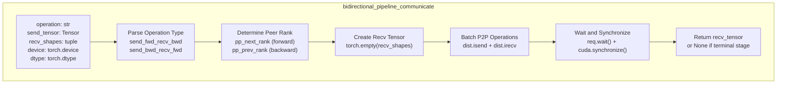
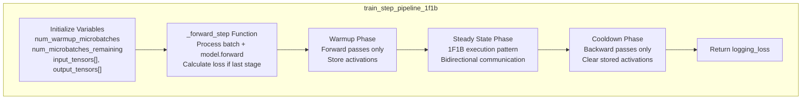
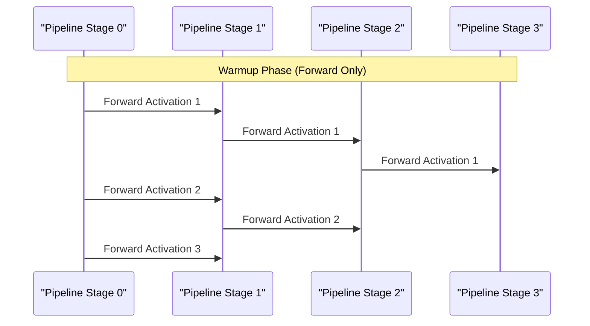
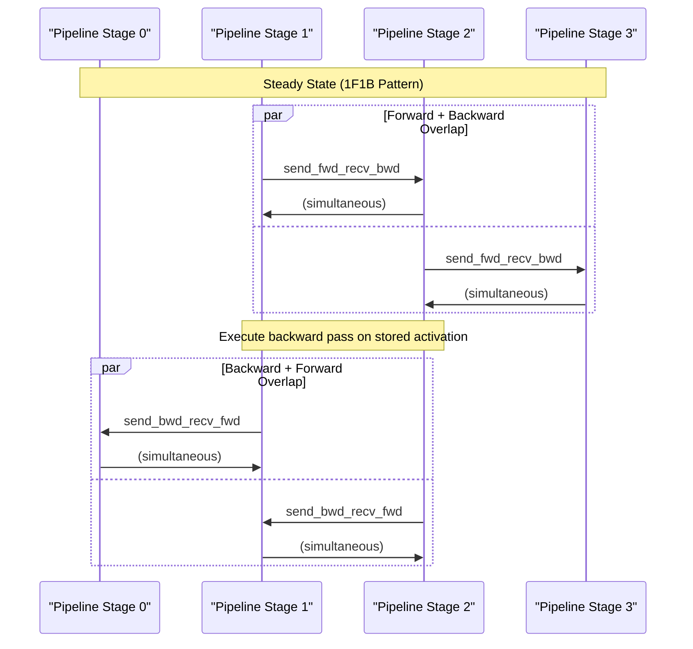
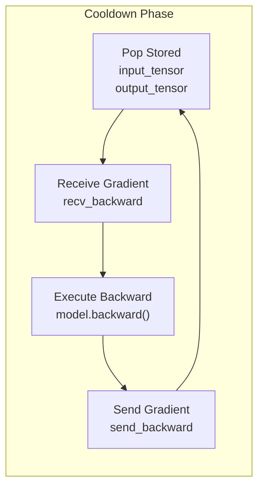
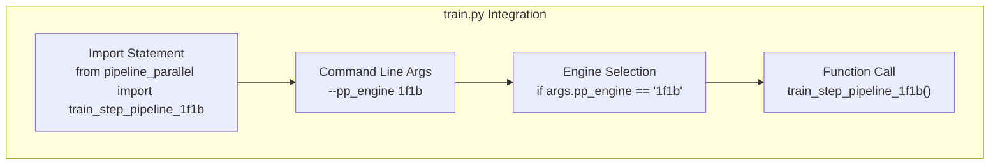

<!-- source: DeepWiki mcp.deepwiki.com · repo huggingface/picotron_tutorial · extra page 1F1B Pipeline Engine · fetched 2026-10-26 -->

# 1F1B Pipeline Engine

Relevant source files

The following files were used as context for generating this wiki page:

- [step7_pipeline_parallel_afab/pipeline_parallel.py](step7_pipeline_parallel_afab/pipeline_parallel.py)
- [step8_pipeline_parallel_1f1b/patch_step_8.diff](step8_pipeline_parallel_1f1b/patch_step_8.diff)

This document covers the One Forward One Backward (1F1B) pipeline parallelism engine implementation in the Picotron tutorial. The 1F1B engine provides an optimized pipeline execution strategy that overlaps forward and backward passes to improve memory efficiency and pipeline utilization compared to the simpler AFAB approach.

For information about the AFAB pipeline engine, see [AFAB Pipeline Engine](#4.3.1). For broader pipeline parallelism concepts, see [Pipeline Parallelism](#4.3).

## Overview

The 1F1B pipeline engine implements an execution pattern where each pipeline stage alternates between forward and backward passes rather than completing all forward passes before starting backward passes. This approach reduces memory usage by limiting the number of activations stored simultaneously and improves pipeline efficiency through better overlap of computation and communication.

**1F1B vs AFAB Execution Pattern**

```mermaid
graph TD
    subgraph "AFAB Pattern"
        AFAB_F1["Forward Pass 1"]
        AFAB_F2["Forward Pass 2"] 
        AFAB_F3["Forward Pass 3"]
        AFAB_B1["Backward Pass 1"]
        AFAB_B2["Backward Pass 2"]
        AFAB_B3["Backward Pass 3"]
        
        AFAB_F1 --> AFAB_F2
        AFAB_F2 --> AFAB_F3
        AFAB_F3 --> AFAB_B1
        AFAB_B1 --> AFAB_B2
        AFAB_B2 --> AFAB_B3
    end
    
    subgraph "1F1B Pattern"
        F1B_W1["Warmup Forward 1"]
        F1B_W2["Warmup Forward 2"]
        F1B_F1["Forward 1"]
        F1B_B1["Backward 1"]
        F1B_F2["Forward 2"]
        F1B_B2["Backward 2"]
        F1B_C1["Cooldown Backward 1"]
        F1B_C2["Cooldown Backward 2"]
        
        F1B_W1 --> F1B_W2
        F1B_W2 --> F1B_F1
        F1B_F1 --> F1B_B1
        F1B_B1 --> F1B_F2
        F1B_F2 --> F1B_B2
        F1B_B2 --> F1B_C1
        F1B_C1 --> F1B_C2
    end
```

Sources: [step8_pipeline_parallel_1f1b/patch_step_8.diff:75-139]()

## Bidirectional Communication

The 1F1B engine introduces bidirectional communication capabilities that allow simultaneous send and receive operations between pipeline stages. This is essential for the overlapped execution pattern where stages need to send gradients backward while receiving activations forward.

**Bidirectional Communication Function**

The function supports two bidirectional operations:
- `send_fwd_recv_bwd`: Send activations forward, receive gradients backward
- `send_bwd_recv_fwd`: Send gradients backward, receive activations forward

Sources: [step8_pipeline_parallel_1f1b/patch_step_8.diff:16-67]()

## Training Step Implementation

The `train_step_pipeline_1f1b` function orchestrates the three-phase execution pattern with careful management of activation tensors and gradient synchronization.

**Core Function Structure**

Sources: [step8_pipeline_parallel_1f1b/patch_step_8.diff:75-139]()

## Execution Phases

### Warmup Phase

The warmup phase performs forward passes to fill the pipeline with activations. The number of warmup microbatches is calculated as `min(pp_world_size - pp_rank - 1, grad_acc_steps)`, ensuring each stage has the right number of activations queued.

**Warmup Execution Flow**

During warmup, each stage:
1. Receives input tensor via `pipeline_communicate('recv_forward')`
2. Executes `_forward_step()` with received input
3. Sends output tensor via `pipeline_communicate('send_forward')`
4. Stores input and output tensors for later backward passes

Sources: [step8_pipeline_parallel_1f1b/patch_step_8.diff:93-99]()

### Steady State (1F1B)

The steady state implements the core 1F1B pattern where each iteration performs one forward pass and one backward pass. This phase uses bidirectional communication to overlap forward and backward data movement.

**1F1B Steady State Pattern**

Each steady state iteration:
1. Executes forward pass on current input
2. Uses `bidirectional_pipeline_communicate('send_fwd_recv_bwd')` to send activations forward and receive gradients backward
3. Pops oldest stored activation/output pair
4. Executes backward pass using `model.backward()`
5. Uses `bidirectional_pipeline_communicate('send_bwd_recv_fwd')` to send gradients backward and receive next activations forward

Sources: [step8_pipeline_parallel_1f1b/patch_step_8.diff:107-126]()

### Cooldown Phase

The cooldown phase processes remaining stored activations through backward passes only, clearing the pipeline of queued work.

The cooldown ensures all stored activations are processed and gradients are properly propagated through the pipeline.

Sources: [step8_pipeline_parallel_1f1b/patch_step_8.diff:129-137]()

## Gradient Synchronization

The 1F1B engine carefully manages gradient synchronization for data parallelism. The `require_backward_grad_sync` flag is set to `True` only on the final backward pass, ensuring gradients are synchronized across data parallel ranks at the right time.

**Gradient Sync Timing**

| Phase | Sync Behavior |
|-------|---------------|
| Warmup | `require_backward_grad_sync = False` |
| Steady State | `require_backward_grad_sync = True` only on last iteration for rank with `num_warmup_microbatches = 0` |
| Cooldown | `require_backward_grad_sync = True` only on final cooldown iteration |

This ensures gradients are accumulated across all microbatches before synchronization, maintaining correctness while optimizing communication.

Sources: [step8_pipeline_parallel_1f1b/patch_step_8.diff:104-106](), [step8_pipeline_parallel_1f1b/patch_step_8.diff:117-118](), [step8_pipeline_parallel_1f1b/patch_step_8.diff:130-133]()

## Memory Efficiency

The 1F1B pattern significantly reduces memory usage compared to AFAB by limiting the maximum number of stored activations. While AFAB stores activations for all `grad_acc_steps` microbatches simultaneously, 1F1B stores at most `num_warmup_microbatches` activations.

**Memory Usage Comparison**

| Engine | Max Stored Activations | Memory Pattern |
|--------|----------------------|----------------|
| AFAB | `grad_acc_steps` | Peak memory scales with gradient accumulation |
| 1F1B | `min(pp_world_size - pp_rank - 1, grad_acc_steps)` | Memory bounded by pipeline depth |

This makes 1F1B particularly effective for large models with many gradient accumulation steps, where the memory savings can be substantial.

Sources: [step8_pipeline_parallel_1f1b/patch_step_8.diff:76-77]()

## Integration with Training Script

The 1F1B engine integrates into the training script through the `--pp_engine 1f1b` command line argument, which selects `train_step_pipeline_1f1b` instead of `train_step_pipeline_afab` for pipeline execution.

**Training Script Integration**

Sources: [step8_pipeline_parallel_1f1b/patch_step_8.diff:155-165]()

---

