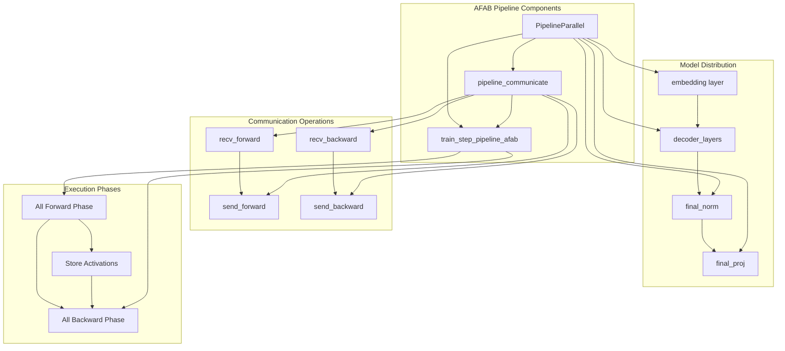
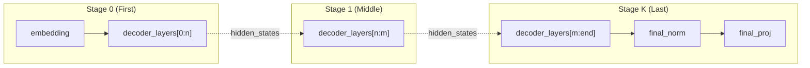
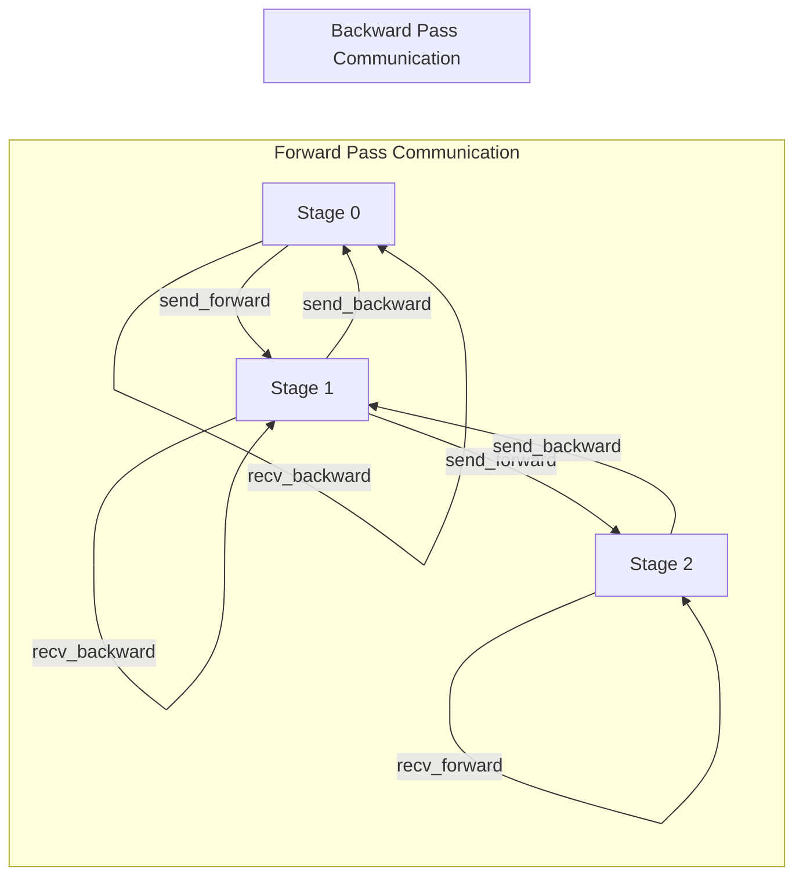
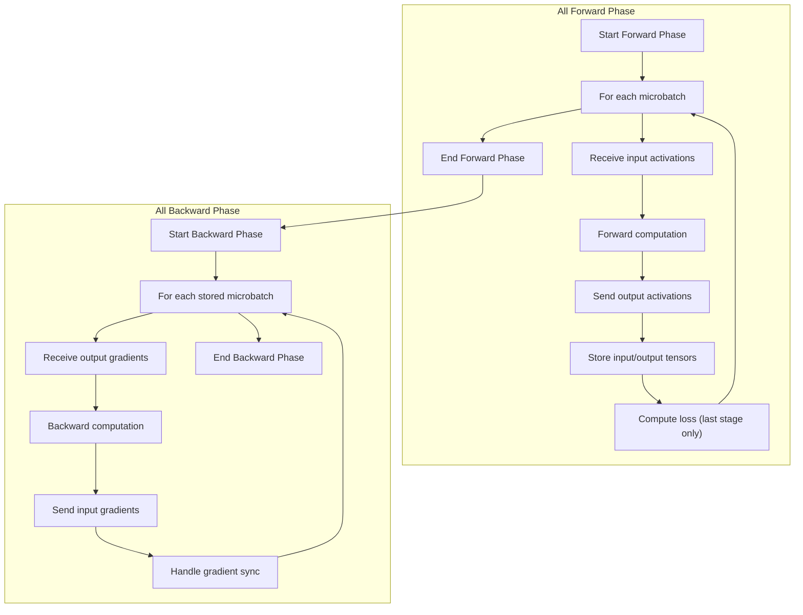
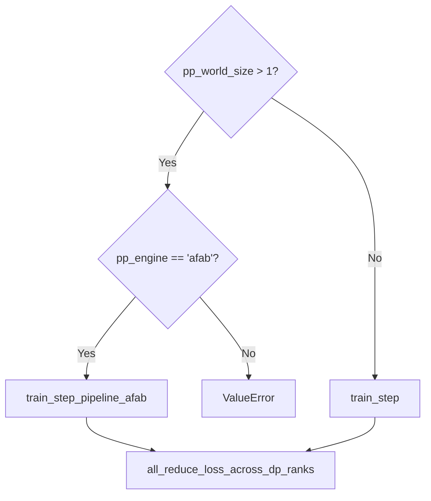

<!-- source: DeepWiki mcp.deepwiki.com · repo huggingface/picotron_tutorial · extra page AFAB Pipeline Engine · fetched 2026-10-26 -->

# AFAB Pipeline Engine

Relevant source files

The following files were used as context for generating this wiki page:

- [step7_pipeline_parallel_afab/patch_step_7.diff](step7_pipeline_parallel_afab/patch_step_7.diff)
- [step7_pipeline_parallel_afab/pipeline_parallel.py](step7_pipeline_parallel_afab/pipeline_parallel.py)

## Purpose and Scope

The AFAB (Activation Forward-Activation Backward) Pipeline Engine implements a pipeline parallelism strategy that completely separates forward and backward computation phases. This engine distributes model layers across multiple pipeline stages and processes microbatches in two distinct phases: all forward passes first, followed by all backward passes. This approach optimizes memory usage by storing intermediate activations and gradients separately.

For the alternative 1F1B pipeline approach that overlaps forward and backward passes, see [1F1B Pipeline Engine](#4.3.2). For tensor parallelism implementation details, see [Tensor Parallelism](#4.1).

## Architecture Overview

The AFAB pipeline engine consists of three main components that work together to distribute model execution across pipeline stages:

Sources: [step7_pipeline_parallel_afab/pipeline_parallel.py:75-142]()

## PipelineParallel Model Wrapper

The `PipelineParallel` class wraps the base LLaMA model and distributes its components across pipeline stages based on the pipeline rank. Each stage only instantiates the model components it needs to execute.

### Layer Distribution Strategy

The model layers are distributed evenly across pipeline stages using a balanced allocation algorithm:

| Stage Type | Components | Purpose |
|------------|------------|---------|
| First Stage | `embedding`, assigned `decoder_layers` | Input tokenization and initial processing |
| Middle Stages | assigned `decoder_layers` only | Core transformer computation |
| Last Stage | assigned `decoder_layers`, `final_norm`, `final_proj` | Output generation and loss computation |

The layer distribution is calculated in the `distribute_layers` method, which ensures balanced workload across all pipeline stages.

Sources: [step7_pipeline_parallel_afab/pipeline_parallel.py:75-87]()

### Model Component Initialization

The `PipelineParallel.__init__` method conditionally instantiates model components based on pipeline stage position:

- **First stage**: Gets `embedding` layer, others get `nn.Identity()`
- **All stages**: Get their assigned subset of `decoder_layers`
- **Last stage**: Gets `final_norm` and `final_proj`, others get `nn.Identity()`

This selective instantiation minimizes memory usage on each stage by only loading required components.

Sources: [step7_pipeline_parallel_afab/pipeline_parallel.py:78-82]()

## Pipeline Communication System

The `pipeline_communicate` function handles all point-to-point communication between adjacent pipeline stages. It supports four distinct communication operations that correspond to forward and backward pass data flow.

### Communication Operations

| Operation | Direction | Source Stage | Destination Stage | Purpose |
|-----------|-----------|--------------|-------------------|---------|
| `recv_forward` | → | Previous stage | Current stage | Receive input activations |
| `send_forward` | → | Current stage | Next stage | Send output activations |
| `recv_backward` | ← | Next stage | Current stage | Receive output gradients |
| `send_backward` | ← | Current stage | Previous stage | Send input gradients |

### Communication Implementation

The communication system uses PyTorch's distributed P2P operations (`dist.P2POp`) with asynchronous send/receive (`dist.isend`/`dist.irecv`) for efficient tensor transfer between stages.

Key implementation details:
- Empty tensors are pre-allocated for receive operations using provided `shapes`
- `torch.cuda.synchronize()` ensures completion before proceeding
- Border stages (first/last) skip unnecessary communication operations
- Optional verbose logging tracks communication flow for debugging

Sources: [step7_pipeline_parallel_afab/pipeline_parallel.py:11-71]()

## AFAB Training Execution

The `train_step_pipeline_afab` function implements the core AFAB execution pattern, processing all microbatches in two completely separate phases.

### Execution Flow

### Memory Management Strategy

The AFAB approach stores intermediate tensors in memory during the forward phase for use in the backward phase:

| Storage Lists | Contents | Purpose |
|---------------|----------|---------|
| `input_tensors` | Input activations for each microbatch | Required for backward pass computation |
| `output_tensors` | Output activations/loss for each microbatch | Source tensors for gradient computation |

The backward phase processes these stored tensors in FIFO order using `list.pop(0)` to maintain correct gradient flow.

### Gradient Synchronization

For configurations with data parallelism (`dp_world_size > 1`), the engine coordinates gradient synchronization:

- Gradient sync is only required on the final microbatch of each training step
- The `require_backward_grad_sync` attribute controls when `DataParallelBucket` performs all-reduce operations
- Loss values are aggregated across data parallel ranks using `all_reduce_loss_across_dp_ranks`

Sources: [step7_pipeline_parallel_afab/pipeline_parallel.py:105-140](), [step7_pipeline_parallel_afab/train.py:173-179]()

## Integration with Training Loop

The AFAB engine integrates into the main training loop when pipeline parallelism is enabled (`pp_world_size > 1`) and the `pp_engine` argument is set to `"afab"`.

### Training Script Integration

The training script in `train.py` determines execution path based on parallelism configuration:

### Tensor Shape Configuration

The AFAB engine requires pre-computed tensor shapes for efficient communication buffer allocation:

- Shape: `(micro_batch_size, seq_len, hidden_size)`
- Used for pre-allocating receive buffers in `pipeline_communicate`
- Computed once at training initialization to avoid repeated calculations

Sources: [step7_pipeline_parallel_afab/train.py:208-216](), [step7_pipeline_parallel_afab/train.py:199]()

## Memory and Performance Characteristics

The AFAB pipeline engine trades memory usage for simplified execution flow:

### Memory Usage Pattern

| Phase | Memory Usage | Reason |
|-------|--------------|--------|
| Forward Phase | Increasing | Accumulates input/output tensors for all microbatches |
| Backward Phase | Decreasing | Processes and releases stored tensors sequentially |
| Peak Usage | Forward phase end | All microbatch tensors stored simultaneously |

### Communication Pattern

- **Synchronous**: Each communication operation blocks until completion
- **Sequential**: Forward phase completes entirely before backward phase begins
- **Predictable**: Communication pattern is deterministic and debuggable
- **Memory-bound**: Peak memory usage scales with gradient accumulation steps

This approach is optimal for scenarios where memory is sufficient and execution simplicity is preferred over peak efficiency.

Sources: [step7_pipeline_parallel_afab/pipeline_parallel.py:114-140]()

---

