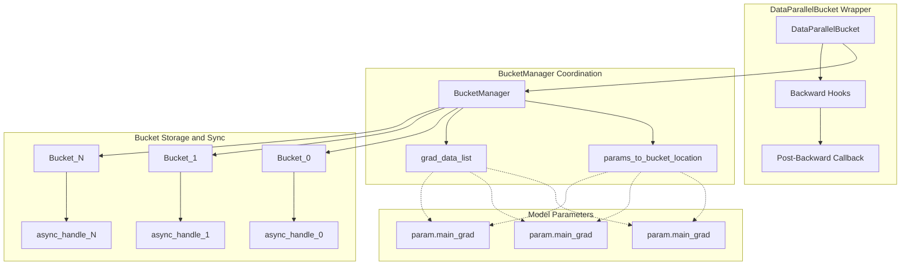
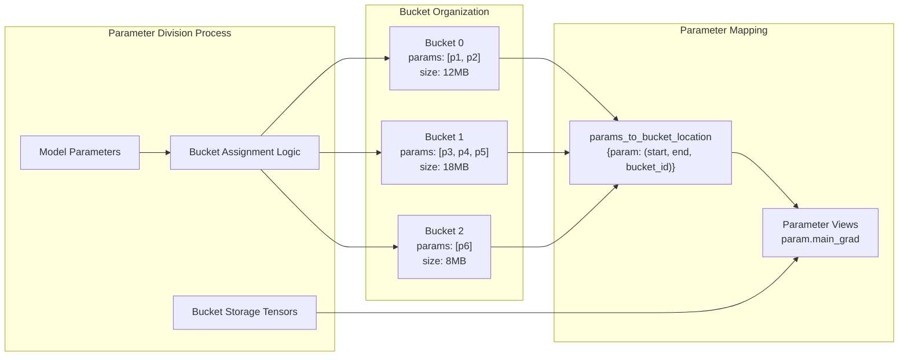
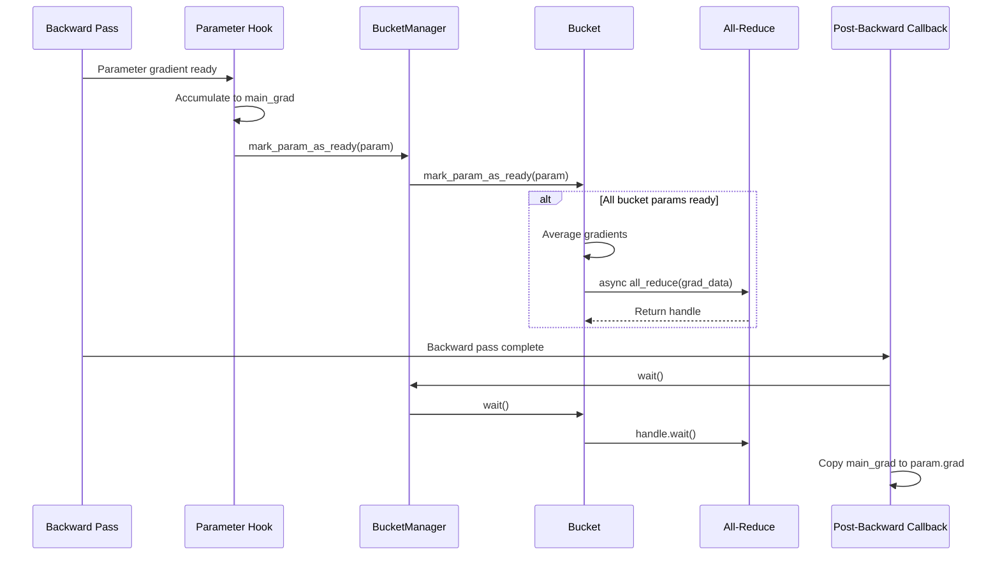
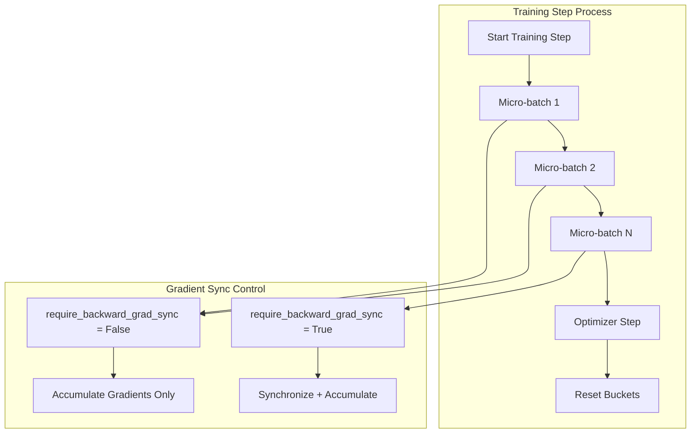

<!-- source: DeepWiki mcp.deepwiki.com · repo huggingface/picotron_tutorial · extra page Bucketed Data Parallelism · fetched 2026-10-26 -->

# Bucketed Data Parallelism

<details>
<summary>Relevant source files</summary>

The following files were used as context for generating this wiki page:

- [step6_data_parallel_bucket/patch_step_6.diff](step6_data_parallel_bucket/patch_step_6.diff)
- [step6_data_parallel_bucket/train.py](step6_data_parallel_bucket/train.py)

</details>


This document covers the bucketed data parallelism implementation in the Picotron tutorial, which provides an optimized approach to gradient synchronization across data-parallel processes. This implementation groups model parameters into buckets to enable overlapped computation and communication, improving training efficiency compared to the naive all-reduce approach.

For information about the simpler naive data parallelism approach, see [Naive Data Parallelism](#4.2.1). For details on tensor parallelism strategies, see [Tensor Parallelism](#4.1).

## Overview and Benefits

Bucketed data parallelism addresses the communication bottleneck in naive data parallelism by grouping model parameters into buckets and performing asynchronous gradient synchronization. Instead of waiting for all gradients to be computed before starting communication, this approach begins synchronizing gradients as soon as complete buckets are ready.

The key benefits include:
- **Overlapped Communication**: Gradient synchronization begins before all gradients are computed
- **Reduced Memory Pressure**: Gradients are organized into fixed-size buckets
- **Improved Throughput**: Less idle time waiting for synchronization
- **Asynchronous Operations**: Non-blocking all-reduce operations

## System Architecture

The bucketed data parallelism system consists of three main components that work together to manage gradient synchronization:



Sources: [step6_data_parallel_bucket/patch_step_6.diff:146-238](), [step6_data_parallel_bucket/patch_step_6.diff:64-144](), [step6_data_parallel_bucket/patch_step_6.diff:20-62]()

## Core Components

### DataParallelBucket Class

The `DataParallelBucket` class serves as the main interface, wrapping the model and coordinating gradient synchronization. It manages the overall process including gradient accumulation and backward hook registration.

| Component | Purpose | Key Methods |
|-----------|---------|-------------|
| `module` | Wrapped model reference | `forward()`, `backward()` |
| `bucket_manager` | Coordinates bucket operations | `mark_param_as_ready()`, `wait()` |
| `require_backward_grad_sync` | Controls sync timing | Set per micro-batch |
| `grad_accs` | Gradient accumulator functions | Registered as hooks |

The class automatically calculates bucket size based on a configurable capacity (default 25MB) and gradient data type size.

Sources: [step6_data_parallel_bucket/patch_step_6.diff:146-156]()

### BucketManager Class  

The `BucketManager` divides model parameters into buckets and manages the mapping between parameters and their storage locations within buckets.



The bucket assignment algorithm works sequentially through parameters, creating new buckets when the size limit would be exceeded.

Sources: [step6_data_parallel_bucket/patch_step_6.diff:83-127]()

### Bucket Class

Individual `Bucket` instances manage gradient synchronization for their assigned parameters. Each bucket tracks parameter readiness and launches asynchronous all-reduce operations.

| Attribute | Purpose |
|-----------|---------|
| `params` | Set of parameters in this bucket |
| `params_with_grad_ready` | Parameters ready for synchronization |
| `grad_data` | Tensor storing gradients for this bucket |
| `process_group` | Data parallel process group |
| `handle` | Async all-reduce operation handle |

Sources: [step6_data_parallel_bucket/patch_step_6.diff:20-34]()

## Gradient Synchronization Flow

The gradient synchronization process involves multiple stages, from parameter readiness detection to final gradient application:



The key optimization is that all-reduce operations begin as soon as individual buckets are complete, rather than waiting for all parameters to be ready.

Sources: [step6_data_parallel_bucket/patch_step_6.diff:194-220](), [step6_data_parallel_bucket/patch_step_6.diff:56-62]()

## Integration with Training Loop

The bucketed data parallelism integrates seamlessly with the training process through the `require_backward_grad_sync` flag and gradient accumulation control.

### Training Step Integration



The training script controls synchronization timing by setting `model.require_backward_grad_sync = (i == dataloader.grad_acc_steps - 1)` to enable synchronization only on the final micro-batch.

Sources: [step6_data_parallel_bucket/train.py:29-40]()

### Model Wrapping Process

The model is wrapped with `DataParallelBucket` after tensor parallel application and device placement:

| Step | Code Location | Purpose |
|------|---------------|---------|
| Apply tensor parallel | [step6_data_parallel_bucket/train.py:134-135]() | Shard model weights |
| Move to device | [step6_data_parallel_bucket/train.py:139]() | Place on GPU before hook registration |
| Wrap with DataParallelBucket | [step6_data_parallel_bucket/train.py:141-142]() | Enable gradient bucketing |

The device placement before wrapping is critical because backward hooks must be attached to the GPU model instance.

Sources: [step6_data_parallel_bucket/train.py:134-144]()

## Memory and Communication Optimization

The bucketed approach provides several optimization benefits compared to naive data parallelism:

### Bucket Size Configuration

The default bucket capacity is 25MB, calculated as:
```
bucket_size = bucket_cap_mb * 1024 * 1024 // grad_size
```

Where `grad_size = 2` bytes for bfloat16 gradients, resulting in approximately 13M gradient elements per bucket.

### Gradient Data Type Handling

The system supports mixed precision by storing gradients in a configurable type (default `torch.float32`) while copying them back to parameter dtype during the post-backward callback. This prevents precision loss during accumulation while maintaining compatibility with the optimizer.

Sources: [step6_data_parallel_bucket/patch_step_6.diff:147-155](), [step6_data_parallel_bucket/patch_step_6.diff:234]()

### Asynchronous Communication Pattern

Unlike naive data parallelism which performs blocking all-reduce operations, the bucketed approach uses `async_op=True` to enable computation-communication overlap. The `handle.wait()` call is deferred until the post-backward callback, allowing gradient computation to continue while communication proceeds.

Sources: [step6_data_parallel_bucket/patch_step_6.diff:40](), [step6_data_parallel_bucket/patch_step_6.diff:52-54]()

---

