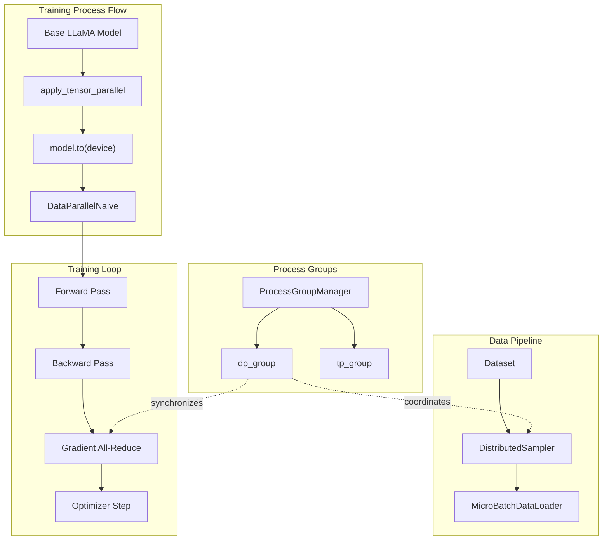
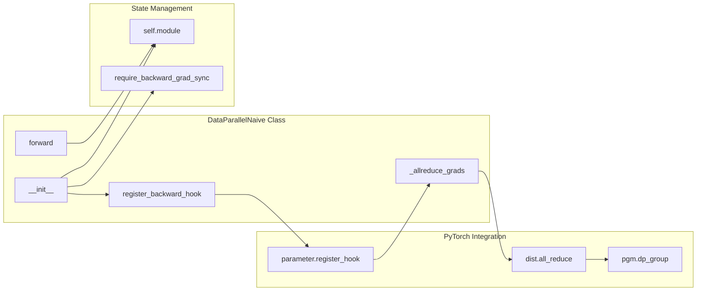
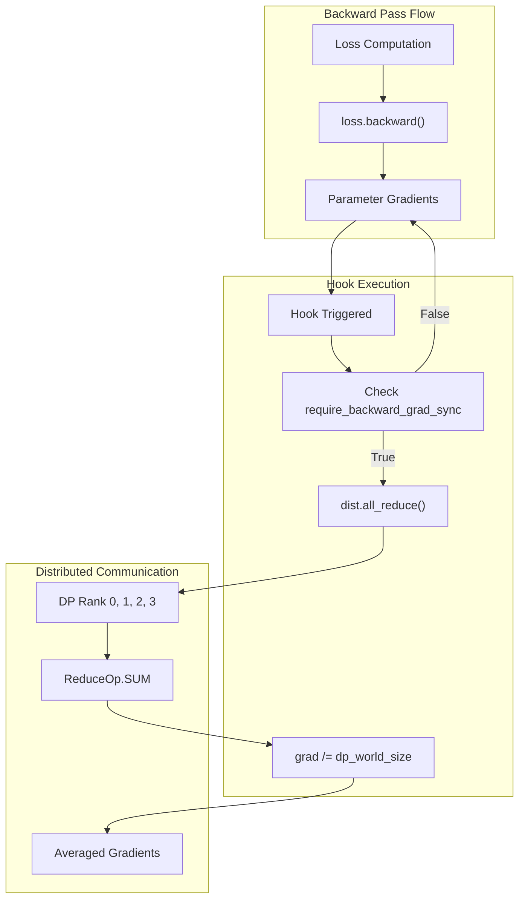
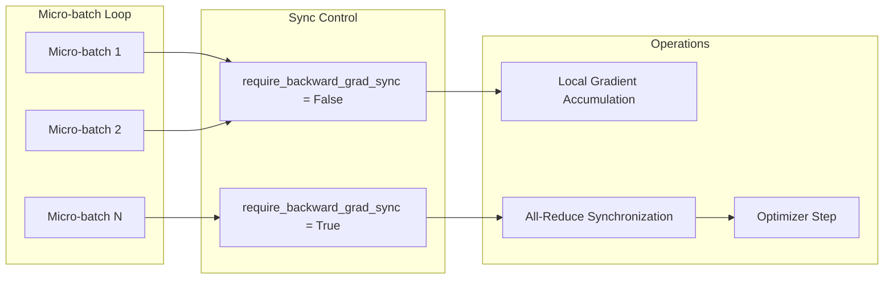
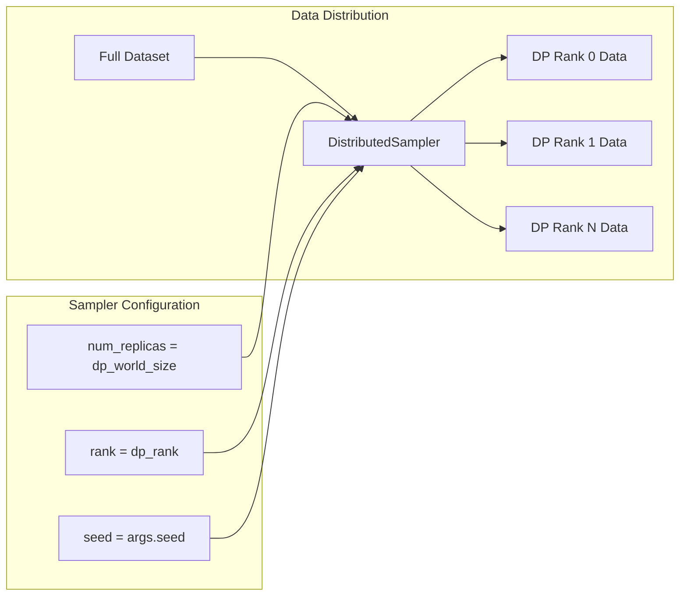
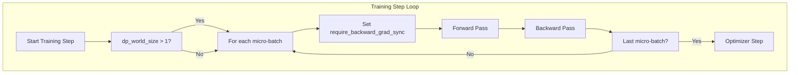

<!-- source: DeepWiki mcp.deepwiki.com · repo huggingface/picotron_tutorial · extra page Naive Data Parallelism · fetched 2026-10-26 -->

# Naive Data Parallelism

Relevant source files

The following files were used as context for generating this wiki page:

- [step5_data_parallel_naive/data_parallel.py](step5_data_parallel_naive/data_parallel.py)
- [step5_data_parallel_naive/patch_step_5.diff](step5_data_parallel_naive/patch_step_5.diff)

This document covers the naive data parallelism implementation in the Picotron tutorial, which provides the simplest approach to synchronizing gradients across multiple processes in distributed training. This implementation uses straightforward all-reduce operations to average gradients after backward passes.

The naive approach forms the foundation for understanding data parallelism concepts before moving to more optimized implementations. For the advanced bucketed approach that improves communication efficiency, see [Bucketed Data Parallelism](#4.2.2). For tensor parallelism strategies, see [Tensor Parallelism](#4.1).

## System Architecture

The naive data parallelism implementation operates as a wrapper around the base model, intercepting gradient computations to perform synchronization across data parallel process groups.

### High-Level Integration

Sources: [step5_data_parallel_naive/patch_step_5.diff:88-132](), [step5_data_parallel_naive/data_parallel.py:9-34]()

## DataParallelNaive Implementation

The core implementation wraps the base model and manages gradient synchronization through PyTorch's backward hook mechanism.

### Class Structure

Sources: [step5_data_parallel_naive/data_parallel.py:10-34]()

### Key Components

| Component | Purpose | Implementation |
|-----------|---------|----------------|
| `module` | Wrapped base model | Stores reference to original model |
| `require_backward_grad_sync` | Controls synchronization timing | Boolean flag for gradient accumulation |
| `register_backward_hook` | Hook registration | Attaches `_allreduce_grads` to all parameters |
| `_allreduce_grads` | Gradient synchronization | Performs all-reduce and averaging |

## Gradient Synchronization Mechanism

The naive approach uses PyTorch's parameter hooks to intercept gradients during backward passes and synchronize them across the data parallel group.

### Synchronization Flow

Sources: [step5_data_parallel_naive/data_parallel.py:27-33]()

### Gradient Accumulation Integration

The implementation coordinates with gradient accumulation by only synchronizing gradients on the final accumulation step:

Sources: [step5_data_parallel_naive/patch_step_5.diff:108-118]()

## Training Integration

The naive data parallelism is integrated into the training pipeline with specific coordination between the model wrapper, data loading, and gradient accumulation.

### Model Initialization Sequence

The model undergoes a specific initialization sequence to ensure proper device placement and wrapper ordering:

| Step | Operation | Code Location |
|------|-----------|---------------|
| 1 | Create base model | [step5_data_parallel_naive/patch_step_5.diff:123]() |
| 2 | Apply tensor parallelism | [step5_data_parallel_naive/patch_step_5.diff:124]() |
| 3 | Move to device | [step5_data_parallel_naive/patch_step_5.diff:128]() |
| 4 | Wrap with DataParallelNaive | [step5_data_parallel_naive/patch_step_5.diff:130-131]() |

### Data Loading Coordination

The data loading pipeline integrates with data parallelism through `DistributedSampler`:

Sources: [step5_data_parallel_naive/patch_step_5.diff:70-85]()

### Training Step Coordination

Each training step coordinates gradient synchronization with gradient accumulation:

Sources: [step5_data_parallel_naive/patch_step_5.diff:104-118]()

## Communication Patterns

The naive implementation uses simple all-reduce operations without optimization, resulting in straightforward but potentially inefficient communication patterns.

### All-Reduce Operation Details

| Aspect | Implementation | Code Reference |
|--------|----------------|----------------|
| Operation | `dist.all_reduce()` | [step5_data_parallel_naive/data_parallel.py:31]() |
| Reduce Operation | `ReduceOp.SUM` | [step5_data_parallel_naive/data_parallel.py:31]() |
| Process Group | `pgm.process_group_manager.dp_group` | [step5_data_parallel_naive/data_parallel.py:31]() |
| Averaging | `grad /= dp_world_size` | [step5_data_parallel_naive/data_parallel.py:32]() |

### Performance Characteristics

The naive approach has the following performance characteristics:

- **Simplicity**: Straightforward implementation with minimal complexity
- **Synchronous**: All processes must wait for gradient synchronization to complete
- **Per-parameter**: Each parameter gradient triggers a separate all-reduce operation
- **Memory Overhead**: Minimal additional memory usage beyond the base model

Sources: [step5_data_parallel_naive/data_parallel.py:27-33]()

---

