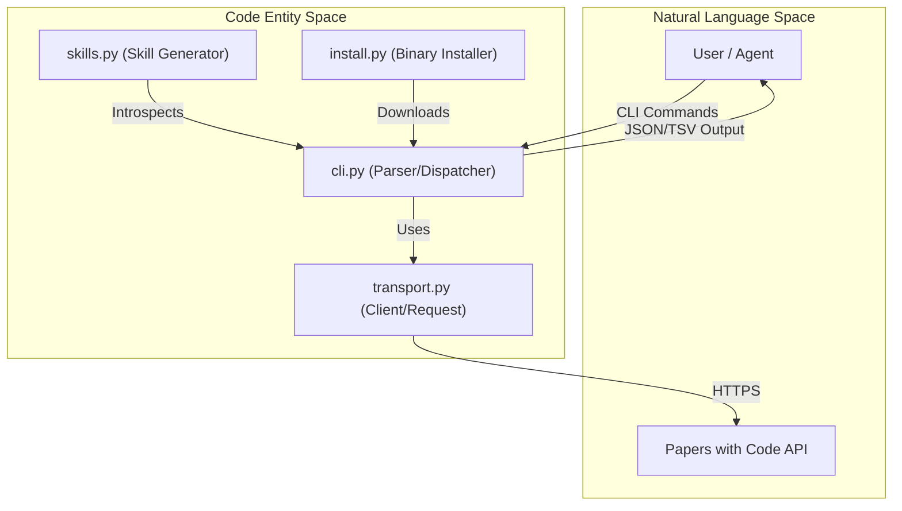
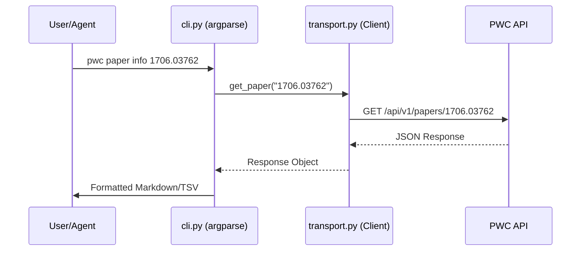

<!-- source: DeepWiki mcp.deepwiki.com · repo huggingface/pwc-cli · page 1 Overview · fetched 2026-10-26 -->

# Overview

<details>
<summary>Relevant source files</summary>

The following files were used as context for generating this wiki page:

- [README.md](README.md)
- [standalone_cli/README.md](standalone_cli/README.md)
- [standalone_cli/src/pwc_cli/__init__.py](standalone_cli/src/pwc_cli/__init__.py)

</details>


The `pwc-cli` is a fast, read-only command-line client designed for exploring the public [Papers with Code](https://paperswithcode.co) catalog. It provides a structured interface for searching papers, browsing benchmarks, and inspecting the research taxonomy (tasks, methods, conferences) without requiring an account, API token, or a full Python environment when using the prebuilt binaries [README.md:1-15]().

Beyond serving human users, the repository includes a "Skills" system that allows coding agents (like Claude Code, Cursor, or Codex) to integrate the CLI into their toolset, enabling them to perform research tasks autonomously [README.md:81-86]().

## System Architecture

The project is divided into a lightweight Python client and a distribution layer. The client communicates with the Papers with Code API using a versioned contract to ensure stability [standalone_cli/src/pwc_cli/__init__.py:4]().

### High-Level Component Mapping

The following diagram maps the logical components of the system to their respective code entities:

**System to Code Mapping**

**Sources:** [standalone_cli/src/pwc_cli/cli.py:1-20](), [standalone_cli/src/pwc_cli/transport.py:1-15](), [standalone_cli/src/pwc_cli/skills.py:1-10](), [standalone_cli/install.py:1-20]()

## Key Features

*   **Paper Exploration**: Search by title or arXiv ID, read paper metadata, and access Markdown content [README.md:111-127]().
*   **SOTA Benchmarks**: Browse leaderboards, filter by metrics (e.g., `--min FPS=60`), and identify Pareto-optimal models [standalone_cli/README.md:69-75]().
*   **Research Taxonomy**: Navigate the hierarchy of Tasks, Methods, and Organizations [README.md:149-166]().
*   **Agent Integration**: Export CLI capabilities as a machine-readable skill for LLM-based agents [README.md:87-108]().
*   **Flexible Output**: Automatically switches between aligned Markdown tables for interactive terminals and lossless TSV for piped output/scripts [standalone_cli/README.md:37-48]().

## Repository Organization

The repository is structured to support both source installation and automated binary distribution.

| Directory / File | Responsibility |
| :--- | :--- |
| `standalone_cli/src/pwc_cli/` | The core Python package containing the CLI logic, transport layer, and skill generator. |
| `standalone_cli/install.py` | A standalone script for downloading and verifying prebuilt binaries. |
| `tests/` | The test suite, including `test_cli.py` for functional verification. |
| `scripts/` | Utility scripts, such as `check_contract.py` for ensuring documentation stays in sync with code. |
| `.github/workflows/` | CI/CD pipelines for testing and generating cross-platform releases. |

For a detailed breakdown of the file structure, see [Repository Layout](#1.2).

## Getting Started

Users can install `pwc-cli` via a prebuilt binary or through Python package managers like `uv` or `pipx`.

```bash
# Binary installation
curl -LsSf https://raw.githubusercontent.com/huggingface/pwc-cli/main/standalone_cli/install.py | python3

# Source installation via uv
uv tool install 'git+https://github.com/huggingface/pwc-cli.git#subdirectory=standalone_cli'
```
**Sources:** [README.md:30-33](), [README.md:57-59]()

For detailed installation steps and initial configuration (such as setting `PWC_API_URL`), see [Getting Started](#1.1).

## Internal Workflow

The CLI follows a standard request-response lifecycle, mediated by an internal `Client` class.

**Request Lifecycle**

**Sources:** [standalone_cli/src/pwc_cli/cli.py:2465](), [standalone_cli/src/pwc_cli/transport.py:80-83]()

---

