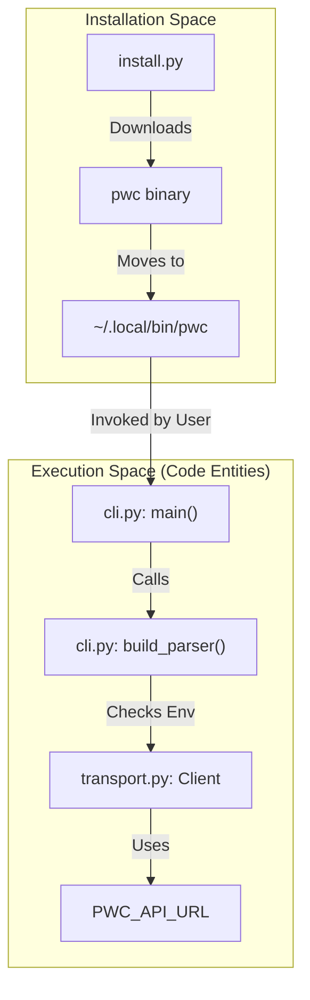
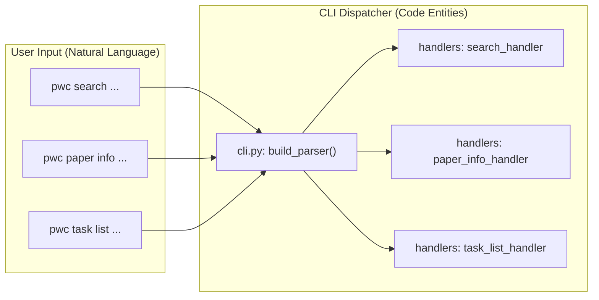

<!-- source: DeepWiki mcp.deepwiki.com · repo huggingface/pwc-cli · page 1.1 Getting Started · fetched 2026-10-26 -->

# Getting Started

<details>
<summary>Relevant source files</summary>

The following files were used as context for generating this wiki page:

- [README.md](README.md)
- [standalone_cli/install.py](standalone_cli/install.py)
- [standalone_cli/pyproject.toml](standalone_cli/pyproject.toml)

</details>


The `pwc-cli` is a high-performance, read-only command-line interface designed for researchers and developers to explore the [Papers with Code](https://paperswithcode.co) catalog [README.md:1-12](). It operates without requiring an account or API token for public reads [README.md:14-14]().

## Installation Methods

### 1. Prebuilt Binary (Recommended)
The fastest way to install `pwc-cli` is via the dedicated installer script. This method downloads a platform-specific binary, verifies its SHA-256 checksum, and installs it to `~/.local/bin/pwc` [README.md:25-33]().

**One-liner installation:**
```bash
curl -LsSf "https://raw.githubusercontent.com/huggingface/pwc-cli/main/standalone_cli/install.py" | python3
```

**Installer Logic and Implementation:**
The `install.py` script performs several critical checks to ensure a secure and functional installation:
*   **Version Resolution**: It queries the GitHub API to find the latest release tag unless an explicit version is provided via `--version` [standalone_cli/install.py:83-101]().
*   **Platform Mapping**: It maps system architectures (e.g., `aarch64` to `arm64`) to match release artifact naming conventions [standalone_cli/install.py:196-206]().
*   **Integrity Verification**: It downloads the corresponding `.sha256` file and validates the binary using `hashlib.sha256` [standalone_cli/install.py:115-134]().
*   **Atomic Installation**: It uses `tempfile.mkstemp` and `os.replace` to ensure the binary is updated atomically, preventing partial writes if the process is interrupted [standalone_cli/install.py:137-152]().

### 2. Source Installation (pipx / uv)
For users who prefer managing tools via Python environments, `pwc-cli` can be installed from source. This requires Python 3.10 or newer [README.md:53-53]().

**Using `uv`:**
```bash
uv tool install 'git+https://github.com/huggingface/pwc-cli.git#subdirectory=standalone_cli'
```

**Using `pipx`:**
```bash
pipx install 'git+https://github.com/huggingface/pwc-cli.git#subdirectory=standalone_cli'
```

Sources: [README.md:25-65](), [standalone_cli/install.py:83-152](), [standalone_cli/pyproject.toml:6-8]()

---

## Verification and Configuration

### Verifying Installation
Once installed, verify the version and ensure the binary is reachable in your `PATH`:
```bash
pwc version
```
The installer script automatically checks if `~/.local/bin` is in your `PATH` and provides shell export instructions if it is missing [standalone_cli/install.py:154-180]().

### Configuring the API URL
By default, the CLI connects to the production Papers with Code API. Developers or users of internal mirrors can override this by setting the `PWC_API_URL` environment variable.

| Variable | Description | Default Value |
| --- | --- | --- |
| `PWC_API_URL` | The base URL for the PWC API endpoints. | `https://paperswithcode.com/api/v1` |

**Data Flow: Installation to Execution**
The following diagram illustrates how the installer places the binary and how the CLI initializes its connection settings.

**System Path and Initialization Flow**


Sources: [README.md:75-79](), [standalone_cli/install.py:154-180](), [standalone_cli/pyproject.toml:10-11]()

---

## First Commands

The `pwc-cli` is organized into entity-based subcommands. Below are the primary entry points for exploring the catalog.

### 1. Searching for Papers
Search uses the `pwc search` command, which supports keyword queries and semantic search modes [README.md:111-117]().
```bash
pwc search "retrieval augmented generation" --limit 5
```

### 2. Inspecting Paper Details
You can retrieve metadata using an arXiv ID, a numeric ID, or a quoted title [README.md:182-185]().
```bash
pwc paper info 1706.03762 --include-resources
```

### 3. Exploring the Taxonomy
The CLI allows browsing by research area, task, or method [README.md:151-166]().
```bash
pwc task list --area Vision
pwc method --name Transformer
```

### Command Dispatch Architecture
The CLI uses a hierarchical parser where each subcommand is mapped to a handler function.

**Natural Language Command to Code Handler Mapping**


Sources: [README.md:109-178](), [README.md:182-185]()

---

## Integrating Agent Skills

If you use AI coding agents (like Claude Code, Cursor, or GitHub Copilot), you should install the "Skill". This provides the agent with a machine-readable description of the CLI's capabilities [README.md:81-85]().

```bash
# Install for the current project (.agents/skills)
pwc skills add

# Install for Claude Code specifically
pwc skills add --claude
```

The `pwc skills add` command generates a `SKILL.md` file by introspecting the current CLI's `argparse` configuration, ensuring the agent always has documentation that matches your installed version [README.md:83-85]().

Sources: [README.md:81-107]()

---

