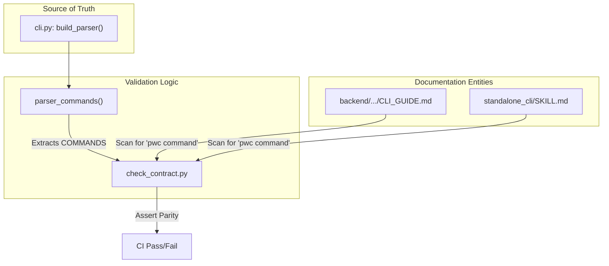
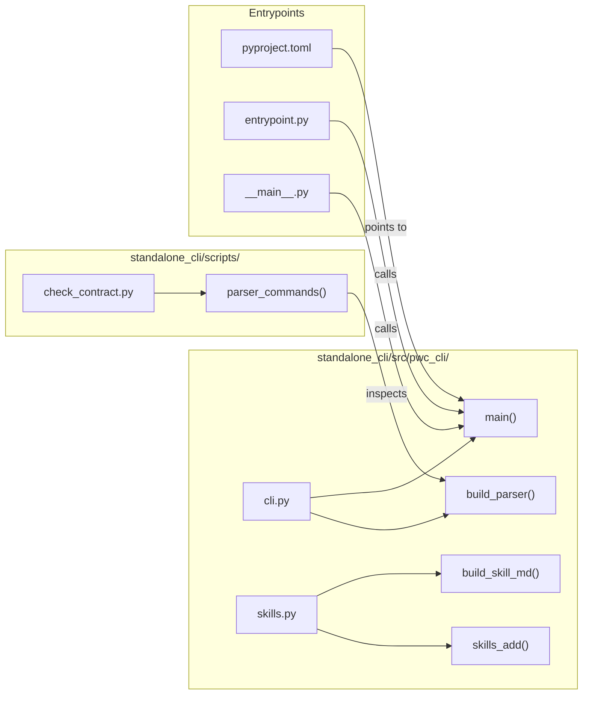

<!-- source: DeepWiki mcp.deepwiki.com · repo huggingface/pwc-cli · page 1.2 Repository Layout · fetched 2026-10-26 -->

# Repository Layout

Relevant source files

The following files were used as context for generating this wiki page:

- [backend/chat_sandbox_worker/CLI_GUIDE.md](backend/chat_sandbox_worker/CLI_GUIDE.md)
- [standalone_cli/entrypoint.py](standalone_cli/entrypoint.py)
- [standalone_cli/pyproject.toml](standalone_cli/pyproject.toml)
- [standalone_cli/scripts/check_contract.py](standalone_cli/scripts/check_contract.py)
- [standalone_cli/src/pwc_cli/__main__.py](standalone_cli/src/pwc_cli/__main__.py)

This page details the physical and logical organization of the `pwc-cli` repository. The project is structured to support a standalone Python package, a distribution system for pre-compiled binaries, and integration with AI agent environments.

## Directory Structure Overview

The repository is organized into three primary functional areas: the CLI source code, backend configuration for sandbox environments, and automation scripts for CI/CD and contract validation.

| Directory / File | Responsibility |
|:---|:---|
| `standalone_cli/src/pwc_cli/` | Core Python source code for the CLI. |
| `standalone_cli/tests/` | Unit and integration tests for CLI commands and transport logic. |
| `standalone_cli/scripts/` | Utility scripts for build-time validation and skill generation. |
| `backend/chat_sandbox_worker/` | Configuration and guides for AI agent sandbox environments. |
| `.github/workflows/` | GitHub Actions definitions for testing and multi-platform releases. |
| `standalone_cli/pyproject.toml` | Build system configuration and entry point definitions. |

**Sources:** [standalone_cli/pyproject.toml:1-18](), [standalone_cli/scripts/check_contract.py:9-12]()

---

## Standalone CLI (`standalone_cli/`)

The `standalone_cli` directory contains the primary codebase for the `pwc` tool. It is designed to be self-contained, requiring no external internal dependencies from the rest of the repository.

### Source Code (`src/pwc_cli/`)
This directory follows standard Python packaging conventions. The package is defined in `pyproject.toml` [standalone_cli/pyproject.toml:1-18]() and uses `hatchling` as the build backend.

*   **Entry Points**: The CLI can be invoked via `pwc` (defined in `project.scripts`) [standalone_cli/pyproject.toml:10-11](), `python -m pwc_cli` [standalone_cli/src/pwc_cli/__main__.py:1-3](), or the root-level `entrypoint.py` [standalone_cli/entrypoint.py:1-3]().
*   **Core Modules**:
    *   `cli.py`: Contains `build_parser()` which defines the command hierarchy and `main()` for execution [standalone_cli/src/pwc_cli/cli.py:12-12]().
    *   `skills.py`: Logic for generating `SKILL.md` and installing the CLI as an agent skill.

### Validation Scripts (`scripts/`)
Contains `check_contract.py`, a critical validation tool that prevents "documentation drift." It ensures that every command registered in the `argparse` tree is also documented in the AI sandbox guides and the public skill inventory [standalone_cli/scripts/check_contract.py:68-82]().

**Sources:** [standalone_cli/pyproject.toml:1-18](), [standalone_cli/src/pwc_cli/__main__.py:1-3](), [standalone_cli/scripts/check_contract.py:14-37]()

---

## Backend & Sandbox Integration (`backend/`)

The `backend/chat_sandbox_worker/` directory bridges the CLI with LLM-based coding agents.

*   **CLI_GUIDE.md**: A concise reference used by agents to understand how to invoke `pwc` commands [backend/chat_sandbox_worker/CLI_GUIDE.md:1-27]().
*   **Contract Enforcement**: The `check_contract.py` script specifically verifies that every research command (e.g., `paper info`, `benchmark list`) appears in this guide to ensure agents have up-to-date instructions [standalone_cli/scripts/check_contract.py:72-81]().

**Sources:** [backend/chat_sandbox_worker/CLI_GUIDE.md:1-34](), [standalone_cli/scripts/check_contract.py:72-81]()

---

## Data Flow and Command Discovery

The following diagram illustrates how the repository components interact during a validation cycle (e.g., in CI) to ensure the `argparse` implementation matches the documentation.

### Logic Flow: Contract Validation
"Logic Flow: Contract Validation"

**Sources:** [standalone_cli/scripts/check_contract.py:42-65](), [standalone_cli/scripts/check_contract.py:68-82]()

---

## Code Entity Mapping

This diagram maps high-level repository areas to the specific Python classes and functions that implement their behavior.

### System Mapping: Repository to Code Entities
"System Mapping: Repository to Code Entities"

**Sources:** [standalone_cli/pyproject.toml:10-11](), [standalone_cli/entrypoint.py:1-3](), [standalone_cli/src/pwc_cli/__main__.py:1-3](), [standalone_cli/scripts/check_contract.py:42-43]()

---

