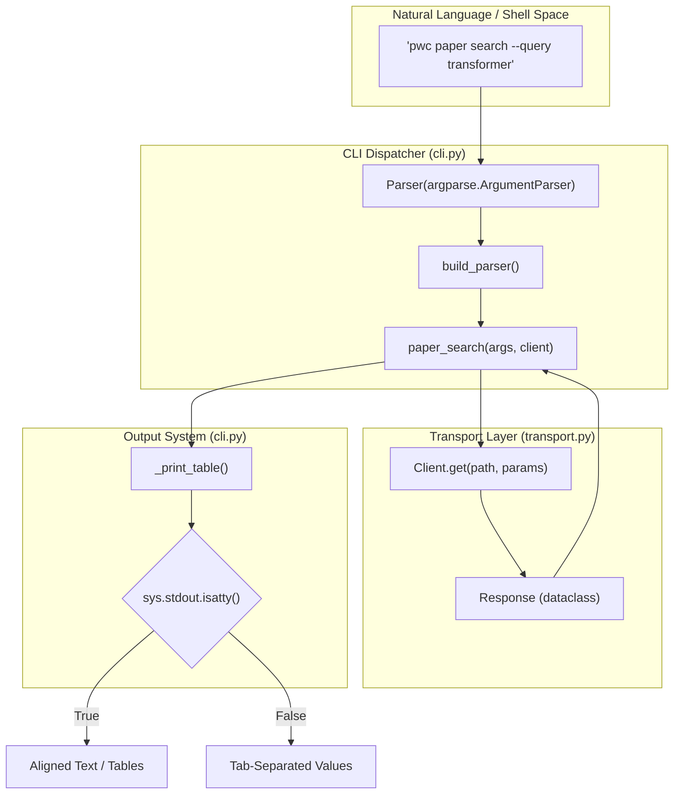
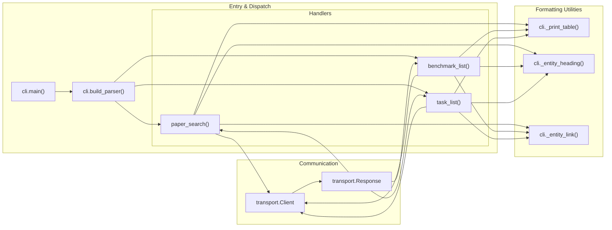

<!-- source: DeepWiki mcp.deepwiki.com · repo huggingface/pwc-cli · page 2 Core Architecture · fetched 2026-10-26 -->

# Core Architecture

Relevant source files

The following files were used as context for generating this wiki page:

- [standalone_cli/entrypoint.py](standalone_cli/entrypoint.py)
- [standalone_cli/src/pwc_cli/__init__.py](standalone_cli/src/pwc_cli/__init__.py)
- [standalone_cli/src/pwc_cli/__main__.py](standalone_cli/src/pwc_cli/__main__.py)
- [standalone_cli/src/pwc_cli/cli.py](standalone_cli/src/pwc_cli/cli.py)

The `pwc-cli` is structured as a layered command-line application designed for both interactive human use and programmatic consumption by LLM-based coding agents. The architecture prioritizes deterministic output, minimal dependencies, and a strict contract between the CLI and the Papers With Code (PWC) backend.

### Package Structure and Entrypoints

The codebase follows a standard Python package layout. The core logic resides within the `pwc_cli` package, with specific entrypoints defined for different execution contexts.

*   **Package Root**: `standalone_cli/src/pwc_cli/` contains the implementation modules.
*   **Version Metadata**: `__init__.py` defines the package version and the `API_CONTRACT_VERSION`, which ensures compatibility between the client and the data schema [standalone_cli/src/pwc_cli/__init__.py:3-4]().
*   **Execution Entrypoints**:
    *   `pwc_cli/cli.py`: Contains the `main()` function, the primary entrypoint for the application [standalone_cli/src/pwc_cli/cli.py:1088-1111]().
    *   `pwc_cli/__main__.py`: Enables execution via `python -m pwc_cli` [standalone_cli/src/pwc_cli/__main__.py:1-3]().
    *   `entrypoint.py`: A top-level script used for binary builds (e.g., PyInstaller) [standalone_cli/entrypoint.py:1-3]().

### Architectural Layers

The system is divided into three primary functional layers that handle the lifecycle of a command, from parsing to remote execution and final rendering.

#### 1. CLI Dispatcher (Application Layer)
The dispatcher is responsible for command-line argument parsing and routing. It uses a single `argparse.ArgumentParser` tree built by `build_parser()` [standalone_cli/src/pwc_cli/cli.py:848-1085](). Each subcommand is associated with a specific `Handler` function that encapsulates the business logic for that command.

For details on command registration and the dispatch loop, see **[CLI Dispatcher (cli.py)](#2.1)**.

#### 2. Transport Layer (Network Layer)
The `Client` class in `transport.py` handles all HTTP communication with the PWC API. It manages URL construction, header injection (including User-Agent and contract versioning), and response validation. It also enforces safety limits, such as `MAX_RESPONSE_BYTES`, to prevent memory exhaustion when handling large datasets.

For details on request lifecycle and error handling, see **[Transport Layer (transport.py)](#2.2)**.

#### 3. Output Formatting System (Presentation Layer)
The output system is "TTY-aware." It detects whether the output is being sent to a terminal or piped to another process. It supports three primary modes:
*   **Interactive**: Markdown-style tables and headers for readability.
*   **Piped/Scripted**: Lossless Tab-Separated Values (TSV) for easy parsing by standard Unix tools.
*   **Machine-Readable**: Versioned JSON envelopes triggered by the `--json` flag.

For details on the formatting logic and TTY detection, see **[Output Formatting System](#2.3)**.

### Data Flow and Entity Mapping

The following diagram illustrates how a user command traverses the internal layers and maps to specific code entities.

**Command Execution Flow**

**Sources:** [standalone_cli/src/pwc_cli/cli.py:29-33](), [standalone_cli/src/pwc_cli/cli.py:848-850](), [standalone_cli/src/pwc_cli/cli.py:114-140](), [standalone_cli/src/pwc_cli/transport.py:46-52]().

### Component Interaction Diagram

This diagram bridges the conceptual modules to the specific classes and functions defined in the codebase.

**System Component Map**

**Sources:** [standalone_cli/src/pwc_cli/cli.py:1088-1111](), [standalone_cli/src/pwc_cli/cli.py:114-140](), [standalone_cli/src/pwc_cli/cli.py:178-184](), [standalone_cli/src/pwc_cli/transport.py:72-83]().

### Module Responsibilities

| Module | Primary Responsibility | Key Entities |
| :--- | :--- | :--- |
| `cli.py` | Command definitions, parsing, and output rendering. | `Parser`, `build_parser`, `_print_table` |
| `transport.py` | API communication and raw data validation. | `Client`, `Response`, `TransportError` |
| `skills.py` | LLM agent integration and skill installation. | `skills_add`, `build_skill_md` |
| `__init__.py` | Global constants and versioning. | `__version__`, `API_CONTRACT_VERSION` |

**Sources:** [standalone_cli/src/pwc_cli/cli.py:1-23](), [standalone_cli/src/pwc_cli/transport.py:1-25](), [standalone_cli/src/pwc_cli/skills.py:1-30]().

---

