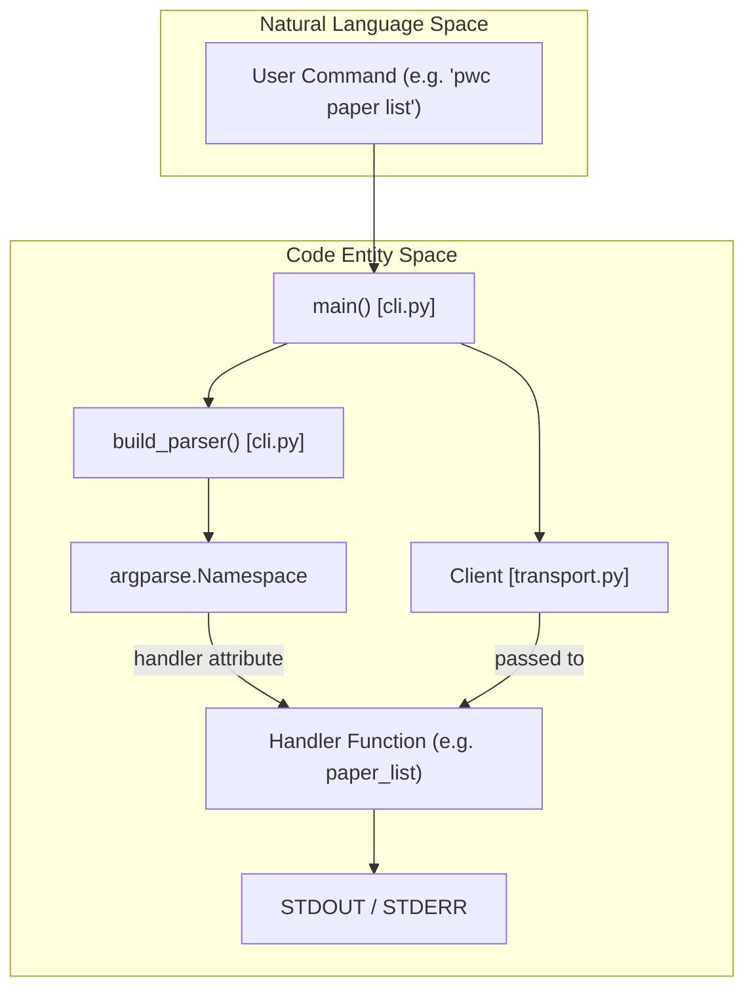
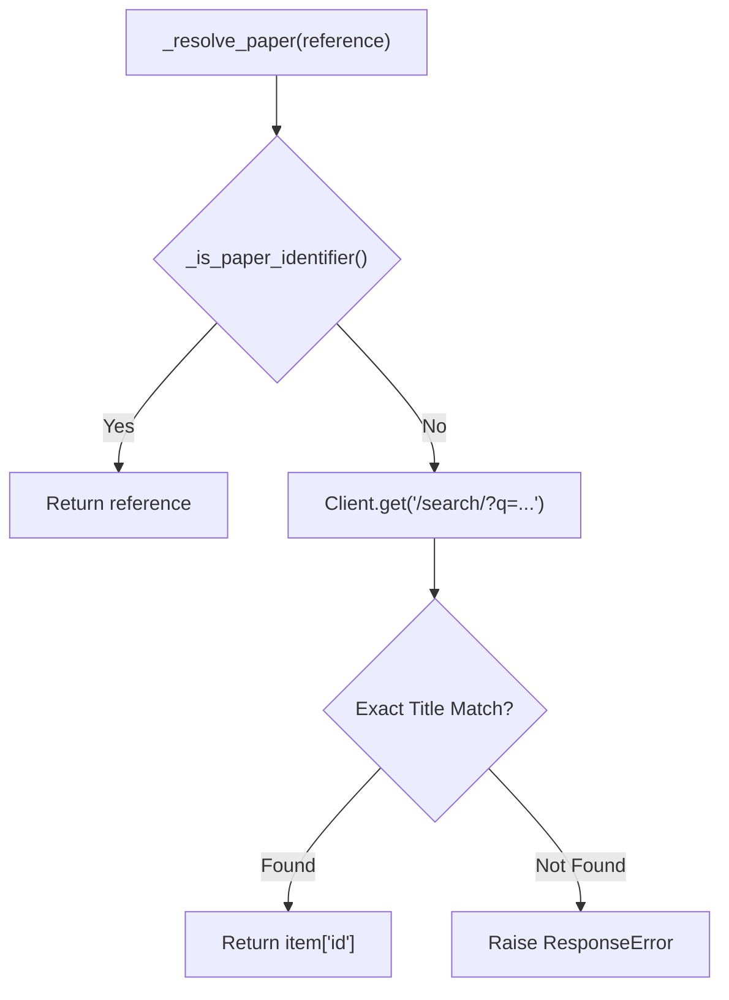

<!-- source: DeepWiki mcp.deepwiki.com · repo huggingface/pwc-cli · page 2.1 CLI Dispatcher (cli.py) · fetched 2026-10-26 -->

# CLI Dispatcher (cli.py)

<details>
<summary>Relevant source files</summary>

The following files were used as context for generating this wiki page:

- [standalone_cli/src/pwc_cli/cli.py](standalone_cli/src/pwc_cli/cli.py)
- [standalone_cli/tests/test_cli.py](standalone_cli/tests/test_cli.py)

</details>


The `cli.py` module serves as the entry point and command router for the `pwc-cli` application. It is responsible for defining the command-line interface structure, parsing user input, and dispatching execution to specific handler functions. It also manages global error handling and ensures that all JSON outputs conform to the versioned API contract.

## Parser Construction

The CLI uses a hierarchical `argparse` tree constructed by the `build_parser()` function [[standalone_cli/src/pwc_cli/cli.py:657-658]](). It utilizes a custom `Parser` class that overrides the default error behavior to provide more helpful usage hints [[standalone_cli/src/pwc_cli/cli.py:29-33]]().

### Argument Validation
Several internal helper functions validate specific types of command-line inputs:
*   **Bounding**: `_bounded` ensures integers fall within a specific range (e.g., `--limit` between 1-100) [[standalone_cli/src/pwc_cli/cli.py:35-43]]().
*   **Metric Constraints**: `_metric_bound` parses `METRIC=VALUE` strings for leaderboard filtering [[standalone_cli/src/pwc_cli/cli.py:68-77]]().
*   **Pareto Objectives**: `_pareto_objectives` validates the syntax for multi-objective optimization (e.g., `accuracy:higher,params:lower`) [[standalone_cli/src/pwc_cli/cli.py:88-99]]().

### Command Tree Logic
The parser uses `add_subparsers()` to create nested command groups (e.g., `pwc paper list`). Every leaf command in the tree is assigned a `handler` function via `set_defaults(handler=...)`.

| Command Group | Purpose | Handler Example |
| :--- | :--- | :--- |
| `search` | Global search across papers and entities | `search_global` [[standalone_cli/src/pwc_cli/cli.py:255]]() |
| `paper` | Paper metadata, search, and lineage | `paper_list` [[standalone_cli/src/pwc_cli/cli.py:382]]() |
| `benchmark` | Leaderboard and evaluation data | `benchmark_get` [[standalone_cli/src/pwc_cli/cli.py:623]]() |
| `skills` | LLM agent skill installation | `skills_add` [[standalone_cli/src/pwc_cli/cli.py:16]]() |

**Sources:** [[standalone_cli/src/pwc_cli/cli.py:29-99]](), [[standalone_cli/src/pwc_cli/cli.py:657-790]]()

## Dispatcher Workflow

The `main()` function handles the lifecycle of a CLI execution. It initializes the `Client`, parses arguments, and executes the associated handler.

### Execution Flow Diagram


**Sources:** [[standalone_cli/src/pwc_cli/cli.py:811-835]]()

### Error Handling Wrapper
The `main()` function wraps execution in a `try-except` block to provide clean, non-traceback error messages for expected failure modes:
*   **`UsageError`**: Raised when valid syntax is used but options are incompatible [[standalone_cli/src/pwc_cli/cli.py:25-26]]().
*   **`TransportError`**: Handles network-level failures (DNS, timeouts) [[standalone_cli/src/pwc_cli/cli.py:17]]().
*   **`ResponseError`**: Handles API-level issues like 404s or invalid JSON shapes [[standalone_cli/src/pwc_cli/cli.py:17]]().
*   **`SkillInstallError`**: Specific to the `skills add` command [[standalone_cli/src/pwc_cli/cli.py:16]]().

**Sources:** [[standalone_cli/src/pwc_cli/cli.py:823-833]]()

## API Contract and JSON Envelope

When the `--json` flag is provided, the CLI wraps all output in a versioned JSON envelope. This ensures that external tools (and LLM agents) can verify compatibility with the output schema.

### Envelope Structure
The envelope is constructed at the end of handlers using a standard dictionary format:
```python
{
    "schema_version": API_CONTRACT_VERSION,
    "data": payload
}
```
The `API_CONTRACT_VERSION` is imported from the package root [[standalone_cli/src/pwc_cli/cli.py:15]]().

### Paper Identification Logic
A critical part of the dispatcher's role is resolving `PAPER` identifiers. The CLI supports:
1.  **ArXiv IDs**: Validated via `MODERN_ARXIV_ID` and `LEGACY_ARXIV_ID` regex [[standalone_cli/src/pwc_cli/cli.py:21-22]]().
2.  **Internal IDs**: Numeric strings [[standalone_cli/src/pwc_cli/cli.py:201-206]]().
3.  **Title Search**: If a string doesn't match an ID pattern, `_resolve_paper()` performs a search and attempts an exact title match to find the correct ID [[standalone_cli/src/pwc_cli/cli.py:209-231]]().

### Identifier Resolution Diagram


**Sources:** [[standalone_cli/src/pwc_cli/cli.py:201-231]]()

## Key Internal Utilities

| Function | Responsibility |
| :--- | :--- |
| `_print_table` | Renders Markdown-style tables for TTY or TSV for pipes [[standalone_cli/src/pwc_cli/cli.py:114-138]](). |
| `_rows` | Extracts data and total counts from paginated API responses [[standalone_cli/src/pwc_cli/cli.py:141-155]](). |
| `_exact_entity_match` | Performs case-insensitive matching for tasks, methods, and organizations [[standalone_cli/src/pwc_cli/cli.py:157-175]](). |
| `_clean` | Escapes control characters (tabs, newlines) for safe TSV output [[standalone_cli/src/pwc_cli/cli.py:102-112]](). |

**Sources:** [[standalone_cli/src/pwc_cli/cli.py:102-175]]()

---

