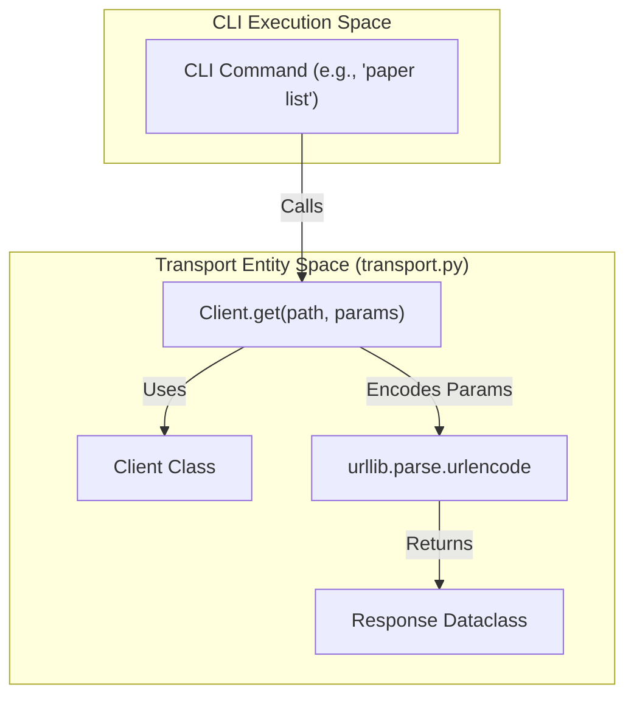
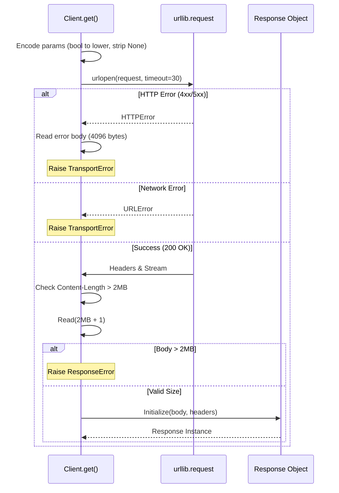

<!-- source: DeepWiki mcp.deepwiki.com · repo huggingface/pwc-cli · page 2.2 Transport Layer (transport.py) · fetched 2026-10-26 -->

# Transport Layer (transport.py)

Relevant source files

The following files were used as context for generating this wiki page:

- [.github/workflows/pwc-cli-release.yml](.github/workflows/pwc-cli-release.yml)
- [standalone_cli/src/pwc_cli/transport.py](standalone_cli/src/pwc_cli/transport.py)
- [standalone_cli/tests/test_cli.py](standalone_cli/tests/test_cli.py)

The Transport Layer provides a credential-ready, anonymous-first HTTP client specialized for interacting with the Papers with Code public catalog API. It is implemented in `standalone_cli/src/pwc_cli/transport.py` and is responsible for request lifecycle management, parameter encoding, and safety enforcement via response size limits.

### Core Components

The transport system is built around three primary entities: the `Client` class which manages the connection, the `Response` dataclass for structured output, and a set of custom exceptions for error handling.

| Entity | Type | Description |
| :--- | :--- | :--- |
| `Client` | Class | Main entry point for performing HTTP GET requests. Handles URL construction and header injection. |
| `Response` | Dataclass | A frozen container for `body` (bytes) and `headers` (dict). Includes a `json()` helper. |
| `TransportError` | Exception | Raised for network-level failures or non-200 HTTP status codes. |
| `ResponseError` | Exception | Raised for content-level failures, such as invalid JSON or exceeding size limits. |

**Sources:**
- `Client` definition: [standalone_cli/src/pwc_cli/transport.py:39-43]()
- `Response` definition: [standalone_cli/src/pwc_cli/transport.py:27-37]()
- Exception definitions: [standalone_cli/src/pwc_cli/transport.py:19-24]()

### Request Lifecycle and Configuration

The `Client` determines the target API endpoint by checking the following hierarchy:
1. An explicit `base_url` passed to the constructor [standalone_cli/src/pwc_cli/transport.py:40-41]().
2. The `PWC_API_URL` environment variable [standalone_cli/src/pwc_cli/transport.py:41-41]().
3. The hardcoded `DEFAULT_API_URL` (`https://paperswithcode.co/api/v1`) [standalone_cli/src/pwc_cli/transport.py:15-15](), [standalone_cli/src/pwc_cli/transport.py:41-41]().

#### Data Flow: Natural Language to Transport Entity
The following diagram maps CLI request concepts to the specific code entities in `transport.py`.

**Sources:**
- `Client` and `get` logic: [standalone_cli/src/pwc_cli/transport.py:39-83]()

### Implementation Details

#### Parameter Encoding
The `get` method performs specific transformations on the `params` dictionary:
- **Null Stripping**: Keys with `None` values are omitted [standalone_cli/src/pwc_cli/transport.py:52-52]().
- **Boolean Normalization**: Python `True`/`False` values are converted to lowercase strings (`"true"`/`"false"`) to match API expectations [standalone_cli/src/pwc_cli/transport.py:50-50]().
- **Stringification**: All other non-null values are cast to strings before encoding [standalone_cli/src/pwc_cli/transport.py:50-50]().

#### Header Injection
Every request includes a `User-Agent` header identifying the CLI version (e.g., `pwc-cli/0.1.14`) and an `Accept` header for JSON [standalone_cli/src/pwc_cli/transport.py:58-61](). If a `credential` is provided during `Client` initialization, it is injected as a `Bearer` token in the `Authorization` header [standalone_cli/src/pwc_cli/transport.py:62-63]().

#### Safety Limits (`MAX_RESPONSE_BYTES`)
To prevent memory exhaustion when handling large catalog exports, the transport layer enforces a strict `MAX_RESPONSE_BYTES` limit of 2MB [standalone_cli/src/pwc_cli/transport.py:16-16](). 
1. **Pre-check**: The `Content-Length` header is inspected before reading [standalone_cli/src/pwc_cli/transport.py:67-69]().
2. **Post-check**: The client attempts to read `MAX_RESPONSE_BYTES + 1`. If the resulting buffer exceeds the limit, a `ResponseError` is raised [standalone_cli/src/pwc_cli/transport.py:70-72]().

### Request Execution Flow
The following diagram illustrates the internal logic of the `get` method, including error handling and safety checks.

**Sources:**
- Request timeout: [standalone_cli/src/pwc_cli/transport.py:66-66]()
- Size limit enforcement: [standalone_cli/src/pwc_cli/transport.py:68-72]()
- HTTP Error handling: [standalone_cli/src/pwc_cli/transport.py:77-81]()
- URL Error handling: [standalone_cli/src/pwc_cli/transport.py:82-83]()

### Error Handling Summary

| Exception | Cause | Code Pointer |
| :--- | :--- | :--- |
| `TransportError` | Non-200 HTTP status code (includes error body detail). | [transport.py:77-81]() |
| `TransportError` | Connection failures, DNS issues, or timeouts. | [transport.py:82-83]() |
| `ResponseError` | Response body exceeds 2MB limit. | [transport.py:69,72]() |
| `ResponseError` | `json.loads()` fails during `Response.json()` call. | [transport.py:35-36]() |

**Sources:**
- `Response.json` implementation: [standalone_cli/src/pwc_cli/transport.py:32-36]()
- Error wrapping: [standalone_cli/src/pwc_cli/transport.py:77-83]()

---

