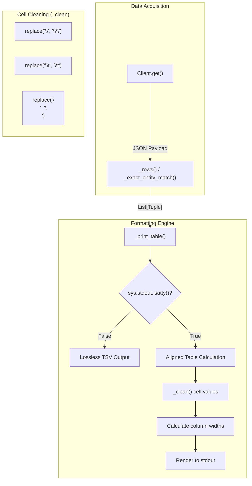
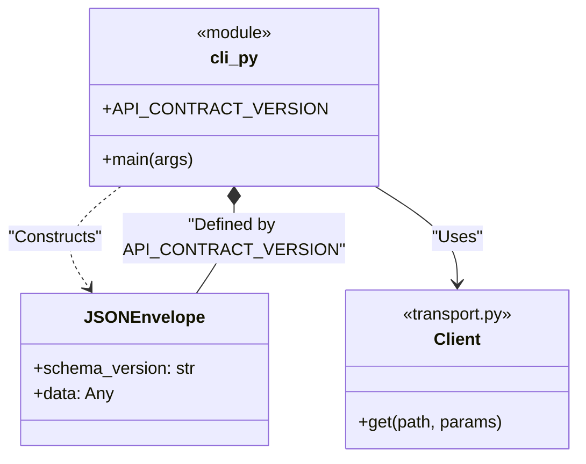

<!-- source: DeepWiki mcp.deepwiki.com · repo huggingface/pwc-cli · page 2.3 Output Formatting System · fetched 2026-10-26 -->

# Output Formatting System

Relevant source files

The following files were used as context for generating this wiki page:

- [standalone_cli/README.md](standalone_cli/README.md)
- [standalone_cli/src/pwc_cli/cli.py](standalone_cli/src/pwc_cli/cli.py)
- [standalone_cli/tests/test_cli.py](standalone_cli/tests/test_cli.py)

The `pwc-cli` employs a dual-mode output system designed to maximize readability for human users in interactive terminals while ensuring data integrity for programmatic consumers (scripts, pipes, and LLM agents). The system automatically detects the execution environment and switches between aligned Markdown-style tables, lossless Tab-Separated Values (TSV), and versioned JSON envelopes.

## Terminal Detection and Mode Selection

The formatting logic relies on `sys.stdout.isatty()` to determine if the output is being rendered to a live terminal or captured by a pipe/file [standalone_cli/src/pwc_cli/cli.py:122-125]().

### 1. Interactive TTY Mode
When a TTY is detected, the CLI prioritizes visual alignment. It calculates the maximum width of each column across the entire result set to produce perfectly aligned tables [standalone_cli/src/pwc_cli/cli.py:127-138]().
- **Headers:** Rendered as the first row.
- **Alignment:** Columns are generally left-aligned, but specific numeric columns (like metrics or counts) can be right-aligned via the `right_align` parameter [standalone_cli/src/pwc_cli/cli.py:118-133]().
- **Padding:** Uses two spaces between columns for clear separation [standalone_cli/src/pwc_cli/cli.py:138]().

### 2. Captured/Piped Mode (Lossless TSV)
When output is piped (e.g., `pwc search "..." | grep`), the CLI switches to a "lossless" format [standalone_cli/README.md:47-48]().
- **Delimiter:** Uses a single Tab character (`\t`) [standalone_cli/src/pwc_cli/cli.py:124]().
- **Escaping:** To prevent data corruption, the `_clean` function escapes backslashes, tabs, and newlines within cell values [standalone_cli/src/pwc_cli/cli.py:102-111]().

### 3. Structured JSON Mode
When the `--json` flag is provided, the CLI bypasses table formatting entirely and prints a structured JSON object to `stdout`.
- **Envelope:** Every JSON response includes a `schema_version` to allow clients to handle breaking changes in the API contract [standalone_cli/src/pwc_cli/cli.py:228-232]().
- **Contract:** The version is defined by `API_CONTRACT_VERSION` [standalone_cli/src/pwc_cli/cli.py:15]().

**Sources:** [standalone_cli/src/pwc_cli/cli.py:102-139](), [standalone_cli/README.md:37-48](), [standalone_cli/src/pwc_cli/cli.py:228-232]()

---

## Implementation Details

### Table Rendering Pipeline
The core of the formatting system is the `_print_table` function. It handles the transition between TTY-aligned text and TSV.

**Code Entity Space to Data Flow**
The following diagram illustrates how raw API data is transformed into formatted output.

Table Formatting Logic

**Sources:** [standalone_cli/src/pwc_cli/cli.py:102-139](), [standalone_cli/src/pwc_cli/cli.py:141-176]()

### Specialized Entity Formatting
Beyond generic tables, certain entities use specific formatting helpers:
- **`_entity_heading`**: Renders a bold name in TTYs or a Markdown H1 (`#`) when piped [standalone_cli/src/pwc_cli/cli.py:178-181]().
- **`_entity_link`**: Renders a raw URL in TTYs or a Markdown link `[label](url)` when piped [standalone_cli/src/pwc_cli/cli.py:183-184]().
- **`_markdown_text`**: Escapes Markdown special characters (like `*` or `_`) to ensure the output doesn't accidentally trigger formatting in Markdown viewers [standalone_cli/src/pwc_cli/cli.py:220-225]().

**Sources:** [standalone_cli/src/pwc_cli/cli.py:178-184](), [standalone_cli/src/pwc_cli/cli.py:220-225]()

---

## Versioned JSON Envelopes

When `--json` is invoked, the CLI wraps the API response in a consistent envelope. This ensures that even if the underlying `paperswithcode.co` API changes, the CLI provides a stable interface for tools like `pwc-cli-installer` or agentic workflows.

**Entity Association Diagram**
Associating CLI components with their JSON output responsibilities.

JSON Output Schema

**Sources:** [standalone_cli/src/pwc_cli/cli.py:15](), [standalone_cli/src/pwc_cli/cli.py:228-232](), [standalone_cli/src/pwc_cli/transport.py:34-80]()

### JSON Schema Structure
| Field | Type | Description |
| :--- | :--- | :--- |
| `schema_version` | `string` | The version of the CLI output contract (e.g., `1.0.0`) [standalone_cli/src/pwc_cli/cli.py:230](). |
| `data` | `object/array` | The raw or processed data from the backend [standalone_cli/src/pwc_cli/cli.py:231](). |

---

## Summary of Output Modes

| Feature | Interactive (TTY) | Piped/Captured | JSON (`--json`) |
| :--- | :--- | :--- | :--- |
| **Visuals** | Space-aligned columns | Tab-separated values | Minified JSON |
| **Escaping** | Human readable | `\n`, `\t` escaped | Standard JSON escaping |
| **Headers** | Included | Included | N/A |
| **Links** | Plain text URL | Markdown `[L](U)` | Field in JSON object |
| **Use Case** | Terminal browsing | `grep`, `awk`, `sed` | Programmatic integration |

**Sources:** [standalone_cli/src/pwc_cli/cli.py:121-139](), [standalone_cli/src/pwc_cli/cli.py:183-184](), [standalone_cli/README.md:37-48]()

---

