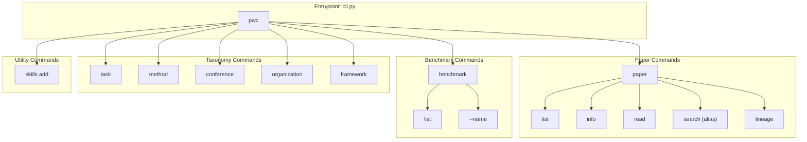
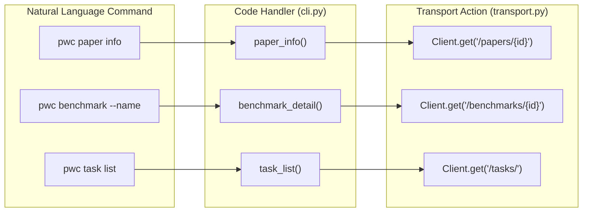

<!-- source: DeepWiki mcp.deepwiki.com · repo huggingface/pwc-cli · page 3 Command Reference · fetched 2026-10-26 -->

# Command Reference

Relevant source files

The following files were used as context for generating this wiki page:

- [backend/chat_sandbox_worker/CLI_GUIDE.md](backend/chat_sandbox_worker/CLI_GUIDE.md)
- [standalone_cli/README.md](standalone_cli/README.md)
- [standalone_cli/SKILL.md](standalone_cli/SKILL.md)

The `pwc-cli` provides a comprehensive command hierarchy for interacting with the Papers With Code catalog. The interface is organized around primary research entities: papers, benchmarks, and a structured taxonomy of tasks, methods, and organizations.

All commands follow a consistent structure: `pwc <entity> <action> [options]`. For example, `pwc paper list` or `pwc benchmark --name IDENTIFIER`.

### Entity Hierarchy Overview

The following diagram maps the logical command structure to the underlying `argparse` implementation in [standalone_cli/src/pwc/cli.py]().

**CLI Command Structure**

**Sources:** [standalone_cli/src/pwc/cli.py:350-480](), [standalone_cli/SKILL.md:35-130]()

---

### 3.1. Paper Commands
The `paper` command group is the primary entry point for research discovery. It supports various ways to resolve a `PAPER` identifier, which can be a modern arXiv ID (e.g., `2501.01234`), a numeric external-paper ID, or an exact quoted title [standalone_cli/SKILL.md:28-33]().

Key capabilities include:
*   **Search and Discovery**: Hybrid, keyword, and semantic search via `pwc search` [standalone_cli/SKILL.md:37-38]().
*   **Metadata Retrieval**: Detailed info including abstracts, predecessors, and successors via `pwc paper info` [standalone_cli/SKILL.md:39-45]().
*   **Reading Content**: Accessing paper Markdown for modern arXiv records via `pwc paper read` [standalone_cli/SKILL.md:46-47]().
*   **Filtering**: Listing papers by task, method, conference, framework, or organization [standalone_cli/SKILL.md:48-55]().

For details, see [Paper Commands](#3.1).

---

### 3.2. Benchmark Commands and Leaderboard Processing
The `benchmark` command group provides access to State-of-the-Art (SOTA) leaderboards. Unlike simple metadata retrieval, the benchmark system includes a client-side processing pipeline for handling complex evaluation data.

*   **Discovery**: `pwc benchmark list` allows finding benchmarks by task or area, supporting both grouped Markdown views and flat tables [standalone_cli/README.md:37-41]().
*   **Leaderboard Analysis**: `pwc benchmark --name` fetches evaluation results. The CLI performs client-side merging and filtering, allowing users to select Pareto frontiers for multi-metric tradeoffs (e.g., `mAP` vs `FPS`) [standalone_cli/README.md:69-75]().

For details, see [Benchmark Commands and Leaderboard Processing](#3.2).

---

### 3.3. Taxonomy Commands
The taxonomy commands provide structured access to the AI/ML knowledge graph. These entities share a common pattern where `list` provides a catalog view and `--name` provides a detailed entity page [standalone_cli/README.md:60-63]().

| Entity | Primary Actions | Key Features |
| :--- | :--- | :--- |
| **Task** | `list`, `--name` | Area hierarchy (Vision, NLP, etc.), research trends, and subtasks [standalone_cli/SKILL.md:64-77](). |
| **Method** | `list`, `--name` | Filter by area or introduction year; link to source papers [standalone_cli/SKILL.md:78-89](). |
| **Conference** | `list`, `--name` | Filter by year; view venue details and paper counts [standalone_cli/SKILL.md:90-94](). |
| **Organization** | `list`, `--name` | Featured research labs and their trending paper metadata [standalone_cli/SKILL.md:95-98](). |
| **Framework** | `list`, `--name` | Filter by platform (e.g., GPU) or domain [standalone_cli/SKILL.md:99-103](). |

For details, see [Taxonomy Commands (Task, Method, Conference, Organization, Framework)](#3.3).

---

### Mapping Natural Language to Code Entities

The following diagram illustrates how user-facing commands map to specific handler functions and API interactions defined in the codebase.

**Command to Code Mapping**

**Sources:** [standalone_cli/src/pwc/cli.py:500-1200](), [standalone_cli/src/pwc/transport.py:60-90]()

---

