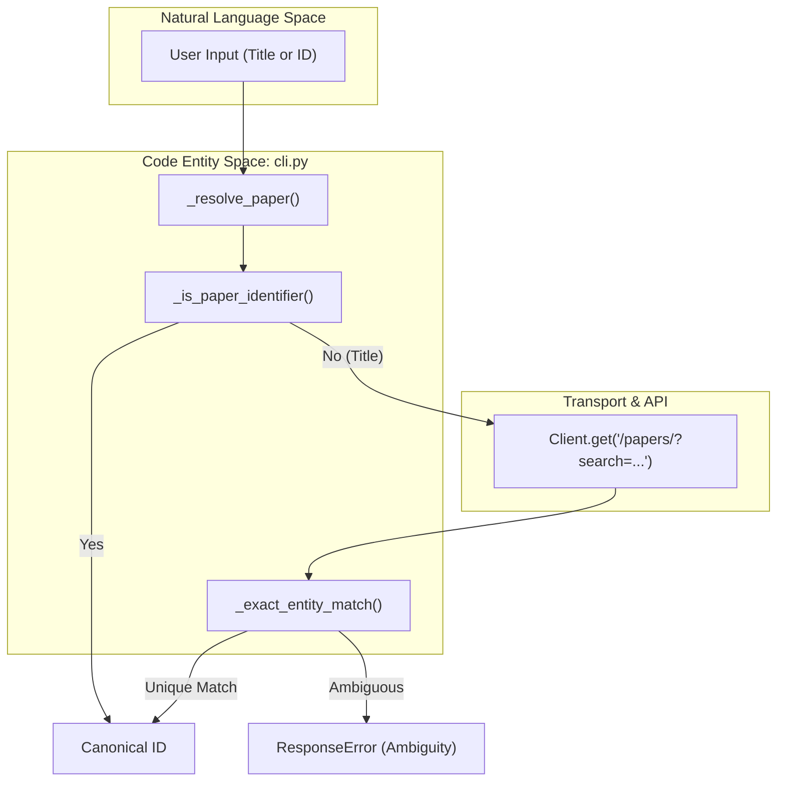
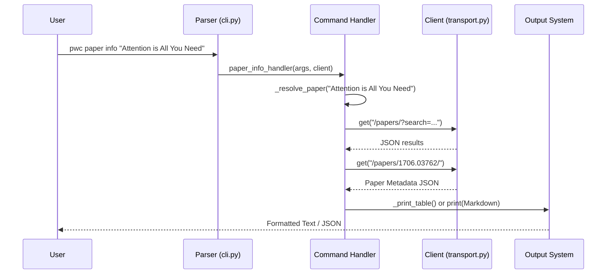

<!-- source: DeepWiki mcp.deepwiki.com · repo huggingface/pwc-cli · page 3.1 Paper Commands · fetched 2026-10-26 -->

# Paper Commands

Relevant source files

The following files were used as context for generating this wiki page:

- [standalone_cli/SKILL.md](standalone_cli/SKILL.md)
- [standalone_cli/src/pwc_cli/cli.py](standalone_cli/src/pwc_cli/cli.py)
- [standalone_cli/tests/test_cli.py](standalone_cli/tests/test_cli.py)

The `pwc` CLI provides a comprehensive suite of commands for interacting with the Papers With Code catalog. These commands allow users to search for research, inspect metadata, read abstracts, and explore the lineage of AI/ML papers.

## Paper Identifier Resolution

A core feature of the paper command group is the ability to resolve diverse input strings into a canonical paper identifier. The resolution logic is implemented in `_resolve_paper` [standalone_cli/src/pwc_cli/cli.py:209-232]().

### Resolution Logic
1.  **Direct Identifier**: If the input matches a modern arXiv ID (e.g., `2501.12345`), a legacy arXiv ID (e.g., `cs/0101001`), or a numeric ID, it is used directly [standalone_cli/src/pwc_cli/cli.py:20-22, 201-207, 213-214]().
2.  **Title Lookup**: If the input is not an identifier, the CLI performs a search by title.
    *   It queries the `/papers/` endpoint with the title as a search parameter [standalone_cli/src/pwc_cli/cli.py:216-218]().
    *   It performs a case-insensitive exact match against the returned results [standalone_cli/src/pwc_cli/cli.py:220-222]().
    *   If exactly one match is found, its `arxiv_id` or `id` is returned [standalone_cli/src/pwc_cli/cli.py:223-224]().
    *   If multiple papers share the same title, the command fails with an ambiguity error listing the matching IDs [standalone_cli/src/pwc_cli/cli.py:225-232]().

### Resolution Data Flow
The following diagram illustrates how a user-provided string is transformed into a canonical ID used for subsequent API calls.

**Title to ID Resolution Flow**

*Sources: [standalone_cli/src/pwc_cli/cli.py:201-232](), [standalone_cli/SKILL.md:28-33]()*

---

## Primary Subcommands

### `pwc search QUERY`
Performs a hybrid keyword and semantic search powered by `pgvector` on the backend [standalone_cli/SKILL.md:37-38]().
*   **Modes**: `hybrid` (default), `keyword`, or `semantic`.
*   **Implementation**: Dispatched to `search_handler` which calls `Client.get("/search/...")` [standalone_cli/src/pwc_cli/cli.py:241-260]().

### `pwc paper info PAPER`
Retrieves detailed metadata for a paper.
*   **Flags**:
    *   `--include-resources`: Adds sections for GitHub repositories, project pages, and Hugging Face artifacts [standalone_cli/SKILL.md:41-42]().
    *   `--include-evals`: Fetches and displays all evaluation results associated with the paper in a Markdown table [standalone_cli/SKILL.md:43-45]().
*   **Implementation**: Uses `_resolve_paper` then calls `Client.get(f"/papers/{paper_id}/")` [standalone_cli/src/pwc_cli/cli.py:346-350]().

### `pwc paper read PAPER`
Displays the Markdown content of a paper. This requires the paper to have a modern arXiv record [standalone_cli/SKILL.md:46-47]().
*   **Implementation**: Dispatched to `paper_read_handler` which calls `Client.get(f"/papers/{paper_id}/read/")` [standalone_cli/src/pwc_cli/cli.py:449-462]().

### `pwc paper list`
A powerful filtering command for the paper catalog.
*   **Filters**: Supports `--task`, `--method`, `--conference`, `--framework`, and `--organization` [standalone_cli/SKILL.md:48-55]().
*   **Pagination**: Uses `--page` and `--page-size` [standalone_cli/SKILL.md:49]().
*   **Sorting**: Supports `trending`, `date_published`, and `citation_count` [standalone_cli/SKILL.md:53]().

### `pwc paper lineage list PAPER`
Renders the "family tree" of a paper, showing its predecessors and successors based on the PWC graph [standalone_cli/SKILL.md:62-63]().
*   **Implementation**: Calls `Client.get(f"/papers/{paper_id}/lineage/")` [standalone_cli/src/pwc_cli/cli.py:537-548]().

---

## Technical Data Flow

The paper commands follow a consistent pattern: Argument parsing -> Identifier resolution -> API Request -> Output formatting.

**Paper Command Execution Pattern**

*Sources: [standalone_cli/src/pwc_cli/cli.py:346-447](), [standalone_cli/src/pwc_cli/transport.py:46-83]()*

## Command Summary Table

| Command | Key Flags | Purpose |
| :--- | :--- | :--- |
| `search` | `--mode`, `--limit` | Hybrid semantic/keyword search |
| `paper info` | `--include-evals`, `--include-resources` | Comprehensive metadata and links |
| `paper read` | `--json` | View paper content as Markdown |
| `paper list` | `--task`, `--method`, `--published-after` | Filtered catalog browsing |
| `paper recent` | `--limit` | Latest additions to the catalog |
| `paper trending` | `--max-age-days`, `--min-velocity` | Papers with high repository activity |
| `paper related` | `--limit` | Discovery via embedding similarity |
| `paper lineage list`| `--json` | Navigate research predecessors/successors |

*Sources: [standalone_cli/SKILL.md:37-63](), [standalone_cli/src/pwc_cli/cli.py:234-548]()*

---

