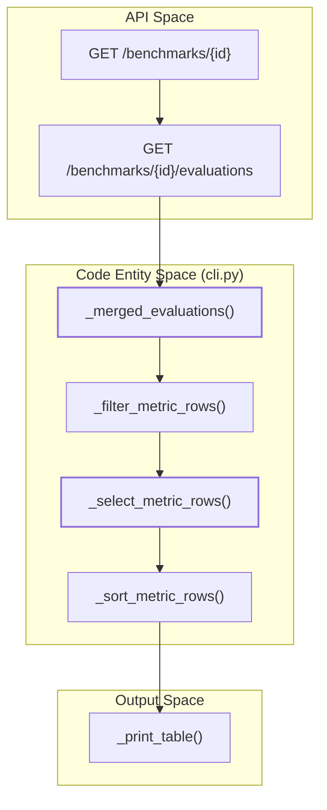
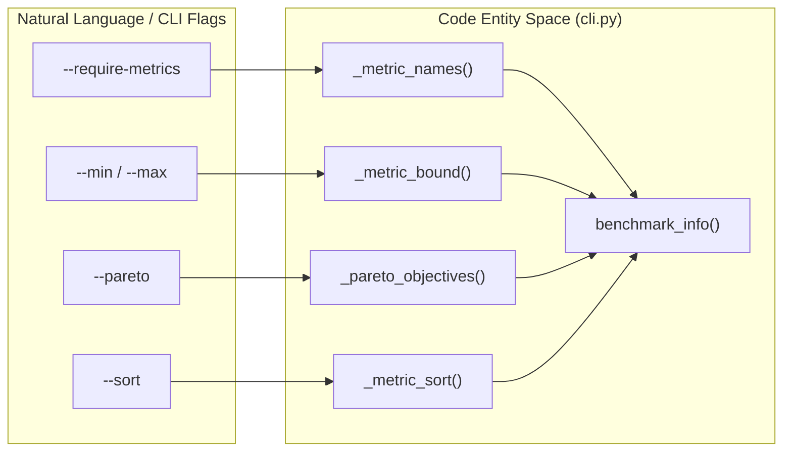

<!-- source: DeepWiki mcp.deepwiki.com · repo huggingface/pwc-cli · page 3.2 Benchmark Commands and Leaderboard Processing · fetched 2026-10-26 -->

# Benchmark Commands and Leaderboard Processing

Relevant source files

The following files were used as context for generating this wiki page:

- [standalone_cli/SKILL.md](standalone_cli/SKILL.md)
- [standalone_cli/src/pwc_cli/cli.py](standalone_cli/src/pwc_cli/cli.py)
- [standalone_cli/tests/test_cli.py](standalone_cli/tests/test_cli.py)

The `pwc-cli` provides a sophisticated client-side pipeline for discovering benchmarks and processing leaderboards. While the API provides raw evaluation data, the CLI implements advanced logic for metric filtering, Pareto frontier selection, and multi-metric merging to produce readable state-of-the-art (SOTA) tables.

## Benchmark Discovery (`pwc benchmark list`)

The `benchmark list` command allows users to navigate the Papers With Code benchmark catalog. It supports two primary display modes: a hierarchical grouped view (default for TTY) and a flat paginated table.

### Implementation Details
The command handler `benchmark_list` [standalone_cli/src/pwc_cli/cli.py:827-868]() dispatches requests based on the provided filters.

*   **Grouped View**: If no specific task or search query is provided, the CLI fetches benchmarks grouped by research area and task [standalone_cli/src/pwc_cli/cli.py:837-838]().
*   **Flat View**: When filters like `--task`, `--search`, or `--flat` are applied, the CLI returns a standard table of benchmarks [standalone_cli/src/pwc_cli/cli.py:851-855]().
*   **Open Models Filter**: The `--is-open` flag allows filtering for benchmarks that specifically track open-source model performance [standalone_cli/src/pwc_cli/cli.py:852]().

### Sources
- [standalone_cli/src/pwc_cli/cli.py:827-868]()
- [standalone_cli/SKILL.md:104-117]()

---

## Leaderboard Processing Pipeline (`pwc benchmark --name`)

When a specific benchmark is requested via `pwc benchmark --name IDENTIFIER`, the CLI performs a multi-stage transformation of the raw evaluation data.

### 1. Data Retrieval and Merging
The CLI first resolves the benchmark metadata and then fetches all associated evaluations [standalone_cli/src/pwc_cli/cli.py:877-885](). Because evaluations for the same paper/model combination may be split across different records in the backend, the `_merged_evaluations` function [standalone_cli/src/pwc_cli/cli.py:706-728]() aggregates them into a single row per result, keyed by the paper and model name.

### 2. Metric Filtering
Users can constrain the leaderboard using several numeric filters:
*   **`--require-metrics`**: Filters out rows that do not contain the specified comma-separated metrics [standalone_cli/src/pwc_cli/cli.py:734-735]().
*   **`--min` / `--max`**: Applies threshold bounds (e.g., `Accuracy=80.0`) to specific metrics [standalone_cli/src/pwc_cli/cli.py:737-744]().

### 3. Pareto Frontier Selection
For benchmarks with multiple objectives (e.g., Accuracy vs. Latency), the `_select_metric_rows` function [standalone_cli/src/pwc_cli/cli.py:755-802]() can calculate the Pareto frontier.
*   It identifies "non-dominated" results based on the `--pareto` flag (e.g., `Accuracy:higher,Params:lower`) [standalone_cli/src/pwc_cli/cli.py:777-802]().
*   A row is dominated if there exists another row that is better in at least one objective and not worse in any other.

### 4. Sorting and Ranking
Finally, the results are sorted using the `--sort` flag. If no sort is provided, it defaults to the benchmark's primary metric in descending order [standalone_cli/src/pwc_cli/cli.py:805-812]().

### Leaderboard Data Flow
The following diagram illustrates the transformation from raw API evaluations to the final CLI table.

**Leaderboard Transformation Logic**

### Sources
- [standalone_cli/src/pwc_cli/cli.py:706-825]()
- [standalone_cli/src/pwc_cli/cli.py:870-917]()

---

## Metric Handling and Validation

The CLI uses specialized argument types to ensure that metric-based queries are well-formed before hitting the network.

| Function | Purpose | Example Syntax |
| :--- | :--- | :--- |
| `_metric_names` | Validates a list of required metrics. | `Accuracy,F1` |
| `_metric_bound` | Parses threshold filters. | `Accuracy=90.0` |
| `_metric_sort` | Parses sort direction. | `Accuracy:asc` |
| `_pareto_objectives` | Validates multi-objective directions. | `Top1:higher,Latency:lower` |

### System Mapping: Arguments to Logic
This diagram maps the CLI flags to the internal processing functions.

**Command Argument Mapping**

### Sources
- [standalone_cli/src/pwc_cli/cli.py:61-99]()
- [standalone_cli/src/pwc_cli/cli.py:1264-1296]() (Parser definitions)

---

## Technical Constraints
*   **Row Limit**: To prevent client-side performance degradation during Pareto calculation, metric scanning is capped at `MAX_METRIC_SCAN_ROWS = 1_000` [standalone_cli/src/pwc_cli/cli.py:20]().
*   **Numeric Enforcement**: Filters like `--min` and `--max` only operate on values that can be cast to floats; non-numeric evaluation results are ignored during these specific filtering steps [standalone_cli/src/pwc_cli/cli.py:74-75]().

### Sources
- [standalone_cli/src/pwc_cli/cli.py:20]()
- [standalone_cli/src/pwc_cli/cli.py:737-744]()

---

