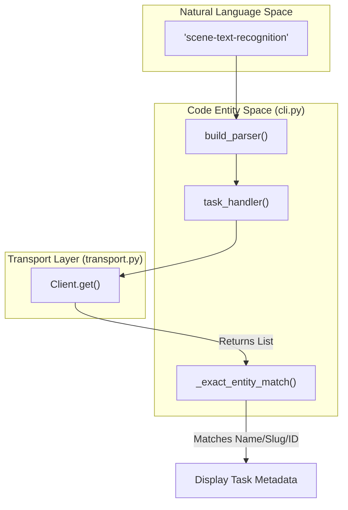
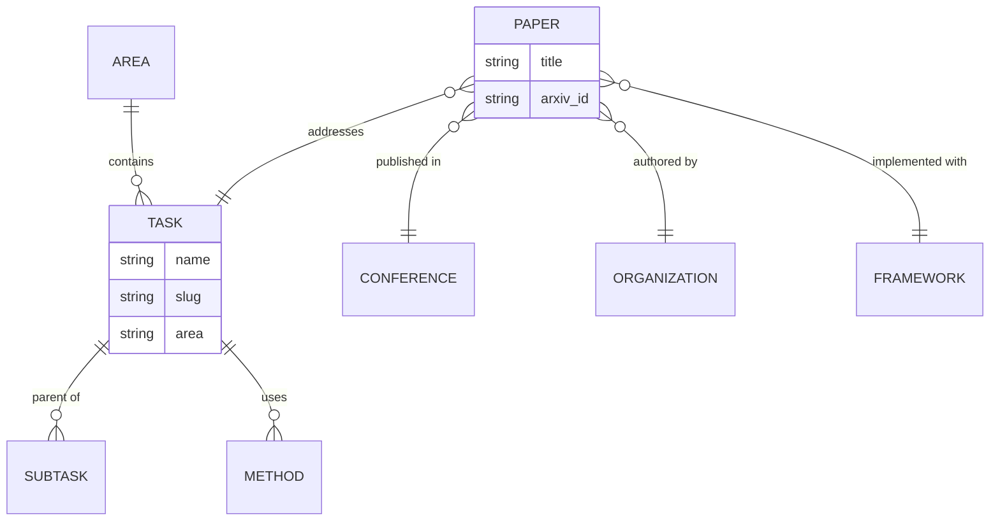

<!-- source: DeepWiki mcp.deepwiki.com · repo huggingface/pwc-cli · page 3.3 Taxonomy Commands (Task, Method, Conference, Organization, Framework) · fetched 2026-10-26 -->

# Taxonomy Commands (Task, Method, Conference, Organization, Framework)

<details>
<summary>Relevant source files</summary>

The following files were used as context for generating this wiki page:

- [standalone_cli/README.md](standalone_cli/README.md)
- [standalone_cli/src/pwc_cli/cli.py](standalone_cli/src/pwc_cli/cli.py)
- [standalone_cli/tests/test_cli.py](standalone_cli/tests/test_cli.py)

</details>


This page documents the CLI commands used to navigate the Papers With Code (PWC) taxonomy. These commands allow users to explore the hierarchical relationships between research areas, tasks, methods, and the entities (organizations, conferences, frameworks) that support them.

## Overview of Taxonomy Entities

The PWC catalog is organized into several primary entities. The CLI provides a consistent interface for querying these entities via `list` subcommands and detail views using the `--name` flag.

| Entity | CLI Command | Key Hierarchical Concept |
| :--- | :--- | :--- |
| **Task** | `pwc task` | Area → Task → Subtask |
| **Method** | `pwc method` | Area → Method |
| **Conference** | `pwc conference` | Proceedings by Year |
| **Organization** | `pwc organization` | Research Labs & Companies |
| **Framework** | `pwc framework` | Libraries by Domain/Platform |

Sources: [standalone_cli/src/pwc_cli/cli.py:533-542](), [standalone_cli/README.md:14-25]()

---

## Tasks and the Area Hierarchy

Tasks are the central node of the PWC taxonomy. They are organized into high-level **Areas** (e.g., Computer Vision, Natural Language Processing).

### Task Listing and Grouping
The `pwc task list` command supports two primary view modes:
1.  **Grouped View**: Uses the `--group-by-area` flag (or defaults to this in a TTY) to render a Markdown-formatted hierarchy [standalone_cli/src/pwc_cli/cli.py:643-646]().
2.  **Flat View**: Uses the `--flat` flag to return a TSV or aligned table of tasks with their associated counts for papers, benchmarks, and evaluations [standalone_cli/src/pwc_cli/cli.py:633-641]().

### Task Detail View
Using `pwc task --name <IDENTIFIER>` (where identifier is a Name, Slug, or ID) retrieves a comprehensive summary of the task, including its description, sister tasks, and trending research [standalone_cli/src/pwc_cli/cli.py:609-631]().

### Data Flow: Task Resolution

Sources: [standalone_cli/src/pwc_cli/cli.py:157-175](), [standalone_cli/src/pwc_cli/cli.py:609-620](), [standalone_cli/src/pwc_cli/transport.py:59-70]()

---

## Methods and Frameworks

Methods represent specific architectural components (e.g., "Transformer", "ResNet"), while Frameworks represent the software implementations (e.g., "PyTorch", "vLLM").

### Method Commands
-   **Filter by Area**: `pwc method list --area <AREA_NAME>` filters methods by their research domain [standalone_cli/src/pwc_cli/cli.py:674-676]().
-   **Detail View**: `pwc method --name <NAME>` provides the method's description and its categorization within the taxonomy [standalone_cli/src/pwc_cli/cli.py:657-670]().

### Framework Commands
Frameworks include metadata regarding their supported platforms and libraries.
-   **Platform Filter**: `pwc framework list --platform <gpu|tpu|cpu>` [standalone_cli/src/pwc_cli/cli.py:779-781]().
-   **Domain Filter**: `pwc framework list --domain <domain>` [standalone_cli/src/pwc_cli/cli.py:782-784]().

Sources: [standalone_cli/src/pwc_cli/cli.py:651-686](), [standalone_cli/src/pwc_cli/cli.py:760-796]()

---

## Conferences and Organizations

These entities provide the institutional and venue context for research papers.

### Conference Listing
Conferences are typically queried by year.
-   **Year Filter**: `pwc conference list --year <YYYY>` [standalone_cli/src/pwc_cli/cli.py:711-713]().
-   **Implementation**: The `conference_handler` uses the `conferences/` API endpoint and applies client-side filtering if a year is provided [standalone_cli/src/pwc_cli/cli.py:711-722]().

### Organization Listing
-   **Featured Filter**: `pwc organization list --featured-only` restricts the list to prominent research entities [standalone_cli/src/pwc_cli/cli.py:748-750]().
-   **Detail View**: Shows the organization's name and associated metadata [standalone_cli/src/pwc_cli/cli.py:732-744]().

Sources: [standalone_cli/src/pwc_cli/cli.py:691-727](), [standalone_cli/src/pwc_cli/cli.py:732-758]()

---

## Implementation Details

### Shared Entity Resolution Logic
Most taxonomy commands utilize the `_exact_entity_match` helper function. This function ensures that when a user provides a string identifier, the CLI correctly maps it to the unique entity in the PWC database by checking multiple fields.

```python
def _exact_entity_match(
    reference: str,
    items: list[dict[str, Any]],
    *,
    label: str,
    fields: tuple[str, ...] = ("name", "slug", "id"),
) -> dict[str, Any]:
    target = reference.strip().casefold()
    for field in fields:
        for item in items:
            if str(item.get(field) or "").strip().casefold() == target:
                return item
    # ... handles suggestions if no match found ...
```
Sources: [standalone_cli/src/pwc_cli/cli.py:157-175]()

### Command Dispatch Mapping
The taxonomy commands are dispatched via the `argparse` subparser system defined in `build_parser()`.

| Command | Handler Function | Endpoint |
| :--- | :--- | :--- |
| `task` | `task_handler` | `/tasks/` |
| `method` | `method_handler` | `/methods/` |
| `conference` | `conference_handler` | `/conferences/` |
| `organization` | `organization_handler` | `/organizations/` |
| `framework` | `framework_handler` | `/frameworks/` |

Sources: [standalone_cli/src/pwc_cli/cli.py:533-580]()

### Entity Relationship Diagram
This diagram illustrates how the CLI views the relationships between different taxonomy entities during a query.


Sources: [standalone_cli/README.md:64-67](), [standalone_cli/src/pwc_cli/cli.py:609-631]()

---

